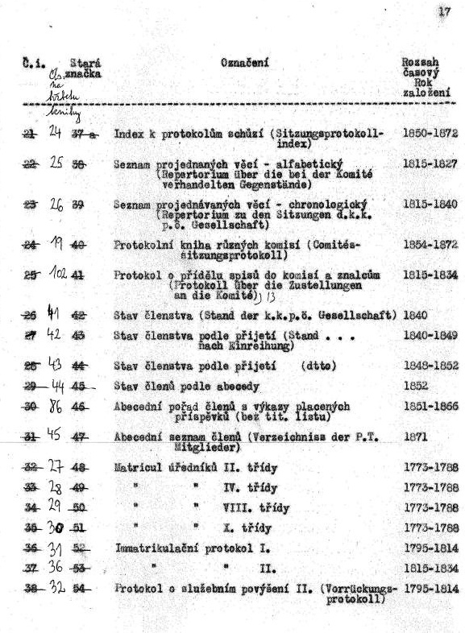

# Osobní doklady myslivců a účty panství

## Úřední matriky, kde mohlo být uvedeno rodiště

Josef II. nařídil 1. října 1788 přihlášení hospodářských úředníků v Čechách k hospodářské společnosti. Podle § 4 měli dosud sloužící podléhající novému zápisu doručit do **1. února 1789** svému krajskému úřadu jméno, **rodiště**, bydliště, úřad a vrchnost. Termín je zajímavý pro oba muže. Maximilián zemřel až v červnu a Josef právě změnil revír. Dříve zapsané úředníky § 2 osvobozoval od opakované imatrikulace. Podle § 6 kraj měl do konce února soustředit hlášení v souhrnném výkazu (*Hauptausweis*) a poslat je prostřednictvím krajského pokladníka předsedovi společnosti. Podle § 7 se postup do vyšší třídy oznamoval do čtyř týdnů. Nové místo stejné třídy tedy nemuselo vyvolat nové hlášení. [Archiv český XXV, č. 655, s. 179](https://www.rbmonline.cz/portal/book/1104?lpage=179) · [§ 2–6, s. 180](https://www.rbmonline.cz/portal/book/1104?lpage=180) · [§ 6–9, s. 181](https://www.rbmonline.cz/portal/book/1104?lpage=181)

§ 5 výslovně uvádí lesmistra (*Forstmeister*) ve II. třídě, lesního pojezdného (*Waldbereiter*) v VII. a lesního písaře (*Holzschreiber*) v VIII. třídě. Do X. patřili mimo jiné praktikanti. Maximilián je v místních pramenech *Oberförster* a Josef *venator* a později *fořt*. Zda jejich konkrétní úřady vedla společnost a pod kterou třídou, rozhodne srovnání s dalšími myslivci téhož panství. Stejně tak se musí z nadpisu knihy z let 1773–1788 ověřit, co obsahoval starší systém a zda zapisoval také rodiště. Povinnost uvést rodiště dokládá výslovně **předpis z roku 1788**.

V Národním archivu jsou dohledány tyto jednotky fondu **Vlastenecko-hospodářská společnost Praha, NAD 638**. Četli jsme skeny inventáře M. Volfa, 47/02. Osobní zápis některého z obou Gillerů zatím přečten nebyl.

| Co hledat | Jednotka a postup |
|---|---|
| **Maximilián po zavedení starší evidence 28. 10. 1773** | Inventář s. 17, „Matricul úředníků II. třídy“, **číslo na štítku knihy 27**, léta 1773–1788, přeškrtnutá stará značka 48. Začít tvary Giller/Gyller/Güller/Gillern a srovnat poděbradský a brandýský personál téhož stupně. Jako kontrolní jména pro závěr období použít Jana Bösera v Poděbradech a Vilkedinga na brandýském panství až po ověření dobové funkce. Zapsat zvlášť pořadové číslo, datum, třídu, panství a jednotlivé rubriky. [Inventář, s. 17](https://vademecum.nacr.cz/vademecum/permalink?xid=88ec3f678b982944bc265411e2f4bbe8&scan=9d30b696-5c36-421f-9dfd-8f5d9f22ed60) |
| **Josef a krajské výkazy 1788–1789** | Inventář s. 27 uvádí pod č. **245** skupinu **1788 I, 1**, kart. **35**, a pod č. **260** skupinu **1789 I, 7**, kart. **37**. Klíč na s. 49 uvádí pod I výslovně imatrikulační fase, listy a přílohy vedle jiných témat. Prioritou je tedy č. 260, kart. 37. Obsah jednotlivých spisů včetně případného krajského výkazu je třeba přečíst. Jde o věcné třídění. U přepisu uvést, zda konkrétní dokument je původní přihláška, její opis či výtah a zda se rodiště dochovalo. Doplňkově 1788 F, 14, č. 243, kart. 35. Pokud se originální hlášení ve spisové řadě nenajde, vyhledat pro leden–duben 1789 odkazy v protokolu schůzí III (1785–1794) přes index rozhodnutí, štítek 22 (1770–1815), a po čísle v agendě příslušného kraje. [Inventář, s. 27](https://vademecum.nacr.cz/vademecum/permalink?xid=88ec3f678b982944bc265411e2f4bbe8&scan=8adf5d21-d694-4ccc-a1f2-2339caac62f7) · [Protokoly, s. 16](https://vademecum.nacr.cz/vademecum/permalink?xid=88ec3f678b982944bc265411e2f4bbe8&scan=7438b3cb-124c-4761-9188-baee204e2015) · [Klíč, s. 49](https://vademecum.nacr.cz/vademecum/permalink?xid=88ec3f678b982944bc265411e2f4bbe8&scan=7c51016f-745e-43ec-b139-ef6709ba8a7f) |
| **Na kterém kraji hledat opis** | Poděbrady spadaly do **Bydžovského** kraje. Kolín hledat v **Kouřimském**. Také město Brandýs bylo na kouřimské straně Labe. U staroboleslavské myslivny ověřit rovněž **Boleslavský** kraj podle bydliště a podle toho, kolika úřady prošlo hlášení zaměstnanců panství. Moderní město Brandýs nad Labem–Stará Boleslav spojuje obě strany. Zapsat zvlášť rubriku bydliště a vrchnosti. Místní opisy a podací protokoly hledat ve fondech [Krajský úřad Kouřim, NAD 2](https://aron.soapraha.cz/apu/6c886478-d44e-4851-b75e-42d1934a817b), [Krajský úřad Mladá Boleslav, NAD 6](https://aron.soapraha.cz/apu/77ebc5af-ea60-4a5f-8418-750b3f83cd99) a [Krajský úřad Nový Bydžov (Jičín I), NAD 14](https://vychodoceskearchivy.cz/wp-content/uploads/2022/07/Fondy_Hradec_Kralove_Zamrsk_20220715_pro_web_PUBLIKOVANO_ver36.pdf). [Vavák, rok 1789, s. 72](https://librinostri.catholica.cz/download/vavakpam2-r.pdf) · [Schaller, Kouřimský kraj, 1788](https://books.google.com/books?id=DeRdAAAAcAAJ) · [Brandýs a krajský úřad 1788](https://www.knihovna.brandysnl.cz/storage/content/NP-2023-02-2023-04-19.pdf#page=19) |
| **Když obecný zápis Josefa chybí** | Další tři knihy na s. 17 jsou třídy IV, VIII a X (štítky 28, 29, 30). Jan Lhoták přímo cituje knihu 30 a jednotlivý skutečný zápis praktikanta Jana Františka Seidla z roku 1774 pod č. 549 v X. třídě. Seidl veřejně dokládá, že v knihách jsou jednotlivé osoby. Je-li v ověřených rubrikách zachycena jen vyšší lesní správa, vlastní zařazení řadového fořta hledat přednostně v přijímacím spise velkostatku. Od roku 1795 existuje imatrikulační protokol I (štítek 31) a protokol služebních povýšení (štítek 32). U Josefa mají smysl pouze pro novou přihlášku či změnu v období 1795–1799. [Lhoták, Folia Historica Bohemica 34/1, s. 47–48, pozn. 165](https://www.hiu.cas.cz/user_uploads/vydavatelska_cinnost/periodika/folia_historica_bohemica/fhb_34_1_2019_fin_el_verze.pdf#page=48) |

[Přední list inventáře](vyrezy/vhs-47-02-titul.jpg) · [Seznam protokolů](vyrezy/vhs-47-02-s16-protokoly.jpg) · [Spisové položky 1788 a 1789](vyrezy/vhs-47-02-s27-spisy.jpg) · [Význam písmene I](vyrezy/vhs-47-02-s49-klic-I.jpg)

## Co dávají účty a soupisy

**Co už bylo přečteno online.** Velkostatek Poděbrady, inv. 544. Rejstřík soupisu poddaných 1745 klade Bobnice od fol. 219 a další obec od fol. 229. Na sn. 221–230 (fol. 219–228) byly přečteny domácnosti obce. Nebyl rozpoznán Giller, pojmenovaná myslivna ani samostatná myslivecká domácnost. Matriční zápisy z Boru však uvádějí osobně svobodné rodiče. Z absence v soupisu poddaných proto nelze odvodit, že přišli až po roce 1745. [Rejstřík](https://ebadatelna.soapraha.cz/a/4908/3) · [Fol. 219](https://ebadatelna.soapraha.cz/a/4908/221) · [Fol. 228](https://ebadatelna.soapraha.cz/a/4908/230)

**Přímý účetní předobraz** představuje Velkostatek Pardubice, NAD 377, **inv. 227, Hlavní výtah požitků zaměstnanců panství v Čechách**, vročení opravené na **1741**. Tereza Siglová publikuje pardubickou loveckou skupinu včetně pojmenovaných zaměstnanců a položek bez osobního jména. Poděbrady, Brandýs a další komorní panství jsou v témže soupisu zastoupeny. Poděbradský oddíl je v publikaci jen v souhrnu. Výtah je dobrou pomůckou, jaké druhy platů, naturálií a hodností v původních účtech hledat. Sken poděbradského oddílu ani souvislá řada osobních výplat 1747–1750 zatím nebyly identifikovány. [Siglová, studie a příloha](https://www.vcm.cz/en/documents/168/siglova_vcsh08_1999.pdf)

**Cíl pro Bor v roce 1749** je doložit první zúčtované období a předchozího příjemce. Hledat také pod místními názvy *Bobnitz, Bor*, pod nadřízeným Hoffmannem, pod *Jägerpartie, Besoldung, Deputat, Aufnahme, Versetzung*. Vedle poděbradského fondu katalogizuje odborná studie personální přesuny v NA, **ČDKM V, kart. 20**. Citovaný případ je až z roku 1756. Anonymní kandidát z Holíče není ztotožněn s Maximiliánem. [Poděbrady, pomůcka 257](https://aron.soapraha.cz/apu/178006b2-3e38-4fb1-940a-cb14b8d8a3cd) · [Studie a původní signatura, s. 117](https://www.vcm.cz/documents/1194/martinkova-valenta-vilimovska_vcsh14-2007.pdf#page=9)

**Cíl pro Býchory** je najít předávací, přijímací nebo platový doklad k č. 11. Hledat vedle Josefa také předchozího doloženého myslivce Františka Höfera. Při částce bez jména nejprve porovnat stejné účetní místo v dalším ročníku. Výuční list, doporučení nebo potvrzení od předchozího pána by určily, ve které farnosti hledat dál. U Velkostatku Kolín je ověřena pomůcka č. 339, dataci relevantní osobní řady je ještě potřeba určit. [Pomůcka](https://aron.soapraha.cz/apu/7eef756c-b153-4e71-9d00-5db1d9dfb67e)

## Souběžné cesty a stav jejich dostupnosti

- **Johannini svědci v Kladrubech.** Pro dobu před prvním doloženým pobytem rodiny v hřebčíně číst v online knize Kladruby 1776 svatby a křty domácnosti ředitele manufaktury **Guillauma Josepha Baillouxe** (v matrice Pailloux), jeho ženy Alžběty a Marie Magdaleny Lambottin v letech **1750–1754**. Manželé jsou svědky u Gillerových až v letech 1757–1761. Hledaným výsledkem je dřívější společný výskyt s Johannou či Maximiliánem nebo určení Johannina rodného jména. Samotné doložení původu majitele manufaktury neposouvá rodinu do Verviers ani Jihlavy. Bez společné stopy hledání dále nerozšiřovat. [Kladruby 1776, digitalizovaná matrika](https://aron.vychodoceskearchivy.cz/apu/8db56854-9c22-46b4-9474-7896b483f08b) · [Dějiny manufaktury](https://www.bohemia-online.de/index.php/bohemia/article/download/4510/7006)
- **Na slezském konci** při zprávě o službě, odkladu přísahy nebo důvodu odchodu prověřit GStA PK I. HA GR Rep. 46 B č. 94 (hold 1741) a 96 (hlášení a odklady 1741–1743). Online je inventář. Sám zápis „Giller auf Hammer“ nejspíš patří držiteli panství. Číslo 96 má pro přesun syna hodnotu teprve při osobní zmínce nebo označení služby. Katolický Hammer patřil ke Krehlau. Před dalším čtením vybledlých míst v něm zkontrolovat dosavadní pokrytí a druhý exemplář. [Úřední inventář](https://archivdatenbank.gsta.spk-berlin.de/midosasearch-gsta/MidosaSEARCH/i_ha_gr_rep_46_b/xml/inhalt/GStA_i_ha_gr_rep_46_b_15_2.htm) · [Matrika Krehlau](https://www.familysearch.org/search/film/008244729)
- **Při nedostupnosti historických knih doma** připadá v úvahu žádost o několik reprodukcí knihy 27 a spisové položky 1789 I. Přesný předmět, signaturu a kraj lze nyní uvést. Široká archivní rešerše není předpokladem pro kladrubskou kontrolu.
