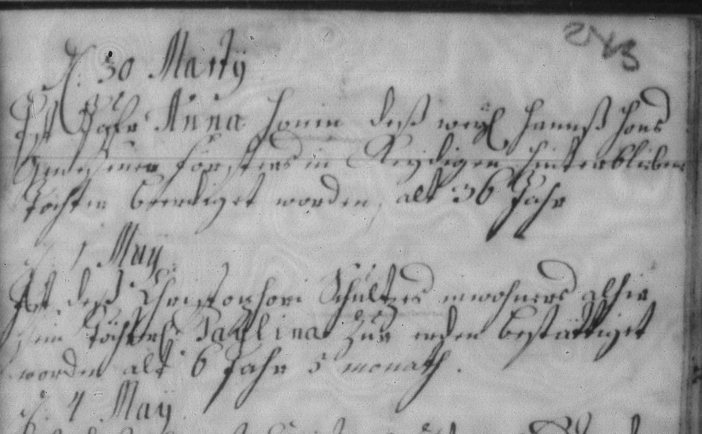

# Pohřeb Antonie von Giller, rozené Rüffer, 27. února 1745

**Oprava z 26. 11. 2026.** Na levé straně snímku 244 se našel výslovný pohřeb Antonie von Giller, rozené von Rüffer, u volovských karmelitánů dne **27. 2. 1745**. Matrika uvádí i Starý Volov. Identifikaci ženy silně podporují obě příjmení, titul a místo. Její přesný den smrti zůstává otevřený. Dubnové datum z heraldické příručky neobstojí proti únorovému pohřbu. [Matriční obraz](https://www.familysearch.org/ark:/61903/3:1:3Q9M-CSPD-49B5-6) · [Přepis, výřez a srovnání obou pramenů](../../2026-11-26-dve-kola/kolo-2/volov/README.md)

## Původ dubnového data a rozsah první kontroly

**Heraldický pramen.** *Der abgestorbene Adel der preußischen Provinz Schlesien*, část 3, 1894, s. 148, heslo „Ruffer (Rüffer)“, podává Marii Antonii jako provdanou svobodnou paní von Gillern, zemřelou 25. 4. 1745 v Alt-Wohlau. Text manžela nejmenuje a neuvádí pohřebiště. V přihlášeném FamilySearch se podařilo otevřít přímo příslušný ročník katolické knihy. Dubnový zápis v něm chybí. [Siebmacher, s. 148](https://sbc.org.pl/Content/4112/PDF/4112.pdf#page=150).

**Přesná jednotka s pohřby.** Státní archiv v Lipsku uvádí **21962, D 1320-2, Wohlau (kath.), Bestattungen**, období **1685–1722 a 1745–1756**. Toto datování potvrzuje pro rok 1745 samostatnou katolickou pohřební kopii. Z obecnější mezery uváděné roku 1902 nelze vyvodit, že se pohřební zápis nedochoval. Obraz byl následně otevřen také ve FamilySearch. [Detail archivní jednotky](https://www.archiv.sachsen.de/archiv/bestand.jsp?guid=6ca73be6-a64c-4b87-a748-b565a3e5a145)

## Obraz pohřební knihy

**FamilySearch, DGS 8241013, položka 2, snímek 244 z 260, filmovací štítek D 1320, dvojstrana 243.** Na levé straně se otevírá rok 1745 zápisem z 12. ledna. Na pravé bez přerušení listu následují po zápisu z 30. března přímo 1. květen. Následují místní dětské pohřby 4., 6. a 10. května. První průchod byl omezen na okolí dubnového data z heraldické příručky. Na levé straně téže dvojstrany je v únoru skutečně její pohřeb u karmelitánů, doložený v opravě výše. Křestní jméno manžela otevřené zůstává. [Přímo dvojstrana 243](https://www.familysearch.org/ark:/61903/3:1:3Q9M-CSPD-49B5-6?view=explore&groupId=M9FH-6NJ&lang=en)

## Rozdíly mezi staršími soupisy

- **Katolický cíl: Wohlau / Wołów, pohřby.** Soupis Christoph uvádí při Alt-Wohlau odkaz na katolické matriky městského Wohlau. U něj uvádí pohřby **1685–1804** v Archiwum Archidiecezjalne we Wrocławiu a soubor katolických knih 1685–1920 na FamilySearch. Starší přehled Jungnitz–Eberlein z roku 1902 ovšem přímo uvádí pro městské katolické křty, sňatky i pohřby **1685–1721, 1722–1755 chybí, 1756–1900**. Široká datace 1685–1804 proto zatím nedokládá souvislé pokrytí. Konkrétní obsah ročníku nyní potvrzuje výše uvedený snímek 244. [Christoph, Alt Wohlau](https://www.christoph-www.de/kbsilesia3.html) · [Christoph, Wohlau](https://www.christoph-www.de/kbsilesia4.html) · [Jungnitz–Eberlein, heslo Wohlau, Kreisstadt](https://sbc.org.pl/Content/77640/Kirchenbucher%20Schlesiens.pdf).
- **Evangelická řada.** Jungnitz–Eberlein u vsi *Wohlau, Alt-* uvádí evangelické křty, sňatky i pohřby v letech **1702–1900**. Christoph jejich dnešní uložení označuje za neznámé. Lipské kopie městského *Wohlau (ev.)* jsou jiná lokalita a konfese než zamýšlené katolické pohřby a pokrytí Alt-Wohlau by vyžadovalo kontrolu obsahu. [Saský státní archiv, fond 21962](https://www.archiv.sachsen.de/archiv/bestand.jsp?bestandid=21962&oid=13.01&syg_id=250596).
- **Karmelitáni.** V cílové době sloužili v nové katolické farnosti ve Wołówě karmelitáni. Kostel sv. Karla Boromejského je dnešním farním kostelem i pro filiálku v Starym Wołowě. Pro dobový obituář či pohřební účet je konkrétní uložení **AP Wrocław, 82/76/0 Klasztor Karmelitów w Wołowie (1682–1808)**, historický repertář Rep. 76, bez veřejných skenů. V přehledu se obituář výslovně neuvádí. Samostatný křestní nebo pohřební sešit zámecké kaple nebyl pro 1745 identifikován. [Dějiny farnosti](https://nowezycie.archidiecezja.wroc.pl/index.php/2023/10/17/lacznik-dziejow/) · [Diecéze, farnost a filiálka](https://archidiecezja.wroc.pl/parafie/sw-karola-boromeusza%2Cdf97ae55-8544-4f01-afaa-e830e8f095fa) · [Státní katalog](https://www.szukajwarchiwach.gov.pl/web/archiwum-panstwowe-we-wroclawiu/zespoly?_ZespolyWeb_INSTANCE_zEpUTaJhvA5o_cur=1&_ZespolyWeb_INSTANCE_zEpUTaJhvA5o_delta=200&_ZespolyWeb_INSTANCE_zEpUTaJhvA5o_resetCur=false&p_p_id=ZespolyWeb_INSTANCE_zEpUTaJhvA5o&p_p_lifecycle=0&p_p_mode=view&p_p_state=normal) · [Derwich a Wójcik, s. 597](https://www.archiwa.gov.pl/wp-content/themes/archiva/images/docs/Archeion_116_lekki.pdf).

## Dobový tisk a pozůstalostní cesta

- Digitalizovaný skutečný ročník 4 (1745) *Schlesische Privilegirte Staats- Kriegs- und Friedens-Zeitungen*, čísla 49–58 od 26. dubna do 17. května, jsem stáhl z Biblioteki Cyfrowe Uniwersytetu Wrocławskiego. V OCR vrstev jednotlivých čísel a jejich přítomných příloh jsem prověřil jména Gillern/Giller/Güller, Ruffer/Rüffer, Antonia, Wohlau a výrazy pro úmrtí a pohřeb. Bez relevantní shody. OCR fraktury je neúplné a tento výsledek není úplným vizuálním průchodem. [Dubnová čísla](https://bibliotekacyfrowa.pl/dlibra/publication?id=29505) · [Květnová čísla](https://bibliotekacyfrowa.pl/dlibra/publication?id=29506) · [Č. 49, 26. 4.](https://bibliotekacyfrowa.pl/Content/35347/PDF/directory.pdf) · [Č. 58, 17. 5.](https://bibliotekacyfrowa.pl/Content/35356/PDF/directory.pdf).
- Při hledání smutečního tisku se ve veřejném vyhledávání objevil zpětně jen Siebmacher. Katalog smutečních tisků **TBK**, který samostatně pokrývá vratislavskou univerzitní knihovnu, a širší **GESA** jsou přímé bibliografické cíle. Vyhledávací rozhraní GESA mi vrátilo chybu, takže shodu v něm nemohu vyloučit. Další konkrétní cesta k jménu manžela je případná pozůstalost v AP Wrocław, **82/2/0 Księstwo Brzesko-Legnicko-Wołowskie**, část IV, místní písemnosti volovského knížectví 1290–1778 včetně pozůstalostních věcí. Katalog této části konkrétní jméno ani skeny neukázal. [TBK](https://www.personalschriften.de/datenbanken/tbk.html) · [GESA](https://www.personalschriften.de/datenbanken/gesa.html) · [AP Wrocław, 82/2/0](https://www.szukajwarchiwach.gov.pl/zespol/-/zespol/88302).
