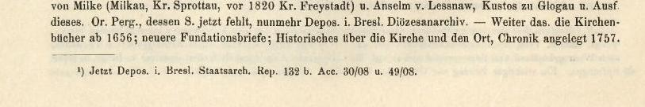
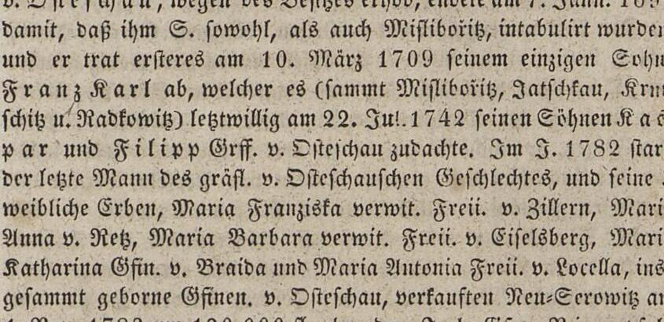

# Hochkirch a Priedemost. Kontroly místa a rodin

**Kronika v Hochkirchu.** Konrad Wutke v inventáři okresu Glogau z roku 1915 uvádí u katolické farnosti na s. 238 matriky od 1656 a zvlášť kroniku založenou roku 1757. Popsal tedy i téměř soudobý pramen k místním rodinám. Dnešní signaturu a digitalizát samotné kroniky jsme nezjistili. Naopak dnes zveřejněný inventář fondu 110, PGro-kat, v diecézním archivu Zielona Góra, vede deset účetních položek počínaje rokem 1778. Křty roku 1739 v tomto konkrétním soupisu uvedeny nejsou. [Wutke, s. 238](https://sbc.org.pl/Content/475613/PDF/iii54558-0000-28-0001.pdf#page=250) · [Inventář diecéze, jedna strana](https://archiwum.diecezjazg.pl/wp-content/uploads/2022/12/Grodowiec-Hochkirch-parafia-katolicka.pdf)

**Lipské kopie.** Původ předloh mohou upřesnit samostatné protokoly o pořízení kopií ve fondu 21962. Pro Hochkirch, křty D 1420 (1735–1765), jde o jednotku 182 s protokoly D 1361–1440. Pro Groß Schmograu, křty D 1294-2 (1666–1754), jde o jednotku 181 s protokoly D 1281–1360. Lipský archiv zpřístupnil k oběma protokolům popis bez reprodukce. [Křty Hochkirch](https://www.archiv.sachsen.de/archiv/bestand.jsp?guid=738b97a9-903a-4ef4-b796-64469299c137) · [Protokoly, jednotka 182](https://www.archiv.sachsen.de/archiv/bestand.jsp?guid=18296f1c-1975-4cd0-b7ce-4de914cf6fc5) · [Protokoly, jednotka 181](https://www.archiv.sachsen.de/archiv/bestand.jsp?guid=4b48c006-f3bf-4029-aada-0124173ac86d)

**Jméno lesníka v českých křtech.** U syna Františka Ludvíka Alexandra zapsal roku 1753 nymburský děkan otce pouze jako Josefa de Giller, myslivce z Boru Bobnického, a matku jako Johannu. Při hledání ve Slezsku je proto třeba číst i Josefa uvedeného bez prvního jména Maximilián. Ve slezské tabulce k roku 1752 se u statků Rettkau a Priedemost vyskytuje Joseph **Anton** se synem Carlem. Tito dva otcové vyžadují odlišení podle rodiny, služby a sídla. [Nymburk, sn. 67](https://ebadatelna.soapraha.cz/d/10406/67) · [Slezská tabulka, s. 292](https://zbc.uz.zgora.pl/Content/58371/16_konopnicka_szlachta.pdf#page=6)

**Vdova rozená Osteschau.** Wolny uvádí mezi dědičkami prodávajícími 1. 11. 1783 Nové Syrovice Marii Franzisku, ovdovělou svobodnou paní „v. Zillern“. Místní přehled držby Priedemostu uvádí roku 1765 jméno Marie Franziska von Gillern, rozená hraběnka Osteschau. Shodná křestní jména, rodné příjmení a vdovský stav nabízejí způsob, jak rozhodnout, zda šlo o jednu ženu. Hosák odkazuje na intabulaci z roku 1786 v znojemských zemských deskách **ZDz IX, 42**. Obraz tohoto zápisu zatím nebyl získán. Jméno manžela ani příbuznost s Josefem Emanuelem v Čechách z těchto údajů neplynou. [Wolny, 1837, s. 509](https://kramerius.vkol.cz/uuid/uuid:97253718-e196-11e4-86c0-90b11c419e63) · [Hosák, s. 158–159](https://librinostri.catholica.cz/download/HosakSlovnik-r.pdf) · [Přehled držby Priedemostu](https://de.wikipedia.org/wiki/Przedmo%C5%9Bcie_(G%C5%82og%C3%B3w))

**Rozsah vsí při vyhodnocení výsledku.** Jerzy B. Sadowski na s. 18 uvádí k roku 1928 dvanáct katolíků z části Priedemostu u filiálního kostela Krzepów / Schrepau pod farností sv. Mikuláše v Hlohově. Zpětné použití tohoto rozdělení pro rok 1746 by vyžadovalo dobový doklad. Druhý veřejný exemplář křtů z cílových let se v databázích BaSIA a Skanoteka nepodařilo prohlédnout. BaSIA u polské jednotky 12 odkazuje na stejný státní portál. Označení „wolna“ znamená, že na přepis lze přihlásit dobrovolníka. [Sadowski, s. 18](https://www.glogow.pl/tzg/bibioteka_mulimedialna/50_lat_redemptorystow.pdf#page=18) · [BaSIA, jednotka 12](https://basia.famula.pl/skany.php?lang=&placeid=527) · [Skanoteka](https://skanoteka.genealodzy.pl/)
