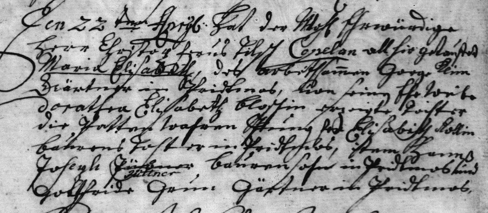

# Gramschütz / Priedemost, křty 1737–1738 a 1746–1747

**Prohlédl jsem obrazy obou cílových oken.** V čitelných řádcích pro děti a rodiče na sledovaných stranách se nepodařilo doložit Josefa nebo Annu s otcem jménem Maximilián, Josef či Emanuel Giller/Gillern. V knize je přímo doložen **Priedemost**, opakovaně na obou časových úsecích. Dne 22. 4. 1746 je v Priedemostu mezi kmotry Josef se škrtaným a opraveným příjmením, patrně Güttner, označený jako syn sedláka. V srpnu se objevuje otec Joseph Krebs. Ani jeden z nich se podle čitelného textu nedá ztotožnit s hledaným otcem.

**Pramen.** FamilySearch, Gramschütz, Glogau, Silesia, Prussia, Germany records, *Baptism Records January 1719–July 1765*, DGS **102649639**, tradiční film **1202294**, položka 1. Jako původce portál uvádí Katholische Kirche Gramschütz (Kr. Glogau). Na filmovacím štítku je **D289**. Každý snímek má jedinou stranu. Pravé a levé strany byly snímkovány odděleně. Pro souvislé čtení zápisů je třeba mezi oběma částmi filmu přecházet. Pár tvoří snímky 119/42 (s. 70/71), 120/43 (s. 72/73), 130/53 (s. 92/93) a 131/54 (s. 94/95). Pořadí odvozuji z čísel stran, štítků *links/rechts* a návaznosti textu.

## Okno 13. 6. 1737 až 12. 6. 1738

| Snímek a strana | Co pokrývá a kontrolní zápisy |
|---|---|
| [41, s. 69](https://www.familysearch.org/ark:/61903/3:1:3Q9M-CS8P-PS6J?cat=325630&view=explore&lang=en&groupId=M9F7-VPX) | Kontrola před začátkem okna. Viditelné jarní zápisy 1737, dole květen. Následující s. 70 už začíná v říjnu. |
| [119, s. 70](https://www.familysearch.org/ark:/61903/3:1:3Q9M-CS8P-PSZ7?cat=325630&view=explore&lang=en&groupId=M9F7-VPX) | Konec října a listopad 1737, tři zápisy. V prvním je celkem čitelně Gottfride, Tobias Hein a Gramschütz. Druhý zapisuje rodinu v Priedemostu, podle indexu Anton, syn Hannsse Dohna. Třetí má podle indexu dítě Anton, otec George Krug. |
| [42, s. 71](https://www.familysearch.org/ark:/61903/3:1:3Q9M-CS8P-PS6G?cat=325630&view=explore&lang=en&groupId=M9F7-VPX) | Záhlaví „Anno 1738“, zápisy z ledna, února a konce dubna. Index nabízí George Hostner (?), Annu Rosinu Hostman, otce Hannsse Hostmana, a řádek Weigerl. Dubnový text říká „2 Kinder“ a index tu uvádí jedinou hlavní položku; index tedy nenahrazuje obraz. |
| [120, s. 72](https://www.familysearch.org/ark:/61903/3:1:3Q9M-CS8P-PSC7?cat=325630&view=explore&lang=en&groupId=M9F7-VPX) | 29. května křest Johanns, otec dle indexu Johanns Sommer; v první polovině června Anna, otec čitelný jako Hannss Scholtz, zahradník, matka Dorathea Elisabeth. Další řádek je 29. srpna a leží mimo okno. |

## Okno 3. 2. 1746 až 2. 2. 1747

| Snímek a strana | Co pokrývá a kontrolní zápisy |
|---|---|
| [52, s. 91](https://www.familysearch.org/ark:/61903/3:1:3Q9M-CS8P-PS6Y?cat=325630&view=explore&lang=en&groupId=M9F7-VPX) | Kontrola před začátkem okna, pravá strana roku 1745, od dubna do podzimu. Index např. Hannss Siegemündt (?), Hannss Friderich Hostman, Christian Lube a Anna Hädwig Mide (?). |
| [130, s. 92](https://www.familysearch.org/ark:/61903/3:1:3Q9M-CS8P-PSZD?cat=325630&view=explore&lang=en&groupId=M9F7-VPX) | Prosinec 1745, leden 1746 a uvnitř cíle 22. 4. 1746 Maria Elisabeth, dcera Georga Klima (Klim dle indexu), zahradníka v Priedemostu, a Dorathey Elisabeth, a 3. 7. 1746 další Maria Elisabeth, otec dle indexu Christian Herrman. Kmotři dubnového zápisu v indexu chybějí. V obrazu je mezi nimi „Joseph [přeškrtnuté příjmení, pod ním patrně Güttner] / Bauern Sohn in Priedemost“. Pracovní výřez z tohoto listu [výřez křtu z 22. dubna](vyrezy/gramschuetz-1746-04-22.jpg). |
| [53, s. 93](https://www.familysearch.org/ark:/61903/3:1:3Q9M-CS8P-PSKP?cat=325630&view=explore&lang=en&groupId=M9F7-VPX) | Srpen 1746. V prvním zápisu ze 7. 8. má otec jméno Joseph Krebs (příjmení souhlasí s indexem). Index u této rodiny uvádí dceru Maria Johanes Eleonora (?) a matku Barbaru Tausslerin (?). Dále podle indexu Gottfride Hostman (?), Anna Rosina Scholtz, otec Christoph Scholtz, a Rosina Bun, otec Martin Bun. |
| [131, s. 94](https://www.familysearch.org/ark:/61903/3:1:3Q9M-CS8P-PSDD?cat=325630&view=explore&lang=en&groupId=M9F7-VPX) | Návaznost konce předešlého zápisu nahoře; září, říjen a prosinec 1746. Index uvádí Annu s otcem Antonem, příjmení čte nejistě H?Nacht, dále Gottfride u Christiana Malluche a Antona u Christiana Fenglera. |
| [54, s. 95](https://www.familysearch.org/ark:/61903/3:1:3Q9M-CS8P-PSN2?cat=325630&view=explore&lang=en&groupId=M9F7-VPX) | Dva prosincové zápisy konce 1746 a po rysce lednový zápis roku 1747. Index má pro první dva Christian Joseph a Hannss Anton Anbe; lednová křtěná je Anna Rosina Hostman s otcem Hannsem Hostmanem. Christian Joseph je v indexu veden jako dítě, bez dokladu příjmení Giller. |
| [132, s. 96](https://www.familysearch.org/ark:/61903/3:1:3Q9M-CS8P-PSV6?cat=325630&view=explore&lang=en&groupId=M9F7-VPX) | Kontrola za koncem cílového okna. Strana pokračuje rokem 1747, nahoře srpen. |

## Co výsledek znamená

Prohlédnutý chronologický sled obsahuje **sedm stran s křty uvnitř obou oken**, tři další obrazy stanovují okraje. Procházel jsem data, děti, příjmení rodičů a čitelná jména kmotrů. Panel **Names** jsem použil jako kontrolu dítěte a rodičů na snímcích 119, 42, 120, 52, 130, 53, 131 a 54. Některé zápisy mají hustý kurent, škrty, nejisté údaje a místy slabou čitelnost, zejména u kmotrů. Uvedené příklady z indexu mají pouze orientační přepisy a nejsou úplnou transliterací všech řádků. Mezi některými po sobě jdoucími daty zbývají dlouhé mezery i při návazné paginaci. Z nepřítomnosti v prohlédnuté řadě proto nevyvozuji nepřítomnost osoby v obci ani v jiné či paralelní knize. Výsledek se týká pouze knihy D289 na filmu 1202294.

