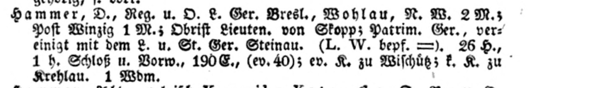

# Hammer (Młoty) u Krehlau (Krzelów): katolická farnost

**Farnost pro Hammer.** Hledaný Hammer Carla Heinricha von Giller se kolem let 1737–1747 zapisoval do katolické farnosti **Krehlau (Krzelów, u Volova)**. Přímé zápisy v době okna zná projekt již dříve, novou nezávislou kontrolou je Knieho historický místopis z roku **1830, s. 233**. Ten pod jménem Hammer v okrese Wohlau výslovně odlišuje evangelický kostel ve Wischütz a katolický v Krehlau. **Groß Schmograu (Smogorzów Wielki)** byla vlastní sousední katolická fara a může posloužit jako kontrola jednotlivého stěhování či přespolního křtu či sňatku. Pro hledání obyvatel doložených přímo na Hammeru mají přednost knihy Krehlau. Nový doklad o Josefovi nevznikl.

## Veřejné historické obrazy

1. **Johann Georg Knie a J. M. L. Melcher, *Alphabetisch-statistisch-topographische Uebersicht …*, Breslau 1830, s. 233, druhé heslo odspodu.** Z obrazu: „Hammer, D., […] Wohlau, N. W. 2 M.; Post Winzig 1 M.; […] Patrim. Ger., vereinigt mit dem L. u. St. Ger. Steinau.“ Za počtem obyvatel je zřetelné „ev. K. zu Wischütz; k. K. zu Krehlau.“ Tedy Hammer, ves dvě míle severozápadně od Volova, s poštou Winzig, patrimoniálním soudem spojeným se stínavským soudem, a s evangelickým kostelem ve Wischütz a katolickým v Krehlau. Stránka uvádí i několik jmenovců v dalších krajích. Kupříkladu Hammer v okrese Freistadt patřil po obou konfesích do Schlawa. Vztah k poště Winzig nebo ke stínavskému soudu tedy není církevní příslušností. [Obraz s. 233, snímek n262](https://archive.org/download/bub_gb_0tgAAAAAcAAJ/page/n262) · [Vydání 1830](https://archive.org/details/bub_gb_0tgAAAAAcAAJ/page/n262/mode/1up)
2. **Knie, 1830, s. 372, hesla „Krehlau Königlich“ a „Krehlau, Ober- und Nieder-“.** První má „1 k. M. K., (Archip. Preichau)“ (katolický mateřský kostel v arcikněžství Preichau). Pro oba jiné díly čteme „k. K. zu königlich Krehlau; ev. K. zu Wischütz.“ Toto je výslovné rozlišení sídla fary od Horního a Dolního Krehlau. [Obraz s. 372, snímek n401](https://archive.org/download/bub_gb_0tgAAAAAcAAJ/page/n401)
3. **Friedrich Albert Zimmermann, *Beyträge zur Beschreibung von Schlesien*, sv. 7, 1787, s. 248–249 č. 45 a s. 314.** Volovské heslo přibližuje Hammer jako ves s panským dvorem; stínavský oddíl potvrzuje výslovně „dieses Dorf gehört eigentlich in den Wohlauschen Kreis“ a „Nur ein Theil des Vorwerkes und 2 Häuser, worin 9 Einwohner, liegen in diesem Kreiße“. Zde „in diesem Kreiße“ odkazuje na Steinau. Současného majitele Förstera uvádějí obě pasáže. Dva krajské údaje tak lze vztáhnout k jedinému Hammeru. U Krehlau na s. 253 č. 64 stojí „Kröhlau, oder Krählau“ a „1 katholische Kirche, 1 Pfarrwohnung“. Jako dva zvláštní vrchnostenské díly téhož místa následují **Ober Kröhlau** a **Nieder-Kröhlau**. Toto rozlišení nepřepisovat na Groß/Klein Krehlau. Hammer je tu vlastní heslo a nemusel být správně-majetkově součástí některého z krehlauských dílů, byť farně spadal do Krehlau. [S. 248](https://archive.org/download/10014530bsb/page/n252) · [S. 249](https://archive.org/download/10014530bsb/page/n253) · [S. 253](https://archive.org/download/10014530bsb/page/n257) · [S. 314](https://archive.org/download/10014530bsb/page/n320)
4. **Dobová praxe podle již existujících reprodukcí v projektu.** Krehlau, katolická křestní kniha D527a, s. 09 vpravo, 2. zápis (snímek 15), pravděpodobně **28. 2. 1738**. Okraj je „Hammer“ a rozhodující úsek „Pfarr allhier dem Gottfried Bäuer, Leibjäger (?) der / Gnädigen Herrschafft zu Hamer ein Söhnl. Frantz / Joseph getaufft“. Čtení povolání a přesného data je pracovní, zatímco místní jméno je čitelné v nadpisu i textu, v textu ve variantě Hamer. Křtil místní farář. Starší doklady ze stejné rodiny jsou **1719** (D526, s. 77 „Carl Heinrich v. Giller Erb Herr auf Hamer“) a **31. 8. 1728** („Pfarr in Krelau […] Carolo Henrico in Hammer“). Pro druhý konec intervalu je v krehlauské oddací knize **24. 11. 1747** (D527B, s. 9 vlevo, snímek 385, vybledlý zápis v oddílu listopadu, přesná datace podle indexu druhého filmování citovaného v projektu) svatba dcery Carla Heinricha z Hammeru. Ve stejné farnosti je **16. 9. 1747** také křest dítěte zahradníka z Nieder-Krehlau. V tomto posledním zápisu je *Heinrich Hammer* jméno kmotra, nikoli místo. Reprodukce a přepisy byly již součástí projektu, v nové rešerši nebyl otevírán FamilySearch. [Projektový přepis, klíče n_1738_krehlau_ignatius_antonius_giller_kmotr a n_1728_giller_joannes_nepomucenus](../../../../data/prepisy.json) · [Výřez zápisu asi 1738](../../../../vyrezy/n_1738_krehlau_ignatius_antonius_giller_kmotr.jpg) · [Výřez zápisu 1728](../../../../vyrezy/n_1728_giller_joannes_nepomucenus.jpg) · [Výřez oddavek 1747](../../../../vyrezy/o_1747_krehlau_giller_maria_josepha.jpg)
5. **Doplňková kontrola novodobého názvu a hranic.** Vratislavská arcidiecéze ve výčtu míst římskokatolické farnosti sv. Martina v Krzelówě uvádí „Młoty (1 km)“. Soupis správního stavu roku 1908 uvádí na řádku 159 „Hammer | Krehlau | Winzig“, kde Krehlau a Winzig označují odlišné civilní obvody podle záhlaví, takže tento řádek sám nenahrazuje Knieho konfesijní údaj. [Arcidiecézní adresář](https://www.archidiecezja.wroc.pl/parafia.php?id_dek=34&id_par=2) · [Gemeindeverzeichnis Kreis Wohlau](https://www.territorial.de/ndschles/wohlau/gem1908w.htm)

## Groß Schmograu a jiná místa téhož jména

Zimmermann ve stejném svazku na s. 263 zvlášť popisuje Groß Schmoger jako ves s katolickým kostelem a farním obydlím v majetkové správě kláštera Leubus, vedle ní Klein Schmoger jako samostatnou ves. Knie 1830 na s. 686 rozlišuje Groß Schmograu s vlastním katolickým mateřským kostelem v arcikněžství Wohlau („1 k. M. K., (Archip. Wohlau)“) od Klein Schmograu, kde výslovně píše „k. K. zu Groß-Schmograu“. [Zimmermann, č. 115–116](https://archive.org/download/10014530bsb/page/n267) · [Knie, s. 686](https://archive.org/download/bub_gb_0tgAAAAAcAAJ/page/n715)

Zámecký statek Hammer v okrese Volov se musí vyhledávat spolu s Krehlau, Wohlau, Steinau nebo Winzig, protože samotné jméno Hammer odkazuje i k mnoha jiným obcím. Podobně „Schmograu“ může znamenat i místo v okrese Namslau. Tištěný soupis Jungnitze a Eberleina *Die Kirchenbücher Schlesiens beider Confessionen* (1902) důsledně odlišuje okr. Wohlau a Namslau (s. 61). Krehlau, okr. Wohlau, současně vede samostatně jako katolickou matriku křtů, oddavek i pohřbů od roku 1602 (s. 31). [Jungnitz a Eberlein 1902, digitalizace](https://protzan.de/wp-content/uploads/2021/10/1902_Kirchenbuecher_Schlesiens_beider_Confessionen.pdf)

Formální správní či vizitační soupis celého krehlauského obvodu z let 1737–1747 se zatím nepodařilo ověřit. Časově odpovídající krehlauské zápisy a jednoznačný pozdější místopis však dávají shodnou odpověď pro samotný Hammer. Zjištění nevylučuje, že jednotlivci z Hammeru přijali svátost v jiné farnosti.

