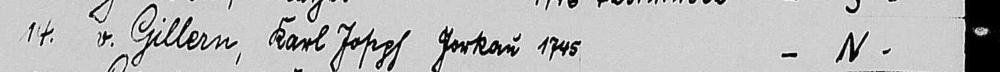
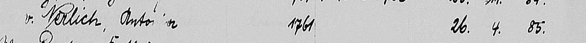

# Groß Karlowitz (Karłowice Wielkie), 26. dubna 1785

**V obou datových přepisech snímků oddací matriky je otec ženicha Joseph Anton.** Obě indexace odkazují na stejný film, digitální složku a strany 189–190. Oba obrazy FamilySearch zpřístupňuje ve středisku. Otevřít se podařilo samostatný historický abecední rejstřík ženichů. Ten přidává místo čtené jako **Gorkau** a letopočet **1745**. Jméno otce ani matky v příslušném řádku nemá, takže konflikt s křtem z Rettkau 21. 3. 1751 přímým čtením oddacího zápisu zatím rozhodnout nelze.

## Oddací matrika a její dva digitální indexy

Farnost Katholische Kirche Groß Karlowitz (Kr. Grottkau), *Kirchenbuch, 1765–1875*, oddíl *Heiraten 1766–1862*, film 936591, DGS **004124424**, digitální složka **004124424_001_M9F7-FCT**, s. **189–190**. Katalog uvádí, že soubor byl filmován z rukopisů v Archiwum Państwowe, Warszawa a z kopie Genealogische Forschungsstelle, Duisburg. U této dvojice snímků katalog neupřesňuje, zda jde o dvojí snímání jedné předlohy či o souběžné fyzické předlohy. [Katalog svazku](https://www.familysearch.org/en/search/catalog/koha:303744?filmNumber=4124424)

| Index | Ženich | Otec podle indexu | Nevěsta |
|---|---|---|---|
| [Snímek 9, ARK 6FY8-CB9Y](https://www.familysearch.org/ark:/61903/1:1:6FY8-CB9Y?lang=en) | Carl Joseph Gillern, 40 let, odhad narození 1745 | Joseph Anton Gillern | Antonia Nerlich, 24 let, otec Franz Nerlich |
| [Snímek 109, ARK 6FY8-M6G7](https://www.familysearch.org/ark:/61903/1:1:6FY8-M6G7?lang=en) | Carl Joseph von Gillern, 40 let, odhad narození 1745 | Joseph Anton V Gillern | Antonia V Nerlich, 24 let, otec Franz V Nerlich |

Indexový údaj o místě události „East Prussia“ je chybná standardizace. Pole *Event Place (Original)* v obou indexech správně uvádí Groß Karlowitz, Kreis Grottkau, Provinz Schlesien, Preußen, Deutschland. Místo narození ženicha, jeho matka ani otcovo sídlo v zobrazených datových polích nejsou. U obou položek hlásí *Check Image Availability* přístup ve FamilySearch Center. Pro ověření případné chyby čtení, matky, původu a sídla je třeba ve středisku porovnat oba obrazy s. 189–190.

## Skutečně otevřený rukopisný abecední rejstřík

Přes *Explore Historical Images*, přesné místo [Groß Karlowitz, Grottkau](https://www.familysearch.org/en/records/images/search-results?place=12590361&pageSize=100), se mezi deseti položkami ukázal oddací rejstřík ženichů 1770–1875, DGS **004124433**. V katalogu film **1958936**, položka 1, *Heiraten 1770–1875 (Kopie, A–Z)*. Další čtyři položky stejného filmu zahrnují křestní a úmrtní evidenci. V seznamu deseti položek tohoto místa nebyl nalezen druhý přístupný obrazový svazek pro oddavky roku 1785.

- [Snímek 38, s. 31, ř. 14](https://www.familysearch.org/ark:/61903/3:1:3QS7-99GT-JSZR-W?cat=koha%3A303744&view=explore&lang=en&groupId=M96J-CW6): „v. Gillern, Karl Josef, Gorkau 1745“, napravo zkratka „N“ pro skupinu nevěst.
- [Snímek 39, s. 32, protilehlá strana](https://www.familysearch.org/ark:/61903/3:1:3QS7-99GT-JSZR-6?cat=koha%3A303744&view=explore&lang=en&groupId=M96J-CW6): „v. Nerlich, Antonia“, „1761“, „26. 4. 85.“

Počáteční písmeno názvu místa má stejnou smyčku a dolní tah jako velké G ve slově *Glatz* na ř. 12. Po něm následuje o, r a skupina kau. Dvě nezávislá čtení se shodují na podobě *Gorkau*. Ztotožnění s konkrétní dnešní obcí zůstává otevřené. V cílených tištěných odkazech se další přímý výskyt Gorkau společně s Gillerovými nebo Nerlichovými nepodařilo doložit.

Na těchto dvou stranách jsou sloupce bez nadepsaných názvů. Ve stejné poloze se u jiných ženichů vyskytují samostatná místní jména, roky nebo úplná data a někdy i datum s křížkem. Lokalitu *Gorkau* lze použít jako vodítko, ale bez definice rubriky z ní samostatně nevyplývá rodiště, bydliště nebo otcovo sídlo. Rok 1745 v rejstříku odpovídá věku 40 při sňatku, ale bez údaje o jeho předloze nelze určit, zda přináší nezávislou informaci o narození.
