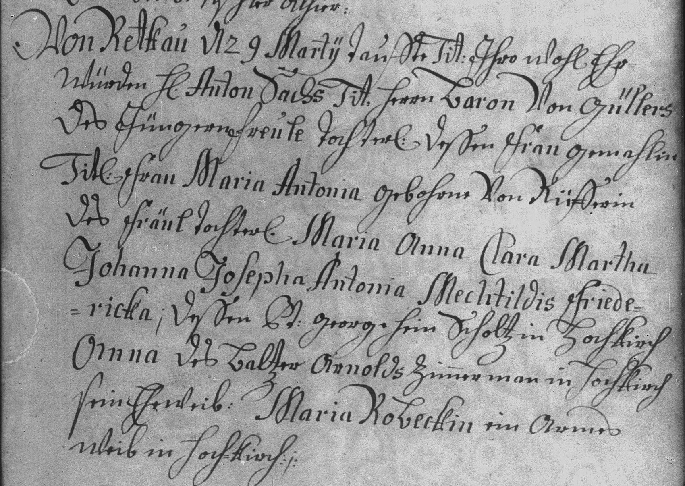
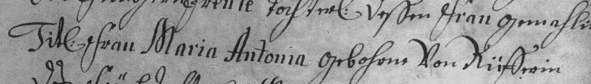
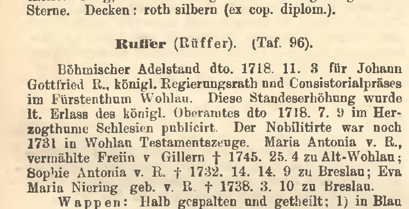

# Maria Anna z Rettkau, pozdější třebnická abatyše Dominika

**V katolické matrice Hochkirchu je 29. března 1739 zapsán křest dcery mladšího barona von Güller a Marie Antonie.** Křestní list uvádí devět jmen dítěte. První dvě, místo a den přesně odpovídají klášterním pramenům o abatyši. Rodné příjmení matky lze s velkou pravděpodobností určit jako **von Rüffer**. Na stejnou rodinu přitom ukazuje další pramen v jiném městě. [Matrika, s. 145](https://www.familysearch.org/ark:/61903/3:1:3Q9M-CSPL-G329-T?view=explore&groupId=TH-909-75352-98992-36&lang=en) · [Klášterní katalog č. 112](https://sbc.org.pl/Content/56157/PDF/56157.pdf#page=246) · [Kázání z roku 1805, světské jméno](https://www.e-rara.ch/zuz/download/pdf/31254317#page=9)

## Křestní zápis

Hochkirch, okres Glogau, dnešní Grodowiec. Křty D 1420, mikrofilm 1203108, DGS 8246290. Snímek 77, pravá strana 145, třetí zápis úplně dole. V úvodu stojí Rettkau a 29. březen, rok potvrzuje záhlaví 1739 na s. 133 (snímek 71). Dne 23. a 24. března v předchozích zápisech křtí tentýž kněz. Díky tomu lze bezpečně rozlišit duchovního jménem Anton od otce dítěte. [Celá strana](https://www.familysearch.org/ark:/61903/3:1:3Q9M-CSPL-G329-T?view=explore&groupId=TH-909-75352-98992-36&lang=en)

**Pracovní přepis.** Rozdělení řádků odpovídá obrazu. Otazník označuje nejisté čtení, včetně jednotlivých písmen v jménu kněze, matky a kmotrů.

> Von Rettkau d[en] 29 Martij tauffte Tit. Ihro wohl Ehr-\
> würden H. Anton Daubß (?) Tit. Herrn Baron Von Güllers\
> deß Jüngeren freüle Töchterl. […] der Frau Gemahlin\
> Titl. Frau Maria Antonia gebohrne Von Rü[ff?]erin\
> das freül. Töchterl. Maria Anna Clara Martha\
> Johanna Josepha Antonia Mechtildis Friede-\
> =ricka. […] der H. George [Hein?] Scholtz in Hochkirch\
> Anna des Baltzer Arnolds Zimmerman in Hochkirch\
> sein Eheweib. Maria Robeckin (?) ein armes\
> Weib in Hochkirch.

**České čtení.** Dne 29. března pokřtil důstojný pan Anton dceru mladšího barona von Güller z Rettkau a jeho manželky Marie Antonie, rozené pravděpodobně von Rüffer. Dítě dostalo jména Marie Anna Klára Marta Johana Josefa Antonie Mechtilda Bedřiška. Po nich jsou zapsáni Jiří, šoltys v Hochkirchu, Anna, manželka tamního tesaře Baltzera Arnolda, a místní chudá žena Marie Robecková (?). Příbuzenský vztah těchto osob k dívce zápis neuvádí.

## Jak bylo určeno rodné příjmení matky

Dvě nezávislá čtení plného obrazu se shodla na křestních jménech Maria Antonia a na krajních písmenech rodného příjmení „Rü…erin“. Jeden čtenář vyhodnotil prostřední skupinu jako „ff“, druhý jako „st“. Přes část písmene zasahuje tah z předcházejícího řádku. V diplomatickém přepisu proto zachováváme nejistotu, v rodinném výkladu dáváme přednost Rüffer.

C. Blažek, *Der abgestorbene Adel der Preussischen Provinz Schlesien*, III, Norimberk 1894, pod heslem **Ruffer (Rüffer)**, tištěná s. 148, jmenuje **Marii Antonii** jako provdanou svobodnou paní **von Gillern** a jako místo a den úmrtí se uvádí **Alt-Wohlau, 25. 4. 1745**. Shodují se dvě křestní jména, titul, jméno manželské rodiny i období. Jde o dodatečnou oporu k příjmení z křtu. Datum úmrtí zatím náleží tomuto tištěnému prameni. V témže hesle uvedený Johann Gottfried Rüffer se z dostupného textu nedá zapsat jako matčin otec. [Siebmacher, s. 148, obraz PDF 150](https://sbc.org.pl/Content/4112/PDF/4112.pdf#page=150)

## Co nález znamená pro Josefa

Matrika potvrzuje Rettkau přímo v této farnosti a rodinu barona už v březnu 1739. Otce farář pojmenoval jen titulem a příjmením s přívlastkem „mladší“. Křest mu sám nepřiřazuje osobní jméno Josef Anton ani Maximilián. Baronka Marie Franziska rozená Osteschau, později spojovaná s Priedemostem, má jiná křestní i rodná jména než zde zapsaná manželka.

Datum 29. 3. je v matrice **dnem křtu**, stejné datum narození uvádí klášterní tradice. Pokud se úmrtní údaj Marie Antonie v roce 1745 potvrdí a náš Josef se narodil podle svého úmrtního věku 1746–1747, nemohla být jeho matkou. U staršího věkového okna 1737–1738 tato časová námitka odpadá. Mezi Marií Annou a Josefem z Býchor zatím nemáme doklad sourozenectví. Jméno matky našeho Josefa v jeho oddacím zápisu chybí. [Josefův sňatek, Poděbrady 1786](https://ebadatelna.soapraha.cz/d/11863/7) · [Josefovo úmrtí, 1799](https://ebadatelna.soapraha.cz/d/10801/8)
