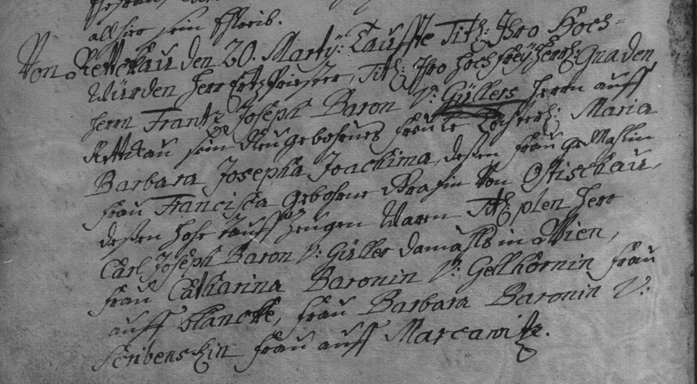

# Rettkau · křest 20. března 1750 · D 1420, strana 586

Na spodní části levé strany 586 je **Franz Joseph von Giller, pán na Rettkau**, výslovně uveden jako manžel **Františky, rozené hraběnky von Ostischau**. Dne 20. 3. 1750 byla pokřtěna jejich dcera **Maria Barbara Josepha Joachima**. Jedním z kmotrů byl **Carl Joseph von Giller, tehdy ve Vídni**. [Hochkirch D 1420, DGS 8246291, snímek 298](https://www.familysearch.org/ark:/61903/3:1:3Q9M-CSPL-G3TX-V?view=explore&groupId=TH-909-75352-104207-45&lang=en)

**Přepis.** Hranaté závorky označují nejisté čtení.

> Von Rettkau den 20. Marty: tauf[f]te Titl: Ihro Hoch-\
> wür[d]en Herr Ertzpriester, Titl: Ihro Hochfreyherrl: Gnaden\
> Herrn Frantz Joseph Baron v: Güllers Herrn auff\
> Rettkau sein Neugebohrnes Fräule [škrtnuto] Töchterl: Maria\
> Barbara Josepha Joachima, dessen Frau Gemahlin\
> Frau Francisca Gebohrne Gräfin Von Ostischau,\
> deren Hoch tauff zeugen waren Titl: plen Herr\
> Carl Joseph Baron v: Güller dama[h]ls in Wien,\
> Frau Catharina Baronin v: Gel[l]hornin Frau\
> auff Blanck[e?], Frau Barbara Baronin v:\
> Seiberschin Frau auff Marcawit[z].

**Překlad.** Z Rettkau. Dne 20. března pokřtil důstojný pan arcikněz novorozenou dcerku pana Františka Josefa, barona z Güllerů a pána na Rettkau, a jeho manželky Františky, rozené hraběnky von Ostischau. Dívka dostala jména Marie Barbora Josefa Jáchyma. Kmotry byli pan Karel Josef, baron von Güller, tehdy ve Vídni, paní Kateřina, baronka von Gel[l]horn a paní na Blanck[e?], a paní Barbora, baronka von Seibersch a paní na Marcawitz [čtení sídel s výhradou].

**Rozlišení osob podle věty.** „Herrn Frantz Joseph Baron v: Güllers Herrn auff Rettkau“ tvoří souvislý úsek, pokračuje „sein Neugebohrnes … Töchterl.“. „Dessen Frau Gemahlin“ pojí matku s týmž Frantzem Josephem. Bezprostředně po příjmení matky stojí přechod „deren … Tauffzeugen waren“ a až poté „Carl Joseph“. Kmotra dále odlišuje dovětek „dama[h]ls in Wien“. Slova mezi „Güllers“ a „auff Rettkau“ jsou opakováním titulu Herr. Po jménu matky stojí „Gräfin Von Ostischau“, bez dalšího křestního jména. Nepřidávám jí proto jméno Maria dle pozdějších tisků do samotného přepisu. U otce je prostor mezi křestními jmény zřetelný a první je Frantz se závěrečným -tz. U dítěte tvoří Maria Barbara Josepha Joachima čtyři souvislá jména. Kmotry text neoznačuje za sourozence, sourozence rodičů ani jiné příbuzné. Datum se vztahuje ke křtu. Formulace označuje dítě jako novorozené bez uvedení samostatného data narození.

## Oprava příbuzenství a úmrtního údaje

Původní profil přiřadil hraběnku Osteschau Josephu Antonovi a dovodil jeho úmrtí před rokem 1765. Podkladem byla posloupnost držitelů části **Priedemostu**. K roku 1757 je uváděn Joseph Anton, k roku 1765 ovdovělá Maria Franziska von Gillern rozená Osteschau. Sám tento pramen neuvádí jméno jejího zesnulého manžela. Křest dcery z roku 1750 naproti tomu výslovně spojuje Františku, hraběnku z Osteschau, s **Franzem Josephem** na **Rettkau**. V rodokmenu je proto její doložený manžel veden pod jménem z matriky. Datum smrti Josepha Antona zůstává otevřené. V samotném křtu matka vystupuje jen jako *Francisca*. [Přehled držby Priedemostu](https://de.wikipedia.org/wiki/Przedmo%C5%9Bcie_(G%C5%82og%C3%B3w)) · [Další výskyt Marie Franzisky rozené Osteschau v Nových Syrovicích](chronika-a-rodina.md)

Roku 1752 zapisuje slezská lenní tabulka u Rettkau a Priedemostu **Josepha Antona** a jeho dvouletého syna **Carla**. V křtu z roku 1750 vystupuje dospělý **Carl Joseph** jako kmotr. Dne [21. března 1751](rettkau-1751.md) pak Franz Joseph s touž manželkou nechal pokřtít vlastního syna Carla Josepha. Dospělý jmenovec je mezi jeho kmotry zapsán také. Z pramenů dosud nelze rozhodnout, zda Franz Joseph a Joseph Anton byli dva muži, nebo zda jsou v jednotlivých pramenech různě pojmenováni. Také otce dcer z roku 1737 a 1739 zde nelze ztotožnit pouze podle statku a titulu. [Lenní tabulka, s. 292](https://zbc.uz.zgora.pl/Content/58371/16_konopnicka_szlachta.pdf#page=6) · [Obě starší sestry](rettkau-maria-josepha.md)

**Vídeň a vazba na Lilienfeld.** Matrika zachycuje konkrétní společenskou vazbu mezi rodinou v Rettkau a dospělým baronem Carlem Josephem ve Vídni. Koryčanský Karel Josef je vzhledem ke jménu, titulu a službě ve Vídni vážným kandidátem na tohoto kmotra. Přízvisko Lilienfeld, přesný příbuzenský poměr ani přítomnost kmotra přímo u obřadu se v zápisu neuvádějí. [Karlův vídeňský sňatek](../viden1722/README.md) · [Podpis z roku 1725 a původ přídomku v literatuře](../konvent/README.md)
