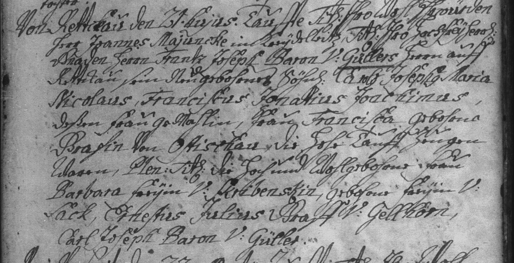

# Carl Joseph z Rettkau, křest 21. března 1751

**Novorozeného syna Carla Josepha nechali pokřtít Franz Joseph von Giller, pán na Rettkau, a jeho manželka Francisca, rozená hraběnka von Ostischau.** O rok dříve jsou titíž manželé zapsáni jako rodiče Marie Barbary. V obou případech je mezi kmotry dospělý Carl Joseph von Giller. [Křest syna, D 1420, s. 603](https://www.familysearch.org/ark:/61903/3:1:3Q9M-CSPL-G32X-G?view=explore&groupId=TH-909-75352-98992-36&lang=en) · [Sestra a vídeňský kmotr, s. 586](rettkau-1750.md)

V obou polovinách knihy byly přečteny strany 581–601 a 603–604 od konce roku 1749 až do března 1751. S. 602 zůstala nepřečtena. Ročník 1750 je nadepsán na s. 584. Ročník 1751 je nadepsán na s. 599. Na s. 603 je datum zapsáno jako 21. „tohoto měsíce“ mezi zápisy z 21. a 22. března. Samostatné datum narození kniha neuvádí. [Záhlaví roku 1750](https://www.familysearch.org/ark:/61903/3:1:3Q9M-CSPL-G3TV-B?view=explore&groupId=TH-909-75352-104207-45&lang=en) · [Záhlaví roku 1751](https://www.familysearch.org/ark:/61903/3:1:3Q9M-CSPL-G32X-T?view=explore&groupId=TH-909-75352-98992-36&lang=en)

## Čtení zápisu

> Von Rettkau den 21. hujus. Tauffte Titl: Ihro Wohl Ehrwürden\
> Herr Joannes Majunc[z]ke in Kreydelwitz, Titl: Ihro Hochfreyherrl:\
> Gnaden Herrn Frantz Joseph Baron v: Güllers Herrn auff\
> Rettkau sein Neugebohrnes Söhnel: Carolus Josephus Maria\
> Nicolaus, Franciscus Ignatius Joachimus,\
> dessen Frau Gemahlin, Frau Francisca Geborne\
> Gräfin Von Ostischau, die Hoch Tauff Zeügen\
> waren, Plen: Titl: die Hoch und Wohlgebohrne Frau\
> Barbara Freyin v: Skribenskin, Geborne Freyin v:\
> Sack, Ernestus Julius Graff v: Gellhorn,\
> Carl Joseph Baron v: Güller.

**Překlad.** Z Rettkau 21. tohoto měsíce. Důstojný pan Jan Majunc[z]ke z Kreidelwitzu pokřtil novorozeného syna pana Františka Josefa, barona z Güllerů a pána na Rettkau, a jeho manželky Františky, rozené hraběnky von Ostischau. Dítě dostalo jména Karel Josef Maria Mikuláš František Ignác Jáchym. Kmotry byli urozená paní Barbora, svobodná paní von Skribenski, rozená svobodná paní von Sack, Arnošt Julius hrabě von Gellhorn a Karel Josef baron von Güller.

**Datace a vztahy.** Den je na listu „21. hujus“. Bezprostředně před ním je „den 21. Marty“, bezprostředně po něm „den 22. Marty“. První číslice u „hujus“ má tvar dvojky stejně jako obě číslice v následujícím 22. Druhá je štíhlejší jednička stejně jako v předcházejícím 21. Na prvním zápisu listu „den 16. Marty“ má šestka jiný, dolů zahnutý tah. Rok 1751 je převzat z kontextu knihy. Datum je křestní a „Neugebohrnes Söhnel“ výslovně označuje novorozeného syna, bez samostatné datace narození.

V obou křtech z Rettkau (1750, strana 586, a 1751, strana 603) je na obraze stejně **Frantz Joseph**, následované titulem „Baron v: Güllers Herrn auff Rettkau“. Podmět křtu je duchovní v Kreydelwitzu, nikoli baron. V obou zápisech je výslovně „dessen Frau Gemahlin“, následuje **Francisca** a rodné **Ostischau**, v obou bez jména Maria. Oba křty tedy jmenují stejný rodičovský pár. Jméno Carl Joseph se na tomto listu vyskytuje dvakrát v odlišných rolích. Nejprve v latinských jménech dítěte, podruhé německy na konci seznamu kmotrů s titulem Baron. U Barbory stojí za manželským příjmením jasné „Geborne Freyin v: Sack“. Kmotry zápis neoznačuje za pokrevní příbuzné. Ztotožnění této Barbory s kmotrou roku 1750 je podpořené jménem, ale čtení manželského příjmení v zápisu 1750 je slabší než zde.

## Srovnání se soupisem, školou a ženichem

| Doklad | Jméno nebo věk | Co lze vyvodit |
|---|---|---|
| Křest v Rettkau, 21. 3. 1751 | Carl Joseph je syn **Franze Josepha** a Františky, rozené hraběnky Ostischau | Přímý doklad o rodičích. Stejný pár je zapsán i při křtu jeho starší sestry. |
| Lenní tabulka k roku 1752, Rettkau a Priedemost | Jmenuje **Josepha Antona**, syn **Carl, 2 roky** | Rozpor s křtem je v otcově křestním jménu i v doslovném dokončeném věku syna. V březnu 1752 dovršilo zde pokřtěné dítě rok. Datování konkrétního zápisu v tabulce a způsob udávání věku je třeba ověřit v předloze. |
| Rytířská akademie v Lehnici, 1770 | Katolík **Carl Joseph von Giller**, 19 let, rodové sídlo **Rettkau** | Shodují se jména, věk i výslovně uvedená obec. Křtěnec z roku 1751 je velmi pravděpodobným žákem. Školní zápis neuvádí rodiče. |
| Sňatek s Antonií Nerlichovou, Groß Karlowitz, 26. 4. 1785 | V rejstříku je ženichovi **40 let** a jeho otcem je **Joseph Anton** | V ten den bylo křtěnci z roku 1751 **34 let**. Samotná shoda jmen neřeší dva rozpory. |
| Úmrtí Carla Josepha, Ober-Glogau, 14. 4. 1824 | Podle oznámení mu bylo **73 let** | Věk křtěnce z března 1751 by odpovídal. Samotný údaj o věku neprokazuje totožnost s žákem a ženichem. |

[Škola, položka 662 na obraze](https://api.digitale-sammlungen.de/iiif/image/v2/bsb11494262_00069/full/1500,/0/default.jpg) · [Konopnicka, tabulka s. 292](https://zbc.uz.zgora.pl/Content/58371/16_konopnicka_szlachta.pdf#page=6) · [Dosavadní rešerše k žákovi a soupisu](../../2026-11-25/SOL-01/Gillern_SOL_01_vysledek.md)

Věková okna pro narození **Josefa Emanuela z Býchor** jsou jinou otázkou. Oba sourozenci pokřtění 1750 a 1751 pocházeli z doloženého manželství Franze Josepha a Františky. Toto otcovství se nevztahuje k sourozencům pokřtěným 1737 a 1739 ani k českému lesníkovi bez samostatného rodinného dokladu.
