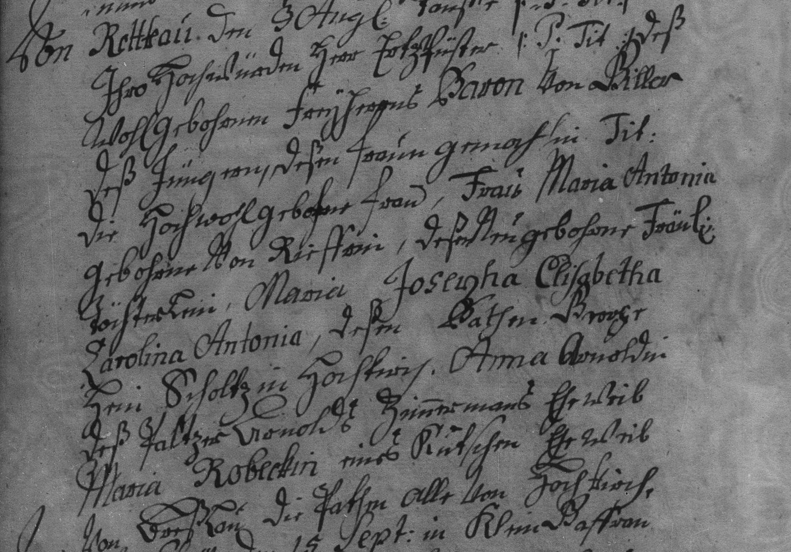
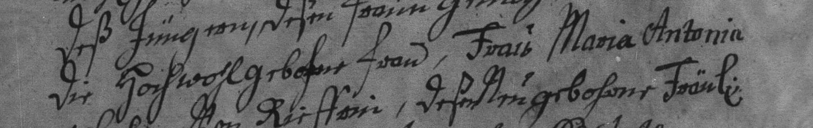

# Druhá dcera mladšího barona z Rettkau

**Maria Josepha Elisabetha Carolina Antonia** byla pokřtěna jako dcera mladšího barona von Giller a Marie Antonie rozené von Rüffer. V obou křtech z Rettkau se opakují tituly rodičů, matčina dvě křestní i rodné příjmení a tři kmotři ve stejném pořadí. Zápisy proto dovolují přiřadit Marii Josefu jako sestru abatyše Dominiky. Její jméno Josepha při čtení Josefova věkového okna patří dceři. [Matrika, s. 100, třetí zápis](https://www.familysearch.org/ark:/61903/3:1:3Q9M-CSPL-G3TC-J?view=explore&groupId=TH-909-75352-104207-45&lang=en) · [Křest sestry, s. 145](rettkau-1739.md)

**Pramen.** Hochkirch, kniha D 1420, levá část, DGS 8246291, snímek 53, s. 100. Zápis je ze **srpna 1737**. Na s. 79 je záhlaví roku 1737, na [s. 108 přechod do roku 1738](https://www.familysearch.org/ark:/61903/3:1:3Q9M-CSPL-G3TV-Z?view=explore&groupId=TH-909-75352-104207-45&lang=en). Přednost má čtení dne 3. (?), přestože před zapsáním tohoto křtu farář zaznamenal datum 23. srpna. Tvar číslice připomíná trojku z předchozího zápisu. Při jiném čtení může jít o 9. srpna. [Záhlaví roku 1737, s. 79](https://www.familysearch.org/ark:/61903/3:1:3Q9M-CSPL-G323-Y?view=explore&groupId=TH-909-75352-98992-36&lang=en).

> Von Rettkau. den [3?] Aug: Tauffte /: P: Tit: /\
> Ihro Hochwürden Herr Ertzpriester /: P: Tit: / deß\
> Wohlgebohrnen Freÿherrns Baron Von Giller\
> deß Jüngern, deßen Frauen Gemahlin Tit:\
> die Hochwohlgebohrne Frau, Frau Maria Antonia\
> gebohrne Von Rüfferin, deßen neugebohrne Fräuli:\
> Töchterlein, Maria Josepha Elisabetha\
> Carolina Antonia, deßen Pathen George\
> Hein Scholtz in Hochkirch, Anna Arnoldin\
> deß Baltzer Arnolds Zimmermans Eheweib\
> Maria Robeckin eines Kutschers Eheweib\
> [seÿnd?] die Pathen alle Von Hochkirch.

**Překlad.** Z Rettkau dne [3.?] srpna důstojný pan arcikněz pokřtil novorozenou dcerušku urozeného svobodného pána barona von Gillera mladšího a jeho vysoce urozené manželky Marie Antonie, rozené von Rüffer. Dítě dostalo jména Marie Josefa Alžběta Karolína Antonie. Kmotři byli Jiří Hein, rychtář v Hochkirchu, Anna Arnoldová, manželka tesaře Baltzera (Baltazara) Arnolda, a Marie Robecková, manželka kočího. Všichni kmotři byli z Hochkirchu.

V tomto zápisu je rodné příjmení matky čitelnější než v zápisu její dcery Marie Anny. Shoda se zprávou o Marii Antonii v Blažkově hesle Ruffer (Rüffer) je dalším potvrzením. V rodině působí jako kmotři místní šoltys Georg Hein (?), Anna, manželka tesaře Baltzera Arnolda, a Maria Robeckin. Tentokrát je poslední z nich označena za manželku kočího. [Srovnání s křtem Marie Anny a Blažkovým heslem](rettkau-1739.md)

V červnu 1790 byla jako kanovnice v Barschau uvedena katolická svobodná paní Maria Josepha von Giller z dědovského sídla v Rettkau. Má tedy shodná první dvě jména, predikát i místo. V tištěném seznamu chybí její věk, další křestní jména a rodiče. Je možné porovnat její přijímací písemnosti nebo pozůstalost s nyní doloženou rodinou. Totožnost obou žen zůstává otevřená. [Dobový seznam, položka č. 3](https://sbc.org.pl/Content/3255/PDF/i4002-1792-02-0001.pdf#page=21)
