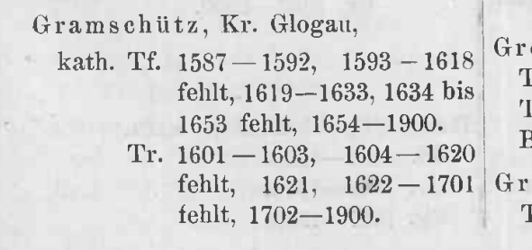
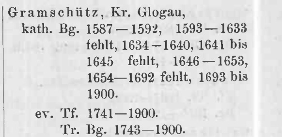
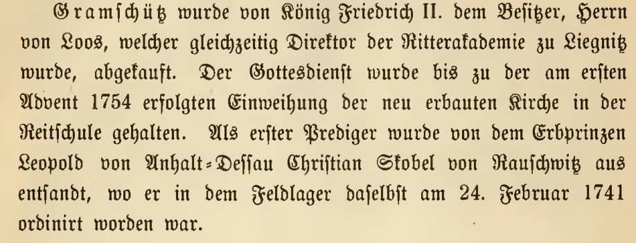

# Gramschütz a Priedemost · druhé kolo, 25. listopadu 2026

**Pozdější ověření po přihlášení.** [Mikrofiše v Hochkirchu a obrazy v Gramschützu](../familysearch/README.md).

Křty z let 1737–1738 a 1746–1747 zůstávají neprohlédnuté. Snímky nevydal polský portál ani FamilySearch. Nově jsem ověřil v obrazu inventáře z roku 1902, že v Gramschützu evidoval samostatné katolické křty od roku 1654 a evangelické od roku 1741. Přibyla konkrétní archivní signatura žádosti Priedemostu o příslušnost ke Gramschützu z roku 1767. Pro českou větev přibyly dvě nadřízené instituce, jejichž písemnosti mohou doplnit místní fondy.

## Křty a kontrola míst

**Polské státní fotokopie, 89/113/0/-/12.** Přímé otevření jednotky HTTP 200 vydalo ochrannou stránku Incapsula bez obrazů. Karta jednotek i karta skenů ohlásily „Portlet is temporarily unavailable“. Katalogový seznam archivu uvádí pro celý fond 12 jednotek a 1 433 skenů. Fond je už v seznamu nově digitalizovaných materiálů z ledna 2014. Číslo a stav obrazů jednotlivé jednotky zůstaly při této kontrole neověřené. BaSIA potvrzuje křty do 29. 12. 1741, úvodní údaj 29. 2. 1735 je zjevně chybný. Předchozí jednotka 11 výslovně jmenuje oba kostelní okruhy Gramschütz a Priedmost a zasahuje až do 15. 2. 1736. To je pozitivní kontrola místa v názvu sousední knihy. V roce 1737 či 1738 je třeba zkontrolovat záhlaví přímo u křtů. [Jednotka 12](https://www.szukajwarchiwach.gov.pl/jednostka/-/jednostka/6659985) · [Přehled fondu](https://www.szukajwarchiwach.gov.pl/de/zespol/-/zespol/63158) · [BaSIA, jednotky 10–12](https://basia.famula.pl/skany.php?lang=&placeid=527) · [Seznam digitalizátů 2014](https://www.pommerscher-greif.de/wp-content/uploads/2014/01/Liste_neue_Digitalisate_januar2014.pdf).

**FamilySearch, katalog 325630.** Přímý požadavek na katalog byl zastaven po HTTP 403. Knihovní katalog byl dohledatelný ve veřejném vyhledávacím indexu, přímý požadavek i na něj vrátil HTTP 403. Knihovní katalog uvádí film **1202294**, první řada křtů 1719–1765 „r. & l. S.“ (pravé a levé strany), a alternativu **1538820**, položky 3–12, se samostatným blokem křtů 1654–1765. Dále uvádí film **1202296** jako výslovně evangelický, křty a oddavky 1716–1753. Pro první okno lze v katalogu 325630 otevřít také **890949**, křty a oddavky 1726–1741. Trvalý odkaz pro přihlášený prohlížeč míří na společný katalog 325630. Konkrétní DGS pro žádný z těchto filmů nebyl vidět a čísla klasických mikrofilmů nejsou DGS. Nepodařilo se ověřit, zda po přihlášení bude prohlížeč vyžadovat návštěvu centra FamilySearch. [Obrazový katalog 325630](https://www.familysearch.org/search/catalog/325630) · [Knihovní katalog](https://libcat.familysearch.org/Record/325630) · [Geneteka, plán a odkaz na stejný katalog](https://geneteka.genealodzy.pl/plany.php?sort=woj).

**Nezávislá kontrola konfesí na obrazu tisku.** Joseph Jungnitz a Gerhard Eberlein, *Die Kirchenbücher Schlesiens beider Confessionen*, Breslau 1902, s. 19, obraz PDF 35. Vlevo ve spodní části začíná Gramschütz, katolické křty a sňatky, pokračování vpravo nahoře uvádí katolické pohřby a evangelickou matriku. Zkrácený přepis relevantních křestních údajů: „kath. Tf. […] 1654–1900“ a „ev. Tf. 1741–1900“. Dobový soupis k roku 1902 eviduje katolickou řadu zahrnující obě cílová období a samostatnou evangelickou křestní řadu pro druhé období. Širší datace smíšených mikrofilmů může odpovídat starším evangelickým zápisům v knihách vedených katolickou farností. Přítomnost jednotlivých obcí a návaznost obou řad musí potvrdit snímky. [Obraz s. 19](https://protzan.de/wp-content/uploads/2021/10/1902_Kirchenbuecher_Schlesiens_beider_Confessionen.pdf#page=35) · [Knihovní záznam](https://www.sbc.org.pl/dlibra/publication/edition/77640).

**Priedemost a Rettkau.** M. R. Górniak v *Adhibenda* 7, s. 40 a 47, jmenuje Priedemost i Rettkau mezi pozdějšími obcemi katolické i evangelické farnosti Gramschütz. Pro 18. století je zvlášť důležitý nově dohledaný popis GStA PK Berlín **I. HA GR, Rep. 46 B, Nr. 2428**, roky jednotky 1743–1770. Katalogová položka pro rok 1767 zní „Gesuch der Gemeinde zu Priedemost zur Kirchfahrt nach Gramschütz“, tedy žádost obce Priedemost o docházku ke kostelu v Gramschützu. Záznam je v řadě evangelicko-luterské agendy. Žádost ani rozhodnutí jsem v obrazu neviděl. Z katalogového údaje nelze předpokládat, že evangelická příslušnost evidovaná v 19. století platila beze změny už roku 1746. Referenčním bodem pro tehdejší existenci sboru je E. Wiegelt, *Die evangelische Kirche in Schlesien c. von 1740–1756* (1889), s. 112, kde je v Gramschützu první kazatel od roku 1741 a vysvěcení stavby o prvním adventu roku 1754. Wiegelt podle obrazu uvádí jako první místo bohoslužeb jízdárnu a jako prvního kazatele Christiana Skobela (OCR může číst Göbel). Górniak na s. 46 píše Scobel a uvádí jeho působení do roku 1746. Jako nástupce uvádí Johanna Andrease Stengela. Obě jména jsou orientačním bodem pro čtení evangelických zápisů kolem roku 1746. [Górniak, s. 40, 46–47](https://serwer1361595.home.pl/www/archiwum-site/wp-content/uploads/2020/10/Adhibenda_7_srodek_internet.pdf) · [GStA PK, Nr. 2428](https://archivdatenbank.gsta.spk-berlin.de/midosasearch-gsta/MidosaSEARCH/i_ha_gr_rep_46_b/xml/inhalt/GStA_i_ha_gr_rep_46_b_55_13_2.htm) · [Wiegelt, s. 112, obraz PDF 114](https://sbc.org.pl/Content/10593/PDF/ii4026-1889-00-0001.pdf#page=114).

**Kontrolní osoby pro čtení.** Pro Rettkau je nejpevnější Maria Anna von Giller, pozdější abatyše Dominika, narozena podle klášterní tradice doložené již za jejího života 29. 3. 1739. Křest hledat v navazující knize 12 nebo filmu 890949, především konec března a počátek dubna. Rodiče zůstávají otevření. Pro Priedemost a Rettkau je podle dříve ověřené edice tabulky z roku 1752 kontrolní domácností Joseph Anton a dvouletý syn Carl. Nový pokus o otevření PDF edice skončil HTTP 503. Křest Carla má smysl hledat zhruba 1749–1751, odděleně od českého Josefa syna Maximiliána a od cílového průchodu 1746–1747. Místní kronika uvádí v roce 1755 Marii Elisabeth Kretschmer, manželku správce dominia Priedemost, jako dárkyni oltářního obrazu v Gramschützu. To je další místní jméno k ověření v knihách, bez doloženého spojení s Gillerny. Ve veřejných materiálech Priedemostu jsem nalezl zmínky o obyvatelstvu z let 1884, 1887 a 1910, bez opisu křtů pro obě cílová období. [Výchozí revize, Dominika](../../2026-11-25/vychozi_revize.md) · [Tabulka z roku 1752, s. 292](https://zbc.uz.zgora.pl/Content/58371/16_konopnicka_szlachta.pdf#page=6) · [Místní kronika](https://www.glogauerheimatbund.de/pages/NGA-Artikel/2005/NGA05_07Ortschronik.html) · [Přehled místních soupisů](https://discourse.genealogy.net/t/re-kirchenbuch-von-priedemost/702081).

**Pozdější křestní vysvědčení jako pozitivní kontrola místa.** Ve veřejném rejstříku křestních vysvědčení přikládaných ke sňatkům u sv. Mikuláše v Hlohově je například dvojice rodičovských příjmení Bardeß–Luge s rodištěm Priedemost, křtem v Gramschützu a evangelickým vyznáním, původní sign. 89/92/0/1.102/28, sn. 26. Nová signatura má místo 1.102 označení 1.2. V oddílu jsou obdobné řádky pro Dorn–Anders, Kurtzke–Otto, Mehlhose, Wende–Baum a Winter–Merschel. Jde o novodobá vysvědčení. Katalog datuje jednotky 24–28 a 100 do let 1897–1934. Ve zveřejněném jmenném přepisu se Gillern nevyskytuje. Jde o pozitivní kontrolu zápisu Priedemost–Gramschütz v pozdějším prameni a o prověřenou alternativu, jejíž katalogové datace nedosahují ke sledovaným křtům. Samostatná jednotka **89/92/0/1.2/45**, sv. Mikuláš v Hlohově, sňatkové písemnosti 1763–1769, má katalogově 7 snímků. Žádný jsem nečetl. [Rejstřík s čísly snímků](https://docs.google.com/spreadsheets/d/1r2MaroQFbNplJSBlKe578KtZZ1Ik8Xato0NY8bEbt80/edit?usp=sharing) · [Přepis na fóru](https://forum.ahnenforschung.net/forum/thread/124107-index-der-taufzeugnisse-k%C3%BCnftiger-eheleute-von-glogau-st-nikolaus/) · [Katalog sňatkové jednotky 45](https://www.szukajwarchiwach.gov.pl/de/jednostka/-/jednostka/6658998).

## České souběžné prameny

| Fond | Co se podařilo ověřit | Co zajistí přesnou kontrolu |
|---|---|---|
| **Vikariátní úřad Poděbrady, NAD 140, pomůcka 1045** | Veřejný katalogový záznam fondu a pomůcky uvádí 45 podacích protokolů či deníků s celkovou datací 1750–1912, manželské záležitosti a úplný elektronický inventář v systému pomůcek. Oba otevřené záznamy mají prázdné přílohy a digitální objekty. Samostatné nahlédnutí do systému pomůcek skončilo HTTP 503 a následným zastavením přístupu. | Najít položku skutečně zahrnující květen–červen 1786 a projít záznamy k oběma snoubencům (Giller, Koch). [Fond](https://aron.soapraha.cz/apu/740f706b-b6c9-4d69-808e-d84d8f83603c) · [Pomůcka 1045](https://aron.soapraha.cz/apu/df469d92-299d-42cd-a73d-39f437793400) · [Systém pomůcek](https://pomucky.soapraha.cz/). |
| **Velkostatek Kolín, NAD 298, pomůcka 339, II 187** | Veřejný katalog fondu a pomůcky potvrzuje správní a účetní knihy, účty, zlomky spisů a šest podacích protokolů či deníků v celkovém rozmezí 1782–1889. Index se vztahuje jen k roku 1849. Oba záznamy mají prázdné přílohy a digitální objekty. | Ověřit dochovaná léta a najít personál a účty býchorského revíru pro X/1787–X/1789 pod Höfer/Hoffer/Hofer a Giller/Güller/Gillern. [Fond](https://aron.soapraha.cz/apu/2e5052cd-613b-441c-9b69-e40b1b28a227) · [Pomůcka 339](https://aron.soapraha.cz/apu/7eef756c-b153-4e71-9d00-5db1d9dfb67e). |

**Správní alternativy.** Pro býchorské jmenování a výplaty připadá v úvahu fond **Administrace státních statků v Národním archivu**. Pavel Koblasa výslovně zahrnuje komorní panství Kolín do její působnosti od roku 1784. Podle studie z roku 2022 obsahuje fond 68 knih a 308 kartonů a je částečně neuspořádaný. Příslušný ročník ani osobní záznam jsem neidentifikoval. [Koblasa, Archivní časopis 72, č. 4, s. 357–366, anotace](https://starfos.tacr.cz/vysledky-vyzkumu/RIV%2F70979821%3A_____%2F22%3AN0000039).

Pro případ, že poděbradská oddavková záležitost postoupila od vikáře výše, Eliška Černá v práci *Patronátní právo na panství Poděbradském v 19. století* (2013) podle Tywoniakova inventáře klade přechod panství pod **královéhradeckou diecézi do roku 1784**. Archivní zpráva dokládá v Hradci Králové zpracovávanou **Biskupskou konsistoř, NAD 2667**, s částí od roku 1783. Veřejné vyhledávání fondů v ARONu Hradec Králové vrátilo dva stejnojmenné záznamy s datací 1664–1950. Dotaz na jednotlivé archiválie zastavilo HTTP 503. Přesná jednotka pro sňatky roku 1786 ani digitalizát nebyly zjištěny. [První záznam fondu](https://aron.vychodoceskearchivy.cz/apu/c2f3948f-f065-49d6-adc4-bfb1182a18fd) · [Druhý záznam fondu](https://aron.vychodoceskearchivy.cz/apu/f58c6431-a893-451a-95b7-47b37afb5962). Kandidátem v místním velkostatku je navíc **Velkostatek Poděbrady, inv. č. 1639, kart. 1197, Záležitosti patronátní 1757–1850**. Studie ze svazku popisuje chronologické přepisy přijatých a odeslaných písemností a pracuje s materiálem od 1784. Jde o patronátní agendu. Zaznamenání konkrétního sňatku závisí na tom, zda vyvolal jednání patronátu. [Studie o patronátu, s. 31–35](https://portal.upce.cz/StagPortletsJSR168/PagesDispatcherServlet?pp_destElement=%23ssSouboryStudentuDivId_108&pp_locale=cs&pp_nameSpace=G6938&pp_page=souboryStudentuDownloadPage&pp_portlet=souboryStudentuPagesPortlet&pp_reqType=render&soubidno=11743) · [SOA v Zámrsku, výroční zpráva 2008](https://vychodoceskearchivy.cz/wp-content/uploads/2020/07/2008.pdf).

## Skutečné pokrytí

| Cíl | Obrazy rukopisů | Co bylo čteno |
|---|---|---|
| Křty 1737–1738 a kontrola Rettkau v březnu 1739 | 0 | BaSIA, popis fondu a položka FamilySearch, inventář 1902 s. 19. |
| Křty leden 1746 až únor 1747, případně Carl 1749–1751 | 0 | Knihovní katalog mikrofilmů, inventář 1902 s. 19 a literatura o příslušnosti farnosti. |
| Priedemost a rodina držitele | 0 | Popis pruské žádosti z 1767, údaje k dříve doložené tabulce z roku 1752 a místní literatura. |
| Vikariát Poděbrady, V–VI/1786 | 0 | Záznamy fondu a pomůcky, odborný popis patronátních spisů, výroční zpráva ke konzistoři. |
| Kolín, Býchory, X/1787–X/1789 | 0 | Záznamy fondu a pomůcky, anotace k nadřízené správě. |

Snímky cílových rukopisů tudíž chybějí. Přílohy jsou výřezy skutečně přečteného inventáře z roku 1902 a Wiegeltova textu z roku 1889. Ochranná stránka polského portálu, HTTP 403 ve FamilySearch a HTTP 503 u systému pomůcek SOA v Praze průchod zastavily. Časové meze katalogů zde nelze vykládat jako skutečně prolistované roky ani jako negativní jmenný výsledek.
