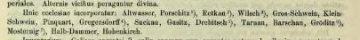
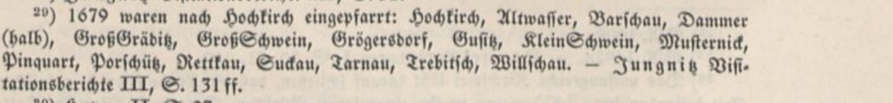

# Hochkirch, Rettkau a Groß Schmograu · druhé kolo

**Pozdější ověření po přihlášení.** [Mikrofiše v Hochkirchu a obrazy v Gramschützu](../familysearch/README.md).

**Nové zjištění.** Retkau je přímo uvedeno mezi vesnicemi náležejícími ke katolickému kostelu v Hochkirch v tištěné edici vizitace z roku 1679. Přesný obvod pro hledané roky zůstává k ověření v knize. FamilySearch v prohlížeči zobrazil běžné přihlášení pro oba cílové katalogy. Pro náhradní křty v Groß Schmograu byla určena další filmová jednotka v Lipsku. Přečteno **0 matričních snímků**. Rodiče a kmotři Marie Anny a Josefův křest zůstávají neověřené.

## Hochkirch / Grodowiec a Rettkau / Retków

- **Farní obvod, přímý obraz tištěné edice dobové vizitace.** Joseph Jungnitz (ed.), *Visitationsberichte der Diözese Breslau. Archidiakonat Glogau. Erster Teil* (Breslau 1907), s. 131–133, Opolska Biblioteka Cyfrowa, snímky 76–77. Na s. 131 začíná oddíl „Ecclesia in Hochenkirch“. Na s. 132 v prvním odstavci po úvodní části stojí „Huic ecclesiae incorporantur: Altwasser, Porschitz, Retkau“. Překlad „K tomuto kostelu náleží Altwasser, Porschitz, Retkau.“ Poznámka 2 na stránce rozepisuje „Retkau“ jako „Rettkau“. Jde o přímý důkaz místní příslušnosti z edice vizitace, přesný obvod pro roky 1737–1747 však ještě zkontroluje matrika. AZON k této edici vrátil HTTP 503 a jeho test skončil. Otevřen byl jiný exemplář v Opoli. [Tištěná s. 131, sn. 76](https://obc.opole.pl/dlibra/applet/publication/812/edition/785?handler=djvu_html5&format_id=1&p=76) · [Tištěné s. 132–133, sn. 77](https://obc.opole.pl/dlibra/applet/publication/812/edition/785?handler=djvu_html5&format_id=1&p=77)
- **Další soupisy obvodu.** Edmund Michael v práci *Die schlesische Kirche und ihr Patronat im Mittelalter unter polnischem Recht* (1926), s. 77 (PDF sn. 79), pozn. 29 k heslu Hochkirch, vztahuje Jungnitzovu edici k roku 1679. Online databáze Meyers uvádí katolickou farnost Hochkirch a evangelickou Gramschütz podle FamilySearch. Popis fondu Gramschütz v Szukaj w Archiwach uvádí Retków i u katolické farnosti. Rozpor v přesných letech lze rozhodnout obsahem a původem knih. [Michael, PDF sn. 79](https://dbc.wroc.pl/Content/15281/PDF/17218.pdf#page=79) · [Meyers, Rettkau](https://www.meyersgaz.org/place/20584015) · [Gramschütz, popis fondu](https://www.szukajwarchiwach.gov.pl/de/zespol/-/zespol/63158)
- **FamilySearch.** Otevření položky **13158** v cloudovém Chromu došlo na standardní stránku „Sign In“ s návratem na konkrétní katalog po přihlášení. V minulém kole se před přihlášením objevila blokovací stránka Incapsula. Bez přihlášené relace nebyly vidět datace jednotlivých nosičů, ikony přístupu ani obrazová skupina odpovídající letům 1735–1765. Údaj **6306986–6307036** ze sekundárního přehledu tudíž dále nepotvrzuje konkrétní DGS ani médium. Přímý starý prohlížeč prvního čísla se v nástroji pro vyhledávání nenačetl. Alternativní veřejné knihovní rozhraní `libcat.familysearch.org` pro dané položky vyhledávací nástroj neotevřel s odkazem na pravidla pro roboty. Nebyl vyzkoušen přístup z přihlášeného účtu ani z badatelského centra. [FS 13158](https://www.familysearch.org/en/search/catalog/13158) · [Přehled nosičů WeRelate](https://www.werelate.org/wiki/Source:Katholische_Kirche_Hochkirch._Kirchenbuch,_1656-1795) · [Původní prohlížeč prvního čísla](https://www.familysearch.org/en/search/film/006306986) · [Knihovní rozhraní](https://libcat.familysearch.org/Record/13158)
- **Původ kopií.** Popis lipského fondu 21962 uvádí, že při přepisu starých filmů na moderní materiál v letech 1975–1988 získala genealogická centra církve provozující FamilySearch kopii všech filmů a filmy z originálů. To je konkrétní opora pro hledání lipského křestního filmu **D 1420** také v katalogu FamilySearch, včetně možných souborných položek pod původcem Reichssippenamt či Staatsarchiv Leipzig. U konkrétního čísla či obrazové skupiny zatím nelze potvrdit shodu záběrů nebo dostupnost z domova. Evidenční detail D 1420 z předchozího kola nemá snímky. [Popis původu fondu 21962](https://www.archiv.sachsen.de/archiv/bestand.jsp?bestandid=21962&oid=13.01&syg_id=) · [Jednotka D 1420](https://www.archiv.sachsen.de/archiv/bestand.jsp?guid=738b97a9-903a-4ef4-b796-64469299c137)
- **Další diecézní evidence.** Vratislavský diecézní archiv nabízí beta katalog s hledáním podle sídla, signatury a názvu. Přímé načtení stránky katalogu v cloudovém prohlížeči skončilo na `ERR_HTTP2_PROTOCOL_ERROR`. Vyhledávač indexuje vstup, samotný katalog v pokusu nedodal. Oddíl **420** z literatury zůstává jediným ověřeným vratislavským označením obce. Ve zveřejněné tabulce Archivu zielonogórsko-gorzowské diecéze je sice fond titulovaný Grodowiec, 110, PGro-kat, ale jediný vypsaný řádek má značku PGra-ew 1 a popisuje evangelické **Gralewo** z let 1895–1945. Tato nesrovnalost v inventáři nedokládá obsah fondu PGro-kat. [Vratislavský katalog](https://archiwum.archidiecezja.wroc.pl/katalog) · [Zielonogórsko-gorzowský diecézní archiv, PGro-kat](https://archiwum.diecezjazg.pl/index.php/zasoby-archiwalne/akta-parafii-katolickiej-grodowiec-hochkirch-zespol-110-sygnatura-pgro-kat/)
- **Klášterní cesta.** Fond cisterciaček v Trzebnici **82/57/0 (Rep.125)** uvádí 549 jednotek a žádné skeny. Přehled fondu zmiňuje závěti, patronát a majetkové doklady, bez explicitně pojmenované knihy profesí. Pro hledání přijímacího dokladu z roku 1754 či profese z roku 1755 je to katalogová stopa. Již ověřené údaje o narození a profesi v tisku shrnuje SOL-01. [Státní archiv ve Vratislavi, fond 82/57/0](https://www.szukajwarchiwach.gov.pl/en/zespol/-/zespol/88348)

## Záložní katolická farnost Groß Schmograu / Smogorzów Wielki

Otevření dosud netestované položky **FamilySearch 356843** v cloudovém Chromu přesměrovalo na identifikační službu s návratem k položce po přihlášení. Test zastavil před katalogovými detaily, bez potvrzeného DGS. Geneteka vede vratislavský diecézní exemplář v **plánu indexace**, s křty 1666–1754, sňatky 1666–1746 a úmrtími 1688–1754. Plán nepotvrzuje hotový index. [FS 356843](https://www.familysearch.org/pl/search/catalog/356843) · [Geneteka, seznam plánů](https://geneteka.genealodzy.pl/plany.php?sort=lata)

Lipský inventář fondu **21962** uvádí tři jednotky katolického Groß-Schmograu. **D 1294-2 (1666–1754)** výslovně uvádí křty („Enthält: Taufen.“) a studium ve Státním archivu v Lipsku. Metadata detailu obsahují `digitalisatExists: false`. **D 1294-1 (1666–1746)** je ve svém detailu výslovně označen jako sňatky. **D 1294-3 (1688–1754)** odpovídá svým rozsahem úmrtím. Při otevření detailu křestního dílu byl k dispozici pouze inventární popis. Tato lokalita je samostatná kontrola okolí Hammeru a Krehlau, příslušnost Hammeru ke Groß Schmograu je třeba ověřit na knize či v dobovém soupisu. [Lipský inventář s trojicí signatur](https://www.archiv.sachsen.de/archiv/bestand.jsp?bestandid=21962&oid=13.01&syg_id=250596) · [Přímý detail křtů D 1294-2](https://www.archiv.sachsen.de/archiv/bestand.jsp?guid=f8b14c6e-7195-4331-a1dd-171bfe438fb5) · [Ověřený detail sňatků D 1294-1](https://www.archiv.sachsen.de/archiv/bestand.jsp?guid=c919bcba-d83e-4f32-9267-04c02a712b59)

## Stav cílových průchodů

| Kniha | Zadaný úsek | Přečteno | Stav |
|---|---|---:|---|
| Hochkirch, FS 13158 / StA Leipzig 21962 D 1420 | 29. 3. 1739 je datum narození Marie Anny. Hledat okolí dne včetně dubna | 0 | Rodiče a kmotři otevřeni |
| Tatáž | Josef 3. 2. 1746–2. 2. 1747 a 13. 6. 1737–12. 6. 1738 s přesahem | 0 | Bez matričního průchodu |
| Groß Schmograu, FS 356843 / StA Leipzig 21962 D 1294-2 | Obě Josefova okna, úvodní kontrola lokality | 0 | Bez matričního průchodu |

Při otevření oprávněné relace FamilySearch zkontrolovat řádky „Film/Digital Notes“ obou katalogů, zaznamenat DGS, ikonu přístupu, titulní snímek a rozsah ročníků. Pro Hochkirch má přednost praktická kontrola Rettkau v březnu a dubnu 1739 a poté obě Josefova okna. V lipském exempláři může přesné členění objasnit také protokol verfilmění, který archiv popisuje u každého filmu. Katalogový průzkum nedává důvod měnit genealogická data.
