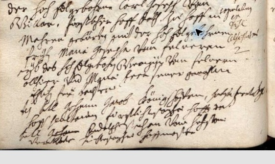

# Vídeň 1722 · Karel Josef Giller a Marie Josefa von Fellner

**Nalezen původní zápis.** Vídeň, Dom- und Metropolitanpfarre St. Stephan, oddací kniha **02-043**, s. **651**, snímek **03-Trauung_0650** (parametr prohlížeče `pg=662`), dole na levé straně. Oddíl má nahoře „Aprilis 1722“. U vlastního zápisu je samostatný okrajový záznam o oddání. Zápis má „zu Hoff in Mähren gebürtig“. Výklad „Hof = Dvorce“ je velmi pravděpodobný a shoduje se s místem narození v Koryčanském zpravodaji. [Matricula, snímek 662](https://data.matricula-online.eu/de/oesterreich/wien/01-st-stephan/02-043/?pg=662)

## První čtení

> Der hochEdelgebohrne Carl Joseph Von Gillar (?) / fürstl[icher] Hoff Rath (?) zu Hoff in / Mähren gebürtig, mit der hochEdelgebohrnen / Fräul. Maria Josepha Von Felnerin, / ehel[iche] des hochEdelgeb[ornen] Georgij Von Felnern / allhier und Maria Eva (?) seiner gemahlin / ehel[ich] erz[eugte] Tochter. / T[estes]: H[err] Johann Jacob Königshofen (?), hochfürstl[icher?] / Hoff Secretarius (?), [několik slov nejistých] / H[err] [přeškrtnuto: Johann (?)] […] Von […] / [přeškrtnutá část vlevo], […] Hoffmeister (?).

V okraji se čte „copulatus est … 2“, nad tím je drobná značka. Prostřední slova, údaj o měsíci a případné místo obřadu zůstávají ve výřezu nejednoznačné. Data uvedená v okrajích jiných zápisů stejného listu mohou být pozdější než duben, pod nímž je soupis veden. Samotný dubnový nadpis tedy neurčuje den obřadu.

**Překlad jistého jádra.** Vysoce urozený Karel Josef von Giller, knížecí dvorní rada (?), narozený v Hofu na Moravě, se slečnou Marií Josefou von Fellner, manželskou dcerou Jiřího von Fellner zde a Marie Evy (?), jeho manželky. Zápis uvádí rodiče nevěsty. Rodiče ženicha, jeho věk ani přesné datum narození v čitelném textu neuvádí.

[Celý list s. 651](vyrezy/st-stephan-02-043-s651-cely-list.jpg) · [Samostatný výřez okraje](vyrezy/st-stephan-02-043-s651-okraj.jpg). Obrazy jsou výřezy z veřejného prohlížeče Matricula. Samostatný přímý požadavek na obrazový server vrátil HTTP 403.

**Druhé čtení.** Nezávislá kontrola na obrazu souhlasí u jména páru, ženichova rodiště a jmen rodičů nevěsty. Slovo za jménem otce lze číst také „seliger“ (zesnulý), v prvním čtení „allhier“ (zde). V okraji druhý čtenář navrhuje „Elisabethen“, tedy možná sv. Alžbětu jako místo oddání. Na vyšším rozlišení nebo v knize místa obřadu ověřit přesné znění. Údaj „Juny“ v jiném okraji na téže straně náleží sousednímu páru. Samotný vídeňský záznam umožňuje označit Dvorce za ženichovo velmi pravděpodobné rodiště. Ani dva dnes známé dvorecké křty, Hans Carl 1690 a Carl Joseph 1696, se tím nerozliší. Ve Vídni roku 1723 navíc vystoupili současně sekretář jako ženich a jeho jmenovec, dvorní rada, jako svědek. [Svatba ve Schotten, s. 120v](https://data.matricula-online.eu/de/oesterreich/wien/01-unsere-liebe-frau-zu-den-schotten/02-23/?pg=242) · [Zemský archiv, historická jména Dvorců](https://www.archives.cz/web/DA_resources/DA_info/matriky_info/Mistopisny_rejstrik_obci_ceskeho_Slezska_a_severni_Moravy.pdf)

## Koryčanský zpravodaj

Karel Müller, „Heraldické památky v Koryčanech – Gillernové“, *Koryčanský zpravodaj*, jaro 2026, s. 20–21. Ověřena původní městská publikace. Na s. 20 autor uvádí svatbu 2. června 1722 ve Vídni s Marií Josefou, dcerou Jiřího Antonína von Fellner. Tamtéž přisuzuje ženichovi narození 25. září 1696 ve Dvorcích a otce Bedřicha Viléma. Detail místa má v oddacím zápisu dobovou oporu. Přesné datum narození a otcovství potřebují vlastní doklad. Článek u těchto údajů neuvádí matriční signaturu. Snubní protokol nebyl procházen. [Originální vydání, PDF s. 20](https://www.korycany.cz/modules/file_storage/download.php?file=ce48b060%7C2545&inline=1#page=20)
