# Giller ve vídeňských vojenských protokolech roku 1647

Přezkoumání digitálních obrazů rakouského Kriegsarchivu, fond Hofkriegsrat (HKR), 296 Expedit a 297 Registratur. Navazuje na [SOL-06](../../2026-11-25/SOL-06/Gillern_SOL_06_vysledek.md). Odkazy používají nulové číslo snímku v adrese (`pg`), listy uvádím podle dobové foliace. Lomítko označuje nový řádek, (?) nejisté čtení a […] vynechaný nebo nečitelný úsek.

## Výsledek

- **Giller je v soudobé výzvě z 8. května 1647.** Bezprostředně před ní úřad odesílá prostřednictvím Blumenthala výzvy k věrnosti několika plukovníkům ve vestfálských posádkách. Rejstřík výzvu spojuje se stejnou vestfálskou agendou. Květnové zápisy pod kolínským heslem se týkají jednání o neutralitě, velení císařským vojskům ve Vestfálsku a dalších napomenutí pro kurkolínské velitele. Gillerovo křestní jméno, hodnost a pluk z těchto zápisů nevyplývají.
- **Podobné jméno se v květnovém Expeditu objevuje u velitele v Hradci Králové.** Čtení okrajového hesla *Guiller* je pracovní. Dne 6. května tentýž úřad výslovně potvrzuje královéhradecké velení plukovníku Zeillnerovi. Podobný zápis tedy přednostně prověřuji jako další výskyt královéhradeckého velitele Andrease Wilhelma Zeillnera. Místo Gillerova postu z výzvy z 8. května zůstává otevřené.
- **Würben a Creutz.** Ještě 3. září úřad jmenuje plukovníka z Vrbna v záležitosti přidělených prostředků. Creutz má v listopadu samostatná hesla k vlastnímu pluku a k jeho sesednutým mužům. Z vybraných zápisů není patrné, kdy a na jakém právním základě by převzal Vrbnovu jednotku. Žádný z nich nejmenuje Heinricha Christofa Gillera.
- **Oprava SOL-06 u Gallase.** F. 9r i rejstřík uvádějí Gallasovu vdovu. Odlišný a dosud nedoceněný doklad o gallasovských mužích bez koní je 28. srpna na f. 243r č. 217. Dne 9. května byly otcovy dragouny výslovně uděleny synovi Antoniu Pankrácovi. Dne 11. května rada o nových majitelích zvlášť vyrozuměla pěšího a dragounského podplukovníka. Žádný z těchto zápisů nejmenuje Johanna Christofa Gillera.

## 8. květen a kurkolínští velitelé

**Registratur 297, f. 170v, č. 90.** Záhlaví „Maius. 8.“. Okraj čtu „[W]ünzenhaimb (?) / Wahl / Westphal / Zehlen (?) / Lanz (?) / Giller“. První písmeno prvního jména kryje vazba a konec čtvrtého a pátého jména je třeba posoudit s rejstříky. Pod *Ca* je samostatné „Laans“ či „Caans“ s foliem 170, tedy kontrolní stopa pro páté jméno. *Westphalien* pod *We* obsahuje rovněž folio 170. To je širší rejstříkové heslo pro oblast a nedoplňuje křestní jméno osoby. *Giller* pod *Gi* má folio 170. Ve výtahu chybí u všech šesti titul i určení jednotlivých míst. Na stejném listu následuje č. 91, druhá podobná skupinová výzva při kolínské neutralitě, s jinými okrajovými jmény. Keller má samostatnou položku č. 93 a pokračování v téže agendě v č. 97 na f. 171r, jako vrchní komisař, a není součástí č. 90. [Č. 90–97](https://library.hungaricana.hu/en/view/KA_HKR_297_1647R/?pg=129) · [Ca](https://library.hungaricana.hu/en/view/KA_HKR_297_1647R/?pg=303) · [We](https://library.hungaricana.hu/en/view/KA_HKR_297_1647R/?pg=386) · [Gi](https://library.hungaricana.hu/en/view/KA_HKR_297_1647R/?pg=322)

> „werden zur beständiger treu / und manutenierung ihrer Posten / ungeacht deß Chur Cöllni- / schen armistitij angemahnt.“

Jsou napomenuti k trvalé věrnosti a k udržení svých postů bez ohledu na příměří kolínského kurfiřta.

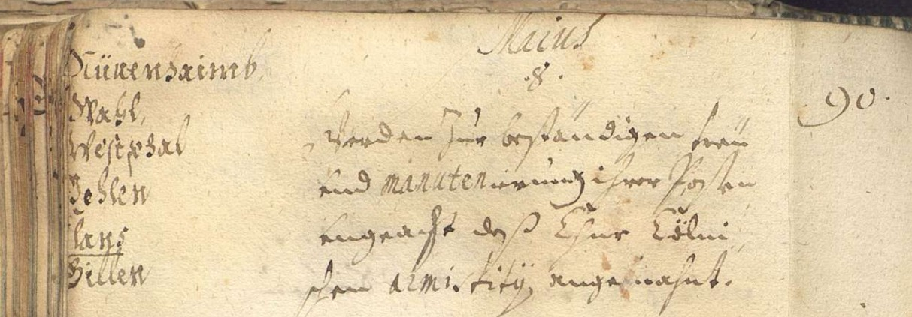

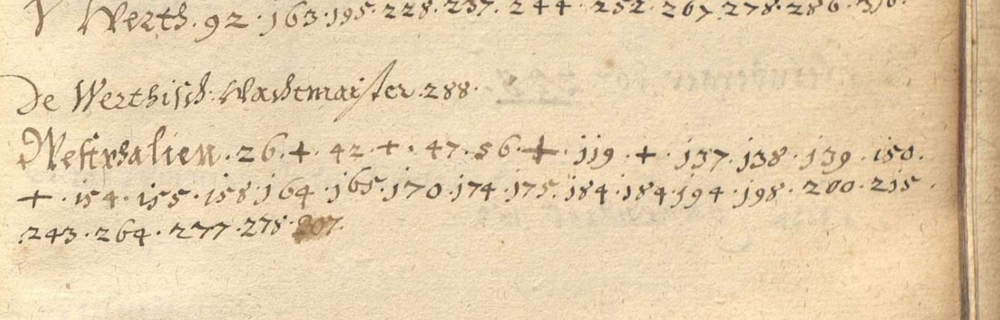

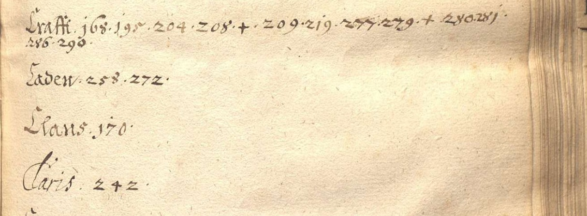

**Registratur 297, stejný den, předchozí f. 170r, č. 87.** Okraj „Blumenthall“. „Includuntur ermahnungß- / schreiben an etliche Obristen / in den guarnisonen deß West- / phalischen Craiß, daß sie treu / verbleiben.“ Blumenthalovi byla přiložena napomínací psaní pro několik plukovníků v posádkách vestfálského kraje, aby zachovali věrnost. Jde o nejbližší souběžnou položku k č. 90, s týmž dnem a účelem, která pravděpodobně objasňuje jeho služební kontext. Text č. 87 nevyjmenovává plukovníky a č. 90 jednotlivé hodnosti neuvádí. Z jejich sousedství nelze přiřadit Gillerovi právě tuto hodnost. [F. 170r](https://library.hungaricana.hu/en/view/KA_HKR_297_1647R/?pg=128)

**Registratur 297, 15. 5., f. 174r, č. 128.** Sparrovi se podává odpověď k jeho hlášení a mimo jiné se sděluje „daß die ermahnungß schreiben / an die Westphälische Commen- / danten ergangen.“ Napomínací psaní tedy byla zaslána vestfálským velitelům. V poznámce je vedle Sparra opět Blumenthal. Jednotliví velitelé zůstávají bez jmen. [F. 174r](https://library.hungaricana.hu/en/view/KA_HKR_297_1647R/?pg=132)

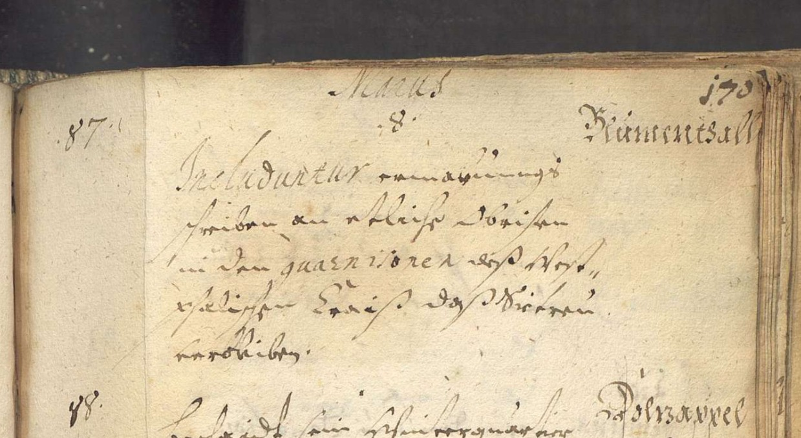

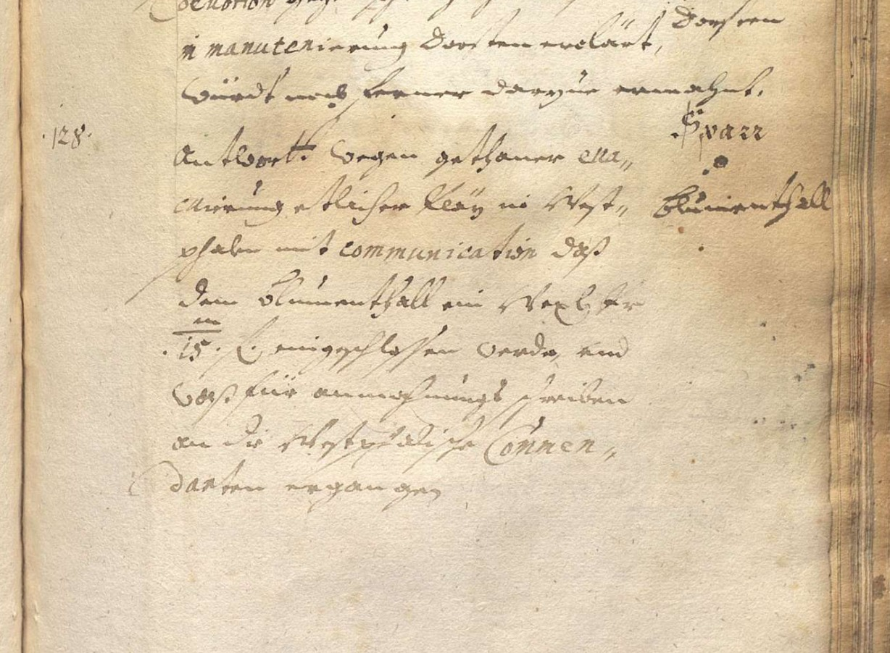

### Věcné paralely v květnovém Expeditu 296

| List a číslo | Rozhodující přepis | Překlad a souvislost |
| --- | --- | --- |
| [F. 167r č. 3](https://library.hungaricana.hu/en/view/KA_HKR_296_1647E/?pg=162) | „Otto Christoff von Spar, wegen / der Chur Cölnischen mit den Fran- / zosen und Schweden getroffenen / neutralitet.“ | Otto Christoph von Sparr ohledně neutrality sjednané kolínským kurfiřtem s Francouzi a Švédy. |
| [F. 169r č. 22](https://library.hungaricana.hu/en/view/KA_HKR_296_1647E/?pg=164) | „Spar p[er] Westphalischen statum / schliest bei, was Er auf des obr. / Kohlbergers Puncten geand- / wort […] die Chur Cölnische / eingegangene neutralitet mit / den Franzosen und Schweden bet.“ | Sparr přikládá k zprávě o situaci ve Vestfálsku svou odpověď na body plukovníka Kohlbergera a věc kolínské neutrality s Francouzi a Švédy. Čtení jména Kohlberger je pracovní. |
| [F. 174v č. 83](https://library.hungaricana.hu/en/view/KA_HKR_296_1647E/?pg=170) | „Lamboy auß deß Stifft Lüttich zu Dettena[?] / den 20. May 1647, antwort auff / dz Ihm […] beuelchs- / habersambt über die Kayl. in / Westphal ligende Völckher.“ | Lamboy ze země lutyšského biskupství 20. května odpovídá ve věci velení císařskému vojsku ležícímu ve Vestfálsku. Místo odeslání je nejisté. |
| [F. 175v č. 96](https://library.hungaricana.hu/en/view/KA_HKR_296_1647E/?pg=171) | „Holstein herzog Philipp Ludwig. Communicationes / von den Westphalischen Kriegs statu.“ | Zprávy vévody Filipa Ludvíka z Holštýnska o válečné situaci ve Vestfálsku. |
| [F. 182v č. 162](https://library.hungaricana.hu/en/view/KA_HKR_296_1647E/?pg=178) | „Blumenthall schliest bey 15. Punckten, so zum Chur / Cöln zubeantworten einges[t]ellet.“ | Blumenthal přikládá patnáct bodů k odpovědi kolínskému kurfiřtovi. |

Tematicky nejbližší pokračování je v **Registratur 297, 22. 5., f. 182r č. 205–206**. „Communicatur, daß auf sein / Vorschlag an die Chur Cöllni- / sche Commendanten für an- / mahnungsschreiben abgangen.“ Trauttmansdorffovi sděleno, že na jeho návrh byla vyslána napomínací psaní ke kurkolínským velitelům. Následuje „Werden die ermahnungß- / schreiben hierbey an die Chur / Cöllnische Commendanten zur / […] bestellung beyge- / schlossen.“ Blumenthalovi přiložena napomínací psaní pro doručení kurkolínským velitelům. Jména adresátů výtah neuvádí. Chronologicky jde o další fázi téže agendy a z textů se nedá určit, zda šlo právě o týchž šest osob. [F. 182r](https://library.hungaricana.hu/en/view/KA_HKR_297_1647R/?pg=140)

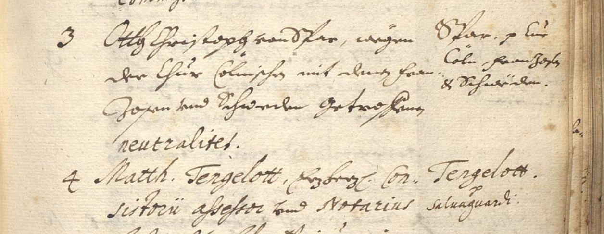

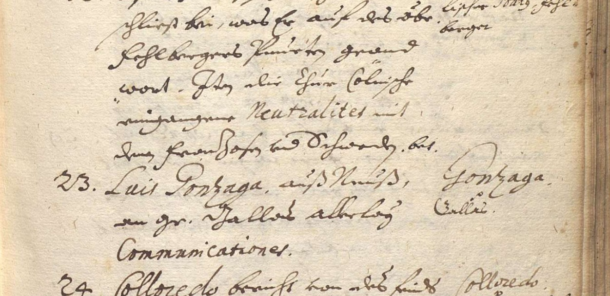

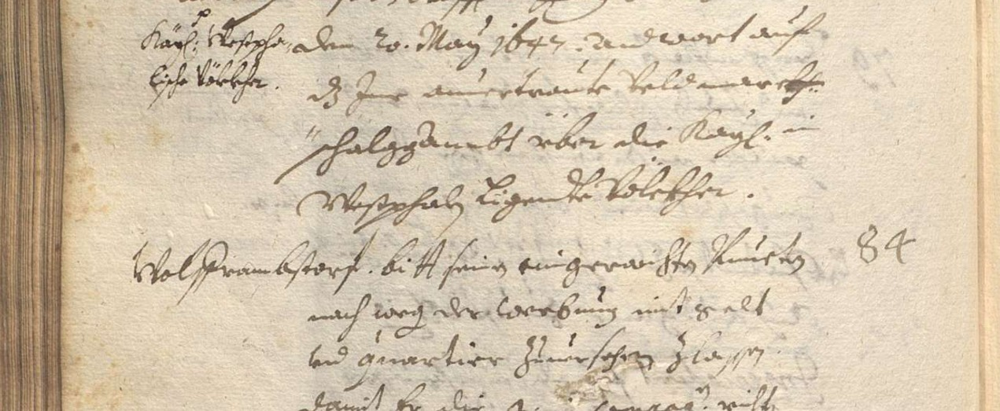

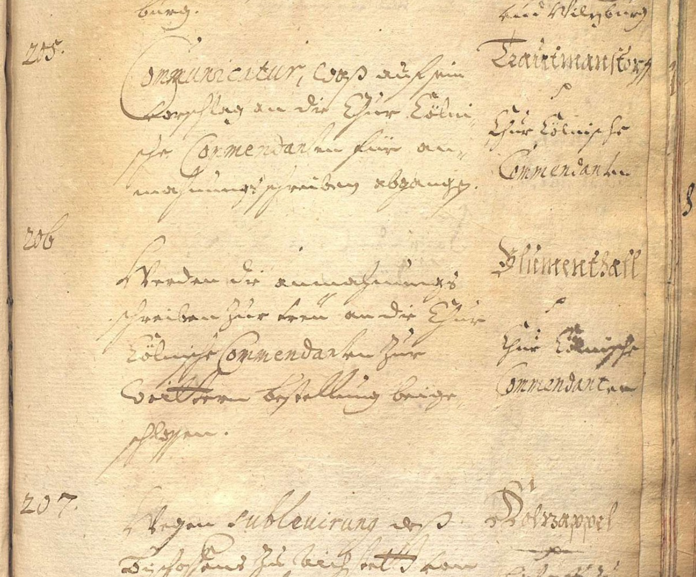

**297, f. 165v č. 32–34** zachycuje rozkaz v téže věci. „daß der Lamboy in Westphalen / commandiren solle“ a „Wurdt zum Kriegs Commendanten / in Westphalen subordinati nach / dem Graff von Holzapfel er- / …“. Lamboy má ve Vestfálsku velet pod hrabětem Holzappelem. Okraje výslovně odkazují na Lamboye v oznámeních vévodovi z Holštýnska, Blumenthalovi, Sparrovi a Waldemarovi. Jde o další skupinu než č. 90. Spolu s květnovým Expedit 296 č. 83 zápisy podávají nařízení a Lamboyovu odpověď. [F. 165v](https://library.hungaricana.hu/en/view/KA_HKR_297_1647R/?pg=124)

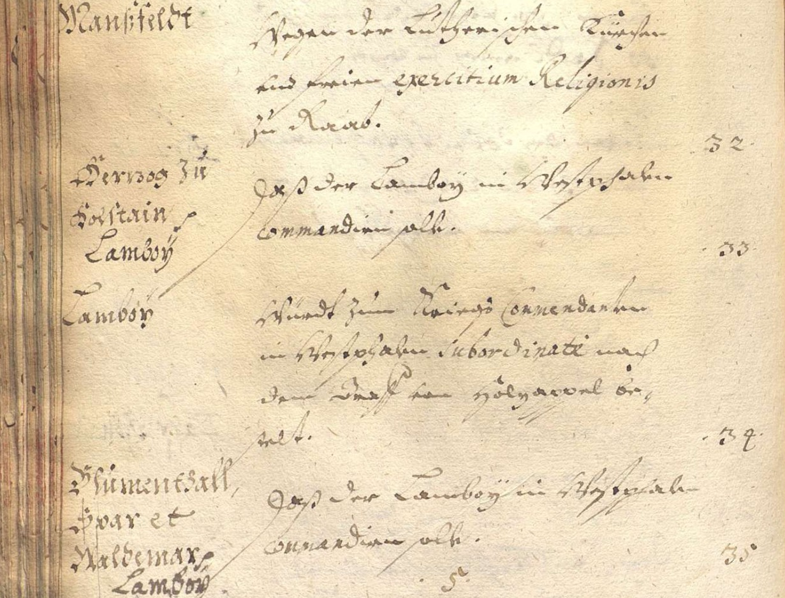

### Podobné zápisy jmen

**296, f. 178v–179r, č. 122.** Okraj pracovní čtení „Guiller“ (případně jiná iniciála). Text „Commendant zu Künigßgrez [= Königgrätz] bericht / den abgang der Mueth[?], Kriegs mu- / nition und die ersetzung täglicher / requisiten, bitt ihn zu einem bestän- / digen Commendanten alda zu bestellen / und den obr. […] über seine vier / habende Compag[nien] zu geben.“ Velitel v Hradci Králové podává zprávu o nedostatku vojenského materiálu a doplňování každodenních potřeb, žádá o potvrzení ve funkci stálého velitele a jedná o čtyřech kompaniích. Slovo před „Kriegsmunition“ a jméno či část funkce v předposledním řádku zůstávají nejisté. Iniciála v tomto zápise se musí porovnat s místním velitelem Zeillnerem, kterého má *Registratur* v rejstříku samostatně jako „Zeilner 166. + #. 210. 246. + 302.“ Dosavadní SOL-06 má v Expeditu 294, f. 316r č. 21 Andrease Wilhelma s titulem velitele v Hradci Králové. [F. 178v–179r](https://library.hungaricana.hu/en/view/KA_HKR_296_1647E/?pg=174) · [Rejstřík Zeilner](https://library.hungaricana.hu/en/view/KA_HKR_297_1647R/?pg=391) · [Expedit 294 f. 316r](https://library.hungaricana.hu/en/view/KA_HKR_294_1646E/?pg=221) · [Wurzbach: Andreas Wilhelm Zeillner](https://de.wikisource.org/wiki/BLK%C3%96:Zeillner,_Andreas_Wilhelm)

**297, 6. 5., f. 166r č. 36 a 40 a f. 166v č. 41.** U č. 40 je na okraji „Obrister / Zeilner / p Königgratz“ a na konci „wird ihm / auch der Commando zu König- / grätz confirmiret“. Plukovníku Zeillnerovi se potvrzuje velení v Hradci Králové. Zároveň jde o přidělení k městu 100 pěších a střelného prachu, o dávky pro výrobce ledku a o dlužné verbovací prostředky. Souběh funkce i městské vojenské agendy s č. 122 v Expeditu zvyšuje pravděpodobnost, že jde o téhož velitele. Čtení okrajového hesla Expeditu zůstává předběžné. Samostatná č. 36 „Wegen deß Obristen Zeilners / außständigen 2[m] fl. Werbgelder“ jmenuje Zeillnerovy dlužné 2 000 zlatých na verbování a její okraj se čte „Wrbÿ p Zeilner“. Č. 41 tuto věc opakuje směrem k české dvorské kanceláři. Vrbnova účast v této administrativě sama neurčuje Zeillnerův útvar. [F. 166r](https://library.hungaricana.hu/en/view/KA_HKR_297_1647R/?pg=124) · [F. 166v](https://library.hungaricana.hu/en/view/KA_HKR_297_1647R/?pg=125)

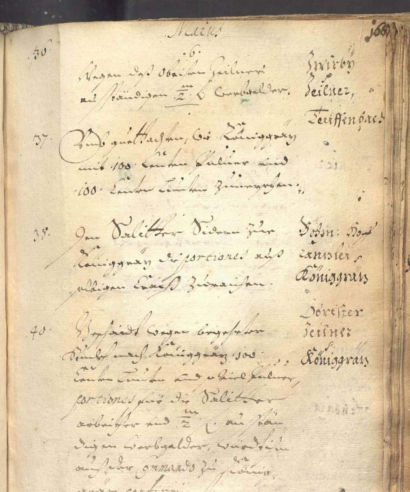

**296, f. 180r, č. 136.** „Guilieri wegen Montecuculischer / 76. dismontirten Reütter.“ Guilieri ve věci 76 Montecuccoliho jezdců bez koní. Rejstřík *Gi* odkazuje pod „Guilieri“ mimo jiné na f. 180, ale nikoli na f. 178. Tvar a předmět jsou odlišné. Údaj nelze připsat Gillerovi z 8. května. [F. 180r](https://library.hungaricana.hu/en/view/KA_HKR_296_1647E/?pg=175) · [Rejstřík Gi](https://library.hungaricana.hu/en/view/KA_HKR_296_1647E/?pg=461)

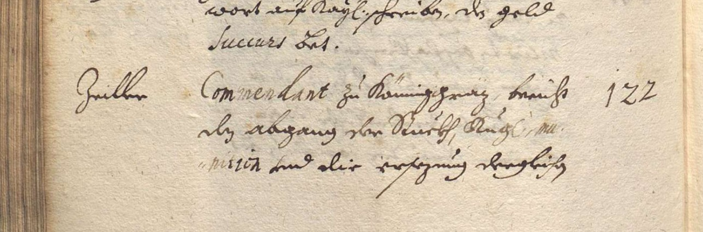

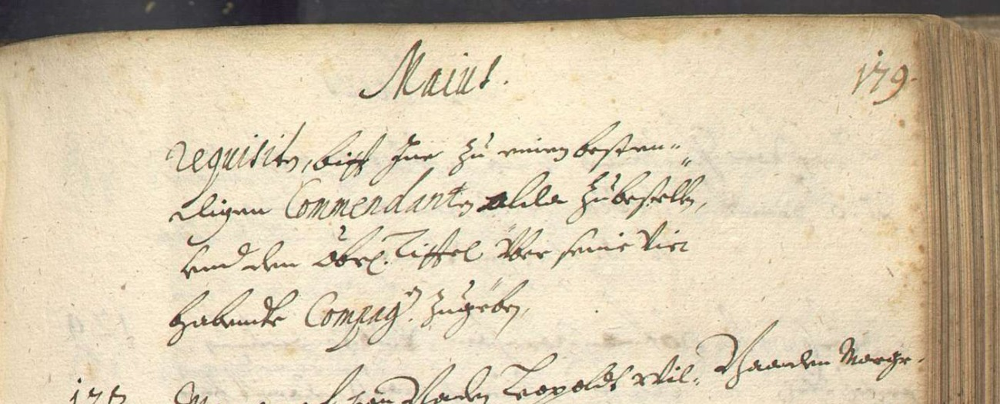

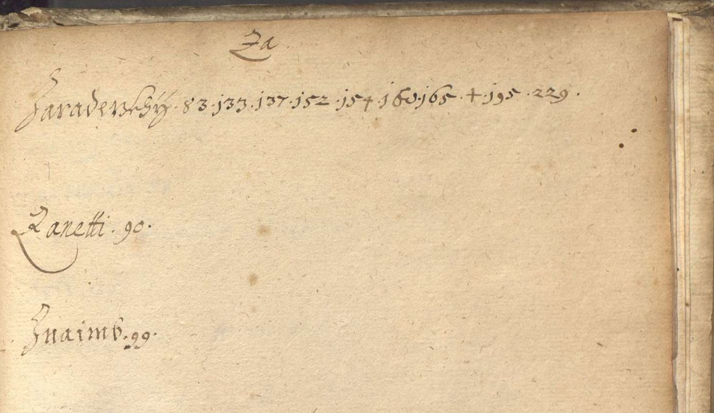

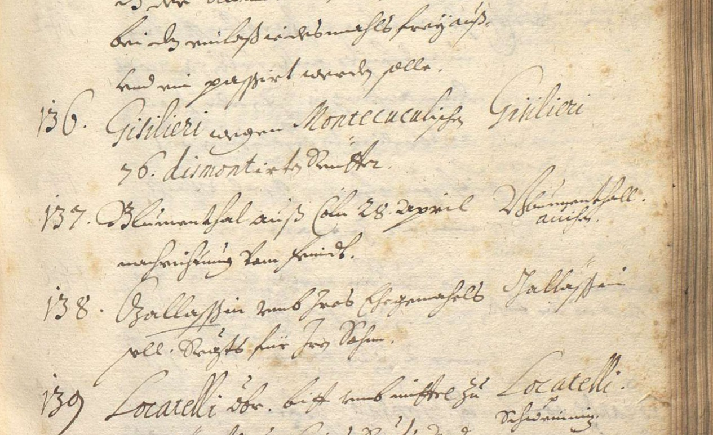

## Würben, Creutz a gallasovští muži bez koní

**297, 6. 5., f. 167r č. 47.** Rada píše Holzappelovi „Wegen der zwey Compag[nien] der / Rittmeister Henneman und / Ungar.“ Dvě kompanie rytmistrů Hennemana a Ungara. Na f. 166v č. 57 jsou oba při jednání o zimním ubytování. Oba příjmením uvádí pozdější přepis vyprávění o posílení brněnské posádky v červnu 1645 v oddílu vedeném Vrbnou. Tam jsou vedle sebe příslušníci různých útvarů včetně Vrbnovy jízdy a Gallasových dragounů, proto z toho nelze přiřadit ani jednomu rytmistrovi konkrétní pluk roku 1647. [F. 166v–167r](https://library.hungaricana.hu/en/view/KA_HKR_297_1647R/?pg=125) · [Jahrbuch Adler, s. 11](https://knihovna.archives.cz/arl-zao/en/csg/?key=9373030495&repo=zaorepo)

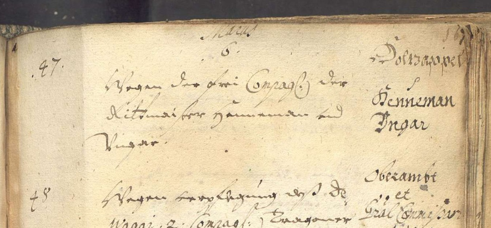

**297, 28. 8., f. 243r, č. 217.** Dobový rejstřík *Wu* odkazuje pod „Würbische Regt. 220. 243.“ na tento list. Potřísněný okraj u č. 217 nadepisuje „Puchäimb“ a níže obsahuje […] „Reitter / Gallassische dismon- / tirte […]“. Ve výtahu „antwortt auf seine relation auß / Prag wegen deß den […] / Reüttern gereichten Brott und / Habern, auch wegen der […] dismontirten. / Item wegen der Gallasischen / dismontirten […]“. Odpověď na Puchheimovo hlášení z Prahy se týká chleba a ovsa dodaných jezdcům a mužů bez koní, výslovně i gallasovských. To je přímá stopa k hospodářské agendě gallasovských mužů bez koní. Samotný výraz dismontirte neurčuje, ke kterému Gallasovu pluku patřili. Poškození brání bezpečnému spojení rejstříkového hesla *Würbische Regt.* s konkrétní formulací ve výtahu. V jednotlivých čitelných položkách f. 243r–v chybí jméno Giller či jméno würbenského podplukovníka. [Rejstřík Wu](https://library.hungaricana.hu/en/view/KA_HKR_297_1647R/?pg=389) · [F. 243r](https://library.hungaricana.hu/en/view/KA_HKR_297_1647R/?pg=203) · [F. 243v](https://library.hungaricana.hu/en/view/KA_HKR_297_1647R/?pg=204)

**297, 3. 9., f. 248v, č. 20.** „[…] den dem Obristen / von Würben assignierten Unter- / halt zu Königsberg, Hütt[?] / […] und Schwanberg […]“. Okraj „Traun […] / General Commiss. / in Böhaimb / p Würben“. Pokračuje vyřizování prostředků přidělených plukovníkovi z Vrbna. Pro čtení jednotlivých míst je třeba další srovnání. F. 249r téhož dne v č. 24 samostatně uvádí „dem Colloredo zu Ermessung[?] / der Gallassischen Dragoner / 500 fl. erlegen zu lassen“, tedy poukaz 500 zlatých pro Colloreda v záležitosti gallasovských dragounů. [F. 248v–249r](https://library.hungaricana.hu/en/view/KA_HKR_297_1647R/?pg=210)

**297, 15. 11., f. 305v–306r, č. 96–97.** „Obrister Creutz […] Intimatur daß seine dismontirte / das quartier in Schlesien haben, und / alda verpfleget werden.“ Plukovníkovi Creutzovi oznámeno, že jeho muži bez koní mají ubytování a zaopatření ve Slezsku. Druhý zápis míří na slezské generální komisaře ve věci přijetí a ubytování týchž mužů. [F. 305v–306r](https://library.hungaricana.hu/en/view/KA_HKR_297_1647R/?pg=269)

**297, 25. 11., f. 309v, č. 124–126.** V č. 124 „Creutz Obrister […] Intimatur daß sein gehabtes / Regt zum Puchhaimb und fol- / gendts in Schlesien in die Quar- / tier geschickt werden soll.“ Plukovníku Creutzovi se oznamuje, že jeho dosavadní pluk má k Puchheimovi a poté do slezských kvartýr. Následující položky oslovují generální komisaře ve Slezsku a v Čechách o převzetí a ubytování „Creuzische Regiment“. F. 319r pod 10. prosincem uvádí plukovníka z Vrbna v jedné z více stručně shrnutých agend. Tato armádní administrativa sama nedokládá chronologii Vrbna → Creutz. [F. 309v](https://library.hungaricana.hu/en/view/KA_HKR_297_1647R/?pg=274) · [F. 319r](https://library.hungaricana.hu/en/view/KA_HKR_297_1647R/?pg=281) · [297 rejstřík Ce](https://library.hungaricana.hu/en/view/KA_HKR_297_1647R/?pg=304) · [296 rejstřík Ce](https://library.hungaricana.hu/en/view/KA_HKR_296_1647E/?pg=441)

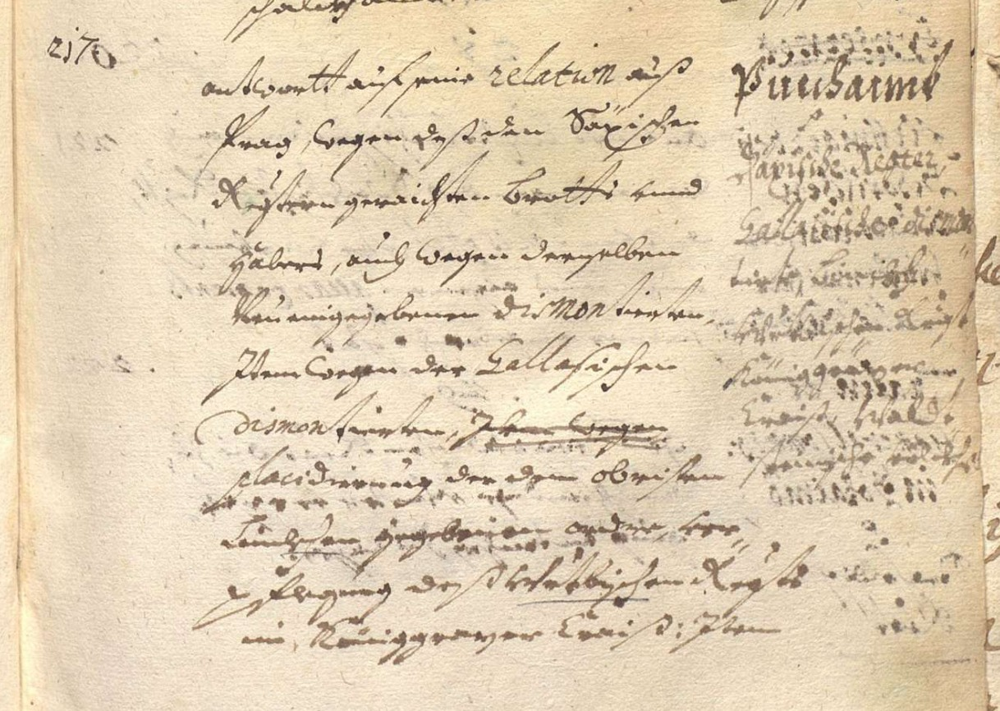

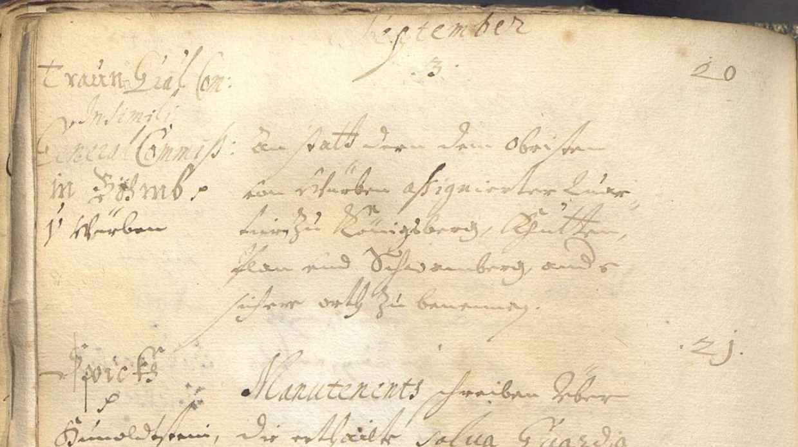

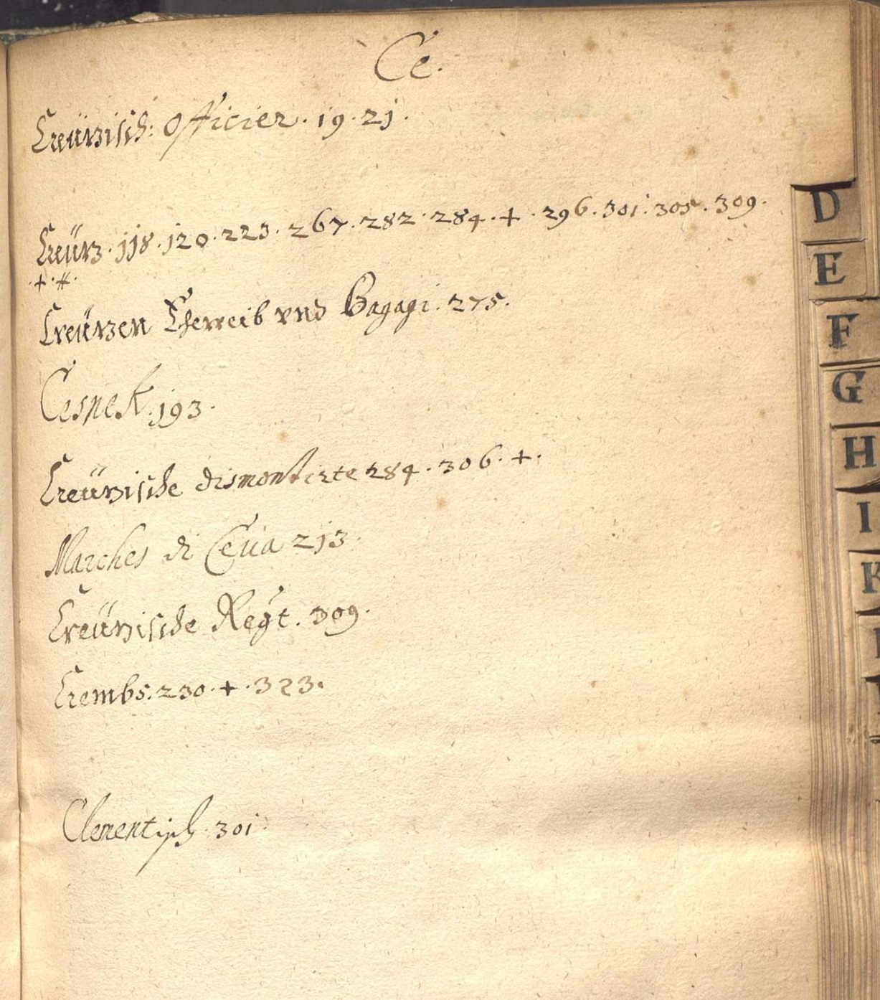

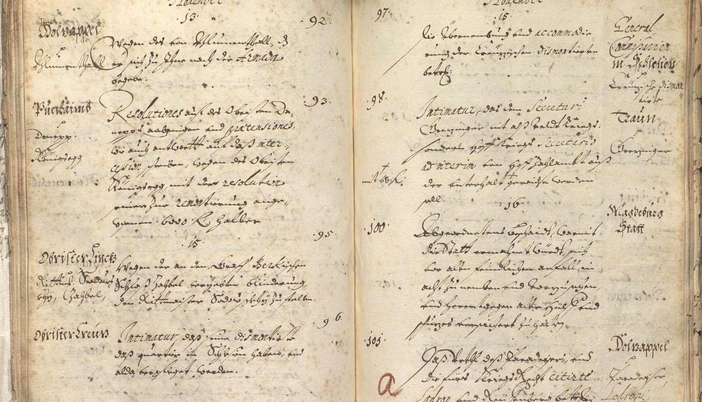

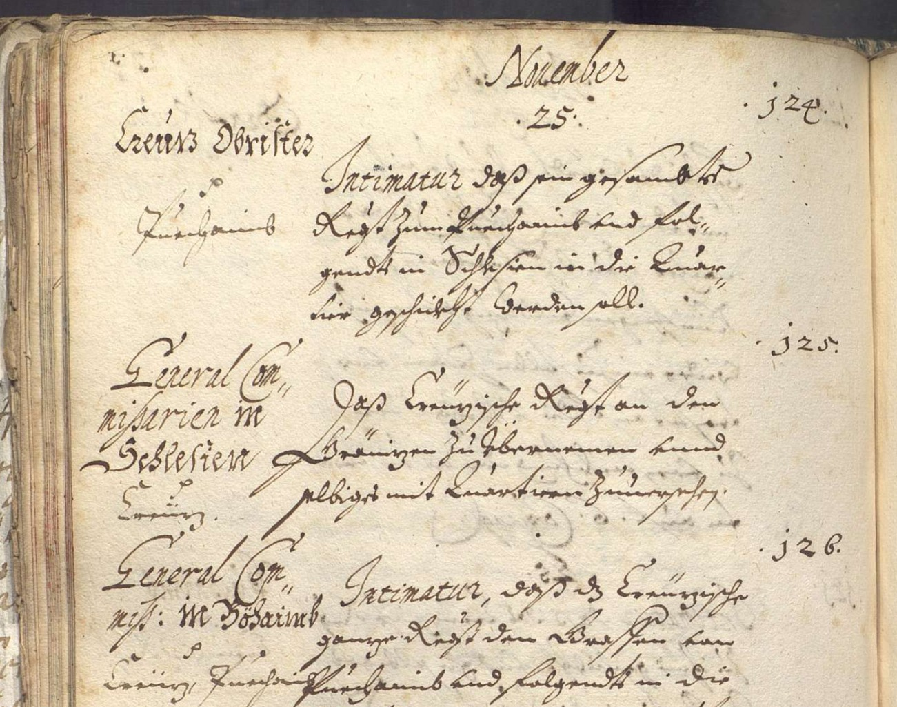

## Gallas v květnu a září

**297, f. 9r.** Okraj „Eidem / Gallass: Wittib.“ a rejstřík „Gallassisch. Wittib. 9.“. V hlavním textu „Anweisung [čtení slova nejisté] 3. Monath in L. O. der / Gallassischen Wittib.“ Jde o tříměsíční zaopatření Gallasovy vdovy, pravděpodobně v zemi nad Enží. Pod dnem 6, nadpis měsíce je světlý, patrně *Maius*. Blízký věcný protějšek **296, květen, f. 170v–171r, č. 44** „Gräfin Gallassin umb die angeschaffte adiuta / di Costa, und 3. Monathliche under- / verpflegung.“ Hraběnka Gallasová žádá o přikázanou peněžitou výpomoc (*aiuto di costa*) a tříměsíční zaopatření. [F. 9r](https://library.hungaricana.hu/en/view/KA_HKR_297_1647R/?pg=8) · [Rejstřík Ga](https://library.hungaricana.hu/en/view/KA_HKR_297_1647R/?pg=320) · [F. 170v–171r](https://library.hungaricana.hu/en/view/KA_HKR_296_1647E/?pg=166)

**297, 9. 5., f. 171v, č. 99.** Okraj „Graff Gallas / Antoni Pancratz“ a text „Wurdt seines Vatters Dra- / goner Regt conferirt.“ Hraběti Antoniu Pankrácovi Gallasovi byl udělen dragounský pluk jeho otce. Tento zápis přímo určuje jméno i původ jednotky a zpřesňuje nejisté druhé jméno v položce č. 116. [F. 171v](https://library.hungaricana.hu/en/view/KA_HKR_297_1647R/?pg=130)

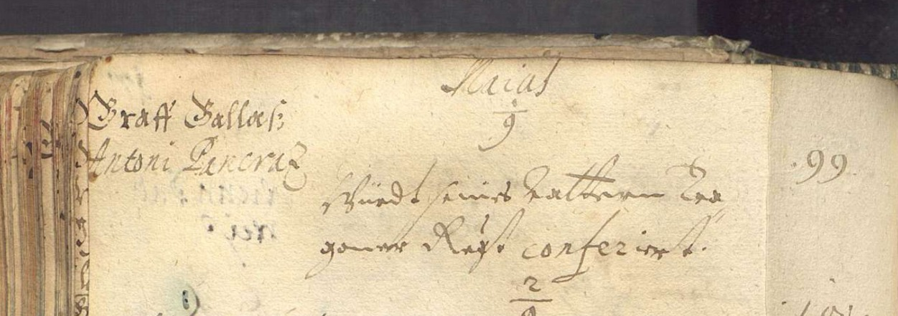

**297, 11. 5., f. 173r–v, č. 115, 116 a 119.** Pěšní a dragounští podplukovníci jsou zvlášť vyrozuměni o udělení jejich pluků dvěma Gallasovým synům. Okraj pro č. 115 „Gallasischen / Obrist Leütt. zu / fueß“, pro č. 116 „Gallasischen / Dragoner Ob- / risten Leütt.“, následně společné oznámení „daß den Galla- / sischen 2. Söhn die Regter / gegeben worden“. Ferdinand Ignác dostal pěší pluk a Antonio Pankrác dragouny. **296, f. 180r č. 138** „Gallassin umb ihres Ehegemahls / […] Regts für ihren Sohn.“ Gallasová ve věci manželova pluku pro syna. Z tohoto stručného výtahu nelze bezpečně určit který pluk. [F. 173r](https://library.hungaricana.hu/en/view/KA_HKR_297_1647R/?pg=131) · [F. 173v](https://library.hungaricana.hu/en/view/KA_HKR_297_1647R/?pg=132) · [F. 180r](https://library.hungaricana.hu/en/view/KA_HKR_296_1647E/?pg=175)

**296, září, f. 307v, č. 123.** „Graff Colloredo. […] die Musquetten für die Gallassische / Dragoner […]“. Colloredo hlásí ohledně mušket pro gallasovské dragouny. Zásobovací agenda potvrzuje samostatné označení dragounů i na podzim roku 1647. Neuvádí rytmistra. [F. 307v](https://library.hungaricana.hu/en/view/KA_HKR_296_1647E/?pg=284)

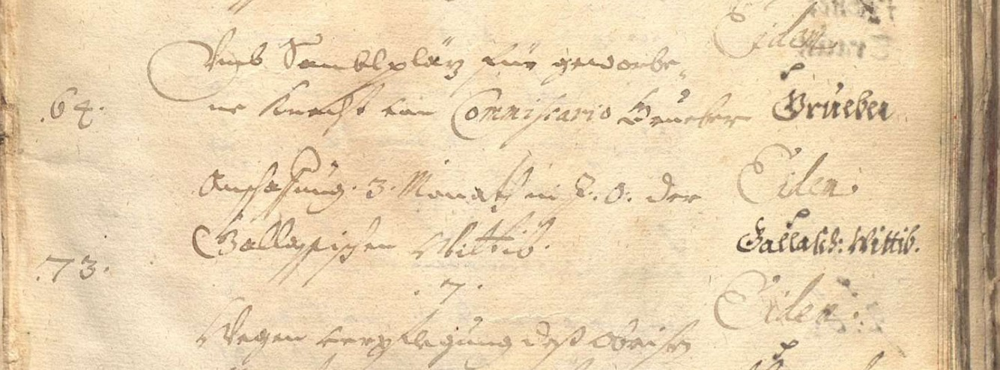

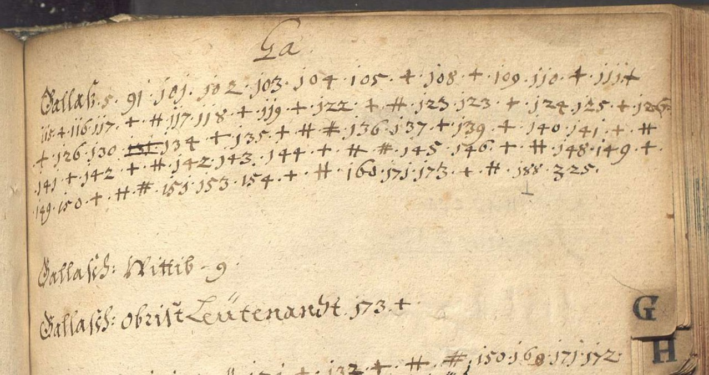

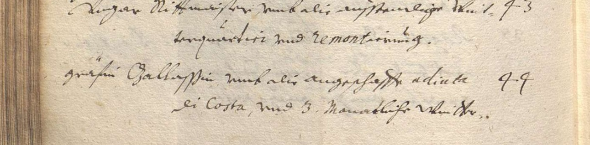

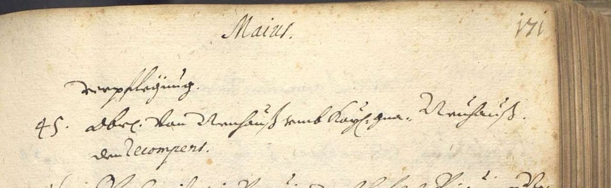

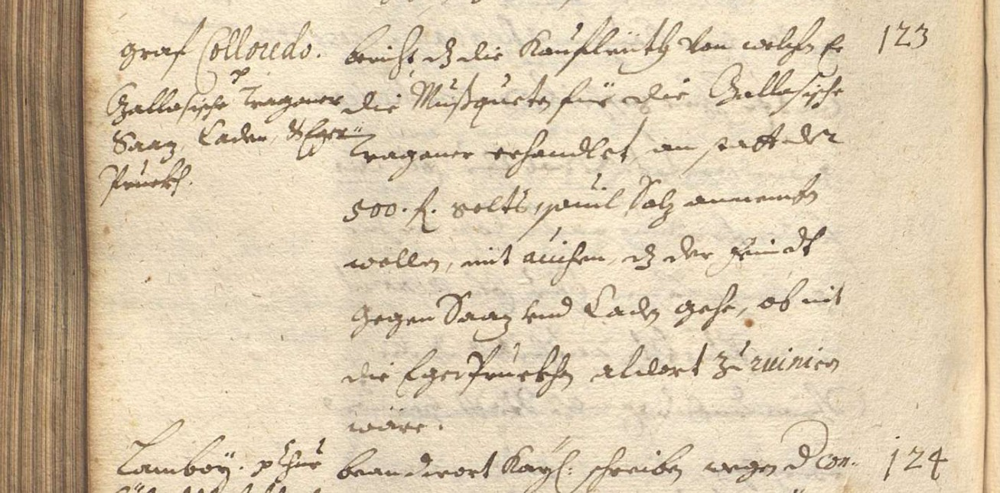

## Rozsah a meze

- V květnovém Expeditu 296 prohlédnuty kvůli jménům a obsahu okraje a vybrané relevantní texty f. 167r–194v (`pg=162–188`, květnová část končí před pravou stranou `pg=188`, kde f. 195r začíná „Junius“). Jde o průchod vedlejšími hesly a cílené čtení uvedených položek, nikoli přepis všech řádků. Témata sledována i podle kolínského rejstříku *Co*, vestfálského *We* a jmenných skupin *Gi/Gu*, *Wa/Wi* a *Ce*. [Květen](https://library.hungaricana.hu/en/view/KA_HKR_296_1647E/?pg=162) · [Začátek června](https://library.hungaricana.hu/en/view/KA_HKR_296_1647E/?pg=188) · [Co](https://library.hungaricana.hu/en/view/KA_HKR_296_1647E/?pg=443) · [We](https://library.hungaricana.hu/en/view/KA_HKR_296_1647E/?pg=527)
- V Registratuře 297 si ověřené položky a použité rejstříkové odkazy lze otevřít v oddílech výše. Další samostatná rozvedení rejstříkových odkazů Creutz a Würben zůstávají možná. Květnové výtahy neobsahují plná znění původních dopisů ani jmenné stavy pluků.
- Samostatný katalog ÖStA, HHStA, Kriegsakten in genere, vede pro 1647 kartony 125–128 (starší signatury 164–168). Detailový archivní dotaz v tomto kole vrátil HTTP 503. Přístup k doméně se podle projektové brzdy zastavil a katalogová položka z 8. května ani obraz samostatného dopisu se tímto postupem neověřily. [Katalogový strom](https://www.archivinformationsystem.at/archivplansuche.aspx?ID=4030049)
