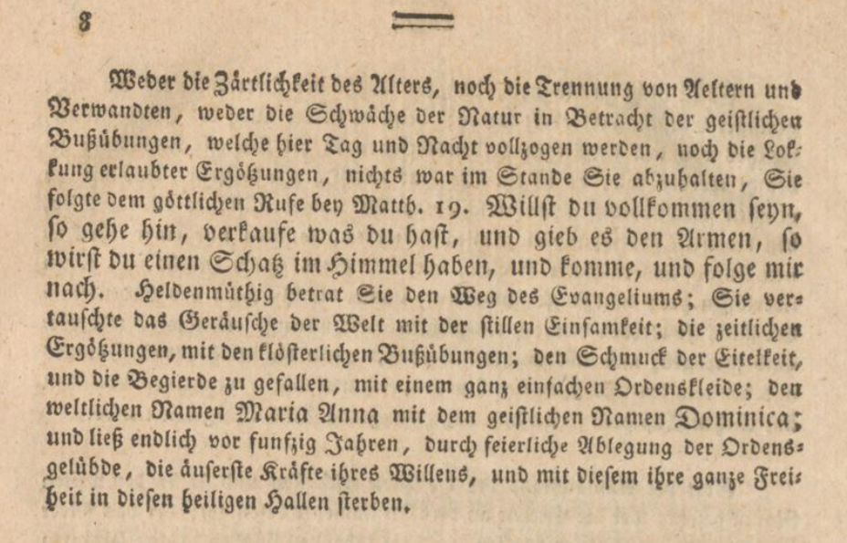
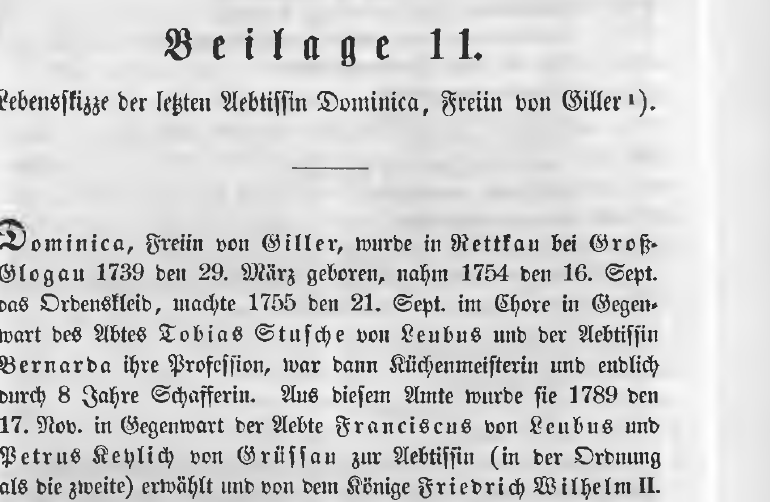
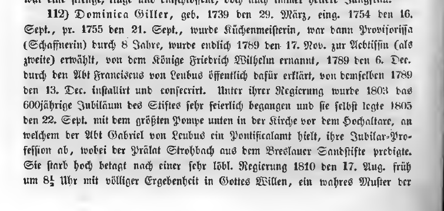
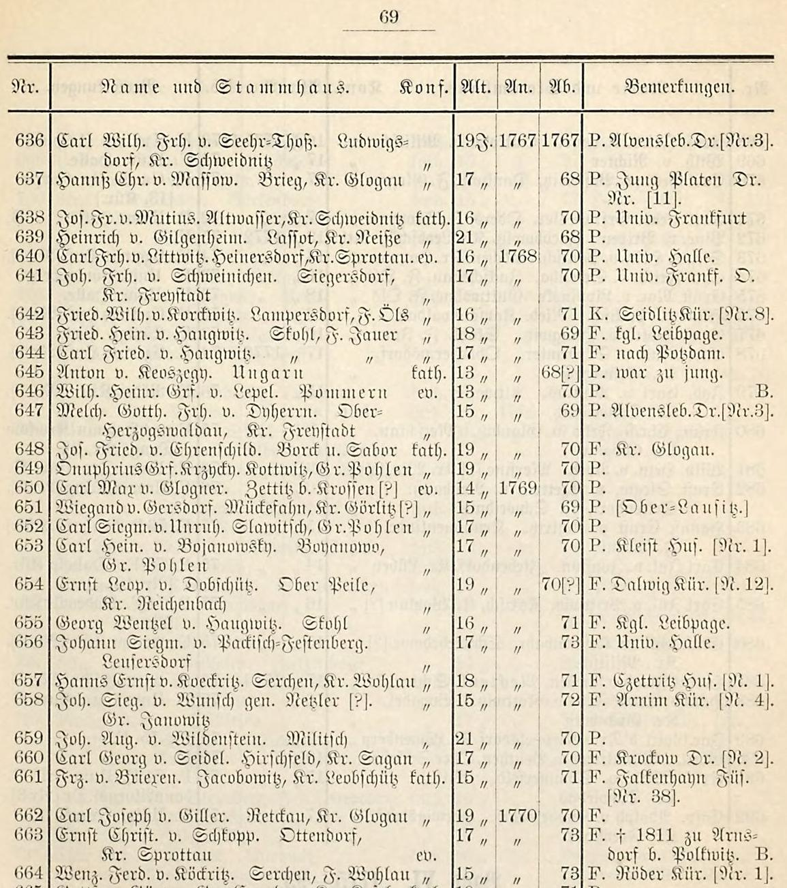
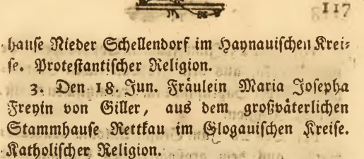

# SOL-01 · Rettkau a křest Josefa Emanuela Gillera

## Závěr

- **Doloženo.** Křty pro Grodowiec jsou evidovány od roku 1656. FamilySearch při všech pokusech místo katalogu a prohlížeče vrátil „Request unsuccessful“ (Incapsula). Státní duplikáty z fondu 89/107/0 začínají u křtů až rokem 1821. Nově je přímo v inventáři ověřen alternativní exemplář, **Staatsarchiv Leipzig, 21962, D 1420**, křty 1735–1765, obě konfese. Detail neobsahuje digitální obrazy (SOL-01-N01).
- **Doloženo v tisku.** Soudobé kázání potvrzuje světské jméno **Maria Anna** v tomto pořadí. Klášterní podklady potvrzují narození dne **29. 3. 1739 v Rettkau**, přijetí hábitu 16. 9. 1754 a profesi 21. 9. 1755. Kázání mluví o odloučení od rodičů a příbuzných bez jmen. Záznam kanovnice Marie Josefy potvrzuje její původ z dědovského rodového sídla Rettkau bez jména děda (SOL-01-N02 a N04). Jde o ověření tvrzení známých z podkladů, nikoli o nové doložení rodičů.
- **Pravděpodobné.** Devatenáctiletý katolík Carl Joseph von Giller z Rettkau, který roku 1770 nastoupil na rytířskou akademii, velmi pravděpodobně odpovídá dvouletému Carlovi, v soupisu 1752 synovi Josepha Antona na Retkau a Priedemostu. Tato shoda neumožňuje sjednotit všechny pozdější záznamy o stejnojmenném muži ani ztotožnit otce s hledaným Maximiliánem (SOL-01-N03).
- **Otevřené.** Josefův křest, rodiče a kmotři obou kontrolních osob, jejich vztah k Josefovi a přítomnost myslivce Maximiliána zůstávají neověřené. Matriční průchod je **0 snímků** (SOL-01-N01 až N04).

Srovnáno s [deníkem na revizi 7c02f35](https://github.com/jgillern/gillernrodokmen/blob/7c02f3528be438f49af80b0761b5653cdd3eee02/data/research_log.md) (zejména č. 571, 580–581, 594, 599, 605, 615) a s údaji ve [stejné revizi rodové syntézy](https://github.com/jgillern/gillernrodokmen/blob/7c02f3528be438f49af80b0761b5653cdd3eee02/data/rod_gillernu.json). Checkout byl na 7c02f35.

## SOL-01-N01 · Katolické křty Hochkirch a alternativní exemplář

18. století, farnost sv. Jana Křtitele v Hochkirch (Grodowiec, Wysoka Cerekiew), okres Glogau. [Přehled Christoph](https://www.christoph-www.de/kbsilesia3#Hochkirch) uvádí „Taufen 1656-1795, Heiraten und Tote 1656-1765 im Diözesanarchiv Breslau“ (křty 1656–1795, sňatky a úmrtí 1656–1765 v diecézním archivu ve Vratislavi). [Soupis pramenů v Leksykon artystów Śląska, sv. I, s. 51](https://wa.pwr.edu.pl/download/9dWBhIeE07IV5XHUVaBg5ZYV0dHyMjAW9RUW9PM2QeeHxbAVRvUgt8NWkfXXxGSgNJNlxCdGJbUWBARw1CS05B%2CbeAlkRKRAROEI9XRY8GxcZVwdaBCNkBA8SHW1VBlRfTHhQH0Rj/leksykon_artystow_slaska_t_1.pdf) uvádí oddíl **420 Grodowiec**, podjednotku **e** pro sňatky 1691–1765. Jde o potvrzený údaj pro sňatky, část pro křty pod touto obcí je potřeba vyžádat podle data.

**Katalog a snímky.** [FamilySearch 13158](https://www.familysearch.org/search/catalog/13158), jazyková varianta, varianta odkazu s „koha:“ a [prohlížeč s prvním číslem z přehledu](https://www.familysearch.org/search/film/006306986) vrátily blokovací stránku, nikde se neotevřel archivní obraz. [WeRelate](https://www.werelate.org/wiki/Source:Katholische_Kirche_Hochkirch._Kirchenbuch,_1656-1795) eviduje *Kirchenbuch, 1656–1795*, Breslau 1936, a řadu **FHL 6306986–6307036**. Přehled čísla nazývá „FHL film numbers“, jednotlivé datace, druh média a odpovídající DGS z něj nelze ověřit. Blokovací stránka také neukazuje, zda nosič FamilySearch vyžaduje přihlášení nebo studium v centru.

**Alternativní exemplář a místní rozsah.** V oficiálním inventáři Sächsisches Staatsarchiv, Staatsarchiv Leipzig, fond **21962 Familiengeschichtliche Sammlungen des Reichssippenamtes, Kirchenbücher**, skupina **04.12 Schlesien, Kreis Glogau**, jsem otevřel detail jednotky **D 1420** (1735–1765). Záznam doslova uvádí: „Hochkirch (ev. und kath.) — Enthält: Taufen.“ Překlad: „Hochkirch (evangelické i katolické). Obsahuje křty.“ „Benutzung im Staatsarchiv Leipzig“ znamená studium ve Státním archivu v Lipsku. Stránka nemá obrazovou záložku a veřejná metadata detailu výslovně uvádějí `digitalisatExists: false`. Jde o filmovou sbírku podle popisu fondu a Pfeiffer výslovně označuje tuto řadu za verfilmovanou. Nosič jsem fyzicky neověřil. [Přímý detail D 1420](https://www.archiv.sachsen.de/archiv/bestand.jsp?guid=738b97a9-903a-4ef4-b796-64469299c137) · [Inventární seznam skupiny](https://www.archiv.sachsen.de/digitalisate/bestandsdaten/bestaende/21962/250797.html) · [Popis filmového fondu](https://www.archiv.sachsen.de/archiv/bestand.jsp?bestandid=21962&oid=13.01&syg_id=) · [Pfeiffer, příspěvek č. 6 z 13. 2. 2010](https://forum.ahnenforschung.net/forum/thread/17224-glogau-pinqwart/).

Inventář eviduje sousední jednotky **D 1418** (1656–1690), **D 1419** (1691–1734), **D 1421** (1766–1795), všechny označené jako katolické, a dvě další katolické jednotky **D 1422–1423** (1691–1765). D 1420 je správný objednací cíl pro **obě Josefova období i obě kontroly**, včetně běžných časových přesahů. Podrobný rozpis konfesí, pořadí obcí, vnitřní mezery a folia zjistí teprve prohlídka. Zda je tatáž kopie i předlohou některé zásilky FamilySearch, z katalogů neplyne.

[Historie farnosti, s. 17](https://old.grebocice.com.pl/portal/pliki/publikacje/grodowiec.pdf#page=17) uvádí Retków v seznamu obcí farnosti sv. Jana Křtitele a na s. 18 jeho vyčlenění v únoru 1960. [Popis fondu katolických matrik Gramschütz](https://www.szukajwarchiwach.gov.pl/de/zespol/-/zespol/63158) uvádí rovněž Retków. Tyto soupisy samy neurčují přesný farní obvod pro každý hledaný rok. [Státní fond Hochkirch 89/107/0](https://www.szukajwarchiwach.gov.pl/zespol/-/zespol/63152) má křty 1821–1874 a [dostupné indexy BASIA](https://www.christoph-www.de/kbsilesia3#Hochkirch) podle přehledu jen pro vybrané ročníky 1857–1874. Volný digitální opis hledaných ročníků jsem těmito cestami neověřil. Pro tuto část jsem četl katalogové a tištěné údaje, bez obrazů hledaných matrik.

## SOL-01-N02 · Maria Anna von Giller, řeholním jménem Dominica

**29. března 1739, Rettkau u Glogau; 1754–1755, Trebnitz.** Johannes Strobach, *Rede am Jubelfeste der erneuerten Ordensgelübde … Dominica Freyin von Giller*, Breslau [1805], Zentralbibliothek Zürich, tisk, s. 7–8, PDF sn. 8–9. Rozhodující údaje na s. 8 v prvním odstavci. [Obraz](https://www.e-rara.ch/zuz/download/pdf/31254317#page=9) · [Trvalý odkaz](https://doi.org/10.3931/e-rara-143392).

> Weder die Zärtlichkeit des Alters, noch die Trennung von Aeltern und Verwandten […] den weltlichen Namen Maria Anna mit dem geistlichen Namen Dominica

„Ani útlý věk, ani odloučení od rodičů a příbuzných […] světské jméno Maria Anna [vyměnila] za řeholní jméno Dominica.“ V celém výřezu Strobach popisuje neodraditelnost rozhodnutí, výměnu světského života za život v klášteře a slavné řeholní sliby před padesáti lety. Na s. 7 připisuje vstup jejímu svobodnému povolání. V ostatních částech stojí „matka“ ve vztahu k řeholnicím. Rodiče, sourozence a rodiště tisk konkrétně nejmenuje.

První odstavec. Zmínka o odloučení je nahoře a obě jména jsou v dolní části odstavce.

Aloysius Bach, vydal August Kastner, *Geschichte und Beschreibung des fürstlichen jungfräulichen Klosterstiftes Cistercienser Ordens in Trebnitz*, 1859. Příloha 11 podle Reinolda, s. 249 a násl., PDF od sn. 267. Úvodní odstavec vysvětluje narození a rané úřady, pozn. 1 odkazuje na Reinolda a na klášterní katalog, příloha 7, č. 112. [Obraz přílohy 11](https://sbc.org.pl/Content/56157/PDF/56157.pdf#page=267) · [Obraz katalogu](https://sbc.org.pl/Content/56157/PDF/56157.pdf#page=246).

> Dominica, Freiin von Giller, wurde in Rettkau bei Groß-Glogau 1739 den 29. März geboren, nahm 1754 den 16. Sept. das Ordenskleid, machte 1755 den 21. Sept. im Chore in Gegenwart des Abtes Tobias Stusche von Leubus und der Aebtissin Bernarda ihre Profession

„Dominika, svobodná paní von Giller, se narodila v Rettkau u Velkého Hlohova dne 29. března 1739. Dne 16. září 1754 přijala řeholní roucho a 21. září 1755 vykonala na chóru řeholní profesi za přítomnosti opata Tobiáše Stuscheho z Lubiąże a abatyše Bernardy.“ Dále byla správkyní kuchyně a osm let hospodářskou správkyní. Dne 17. listopadu 1789 byla zvolena abatyší. Katalog uvádí stejná data narození, vstupu i profese a úmrtí 17. 8. 1810. Životopis v prohlédnutých stranách nejmenuje její rodiče ani rodné sourozence, Rettkau uvádí jako místo narození bez údaje o majiteli konkrétního sídla. „Geistlicher Vater“ na s. 253 znamená duchovního otce, opata Franciska z Lubiąże, který zemřel 21. 2. 1794. [Obraz s. 253](https://sbc.org.pl/Content/56157/PDF/56157.pdf#page=271).

Rodné místo, datum a údaje ke vstupu v prvním odstavci.

Položka 112 v dolní části tištěné s. 228, v prvním řádku datum narození.

**Totožnost.** Strobach jmenuje jubilující úřadující abatyši, klášterní katalog spojuje její jubilejní profesi dne 22. 9. 1805 přímo s kazatelem Strobachem. Moderní [Biographia Cisterciensis](https://zisterzienserlexikon.de/wiki/Gillern,_Dominica) podává jména v opačném pořadí, přednost má doložený tvar z tisku. Pořadí jmen v křestní matrice zůstává k ověření. Datum 29. 3. je výslovně **narození**. Doložená vazba na obec nestačí k určení rodičů, titulu otce, kmotrů ani sourozenectví s Josefem či Marií Josefou.

## SOL-01-N03 · Carl Joseph z Rettkau a syn Josepha Antona

**1770, Liegnitz (Lehnice), Carl Joseph, žák.** Georg Wendt, *Geschichte der Königlichen Ritter-Akademie zu Liegnitz*, I, 1708–1840, Liegnitz 1893, Bayerische Staatsbibliothek, sign. 4 H.lit.p. 252 gb-1887/97, s. 69, snímek bsb11494262_00069, položka 662 dole, přečten obraz tištěné edice. [Přímý obraz BSB](https://api.digitale-sammlungen.de/iiif/image/v2/bsb11494262_00069/full/1500,/0/default.jpg).

> 662 | Carl Joseph v. Giller. Rettkau, Kr. Glogau | „ | 19 „ | 1770 | 70 | F.

„Carl Joseph von Giller. Rodové sídlo Rettkau v okrese Glogau. Katolík (opakování údaje z ř. 661), 19 let. Nástup 1770, odchod 1770. Poznámka: F.“ Věk a údaj o sídle samy neudávají datum nebo místo křtu.

Číslo 662 dole. O řádek výš je výslovně „kath.“, v řádku 662 jsou opakovací čárky.

**1752, knížectví Glogau.** Małgorzata Konopnicka, *Szlachta dawnego księstwa głogowskiego według tablic wasalnych z 1752 r.*, Studia Zachodnie 14 (2012), s. 292, PDF sn. 6. Edice tabulí, Archiwum Państwowe we Wrocławiu, *Personalia, nobilitacje, inkolaty, tabele lenników*, rep. 47, sygn. 11, podle pozn. 7 na s. 287. Přečten text digitální edice prostřednictvím indexu. Přímé stažení obrazu v tomto sezení skončilo chybou, výřez k této části nepřikládám. [Edice s. 292](https://zbc.uz.zgora.pl/Content/58371/16_konopnicka_szlachta.pdf#page=6) · [Katalog vydání](https://zbc.uz.zgora.pl/repozytorium/dlibra/publication/64981/edition/58371?language=en).

> Frhl v. Giller Joseph Anton, geb. 1720, D: Retkau und Priedemost. S: Carl 2 J.,

„Svobodný pán Joseph Anton von Giller, narozen 1720, statky Retkau a Priedemost. Syn Carl, 2 roky.“

**Totožnost.** „Carl“ ze soupisu a Carl Joseph ze školy mají silnou shodu ve věku (cca 1750, resp. 1750/51), jméně a stejném Rettkau. Obraz školy poskytuje samostatné ověření a má nejpřesnější formulaci „rodové sídlo“. [Deník č. 580–581 a 599](https://github.com/jgillern/gillernrodokmen/blob/7c02f3528be438f49af80b0761b5653cdd3eee02/data/research_log.md) uvádí i stejnojmenného ženicha z roku 1785 v Groß Karlowitz, z indexu čtyřicetiletého, se jménem otce Joseph Anton. Věk by směřoval k roku 1744/45 a vyžaduje originál nebo jiné nezávislé propojení. Také narození 1720 u otce v edici je v rozporu s rokem 1710 u stejnojmenného křtěnce v Preichau podle deníku č. 599. Carl z této úlohy je proto konkrétní kandidát ke kontrole, nikoli podklad pro automatické přepsání celého profilu. Prameny mu nepřisuzují otce jménem Maximilian ani otce myslivce.

## SOL-01-N04 · Kanovnice Maria Josepha von Giller z dědovského sídla

**18. 6. 1790, Barschau (dnes Barszów).** *Schlesische Provinzialblätter*, únor 1792, s. 116–117, PDF sn. 20–21, kopie Śląska Biblioteka Cyfrowa. Na s. 116 je datace založení 16. června 1790 a záhlaví seznamu kanovnic podle pořadí udělení řádového kříže. Záznam č. 3 je nahoře na následující straně. [Obraz tisku](https://sbc.org.pl/Content/3255/PDF/i4002-1792-02-0001.pdf#page=21).

> 3. Den 18. Jun. Fräulein Maria Josepha Freyin von Giller, aus dem großväterlichen Stammhause Rettkau im Glogauischen Kreise. Katholischer Religion.

„3. Dne 18. června slečna Maria Josepha, svobodná paní von Giller, z dědovského rodového sídla Rettkau v hlohovském okrese. Katolického vyznání.“

Horní část s. 117, od číslovky 3 po údaj o vyznání. Sídlo patřilo k její rodové identifikaci přes generaci děda. Jméno děda a příbuzenský vztah k abatyši, Carlovi nebo Maximiliánovi zde nejsou. Bez dalšího pramene nelze přiřadit jako vnučku konkrétnímu jednotlivci.

## Tabulka prohledaného

| Pramen a obec | Typ záznamu | Data a snímky od–do | Způsob čtení | Výsledek a mezery |
|---|---|---|---|---|
| FamilySearch 13158, Hochkirch a Rettkau | Katolické křty | Březen–duben 1739, 3. 2. 1746–2. 2. 1747, 13. 6. 1737–12. 6. 1738, 1749–1751; 0 snímků | Nepřístupný katalog a prohlížeč | Žádný interval neprošel. Přesah i další roky před 1750 zbývají |
| Christoph, WeRelate, Leipzig 21962, zpráva F. Pfeiffera | Průvodce a evidence | Jádro 1656–1795; žádné obrazy matrik | Text a katalog | Identifikován alternativní křestní díl 1735–1765. Bez ověření foliací a řazení obcí |
| Szukaj w Archiwach, Grodowiec 89/107/0 a Grębocice (soubor 63158), přehled BASIA | Duplikáty, přehled indexu | Křty Hochkirch od 1821; žádné přečtené matriční snímky | Obsah fondů a seznam let | Pro okna zadaná pro Hochkirch bez pokrytí. Samostatný úkol Gramschütz zde nepokrývám |
| Strobach, Trebnitz | Jubilejní kázání | 1805, PDF sn. 2–17, rozhodující sn. 8–9 | Textový průchod, klíčový snímek ověřen obrazem | Maria Anna a obecná zmínka o rodičích a příbuzných |
| Bach / Reinold, Trebnitz a Rettkau | Klášterní katalog a životopis | PDF sn. 246 a 267–292, životopisné pasáže a následující oddíl | Textový průchod, rozhodující odstavce ze sn. 246 a 267 ověřeny obrazem | Datum a místo narození, vstup, profese. Žádná identifikace pokrevní rodiny |
| Wendt, Liegnitz a Rettkau; Konopnicka, Retkau a Priedemost | Školní seznam a soupis leníků | 1770, sn. bsb11494262_00069; 1752, PDF sn. 6 | Výběr strany, u školy obraz, u soupisu text edice | Věk, sídlo a pravděpodobné propojení. Matriční zápis otevřený |
| Schlesische Provinzialblätter, Barschau a Rettkau | Seznam kanovnic | 1790, vydáno 1792, PDF sn. 20–21 | Výběr dvou stran, obraz položky č. 3 | Dědovské rodové sídlo Marie Josefy doloženo, děd nejmenován |

## Co převzít a kde navázat

**Do deníku.** „Hochkirch, katolické křty: FamilySearch 13158 v daném sezení blokován ještě před zobrazením katalogu a prohlížeče, přečteno 0 snímků. Evidovány FHL 6306986–6307036 podle WeRelate. Alternativní cesta Staatsarchiv Leipzig 21962, D 1420, Hochkirch 1735–1765 (SOL-01-N01). Potvrzeno Maria Anna (* 29. 3. 1739 v Rettkau), řeholní Dominica, rodiče a kmotři otevřeni (N02). Školní Carl Joseph z Rettkau je velmi pravděpodobně Carl, syn Josepha Antona na Retkau a Priedemostu, datum křtu otevřeno a totožnost s ženichem 1785 vyžaduje kontrolu (N03). Maria Josepha z Barschau má doložen dědovský původ ze sídla Rettkau bez určeného děda (N04).“

**První zbývající kniha.** Hochkirch, StA-L 21962, D 1420, díl křtů 1735–1765. Začít posledním březnovým týdnem a prvními dubnovými dny 1739, poté dočíst březen a duben. V témže dílu postupně ověřit 3. 2. 1746–2. 2. 1747 a 13. 6. 1737–12. 6. 1738, vždy s krátkým přesahem. Závěrem projít 1749–1751 kvůli Carlovi. Pro evidenci uvést skutečná folia, všechny zjištěné mezery a rubriky obcí či vyznání. Vedle konkrétního data a jména je u Josefa rozhodující jméno a povolání otce, u obou kontrolních zápisů rodiče, titul, sídlo a kmotři. Pro Vratislav uvést ve vyhledání **Grodowiec, oddíl 420, księga chrztów pokrywająca lata 1737–1751**, a vyžádat identifikátor podjednotky. Pokud by se ukázalo, že Rettkau není v těchto letech v zápisech Hochkirch vůbec přítomno, zkontrolovat farní rozdělení se SOL-02.
