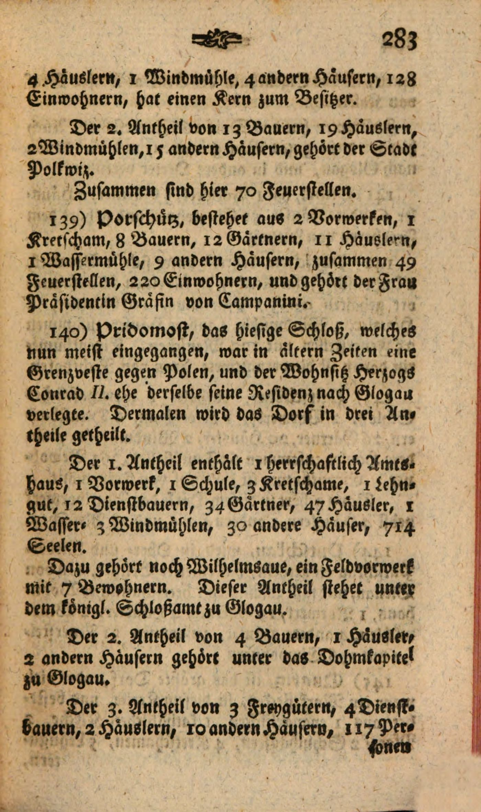
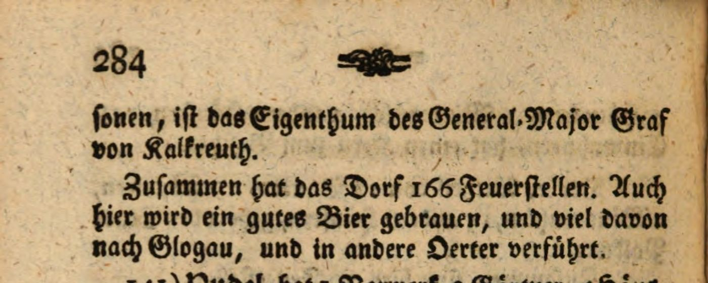

# SOL-02 · Priedemost u Hlohova

## Závěr

- **Doloženo katalogy.** Archiwum Państwowe w Zielonej Górze přiřazuje Priedemost ke Gramschützu u obou konfesí. BaSIA uvádí ves přímo v názvu jednotky 10. FamilySearch navíc eviduje alternativní filmy **890948** pro roky 1716–1725 a **890949** pro roky 1726–1741. Pro rok 1746 má vedle delší řady křtů i výslovně evangelickou řadu **1202296**. To zpřesňuje deník č. 594 a 599, kde v katalogu nebyla kniha pod názvem samotné vsi. Titulní listy ani oddíly na obraze se nepodařilo ověřit (SOL-02-N01).
- **Ověřeno v edici.** Pruská tabulka je datována 1752 a při statcích Retkau a Priedemost uvádí Josepha Antona, narozeného podle tabulky roku 1720, a syna Carla ve věku dvou let. Tato kontrola opakuje výsledek předchozí revize a dokládá držbu už roku 1752 vedle údaje k roku 1757 v profilu. Přibližný rok narození Carla 1750 je bližší odhadu z úmrtního oznámení než věku při sňatku. Shoda Carla s Carlem Josephem z profilu je pravděpodobná, totožnost držitele s křtěncem z Preichau z roku 1710 zůstává otevřená (SOL-02-N02).
- **Nově z obrazu dobového tisku.** Zimmermann roku 1791 rozlišuje tři díly vsi a jmenuje soukromého držitele třetího dílu, generálmajora hraběte von Kalkreuth. Tím zpřesňuje místní tradici o posloupnosti držitelů a dává vodítko k převodním listinám. Samotný převod od Gillernů ani jejich bydliště z něj určit nelze (SOL-02-N03).
- **Otevřeno.** Křest Josefa/Emanuela, syna Maximiliána, i možný křest držitele Josepha Antona kolem 1720 zůstávají neprověřeny. Žádný ze tří cílových intervalů se nepodařilo souvisle číst. Priedemost proto zůstává mezi místy k prověření (SOL-02-N01, N02).

Východisko tvořil [stav rodokmenu 7c02f35](https://github.com/jgillern/gillernrodokmen/tree/7c02f3528be438f49af80b0761b5653cdd3eee02), zvláště [deník č. 580, 594, 599 a 605](https://github.com/jgillern/gillernrodokmen/blob/7c02f3528be438f49af80b0761b5653cdd3eee02/data/research_log.md) a [profily Josepha Antona a Carla Josepha](https://github.com/jgillern/gillernrodokmen/blob/7c02f3528be438f49af80b0761b5653cdd3eee02/data/rod_gillernu.json#L1659). Podle dosavadních českých opisů je v Poděbradech 12. 6. 1786 ženich Josef de Giller katolík, syn Maxmiliána de Giller, nadlesního, ve věku 48 let. Býchorský úmrtní zápis 2. 2. 1799 přisuzuje katolickému myslivci Josefovi věk 52 let. Obě okna předpokládají přesný věk v dokončených letech. Záznamy jsou referenční, přepisy v tomto úkolu znovu nereviduji. [Poděbrady 33, f. 4, třetí zápis](https://ebadatelna.soapraha.cz/d/11863/7) · [Ovčáry 14, f. 10](https://ebadatelna.soapraha.cz/d/10801/8).

## Nálezy

### SOL-02-N01 · Kam patří Priedemost a pod kterými čísly hledat

**Pramen.** Archiwum Państwowe w Zielonej Górze, fond 89/113/0, popis fondu a katalogové záznamy BaSIA. Četl jsem katalogové popisy. Archivní portál u obou přímých jednotek a v kartách seznamu jednotek a skenů fondu hlásil nedostupný portlet. Přímé načtení polské a anglické varianty jednotky vrátilo ochrannou stránku bez obrazů. BaSIA odkazuje zpět na stejné jednotky. Proto chybí folio, snímek, matriční titulní list a potvrzení vnitřní struktury. [Popis fondu](https://www.szukajwarchiwach.gov.pl/en/zespol?_Zespol_id_zespolu=63158&_Zespol_javax.portlet.action=zmienWidok&p_p_id=Zespol&p_p_lifecycle=1&p_p_mode=view&p_p_state=normal) · [Jednotka 10](https://www.szukajwarchiwach.gov.pl/jednostka/-/jednostka/6659983) · [Jednotka 12](https://www.szukajwarchiwach.gov.pl/jednostka/-/jednostka/6659985) · [BaSIA, soupis svazků](https://basia.famula.pl/skany.php?lang=&placeid=527).

**Katalogové znění a překlad.** U 89/113/0/-/10 je v BaSIA „Allgemeines Tauff Buch darinnen zu finden sindt alle, welche ab Anno 1716 in diesem Kirchspiel getauftet worden seindt nehmlich zu Gramschütz und Priedmost“ („Všeobecná kniha křtů všech, kdo byli od roku 1716 pokřtěni v tomto farním obvodu, totiž v Gramschützu a Priedmostu“). Soupis uvádí dvě řady mezních dat 2. 1. 1716–5. 12. 1725 a 6. 1. 1716–25. 11. 1725. U 89/113/0/-/12 je pouze „Tauf und Traubuch“ („Kniha křtů a oddavek“), křty katalogově od roku 1735 do 29. 12. 1741, oddavky 11. 10. 1735–2. 11. 1741. Tištěné katalogové datum „29.02.1735“ je kalendářně nemožné a vyžaduje kontrolu obrazu. Z mezních dat samotných nelze určit, která část patří ke které obci nebo konfesi.

**Náhradní verze.** FamilySearch Library, *Kirchenbuch, 1585–1797*, katalog 325630, původci katolická a evangelická církev Gramschütz. Četl jsem katalogový index. Podle poznámky byly pozdější filmy pořízeny z rukopisů v Archiwum Archidiecezjalne ve Vratislavi. Přímý obrazový katalog na www.familysearch.org a pokus o otevření filmu 1202294 vrátily HTTP 403. Záznam Library v dostupném indexu uvádí klasická čísla mikrofilmů a následující obsah. DGS a čísla jednotlivých obrazů se nepodařilo ověřit. [Katalog FamilySearch Library](https://libcat.familysearch.org/Record/325630) · [Obrazový katalog](https://www.familysearch.org/search/catalog/325630) · [Plán indexací Geneteka, heslo Grębocice-Gramschütz](https://geneteka.genealodzy.pl/plany.php?sort=woj).

| Mikrofilm | Katalog a význam |
|---|---|
| 890948 | „Taufen, Heiraten (Mit Evang.) 1716-1725“ – křty a oddavky s evangelickými zápisy. Alternativa k roku 1720 vedle jednotky 10. |
| 890949 | „Taufen, Heiraten 1726-1741“ – křty a oddavky. Alternativa ke křtům 1737–1738 vedle jednotky 12. |
| 1202294 | První oddíl „Taufen (r. & l. S.) 1719-1765“ – křty 1719–1765. Katalog u tohoto oddílu výslovně nepřipojuje označení „Evang.“, je však společný pro smíšeně popsaný soubor, takže skutečnou strukturu a pokrytí obcí je třeba ověřit na filmu. |
| 1538820, položky 3–12 | Mezi více oddíly „Taufen 1654-1765“ – křty 1654–1765. Číslo konkrétní položky v rámci skupiny neověřeno. |
| 1202296 | „Taufen, Heiraten (Evang.) 1716-1753“ – křty a oddavky výslovně evangelické, jako doplňková řada také pro rok 1746. |

Samostatný fond evangelické farnosti Grębocice 89/1242/0 začíná rokem 1754, má šest jednotek a v popisu má materiály k dějinám farnosti a pozdější smíšené sňatky. Cílový rok 1746 tedy nepokrývá. Plán indexací Geneteka odkazuje pro starší křty na vratislavský diecézní archiv a sám neposkytuje zápisy. [Fond 89/1242/0](https://www.szukajwarchiwach.gov.pl/en/zespol?_Zespol_id_zespolu=64417&_Zespol_javax.portlet.action=zmienWidok&p_p_id=Zespol&p_p_lifecycle=1&p_p_mode=view&p_p_state=normal).

### SOL-02-N02 · Joseph Anton a dvouletý Carl v pruské tabulce

**Rok 1752, hlohovský okres.** Joseph Anton, svobodný pán von Giller, majitel statků Retkau a Priedemost. Carl, syn. Archiwum Państwowe we Wrocławiu, *Personalia, nobilitacje, inkolaty, tabele lenników*, rep. 47, sign. 11 (podle edice). Čteno z textové vrstvy edice Małgorzaty Konopnické *Szlachta dawnego księstwa głogowskiego…*, s. 292, PDF s. 6, oddíl „Glogauscher Creiß“, mezi Gersdorffem a Glaubitzem. Obraz PDF se přímo nenačetl, stažení i snímek stránky skončily vypršením spojení. Originální folio se proto nepodařilo určit. [Edice, s. 292](https://zbc.uz.zgora.pl/Content/58371/16_konopnicka_szlachta.pdf#page=6).

> Frhl v. Giller Joseph Anton, geb. 1720, D: Retkau und Priedemost.\
> S: Carl 2 J.,

„Svobodný pán von Giller Joseph Anton, narozen 1720, statky Retkau a Priedemost. Syn Carl, 2 roky.“

**Totožnost.** Titul, jméno a statky umožňují srovnat tohoto držitele s Josephem Antonem později spojovaným s Priedemostem a s otcem ženicha Carla Josepha v roce 1785. Carlovi by podle roku 1752 připadal přibližný rok narození 1750. Profil Carla Josepha udává podle sňatku asi 1745 a podle úmrtního oznámení asi 1751. Věk při sňatku a úmrtí je třeba chápat jako samostatné údaje. Deník č. 599 zaznamenává v Preichau křest **Josephus Antonius Leopoldus**, 6. 9. 1710, syn Johanna Christopha von Giller a Marie Marthy, DGS 8218293 v širším průchodu na snímcích 316–543. V tomto úkolu obraz křtu ověřen nebyl a jeho přesná pozice nebyla určena. Desetiletý rozpor může ukazovat na chybu pruského soupisu nebo na jmenovce. U českého Josefa se jako otec uvádí Maximilián, odlišný identifikační údaj. [Deník a profil](https://github.com/jgillern/gillernrodokmen/blob/7c02f3528be438f49af80b0761b5653cdd3eee02/data/rod_gillernu.json#L1659) · [Předchozí revize](../vychozi_revize.md).

### SOL-02-N03 · Tři díly Priedemostu v místopisu z roku 1791

**Rok vydání 1791, Pridomost u Hlohova.** Friedrich Albert Zimmermann, *Beyträge zur Beschreibung von Schlesien*, sv. 10, Brieg, s. 283–284, heslo č. 140, v dolní části s. 283 a nahoře na s. 284. Bayerische Staatsbibliothek, Bor. 206 zh-10, bsb10014533, snímky 0287–0288. Čteno z obrazů dobového tisku. Generalmajor Graf von Kalkreuth držel třetí díl, další dva spravoval královský zámecký úřad a hlohovská dómská kapitula. [Snímek 0287](https://api.digitale-sammlungen.de/iiif/image/v2/bsb10014533_00287/full/1400,/0/default.jpg) · [Snímek 0288](https://api.digitale-sammlungen.de/iiif/image/v2/bsb10014533_00288/full/1400,/0/default.jpg).

**Přepis hesla č. 140** (dlouhé ſ jako s, spojena slova dělená na konci řádků):

> 140) Pridomost, das hiesige Schloß, welches nun meist eingegangen, war in ältern Zeiten eine Grenzveste gegen Polen, und der Wohnsitz Herzogs Conrad II. ehe derselbe seine Residenz nach Glogau verlegte. Dermalen wird das Dorf in drei Antheile getheilt.\
> Der 1. Antheil enthält 1 herrschaftlich Amtshaus, 1 Vorwerk, 1 Schule, 3 Kretschame, 1 Lehngut, 12 Dienstbauern, 34 Gärtner, 47 Häusler, 1 Wasser- 3 Windmühlen, 30 andere Häuser, 714 Seelen. Dazu gehört noch Wilhelmsaue, ein Feldvorwerk mit 7 Bewohnern. Dieser Antheil stehet unter dem königl. Schloßamt zu Glogau.\
> Der 2. Antheil von 4 Bauern, 1 Häusler, 2 andern Häusern gehört unter das Dohmkapitel zu Glogau.\
> Der 3. Antheil von 3 Freygütern, 4 Dienstbauern, 2 Häuslern, 10 andern Häusern, 117 Personen, ist das Eigenthum des General-Major Graf von Kalkreuth.\
> Zusammen hat das Dorf 166 Feuerstellen. Auch hier wird ein gutes Bier gebrauen, und viel davon nach Glogau, und in andere Oerter verführt.

**Překlad.** Z velké části zaniklý zámek v Pridomostu býval pohraniční pevností proti Polsku a sídlem vévody Konráda II., než přenesl svou rezidenci do Hlohova. Vesnice je nyní rozdělena na tři díly. První zahrnuje panský úřední dům, dvůr, školu, tři krčmy, lenní statek, 12 robotních sedláků, 34 zahradníků, 47 domkářů, vodní mlýn, tři větrné mlýny a 30 dalších domů, celkem 714 duší. Patří k němu též polní dvůr Wilhelmsaue se sedmi obyvateli. Tento díl podléhá královskému zámeckému úřadu v Hlohově. Druhý díl, zahrnující čtyři sedláky, jednoho domkáře a dva další domy, podléhá hlohovské dómské kapitule. Třetí díl se třemi svobodnými statky, čtyřmi robotními sedláky, dvěma domkáři, deseti dalšími domy a 117 osobami je majetkem generálmajora hraběte von Kalkreuth. Celá ves má 166 ohnišť. Vaří se zde dobré pivo a mnoho se jej vyváží do Hlohova a jinam.

Heslo č. 140 začíná pod Porschützem přibližně ve dvou pětinách stránky. Třetí díl je dole.

Dokončení věty o soukromém držiteli je pod číslem strany, před heslem č. 141.

**Souvislost s Gillerny.** [Místní tradice citovaná v hesle Przedmoście](https://de.wikipedia.org/wiki/Przedmo%C5%9Bcie_(G%C5%82og%C3%B3w)) uvádí po ovdovělé Marii Franzisce von Gillern, rozené Osteschau (1765), Friedricha Adolfa von Kalckreuth (1784). Zimmermann v roce 1791 potvrzuje příjmení soukromého držitele, zároveň určuje jeho díl a neuvádí, kdo jej dříve vlastnil nebo kdo mu jej převedl. Pro případnou kupní smlouvu, poručenský spis nebo soupis dědiců má smysl hledat výslovně **soukromý díl** a oba rody přibližně mezi 1765 a 1784. Přehled literatury uvádí A. Hennig, *Priedemost. Ort und Landschaft*, 1984, s. 159–169 a Kwaśny–Wosch, soupisy slezských vesnic kolem 1765. Podařilo se ověřit odkazy na ně, obraz jmenovitého převodu ani matriční edici se při tomto hledání nepodařilo najít. Pro starší držbu lze prověřit rovněž tištěnou edici Kuczera a Strzyżewského *Spisy dóbr ziemskich księstwa głogowskiego z lat 1671–1727*. [Bibliografie Glogopedie](https://www.glogow.pl/ezg/index.php/Przedmo%C5%9Bcie) · [Edice starších majetkových soupisů](https://dig.pl/index.php?id=327&rodz=12&s=wyniki).

## Tabulka prohledaného

| Pramen a obec | Typ | Data a snímky od–do | Způsob | Výsledek a mezery |
|---|---|---|---|---|
| Gramschütz/Priedmost, 89/113/0/-/10 a FS 890948 | Křty | Cíl 1719–1721, žádný obraz | Katalog a pokusy o otevření | Ves v názvu BaSIA. Křty a konfese na obrazu neprověřeny. |
| Gramschütz, 89/113/0/-/12 a FS 890949 | Křty a oddavky | Cíl 13. 6. 1737–12. 6. 1738 s okolím, žádný obraz | Katalog a pokusy o otevření | Katalogová data zahrnují interval. Priedmost a konfese v samotné knize neprověřeny. |
| Gramschütz, FS 1202294 a 1538820, doplňkově 1202296 | Křty | Cíl 3. 2. 1746–2. 2. 1747 s okolím, žádný obraz | Katalog a pokusy o otevření | Určeny série a alternativy. DGS, obraz, obce a konfese konkrétních zápisů neověřeny. |
| AP Wrocław, tabulka hlohovského okresu | Soupis držby a synů | 1752, edice s. 292, PDF strana 6 | Text edice, řádek Gillernů a záhlaví edice | Joseph Anton, rok 1720, Carl 2 roky. Rukopisné folio neověřeno. |
| BSB, Zimmermann X, Pridomost | Místopis | Vydání 1791, s. 283–284, sn. 0287–0288 | Oba obrazy položky 140 | Tři držební díly a Kalkreuth. Bez rodinné listiny. |

## Co převzít a kde navázat

**Návrh zápisu do deníku.** „SOL-02-N01: katalogově určeny Gramschütz/Priedemost a alternativní mikrofilmy 890948 (1716–1725), 890949 (1726–1741) a 1202296 (evang. 1716–1753). Obrazy křtů 1719–1721, 1737–1738 a 1746–1747 zůstávají k přečtení. SOL-02-N02: edice tabulky z roku 1752 uvádí Josepha Antona, ročník 1720, na Retkau a Priedemostu a syna Carla, 2 roky. Totožnost s křtěncem z Preichau 1710 zůstává otevřená. SOL-02-N03: Zimmermann 1791, X, s. 283–284 dokládá tři díly vsi a vlastnictví třetího dílu hrabětem von Kalkreuth. Křest českého Josefa se zatím nepodařilo doložit.“

1. Otevřít **FS 1202294, první oddíl křtů 1719–1765, Gramschütz/Priedemost**, a začít nejpozději v lednu 1746, pokračovat do konce února 1747. Na prvním skutečném obrazu zaznamenat film, DGS, číslo obrazu, místo a původce zápisu. Je-li film nedostupný, stejnou řadu ověřit na 1538820. V případě potřeby požádat vratislavský diecézní archiv o signaturu originálu a obrazy příslušných stran a nadpisů. Pro evangelický doplněk zkontrolovat mikrofilm 1202296.
2. Souvisle přečíst **jednotku 12** nebo FS **890949** přibližně od poloviny května 1737 do poloviny července 1738. Ověřit, kde kniha uvádí ves a vyznání. Hledat jména Josef/Josephus a Emanuel, Maximiliána ve všech jeho doložených podobách i jeho jiné děti. Zachytit varianty Giller, Gillern, Güller, Gyller, Killer, ženské tvary a předložky de/von.
3. Pro Josepha Antona projít **jednotku 10**, roky **1719–1721**, nebo stejný okruh na FS **890948** a delší křestní řadě. Pokud portlet nadále nevydá skeny, archiv uvádí vlastní mikrofilmy fondu U-445 až U-456. Při případné objednávce žádat přiřazení konkrétní jednotky k filmu a kopie titulních listů i dotčených stran. Porovnávat zejména rodiče s doloženou domácností Johanna Christopha a Marie Marthy v Preichau.
