# SOL-03 · Josef Emanuel z Gillernu a býchorská myslivna

## Závěr

- **Nově přímo doloženo.** V Býchorech č. 11 žila už roku 1784 rodina myslivce Františka Höfera. Jeho čtyřletý syn Antonín je tam zapsán při úmrtí 5. 11. 1784. V téže vsi byl František Höfer 16. 12. 1786 kmotrem s titulem „Forşt“ a paní Anna Höferová 10. 9. 1787 kmotrou se stavem „Mysliwcowa“. V říjnu 1789 je u č. 11 už rodina fořta Josefa z Gillernu. Höfer je doložený starší myslivec z téhož domu a možný přímý předchůdce. Akt předání domu či služby zůstává otevřený (SOL-03-N04 až N06 a N08).
- **Anna.** První jistý osobní zápis v Poděbradech v prověřené řadě je 5. 6. 1785 jako matka Františka Josefa. První býchorský osobní doklad je pravděpodobné kmotrovství 21. 3. 1788. Dvě knihy mají příjmení Güllerová a rubriku stavu „myslivcová“. Tím se oproti předchozí revizi zpřesňuje opora pro ztotožnění s Annou Kochovou. Adresu č. 23 má křtěná domácnost Dvořákových. Sama Anna je jménem a rodným příjmením přímo doložena v býchorské domácnosti č. 11 dne 17. 10. 1789 (SOL-03-N01, N07–N08).
- **Josef.** Nejstarší událost v prověřené řadě, k níž je Josef přiřazen, je křest syna z roku 1785 s dodatečným zápisem otce. První jistý osobní doklad je sňatek z 12. 6. 1786 v Poděbradech. Povolání je bezpečně zapsáno u narození dcery 1. 10. 1787 v Poděbradech č. 7. První jistý býchorský doklad pobytu a současně funkce je 17. 10. 1789, č. 11, „fořt“. Kmotrovství 7. 11. 1789 uvádí jeho plné jméno. Datum přesunu se z kmotrovství Anny samotné určit nedá (SOL-03-N01 až N03, N07–N08).
- **Ještě jeden přímý doklad domácnosti.** V č. 11 dne 9. 5. 1790 zemřel malý Josef, syn fořta Josefa z Gillernu. Je velmi pravděpodobné, že jde o dítě narozené 17. 10. 1789. Uvedený věk je osm měsíců, kalendářně od doloženého narození uplynulo šest měsíců a 22 dní (SOL-03-N08, N09).
- **Otevřené.** Rodiště, předchozí služební místo a datum jmenování Josefa zůstávají nezjištěné. Přípis „28 Apr. 1816“ výslovně mluví o předložení křestního listu dítěte. Odkaz u legitimizace vede k oddavkám na fol. 4. Vikariátní archiv s manželskou agendou a podacími protokoly je konkrétní další cesta. Poděbradský městský soupis mužů má katalogovou jednotku bez připojeného obrazu (SOL-03-N01, N02, N11).

Stav projektu srovnán s deníkem č. 503, 530, 544, 641, 704 a 707 na revizi [7c02f35](https://github.com/jgillern/gillernrodokmen/blob/7c02f3528be438f49af80b0761b5653cdd3eee02/data/research_log.md). „Obraz“ níže znamená digitální reprodukci rukopisné matriky ze Sbírky matrik Státního oblastního archivu v Praze. Přepisy zachovávají doložené tvary, zkratky ponechávají a místo nejistých písmen upozorňují znakem (?).

## SOL-03-N01 · František Josef Koch/Güller, 5. 6. 1785

Poděbrady město č. 56. SOA v Praze, Sbírka matrik, Poděbrady 18, fol. 4, první řádek června. [Obraz, sn. 8](https://ebadatelna.soapraha.cz/d/11848/8).

> Junio. Quinta nat[us] & baptis[atus]. 56. Franciscus Josephus. [Řádky rubrik katolík, chlapec, nemanželský.] Baptisavit R. P. Franciscus (?) [Capellanus (?)]. Anna filia post Jacobum Koch. Franz Dworsky (?) — Bürgers Sohn; Katerzina Kaufmanowa (?) — […] Bürgerin. [Přípisy:] Proles legittimata per subsequens Matrimonium. Vide Matr. Cop. […] fol. 4. Litterae Baptismales exhibitae die 28 Apr. 1816. de Güller Joseph venator.

Překlad. Dne 5. června se narodil a byl pokřtěn katolík František Josef, nemanželský syn Anny, dcery zesnulého Jakuba Kocha. Kmotři byli František Dvorský (?), syn měšťana, a Kateřina Kaufmanová (?), měšťanka. Dítě bylo legitimizováno následným sňatkem. Odkaz vede do oddací matriky na fol. 4, kde skutečně je sňatek z 12. 6. 1786. Křestní list byl předložen 28. dubna 1816. Otec je dodatečně uveden jako Josef de Güller, myslivec. Povaha jednání, při němž byl list předložen, zůstává otevřená. Rok 1816 proto nelze použít jako datum vydání listu ani jako doklad otcovy služby či bydliště.

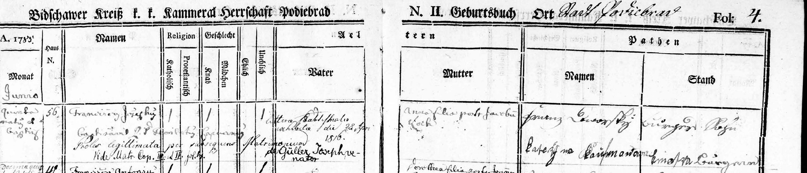

Při porovnání čtěte střed řádku, sloupec otce a pravou polovinu s původním zápisem matky a kmotrů. Číslice po „Matr. Cop.“ jsou nejisté. Shoda folia, osoby nevěsty a jména ženicha spolehlivě spojuje přípis s následujícím nálezem.

## SOL-03-N02 · Sňatek Josefa a Anny, 12. 6. 1786

Poděbrady č. 2. SOA v Praze, Sbírka matrik, Poděbrady 33, kniha oddaných N. I, fol. 4, třetí zápis shora. [Obraz, sn. 7](https://ebadatelna.soapraha.cz/d/11863/7).

> Junij. Duodecima. 2. D. Josephus de Giller filius D. Maximiliani de Giller supremi Venatoris [katolík, 48, svobodný]. Anna filia post † Jacobum Koch [katolička, 26 (?), svobodná]. Copulavit P. [škrtnuto: …] Josephus Mathias, Capell. (?). [Beystand:] Joseff: Dn: Petzina (?), Directeur (?). Johanne (?), uxor […].

Překlad. Pan Josef de Giller, svobodný katolík, 48 let, syn pana Maximiliána de Giller, vrchního myslivce, se oženil s Annou, svobodnou katoličkou, dcerou zesnulého Jakuba Kocha. Jedním svědkem byl pravděpodobně Josef Peřina (?) s označením „Directeur“ (?). Druhý svědek a jeho stav zůstávají nejisté. Čitelné jméno oddávajícího odpovídá poděbradskému knězi Josefu Matyášovi, který vystupuje i u pohřbu Jakuba Kocha. Škrt je uvnitř formulace o oddávajícím. Stav „supremi Venatoris“ je gramaticky vztažen k otci Maximiliánovi. Adresa z oddacího řádku je jediný místní údaj. Rubriky a přípisky nedávají rodiště, původ, potvrzení ani předchozí službu ženicha.

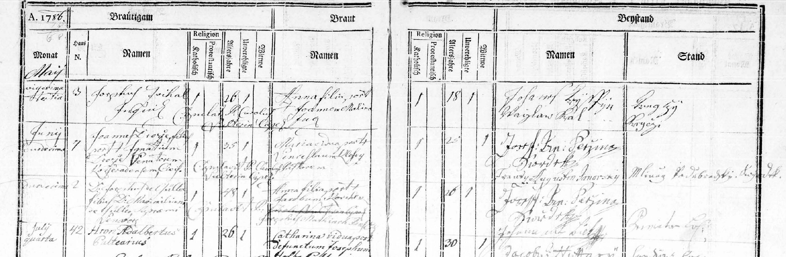

Vlevo třetí řádek odshora má č. 2 a oba snoubence. Přeškrtnutý údaj je pod jmény. O něco níž na stejném foliu je v č. 77 svatba jiného Josefa, vdovce a invalidy. Sňatky rozlišují jak nevěsty a adresy, tak stav ženicha.

## SOL-03-N03 · Anna Rozálie, 1. 10. 1787

Poděbrady město č. 7. SOA v Praze, Sbírka matrik, Poděbrady 18, fol. 26, první řádek nadepsaný October. [Obraz, sn. 31](https://ebadatelna.soapraha.cz/d/11848/31).

> October. Prima nat. & bapt. 7. Anna Rosalia. [Katolička, děvče, manželská.] Bapt.: P. Fr. Fiala (?) Capell. D. Josephus Giller venator. D. Anna. Jungf. Apolinia (?) […] — […] Johann […]; Ferdinand Kaufman — Musikan[t].

Překlad. Dne 1. října se narodila a byla pokřtěna katolická manželská dcera Anna Rozálie, rodiče pan Josef Giller, myslivec, a paní Anna. Mezi kmotry byli patrně panna Apolonie s nejistým dalším údajem a hudebník Ferdinand Kaufman. Samostatná formulace o jmenování nebo služební příslušnosti chybí. Jméno otce, stejné mateřské jméno a místní rodinná souvislost se sňatkem podporují totožnost rodičů s předchozími záznamy.

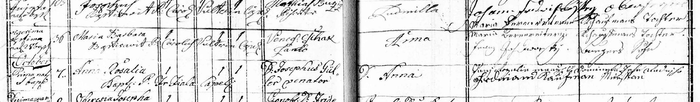

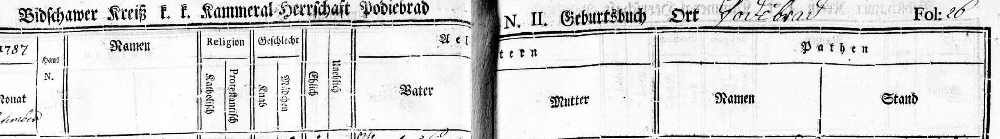

## SOL-03-N04 · Antonín, syn myslivce Höfera, 5. 11. 1784

Býchory č. 11. SOA v Praze, Sbírka matrik, Ovčáry 14, s. 1, pravá strana, první listopadový řádek. [Obraz, sn. 3](https://ebadatelna.soapraha.cz/d/10801/3).

> Novembr. 5. | 11. | Antonin Syn Pana Františka Höfra Mysliwce. | [1 katolík, 1 mužského] | 4. | Na Psotnik (?). Sepelivit P. Wenceslaus Capucinus.

Překlad. Dne 5. listopadu zemřel v domě č. 11 čtyřletý katolík Antonín, syn pana Františka Höfera, myslivce. Příčina je pravděpodobně „na psotník“. Pohřbil jej páter Václav, kapucín. Zápis přímo klade rodinu myslivce Höfera do téhož čísla domu, v němž je roku 1789 zapsána rodina fořta z Gillernu. To zpřesňuje dějiny domácnosti oproti deníku. Úmrtí jmenuje otce a jeho služební stav, matku neuvádí.

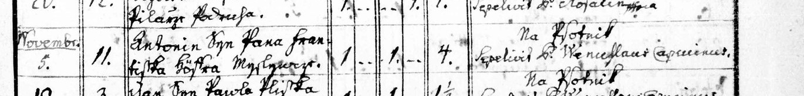

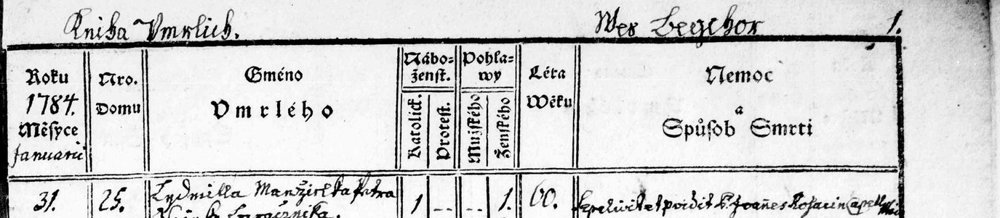

## SOL-03-N05 · František Höfer jako fořt, 16. 12. 1786

Býchory č. 22, křest Jana Nepomuckého. SOA v Praze, Sbírka matrik, Ovčáry 03, s. 3 vpravo, poslední zápis roku 1786. [Obraz, sn. 4](https://ebadatelna.soapraha.cz/d/10790/4).

> [Decembr.] 16. | 22. | Jan Nepomucz[k]ý (?) Lichý. | [katolík, chlapec, manželský] | Mattieg Lichý, Chalupnik. | Katržina Rutinowa (?). | Pan Františſek Höfer, Forşt. Anna Warkowa (?) z Wołař, Chalupnicze. | Baptisavit Pater Rosacin […].

Překlad. Jan Nepomucký Lichý, katolický manželský syn chalupníka Matěje Lichého a Kateřiny Rutinové (?). Kmotrem byl pan František Höfer, fořt, a kmotrou Anna Warková (?) z Volárny, chalupnice. Křtil páter Rosacin. Shoda jména, povolání a vesnice silně spojuje fořta s otcem Antonína z nálezu N04. Dům č. 22 patří rodičům dítěte. U kmotra je doložené povolání, bydliště tento řádek neuvádí.

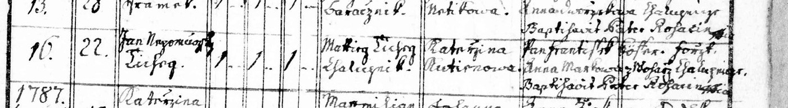

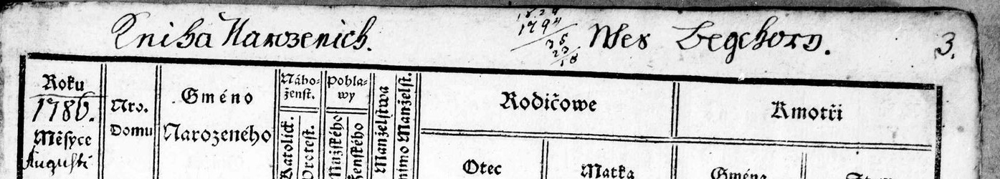

## SOL-03-N06 · Anna Höferová ve stejné vsi, 10. 9. 1787

Býchory č. 24, křest Kateřiny. SOA v Praze, Sbírka matrik, Ovčáry 03, s. 4, šestý zápis shora. [Obraz, sn. 5](https://ebadatelna.soapraha.cz/d/10790/5). Souběžný obraz Ovčáry 02, s. 73 vpravo dole. [Obraz, sn. 40](https://ebadatelna.soapraha.cz/d/10789/40).

> Septembri 10. | 24. | Katržina Rogiřjkowa (?). | [katolička, děvče, manželská] | Jan Rogiřjik (?), Sedlak. | Lidmilla Pschantreczkawa (?). | Panj Anna Höfrowa, Mysliwcowa. Waczlaw Woknior (?), Chalupnik. | Baptisavit Pater Rosacin […]. [Ovčáry 02 navíc ve výčtu kmotrů: Anna Browusowa (?), Chalupnicze.]

Překlad. V č. 24 se narodila katolická manželská dcera Kateřina, rodiče sedlák Jan a Ludmila. Kmotry byli paní Anna Höferová, žena myslivce, a Václav Woknior (?), chalupník. Společná matrika navíc uvádí Annu Browusovou (?), chalupnici. Křtil páter Rosacin. Příjmení a stav ukazují pravděpodobně na rodinu fořta Höfera. Přímý vztah k Františkovi a její vlastní bydliště v řádku chybí.

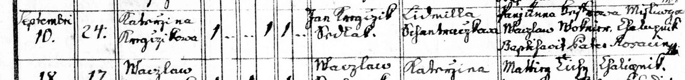

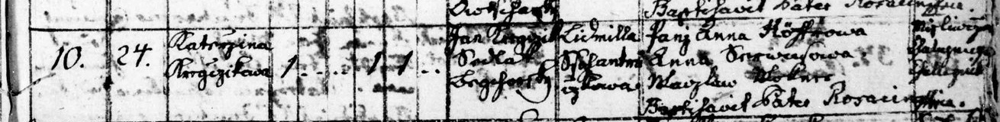

## SOL-03-N07 · Anna Güllerová jako myslivcová, 21. 3. 1788

Býchory č. 23, křest Barbory Dvořákové. SOA v Praze, Sbírka matrik, Ovčáry 03, s. 4 vlevo, předposlední zápis na straně. [Obraz, sn. 5](https://ebadatelna.soapraha.cz/d/10790/5). Souběžný obraz Ovčáry 02, s. 77 vpravo. [Obraz, sn. 42](https://ebadatelna.soapraha.cz/d/10789/42).

> Martii 21. | 23. | Barbora Dworžakowa. | [katolička, děvče, manželská] | Jan Dworžak, Sedlak Licžfan (?) [Ovčáry 02: Chalupnik a Lychtarž (?) Begchorsky]. | Anna Wodwalowa. | Panj Anna Güllerowa, Mysliwcowa. Mattieg Lichý, Chalupnik. | Baptisavit R. P. Fructuosus Capucinus. [Ovčáry 02 navíc ve výčtu kmotrů: Anna Žiakowa, Sedlka.]

Překlad. Barbora Dvořáková, katolická manželská dcera Jana Dvořáka a Anny Wodwalové. Kmotrou je paní Anna Güllerová, žena myslivce, s chalupníkem Matějem Lichým. Souběžná kniha uvádí ještě selku Annu Žákovou a odlišně označuje postavení otce dítěte. Křtil páter Fruktuosus, kapucín. Příjmení kmotry, stav a další oboustranné rodinné kmotrovství silně ukazují na Annu Kochovou, manželku Josefa. Č. 23 patří Dvořákovým a rubrika kmotrů vlastní bydliště Anny nezapisuje.

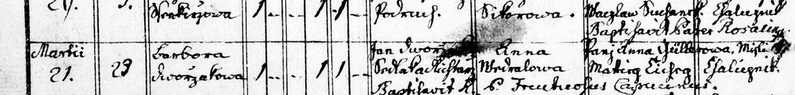

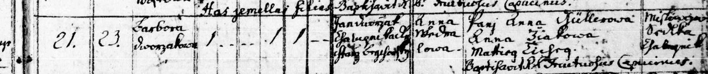

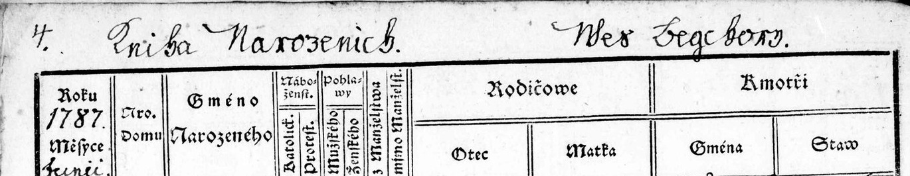

## SOL-03-N08 · Josef jako fořt v č. 11 a jako kmotr, říjen a listopad 1789

SOA v Praze, Sbírka matrik, Ovčáry 03, Býchory, s. 6 vlevo, prostřední dva řádky. [Obraz, sn. 6](https://ebadatelna.soapraha.cz/d/10790/6). Ovčáry 02 zachycují stejné dvě události na s. 84 a 85. [Souběžný obraz s poznámkou o roce, sn. 46](https://ebadatelna.soapraha.cz/d/10789/46).

> Octobri Řigna 17. | 11. | Jozef Emanuel z Gillernu. | [katolík, chlapec, manželský] | Pan Jozef z Gillernu forşt. | Panj Anna Kochowa. | Jan Dworžak, Chalupnik. Anna Žiakowa, Dewka. | Baptisavit Pater Rosacin […].
>
> Novembri Listopadu 7. | 23. | Maximilian Jozef Dworžak. | [katolík, chlapec, manželský] | Jan Dworžak, Chalupnik. | Anna Wodwalowa. | Jozef Emanuel de Gillern, forşt. Katržina Licha, Wegminkaržka. | Baptisavit Pater Rosacin […].

Překlad. Dne 17. října se v č. 11 narodil Josef Emanuel, katolický manželský syn fořta Josefa z Gillernu a Anny Kochové. Kmotry byli chalupník Jan Dvořák a děvečka Anna Žáková. Dne 7. listopadu se v č. 23 narodil Maxmilián Josef Dvořák, katolický manželský syn chalupníka Jana Dvořáka a Anny Wodwalové. Jeho kmotrem byl fořt Josef Emanuel z Gillernu a kmotrou výměnkářka Kateřina Lichá. Křtil páter Rosacin. V sousední knize poznámka u přechodu výslovně uvádí zapisování na budoucí rok 1790. Událost z listopadu tedy kalendářně patří do roku 1789, jak doložila už předchozí revize. Role otce a kmotra v sousedních řádcích umožňují rozlišit dospělého Josefa Emanuela a jeho novorozeného syna.

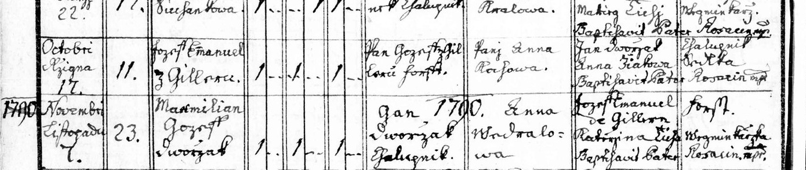

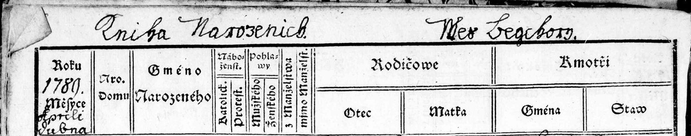

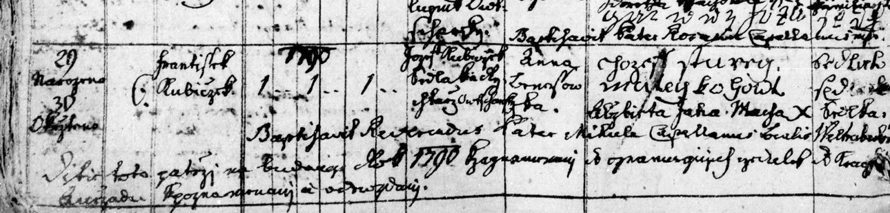

## SOL-03-N09 · Úmrtí malého Josefa, 9. 5. 1790

Býchory č. 11. SOA v Praze, Sbírka matrik, Ovčáry 14, s. 5 vpravo, druhý zápis května. [Obraz, sn. 5](https://ebadatelna.soapraha.cz/d/10801/5).

> [Maji] 9. | 11. | Jozef Syn Pana Jozefa z Gillernu Forşta. | [1 katolík, 1 mužského] | 8 Měsýce. | Na Neſtowicý (?). Sepelivit Pater Rosacin mp.

Překlad. Dne 9. května zemřel Josef, katolický syn pana Josefa z Gillernu, fořta, v č. 11. Zápis udává osm měsíců a pravděpodobně neštovice. Pohřbil páter Rosacin. Jméno dítěte, jméno a povolání otce, číslo domu a přibližný věk spojují tento zápis velmi pravděpodobně s dítětem Josefa a Anny z října 1789. Od 17. října do 9. května uplynulo šest měsíců a 22 dní, takže datum narození je potřeba ponechat podle samostatného křtu. Tato položka nemůže být úmrtím Františka Josefa z poděbradské položky N01, kterému by v květnu 1790 byly téměř čtyři roky a jedenáct měsíců.

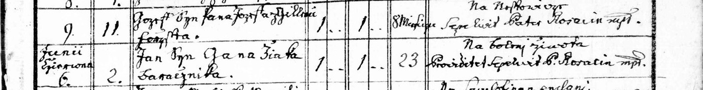

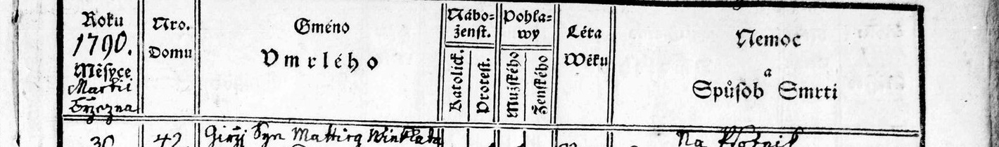

## SOL-03-N10 · Stejné číslo v souběžné matrice více vsí

SOA v Praze, Sbírka matrik, Ovčáry 02, [popis matriky a seznam obcí](https://ebadatelna.soapraha.cz/pages/MatrikaPage/matrikaId/10789). Zápisy s číslem 11 jsou v této společné knize i mimo Býchory.

- **21. 2. 1789**, s. 81 vpravo, šestý zápis. Obraz uvádí „Mattieg Lyna. […] Tomaš Lyna Baracznik Lhotſcharſky (?). Katržina farnikowa (?). Mattieg Lurka (?) Sedlak, Giržj Kallina Chalupnik, Anna Brnuskowa (?) Baracznicze. Baptisavit Moyses Tardy pastor Libicensis.“ Překlad rozhodující části. Matěj, syn domkáře Tomáše Líny označeného jako lhotský a Kateřiny. Tři kmotři a libický evangelický duchovní. Souběžná vesnická matrika Býchor událost v oddílu pro Býchory nemá. [Obraz, sn. 44](https://ebadatelna.soapraha.cz/d/10789/44)
- **29. 9. 1787**, s. 74 vlevo mezi zářím a říjnem, poškozený text. Čitelné „29. | 11. | Winczentius […]“. Jméno fořta ani prokazatelnou býchorskou příslušnost se nepodařilo přečíst. V knize Ovčáry 03 pro samotné Býchory odpovídající křest ve sledované posloupnosti uveden není. [Obraz, sn. 41](https://ebadatelna.soapraha.cz/d/10789/41)
- **28. 11. 1788**, s. 80 vlevo mezi zápisy za listopad a prosinec, dvojčata. Vlastní část „11. | Waczlaw Marčik (?) / Katržina Marčikowa (?) | […] Jakub Marčik (?), Podruh Owčharſky. Katržina Sowomowa (?).“ V češtině jde o Václava a Kateřinu, děti Jakuba a Kateřiny. Otec je uveden jako ovčárský podruh a rok vychází z řazení tohoto listu. [Obraz, sn. 44](https://ebadatelna.soapraha.cz/d/10789/44)

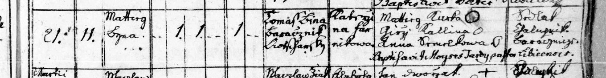

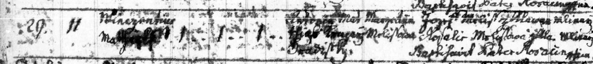

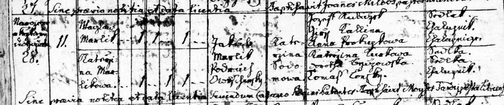

## SOL-03-N11 · Kde hledat pomocné písemnosti

Čteny katalog a inventární popisy. Doby vzniku konkrétních písemností, jména v nich a obrazy jsou samostatné otázky.

- [Proboštský úřad Poděbrady, NAD 187](https://aron.soapraha.cz/apu/6e2beea5-58af-4cd5-80f1-e41d57cfdeec), SOkA Nymburk se sídlem v Lysé nad Labem. Katalog uvádí „ohlášky služeb božích 1804-1936“, „ohlášky snoubenců 1844-1944“, „podací protokoly děkanského a proboštského úřadu 1851-1941“ a „matriční záležitosti-úmrtní listy 1796-1929“. Ve stromu inventáře jsem ověřil také skupinu matriční agendy s výslovně uvedenými snubními protokoly, ohláškami a žádostmi o dispens, která je datována až 1838–1955. [Katalogová jednotka](https://aron.soapraha.cz/apu/d0fae520-465d-4ad3-bc42-f61b8cf73791). Roku 1786 časově odpovídá [rejstřík k císařským a konsistoriálním dekretům 1784–1788](https://aron.soapraha.cz/apu/38f546e2-0b80-49a8-848c-5a9bbe27fdf9), který má smysl prověřit, pokud sňatek vyžadoval zásah konzistoře. [Inventář č. 1014](https://aron.soapraha.cz/apu/252020fc-444a-418f-8bc3-6b660caf1368) · [Strom fondu](https://aron.soapraha.cz/apu/7bc4b0e7-327a-4bd0-9bad-8fd505125cbd)
- [Vikariátní úřad Poděbrady, NAD 140](https://aron.soapraha.cz/apu/740f706b-b6c9-4d69-808e-d84d8f83603c), SOkA Nymburk. Katalog uvádí „podací protokoly vikariátního úřadu 1750-1912“ a „manželské záležitosti“. To je relevantní jiná úroveň správy. Rozpis dochovaných ročníků, konkrétní spis z června 1786 ani snímky v katalogové položce nezjištěny. [Inventář č. 1045](https://aron.soapraha.cz/apu/df469d92-299d-42cd-a73d-39f437793400)
- [Archiv města Poděbrady, inv. 598, kart. 23](https://aron.soapraha.cz/apu/ae18d8aa-33d5-41e1-8c90-5c8970532ae7), SOkA Nymburk. Katalog skutečně říká „soupis vlastníků domů, soupis mužské populace v Poděbradech“. Rozsah 1748–1802 je společný pro smíšenou jednotku. Položka nemá digitální objekt ani připojenou kopii. Sousední [inv. 599, kart. 23](https://aron.soapraha.cz/apu/f8f5f169-1a54-4bf7-8a84-02510e5045ed) obsahuje obecné církevní záležitosti 1625–1815 včetně zprávy o jiné svatbě. Položka se sňatkem Gillera v názvu ani obraz zde zjištěny nebyly.
- [Velkostatek Poděbrady, NAD 189](https://aron.soapraha.cz/apu/829108c6-0de1-4d37-a775-66d4f4d7d723), SOA v Praze, [inventář 257, II 132, 132/1](https://aron.soapraha.cz/apu/178006b2-3e38-4fb1-940a-cb14b8d8a3cd). Popis výslovně uvádí „písemnosti hospodářské a lesní správy velkostatku“ a řadu podacích protokolů a deníků s krajními daty 1784–1892. Ve vyhledaných výsledcích ani v [přehledu digitalizátů](https://soapraha.gov.cz/digitalizace/) jsem nenašel online personální seznam, obsazení lesní služby nebo výplatní knihu pro roky 1784–1789.
- [Velkostatek Kolín, NAD 298](https://aron.soapraha.cz/apu/2e5052cd-613b-441c-9b69-e40b1b28a227), SOA v Praze, [inventář 339, II 187](https://aron.soapraha.cz/apu/7eef756c-b153-4e71-9d00-5db1d9dfb67e). Katalog uvádí „správní a účetní knihy, účty, zlomky spisové agendy“ a podací protokoly a deníky v krajních datech 1782–1889. Personální doklad se jménem Höfer nebo Gillern ve vyhledaných veřejných položkách z let 1784–1789 nezjištěn. Personální výčet nebo výplata mohou doložit službu v daném období. Pro datum ustanovení a původ je třeba hledat dekret, příchozí průvodní písemnost nebo protokol o předání.
- V ARONu mají ročník 1786 v rozsahu také podobně nazvané položky jiných původců. „Snubní protokoly s doklady“ 1786–1800 jsou z [Podbořánek](https://aron.soapraha.cz/apu/f9fc1ef6-9a83-416f-a0ee-6a96a1934c55), „Povolení k sňatku“ 1783–1799 z [Velkostatku Odolena Voda – Chvatěruby – Panenské Břežany](https://aron.soapraha.cz/apu/2627697a-3ac4-4920-b63b-772e9430085c) a „Ohlášky, povolení k sňatku“ 1781–1788 z [kapituly ve Staré Boleslavi](https://aron.soapraha.cz/apu/f1a66e16-efef-47de-a536-fea8123ba06d). Souběžný obraz poděbradského sňatku ani dobové týdenní ohlášky jsem online neidentifikoval. Uvedená zjištění jsou vázaná na dohledané katalogové záznamy a nevypovídají o všech nedigitalizovaných spisech.

## Tabulka prohledaného

| Pramen a obec | Typ záznamu | Data a snímky | Způsob čtení | Výsledek a mezery |
|---|---|---|---|---|
| Poděbrady 18, město | Narození | 5. 6. 1785, sn. 8 | Obraz a dopisky u celého řádku | Legitimizace a předložení listu, N01 |
| Poděbrady 33, město | Oddavky | 12. 6. 1786, celý fol. 4, sn. 7 | Obraz včetně okolních oddavek a všech sloupců sledovaného řádku | Otec ženicha a záměna s invalidou, N02 |
| Poděbrady 18, město | Narození | 1. 10. 1787 až 10. 7. 1788, sn. 31–37 | Souvislá kontrola kmotrů, domácnosti na počátku a jmen v rodičovských rubrikách | N03 a bez dalšího jistého páru. Hraniční data se řídí zápisy na snímku. |
| Poděbrady 18, město | Narození | Červenec až začátek září 1788, sn. 38 | Prohlížeč otevřel rámec, odkaz na obraz nebyl dostupný | Mezera v kontrole, nelze z výsledku usuzovat na nepřítomnost |
| Poděbrady 18, město | Narození | Září 1788 až konec října 1789, sn. 39–50 | Souvislá kontrola rubrik kmotrů, cílená kontrola jmen rodičů | Bez další jisté Anny Güllerové nebo Josefa v této knize. Příbuzná Eleonora Clannerová mezi kmotry v roce 1788 je jiná osoba. |
| Ovčáry 03, oddíl Býchory | Narození | Kontrolní prosinec 1786, sn. 4. Hlavní období od října 1787 do října 1789, sn. 5–6, s. 4–6 | Souvisle podle adres a kmotrovských rubrik. Okolí kontaktů rozšířeno do září 1787 a listopadu 1789. | Höferovi, Anna Güllerová, první jistá adresa č. 11 pro Gillernovy, N05–N08. V záznamech tohoto oddílu po 18. 9. 1787 následuje leden 1788. |
| Ovčáry 02, společný oddíl více vsí | Narození | Září 1787 až říjen 1789, sn. 40–46, s. 73–84, listopad kontrolně s. 85 | Souvislé čtení čísel a cílené čtení kmotrů, povolání a místních přívlastků. Místy silný průsak a skvrny. | Paralelní obrazy ke kmotrovství. Samotná shoda č. 11 je nedostatečná, N06–N08 a N10. |
| Ovčáry 14, Býchory | Zemřelí | 1784 až 1. 8. 1789, sn. 3–5, s. 1–4, kontrolně květen 1790, s. 5 | Souvislá kontrola adres a jmen do konce 1789, samostatná položka 1790 | Předchozí rodina myslivce v č. 11 a následné úmrtí dítěte Gillernových, N04 a N09. Po srpnu 1789 následuje v oddílu leden 1790. |
| ARON, eBadatelna, úřední přehled digitalizátů, Poděbrady a Kolínsko | Pomocné oddací, správní a lesní prameny | Cíleně 1786 a 1784–1789 | Katalogové termíny ohlášky, snubní protokoly, povolení k sňatku, lesní úřad, Býchory, fondy a související položky | N11. U relevantních nepřipojených dokumentů nebylo možné přejít od katalogu k četbě obsahu. |

## Co převzít a kde navázat

> Býchory č. 11: 5. 11. 1784 tam zemřel Antonín, čtyřletý syn myslivce Františka Höfera. František je 16. 12. 1786 v Býchorech jako fořt kmotrem. Dne 10. 9. 1787 je ve vsi kmotrou paní Anna Höferová, myslivcová. Höfer je doložený dřívější myslivec z č. 11 a možný přímý předchůdce Josefa z Gillernu (SOL-03-N04–N06). Dne 21. 3. 1788 je v Býchorech kmotrou paní Anna Güllerová, myslivcová, velmi pravděpodobně Anna Kochová. Položka neuvádí její bydliště (SOL-03-N07). Dne 17. 10. 1789 jsou oba manželé přímo doloženi v Býchorech č. 11 a Josef je uveden jako fořt. Dne 9. 5. 1790 tam zemřel malý Josef, velmi pravděpodobně syn narozený 17. 10. 1789 (SOL-03-N08–N09). Josefovo rodiště a datum nástupu zůstávají otevřené.

První kontrola původu má vést do [inventáře 1045 Vikariátního úřadu Poděbrady](https://aron.soapraha.cz/apu/df469d92-299d-42cd-a73d-39f437793400), do podacích protokolů a manželské agendy za květen a červen 1786. Při průchodu je vhodné hledat oba snoubence i jméno faráře. Druhá kontrola má vést do [inventáře 339 Velkostatku Kolín](https://aron.soapraha.cz/apu/7eef756c-b153-4e71-9d00-5db1d9dfb67e) pro Býchory, nejprve říjen 1787 až říjen 1789, pod oběma jmény Höfer/Hoffer a Giller/Güller/Gillern, a do analogické řady [Velkostatku Poděbrady](https://aron.soapraha.cz/apu/178006b2-3e38-4fb1-940a-cb14b8d8a3cd). Pro městský soupis je konkrétní jednotkou [inv. 598, kart. 23](https://aron.soapraha.cz/apu/ae18d8aa-33d5-41e1-8c90-5c8970532ae7). Doplňující online kontrola začíná chybějícím [snímkem Poděbrady 18/38](https://ebadatelna.soapraha.cz/d/11848/38).
