# SOL-04 · Maximiliánův příchod do Boru Bobnického

## Závěr

- **Přímo doloženo.** Dne 23. ledna 1750 zaznamenal nymburský děkan u křtu dcery z Boru Bobnického otce jako „Maximilian Jozef Emanuel von Gyller“ a jeho povolání jako „Jagr“ (myslivec). Jde o doklad služby k tomuto datu. Matka je uvedena jako Anna Johanna. Prostřední jméno dcery zůstává při čtení tohoto snímku nejisté (SOL-04-N01).
- **Nové oproti deníku.** Oba vídeňské rejstříky Hoffinanz 1749 mají rubriky vztahující se k českým komorním statkům, ale příslušné rubriky jsou na zkontrolovaných obrazech prázdné. Registratur zachycuje jiný typ české agendy, např. zásobování Plzně, Chebu a Hradce Králové střelným prachem. Jmenná shoda „Gillerin“ vede podle protokolu k poště v Trnavě. Záznam z roku 1748 vede k dvorskému radovi a labským účtům (SOL-04-N02, N03, N06).
- **Pravděpodobná pramenná cesta.** K dříve označeným kartonům pro léta 1755–1757 přibyl konkrétně určený místní inventář a dvě cesty pro starší období před formálním nástupem Leopolda Kinského, který už tehdy vykonával úřad prakticky. Přednost mají nymbursko-poděbradské účty a spisy ke službě a přísahám a knihy z let 1747–1750, pokud se v inventáři potvrdí jejich dochování (SOL-04-N04).
- **Otevřeno.** Datum jmenování, faktický nástup, předchozí působiště, doporučující osoba i Josefovo rodiště. Údaj „1749“ zatím nemá přímý podklad. Chybí také jmenný doklad pro spojení s Holíčem. Anna z kladrubské svatby v roce 1759 může být dcerou pokřtěnou roku 1750 nebo starší dcerou (SOL-04-N01, N04, N05).

Kontrola projektu vychází z [revize 7c02f35](https://github.com/jgillern/gillernrodokmen/tree/7c02f3528be438f49af80b0761b5653cdd3eee02), zejména z [deníku č. 632, 644, 697, 707 a 717](https://github.com/jgillern/gillernrodokmen/blob/7c02f3528be438f49af80b0761b5653cdd3eee02/data/research_log.md) a z matrik tam evidovaných.

## SOL-04-N01 · Křest dcery v Boru Bobnickém, 23. ledna 1750

Státní oblastní archiv v Praze, Sbírka matrik, římskokatolická farnost Nymburk, sign. Nymburk 07, s. 82, sn. 47, levá strana, první ze dvou zápisů datovaných 23. ledna (šestý zápis v lednu). Čten obraz originálu. [Přímo na snímek](https://ebadatelna.soapraha.cz/d/10406/47)

**Přepis** (zkratky a kolísání češtiny/němčiny zachovány)

> Januarius. Anno 1750.\
> 23 / Z boru bobniczky. Dto: Anna […] Barbara. P.\
> Maximilian Jozef Emanuel von Gyller Jagr.\
> M. Anna Johanna. L. Anna hollanowa (?) T. Lydmilla\
> Kudlowa (?) Pawel Antoss. Rodičy Liberi.

V patě strany „Quos baptizavit […] Thomas Kulka Decanus“ (Tomáš Kulka, děkan, křtil uvedené děti). Rozpoznání písmen ve slově před „Liberi“ a u křestního jména prvního svědka je méně jisté než čtení otce. Příjmení otce má na obraze spodní tah odpovídající písmenu y, proto přepis „Gyller“. Nad „a“ v titulu není jisté přehlasování, proto „Jagr“ v přepise a německé „Jäger“ jako normalizace. Zápis neuvádí stupeň služby.

**Překlad.** Dne 23. ledna byla pokřtěna Anna […] Barbora z Boru Bobnického. Otcem byl Maximilián Josef Emanuel von Gyller, myslivec, matkou Anna Johanna. Za kmotru je uvedena Anna Hollanová (?), za svědky Ludmila Kudlová (?) a Pavel Antoš. Rodiče jsou označeni jako svobodní lidé. Shoda místní služby a manželky s dalšími projektovými zápisy z Boru a Hradištka podpírá ztotožnění otce. [Křest v Boru roku 1751](https://ebadatelna.soapraha.cz/d/10406/55) · [Křest v Hradištku roku 1756](https://ebadatelna.soapraha.cz/d/11453/142)

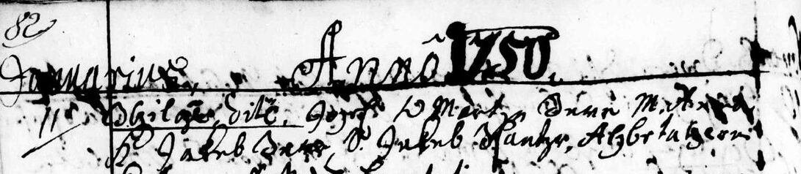

Vlevo nahoře číslo strany, pod ním měsíc a letopočet.

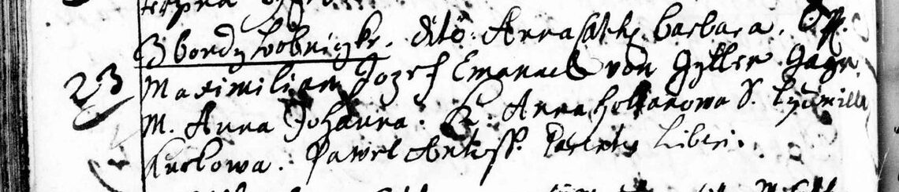

Datum je v levém sloupci, otec a povolání na druhém řádku zápisu.

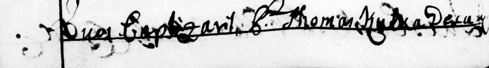

Patní poznámka na téže straně.

## SOL-04-N02 · Gertraut Gillerin v Trnavě, 1748–1749

Österreichisches Staatsarchiv, Finanz- und Hofkammerarchiv, Geschäftsbücher Hoffinanz. Čteny obrazy indexů a protokolu. Indicie „Gillerin“ z oddílu Gi v 1220 (pravá strana sn. `pg=137`) odkazuje na fol. 390. Záznam začíná na jeho rubu, tedy vlevo na `pg=232`. Datum 19. 6. 1749, Trnava. [Index Expedit 1220](https://library.hungaricana.hu/en/view/FHKA_HF_1220_1749E_ind/?pg=137) · [Protokol Expedit 1219, fol. 390v](https://library.hungaricana.hu/en/view/FHKA_HF_1219_1749E_prot/?pg=232)

**Přepis rozhodující položky protokolu**

> 19. / Tyrnau. Gillerin. / Insinuatum von dem K. K. Post Directorio, daß der verwittibten Postmeisterin zu Tyrnau Gertraud Gillerin gegen anerbottener gratis führung der ord. Post, und zurücklassung der bißhero ausgesetzten besoldung für sich und Ihre descend(en)z auch ihr Posthauß erblich allergnädigst verliehen, auch derselben der sonst gewöhnlicher Rittaufschlag nachgesehen worden seye.

**Překlad.** Oznámení c. k. poštovního ředitelství, že ovdovělé trnavské poštmistrové Gertraud Gillerin byl za nabídnuté bezplatné vedení řádné pošty a vzdání se dosavadního platu dědičně propůjčen její poštovní dům pro ni a její potomky a prominut běžný příplatek za jízdu. Ve zkratce rejstříku lze „PostMeisters“ při letmém čtení splést s „Forstmeister“. Výslovné *Post Directorio*, *Postmeisterin* a *Posthauß* v protokolu určují agendu i osobu.

Registratur 1222, heslo „Gertraut Gillerin“ (vlevo na sn. `pg=150`), odkazuje na fol. 488 a znovu uvádí dědičnou poštovní stanici v Trnavě při převzetí obsluhy pošty bez platu a prominutí jízdního poplatku. V online 1221 navazují na sebe fol. 483 a 492, takže na snímcích není fol. 488. Souběžný doklad z Expeditu je čitelný. V Registratur 1748 je na sn. 158 plné jméno „Anna Gertraut Gillerin, verwittibte Postmeisterin zu Tyrnau“, odkazy na fol. 489 ke služebnímu privilegiu a k převzetí výnosu z poštovného a zrušení platu. Snímky s fol. 489 a jeho rubem obsahují jiné položky. Označení poštmistrové v Trnavě ve dvou indexech a potvrzení v protokolu Expedit odlišují záznam od Maximiliána. [Index Registratur 1222](https://library.hungaricana.hu/en/view/FHKA_HF_1222_1749R_ind/?pg=150) · [Fol. 483](https://library.hungaricana.hu/en/view/FHKA_HF_1221_1749R_prot/?pg=360) · [Následující obraz, fol. 492](https://library.hungaricana.hu/en/view/FHKA_HF_1221_1749R_prot/?pg=361) · [Registratur 1748, index 1218](https://library.hungaricana.hu/en/view/FHKA_HF_1218_1748R_ind/?pg=158) · [Protokol 1217, fol. 489r](https://library.hungaricana.hu/en/view/FHKA_HF_1217_1748R_prot/?pg=420) · [Fol. 489v](https://library.hungaricana.hu/en/view/FHKA_HF_1217_1748R_prot/?pg=421)

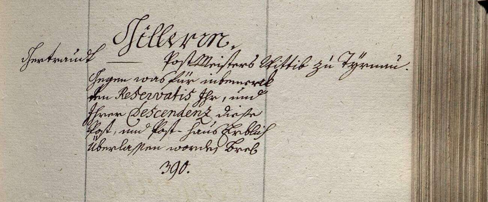

Pravá strana pod hesly Gi, odkaz 390 pod zápisem.

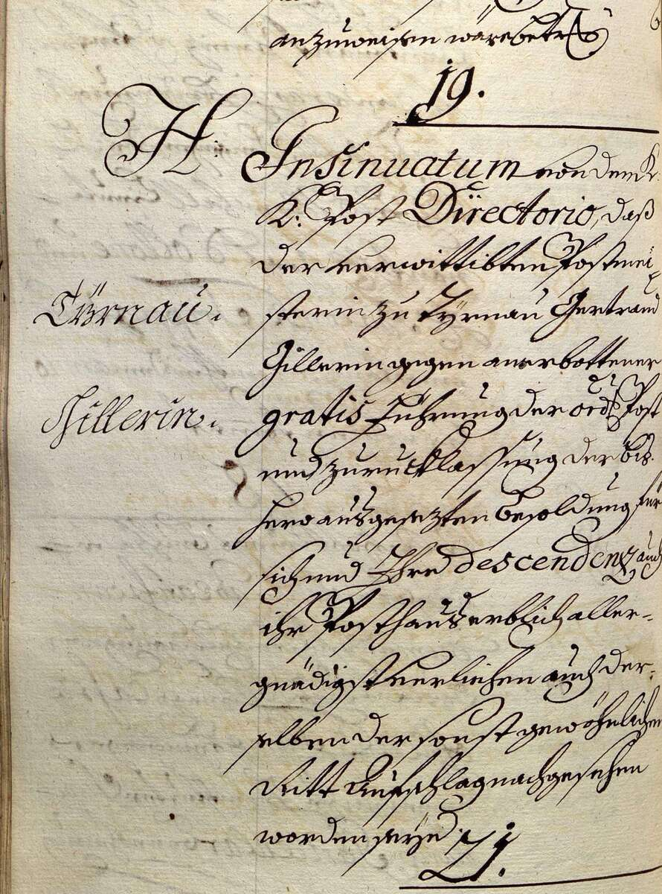

Fol. 390v, vlevo, hesla Tyrnau a Gillerin. V prvním řádku je uveden poštovní úřad.

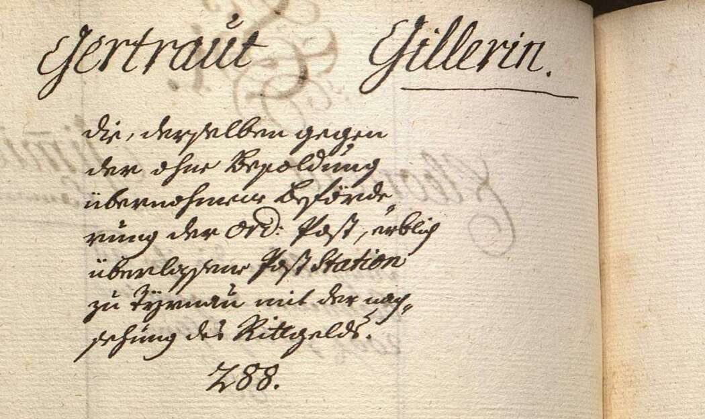

Vlevo nahoře, na konci odkaz 488.

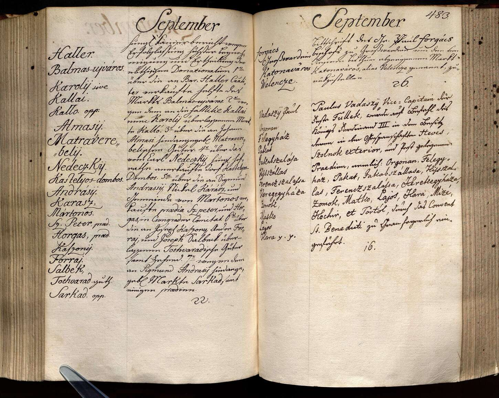

Pravý horní roh je označen číslem 483.

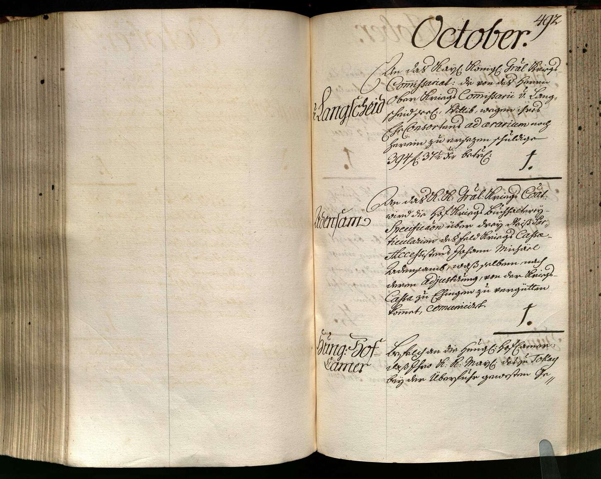

Číslo 492 vpravo nahoře dokumentuje mezeru v přístupném sledu obrazů.

## SOL-04-N03 · Co zachycují knihy Hoffinanz 1749

ÖStA, FHKA, Hoffinanz, vídeňská správa, rok 1749. Čteny originální rejstříky a vybrané listy obou protokolů. Rejstříky obsahují osoby, předměty i územně členěné rubriky. Křížová kontrola pod B, P, F, I/J a G hledala zejména Bobnice/Bobnitz/Bor, Poděbrady/Podiebrad, česká komorní panství, myslivost/lesní personál a tvary Giller/Gillern/Gyller/Güller s křestními jmény Maximilian, Joseph a Emanuel. Hesla osob jsou řazena pod příjmením, křestní jména a funkce pomáhají u jmenné shody.

**Přepisy rubrik a smysl kontroly.** Expedit 1220, sn. 39 pravá strana „Königl. Städte und Camer Gütter in Böheimb“ (královská města a komorní statky v Čechách). Registratur 1222, sn. 40 pravá strana „Königl. Städte, Camer Gütter und Herrschaften, auch Leibgeding Städte in Böhmen“ (královská města, komorní statky a panství i věnná města v Čechách), níže „Königl. Camer-Buchhalterey, und Canzley in Böhmen“ (královská komorní účtárna a kancelář v Čechách). V 1222 na sn. 46 vpravo dole je „Jägerey, und Waldungen in Böhmen“ (myslivost a lesy v Čechách). U těchto hesel není vypsána agenda. Zařazené položky jiného českého resortu jsou vidět např. u „Kriegs-Zeug, Pulver, und Salniter Weesen in Böheimb“ (válečný materiál, prach a ledek v Čechách) v 1220 na sn. 44 vlevo a v 1222 na sn. 45 vlevo. [Expedit sn. 39](https://library.hungaricana.hu/en/view/FHKA_HF_1220_1749E_ind/?pg=39) · [Expedit sn. 44](https://library.hungaricana.hu/en/view/FHKA_HF_1220_1749E_ind/?pg=44) · [Registratur sn. 40](https://library.hungaricana.hu/en/view/FHKA_HF_1222_1749R_ind/?pg=40) · [Registratur sn. 45](https://library.hungaricana.hu/en/view/FHKA_HF_1222_1749R_ind/?pg=45) · [Registratur sn. 46](https://library.hungaricana.hu/en/view/FHKA_HF_1222_1749R_ind/?pg=46)

**Kontrola odkazu do protokolu.** Pod „Stadt Pilsen“ v 1222, sn. 365 vpravo, je odkaz fol. 18. Na fol. 18r nahoře v lednu stojí v margináliích „Pulver und Saln: wesen / Hinterberger / Werd / Eger / Pilsen / Königgratz“. Rozhodující část zápisu zní „die Egrer: Filial Lagstatt mit denen Pulver Sorten zum Verschleiß, gleichwie die Pilsner: und Königgräzer: aus dem Prager: Magazin zu verlegen“. Tedy zásobovat chebský filiální sklad z pražského skladu potřebnými sortami prachu k prodeji stejně jako sklady plzeňský a královéhradecký. Podpis příkazu v probíraném výřezu není uveden, jde o protokolární výtah. Tato pozitivní kontrola dokládá, že řada zahrnuje české lokality, konkrétně v zásobovací agendě. Z prověřeného výběru nevyplývá běžná evidence českého lesního personálu srovnatelného s bobnickým myslivcem. [Index 1222, sn. 365](https://library.hungaricana.hu/en/view/FHKA_HF_1222_1749R_ind/?pg=365) · [Registratur 1221, fol. 18r](https://library.hungaricana.hu/en/view/FHKA_HF_1221_1749R_prot/?pg=19) · [Popis série ÖStA](https://www.archivinformationsystem.at/detail.aspx?ID=480204) · [Úvod Hungaricany a řazení spisů](https://library.hungaricana.hu/en/collection/austrian_state_archives_Hoffinanz/)

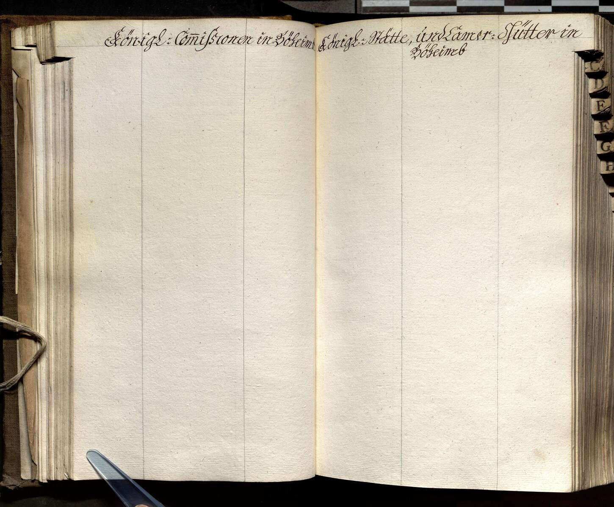

Příslušné záhlaví je vpravo nahoře. Pod ním je volná plocha.

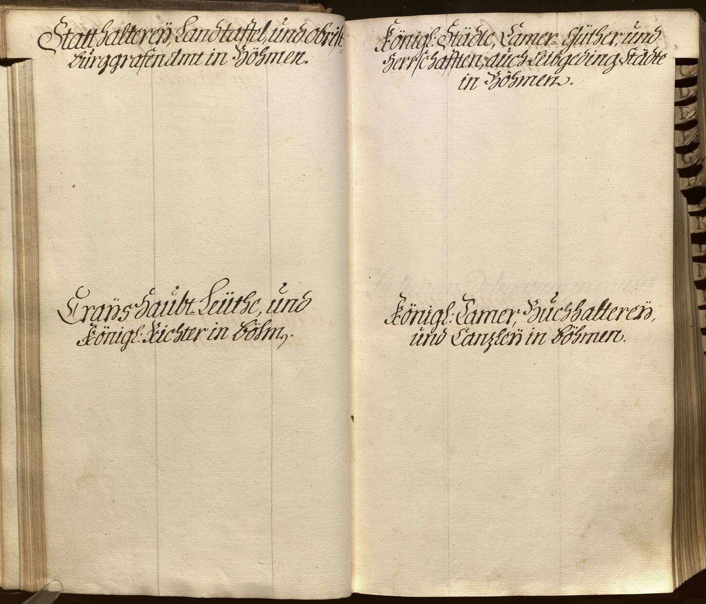

Dvě prázdné české rubriky vpravo.

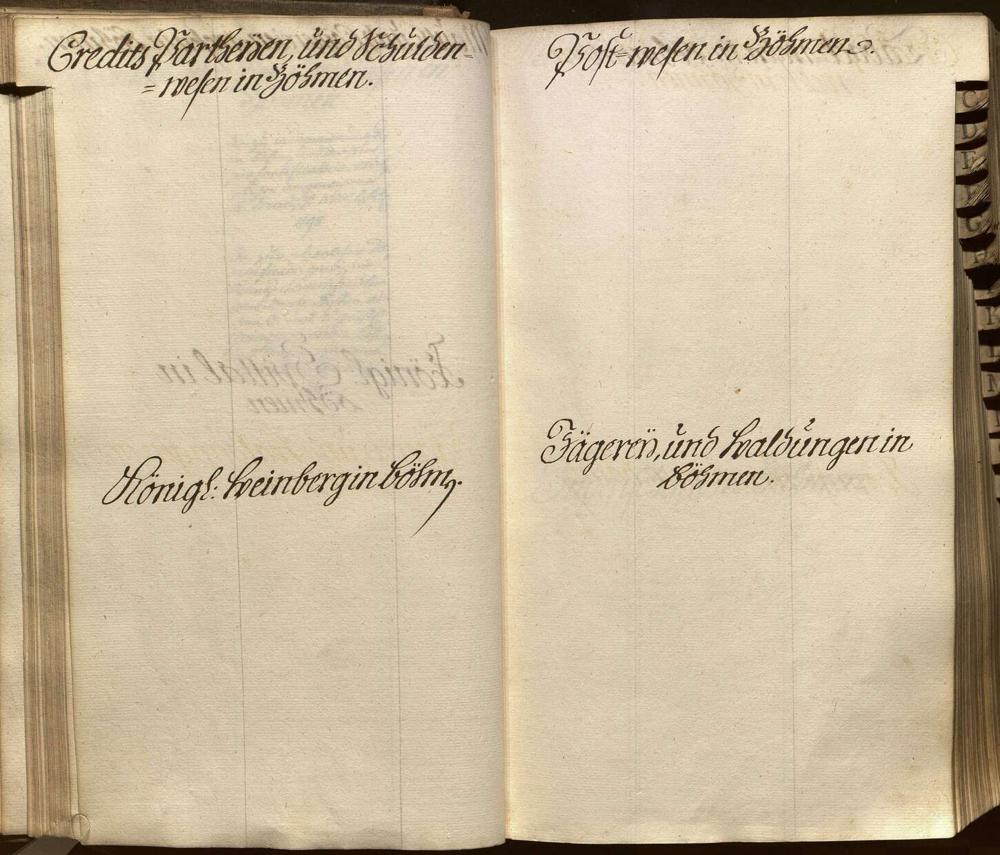

Záhlaví „Jägerey, und Waldungen in Böhmen“ je v pravé dolní části.

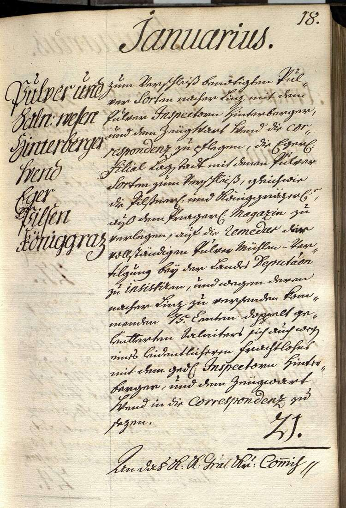

Pravá strana fol. 18. Plzeň, Cheb a Hradec Králové jsou uvedeny v marginálii.

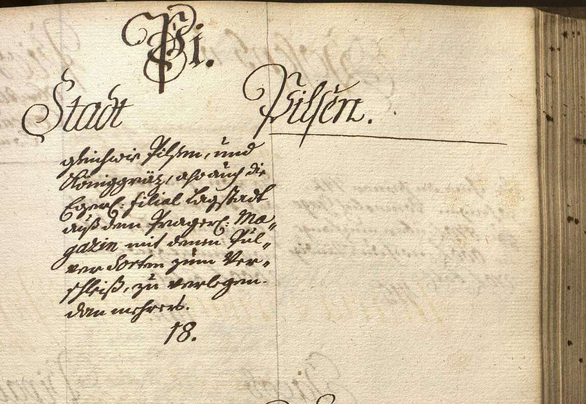

Indexová položka v rubrice Pi s číslem folia protokolu pod textem.

## SOL-04-N04 · Příslušnost poděbradské služební agendy a konkrétní české prameny

**Co bylo čteno.** Veřejný katalog ARON a studie Romany Martínkové, Aleše Valenty a Veroniky Vilimovské *Úřad nejvyššího lovčího za Leopolda Kinského (1751–1760)*, Východočeský sborník historický 14 (2007), s. 109–141, zejména s. 111–120 a pozn. 9, 17, 20, 24, 38–43, 46–48. Prohlédnutý inventární popis SOA Praha je pomůcka č. 257 (J. Tywoniak, 1962) „Velkostatek Poděbrady, 1352–1931“, sign. II 132, 132/1, fond NAD 189. Karta fondu výslovně uvádí „Písemnosti hospodářské a lesní správy velkostatku“. Karta pomůcky nemá přílohu ani rozpis položek online. Jde o katalogový popis, proto níže zůstává inventární číslo výplatní knihy otevřené. [Karta fondu v ARON](https://aron.soapraha.cz/apu/829108c6-0de1-4d37-a775-66d4f4d7d723) · [Karta inventáře 257](https://aron.soapraha.cz/apu/178006b2-3e38-4fb1-940a-cb14b8d8a3cd) · [Studie, s. 111–120](https://www.vcm.cz/documents/1194/martinkova-valenta-vilimovska_vcsh14-2007.pdf#page=3)

| Správa | Doložená role a důsledek pro rešerši |
|---|---|
| Místní vrchní/hospodářský úřad velkostatku Poděbrady | Místní hospodářská správa obstarávala materiál, stavby, výnosy a provoz. Studie dokládá součinnost a spory s loveckým úřadem a popis fondu potvrzuje hospodářskou i lesní registraturu. Proto má smysl hledat, zda je nový myslivec zanesen do knih místního důchodu jako příjemce mzdy, naturálií či uživatel myslivny. Pro rok 1749 nemáme platební doklad ani potvrzený titul účetní knihy. |
| Nejvyšší lovčí a místní lesmistr | V letech 1747–1750 formálně František Karel Clary-Aldringen, faktickou činnost podle studie vykonával jeho zástupce a čekatel Leopold Kinský. Formální dekret o Kinského jmenování je až z 13. 3. 1751. Polesní a další podřízení se objevují ve jmenováních, provizorních obsazeních a přesunech. Lesmistr mohl dílčí změnu navrhnout či realizovat, jak ukazuje záležitost pardubického bažantníka v roce 1755. Konkrétní pravomoc v případu Maximiliána zůstává neověřená. |
| Panovník a vídeňská správa | Za Kinského císař rozhodoval o vyšších funkcích (lesmistr, dvorní myslivec, polesný), přičemž míru rozhodování o nižších místech určovaly instrukce či dílčí pověření. Vídeňská dvorská účtárna kontrolovala nové finanční závazky. Záznam z roku 1753 výslovně dovolil pro daný případ obsadit nižší místa podle úsudku lovčího. Baron Toussaint se v doložených případech zapojoval nejpozději od roku 1753. Tento postup nelze bez dokladu automaticky ztotožnit s případným přijetím myslivce před lednem 1750. |

**Věcná kontrola.** Podle studie (s. 117, pozn. 38 a 40) oznámil Kinský v listu císaři 16. dubna 1756 uprázdnění místa po Johannu Hoffmannovi a žádal audienci. V listu z 27. června 1756 je jako císařův kandidát identifikován dvorní myslivec z Holíče, jméno studie neuvádí. Záznam je vodítko k přesné písemnosti v NA, Česká dvorská komora V, kart. 20. Předmět, hodnost a datum se od lednového bobnického křtu z roku 1750 liší. Konkrétního kandidáta může určit plný list nebo související rozhodnutí. Žádost, která se tohoto kartonu týká, eviduje projekt pod č. 697. [Studie, s. 117](https://www.vcm.cz/documents/1194/martinkova-valenta-vilimovska_vcsh14-2007.pdf#page=9) · [Archivní dotazy projektu](https://github.com/jgillern/gillernrodokmen/blob/7c02f3528be438f49af80b0761b5653cdd3eee02/data/archivni_dotazy.md)

Pro starší období studie přímo odkazuje na **NA, Stará manipulace, sign. J 19**, a **SOA Litoměřice, pracoviště Děčín, RA Clary-Aldringen, kart. 80, inv. č. 205**. K zásahu panovníka ve změně osoby vykonávající úřad uvádí **NA, Ústřední zemědělsko-lesnický archiv, kart. 27, inv. č. 183**. **RA Kinských Chlumec nad Cidlinou, kart. 97, inv. č. 2030**, obsahuje dekrety od roku 1750 (zejména fol. 2–3 jako první konkrétní kontrola, fol. 8–9 dekret z 13. 3. 1751). Pro srovnání platové agendy jsou doloženy výše zmíněný případ bažantníka 1755 a vdovské penze v roce 1756, oba v ČDKM V kart. 20. Veřejné přepisy nebo obrazy zde uvedených listů se nepodařilo dohledat. Místní veřejné obrazy zahrnují poděbradský soupis poddaných 1745 (inv. 544), který není řadou platů ani služebních přísah. [Studie, s. 111–115](https://www.vcm.cz/documents/1194/martinkova-valenta-vilimovska_vcsh14-2007.pdf#page=3) · [Soupis poddaných, popis a obrazy](https://ebadatelna.soapraha.cz/pages/ArchivaliePage/archivalieId/4908/idx/250)

## SOL-04-N05 · Panna Anna jako svědkyně v Kladrubech, 17. května 1759

SOA v Hradci Králové, Sbírka matrik Východočeského kraje, sign. 1776 (poř. č. 4979), fol. 73v, sn. 64, druhý zápis na levé straně. Čten obraz originálu. [Přímo na archivní snímek](https://aron.vychodoceskearchivy.cz/apu/8db56854-9c22-46b4-9474-7896b483f08b/dao/8db56854-9c22-46b4-9474-7896b483f08b/file/97de573a-0d4d-4923-ac50-2436b5b21313)

**Přepis**

> Anno 1759. Die 17. Maj honestus sponsus et Viduus Wen: Kopeczky textor Cladrub. tribus interpolatis vicibus inter Missarum Solennia cum Sponsa sua et superstite filia Barbara post † Georgium Openigs (?) uterque liber in Eccl. Parochiali S. S. Wen. et Leopodi (?) Cladrub. promulgatis ac nullo detecto can. imped. copulatus est. Testes Wen: Sobotka sutor Cladrub. Virgo Anna filia Perill. Dni Maximiliani de Güllern. copul. P. Hruby.

**Překlad.** 17. května 1759 byl počestný ženich a vdovec Václav Kopecký, tkadlec z Kladrub, oddán se svou nevěstou Barborou, pozůstalou dcerou zemřelého Jiřího Openigse (?). Oba byli volní k sňatku. Ohlášky proběhly třikrát během mší v kladrubském farním kostele sv. Václava a Leopolda (?) a nebyla shledána kanonická překážka. Svědčili Václav Sobotka, švec z Kladrub, a panna Anna, dcera urozeného pana Maximiliána de Güllern. Oddal P. Hrubý. Zápis přímo dokládá vztah otce a dcery, bez uvedení věku, matky či rodiště. Devět let po křtu v Boru jsou proto možné dvě osoby stejného křestního jména.

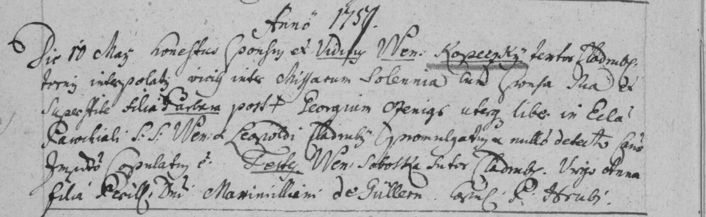

Druhý zápis na levé straně. Anna a Maximilián jsou na konci.

## SOL-04-N06 · Baron a dvorský rada von Gillern v agendě labských účtů, 16. ledna 1748

ÖStA, FHKA Hoffinanz, Registratur, index 1218, sn. 158, vpravo nahoře, a protokol 1217, fol. 18r, sn. 18 vpravo. Obraz originálu. [Index](https://library.hungaricana.hu/en/view/FHKA_HF_1218_1748R_ind/?pg=158) · [Protokol](https://library.hungaricana.hu/en/view/FHKA_HF_1217_1748R_prot/?pg=18)

**Přepis.** Index uvádí „Baron v. Gillern, K. K. Hofcamer Rath“ s odkazem 18. Protokol uvádí „Commissions Decret an herrn Baron v. Gillern, herrn B. v. Schmidlin, und herrn v. Grieblpauer (?): daß selber die in puncto des Elbeckischen Raitungs Wesen, vorhin schon angeordnet geweste Commission zu reassumiren, den von der Hofbuchhalterey über v. Elbeckhs wider die Buchhalterey Erledigungen eingereichte Beschwerlibellen abgestattet ausführigen Bericht, bescheinig zu überlegen, und über den Befund ihre Urt[h]l. Meinung relationando zu weisen gefällig seyn wollen.“

**Překlad.** Komisionální dekret baronu von Gillern, baronu von Schmidlinovi a panu von Grieblpauerovi (?) ukládá obnovit dříve ustavenou komisi ve věci účtů von Elbecka, přezkoumat podrobnou zprávu dvorské účtárny o jeho stížnostech proti vyřízení účtů a předložit stanovisko. Osobu určuje funkce dvorského komorního rady. Karel Josef z Gillernů je podle projektu v této funkci doložen již v roce 1741 (deník č. 705). Zde je ztotožnění s Karlem Josefem pravděpodobné, protože křestní jméno chybí. Agenda se Maximiliána jmenovitě netýká.

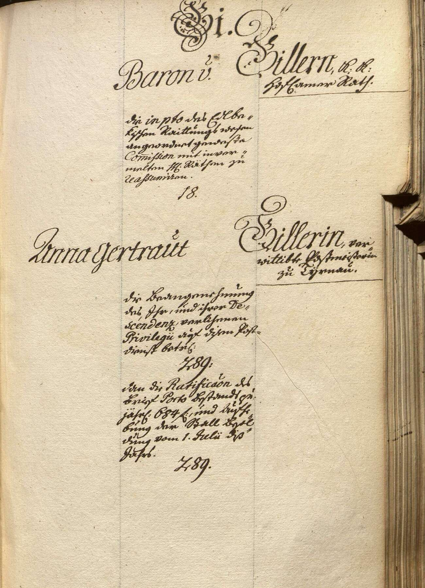

Baronova položka nahoře má odkaz 18. Vdova je uvedena ve druhé rubrice.

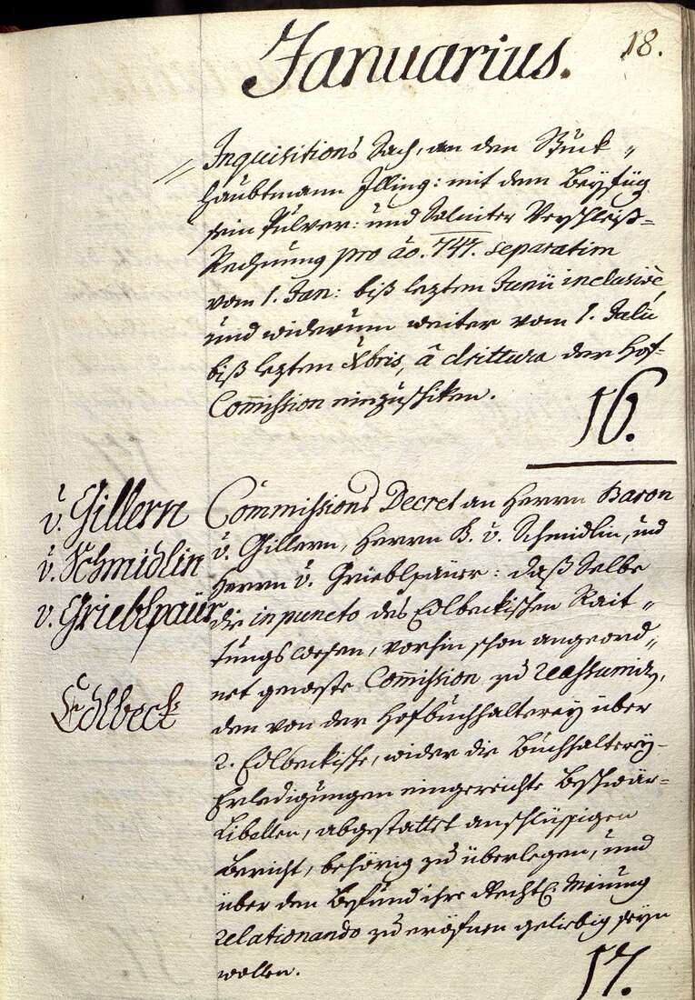

Pravá strana fol. 18, mezi daty 16 a 17 pod lednovým záhlavím. Identifikační jména jsou v levém okraji pravé stránky.

## SOL-04-N07 · Kontrola Hoffmannova hesla z roku 1756

ÖStA, FHKA Hoffinanz, index Registratur 1246, sn. 50 (Margaretha Antonia Hoffmannin vlevo nahoře, Johann Hoffmann vpravo uprostřed), protokol 1245, fol. 46r (sn. 21) a 107r (sn. 53). Originální obrazy. [Index 1246](https://library.hungaricana.hu/en/view/FHKA_HF_1246_1756R_ind/?pg=50) · [Fol. 46r](https://library.hungaricana.hu/en/view/FHKA_HF_1245_1756R_prot/?pg=21) · [Fol. 107r](https://library.hungaricana.hu/en/view/FHKA_HF_1245_1756R_prot/?pg=53)

**Přepisy rozhodujících částí.** Fol. 46r „Hung. Hof Cr. Hoffmannin / Hungl. Hof Camer über das Ansuchen der Wittib Margareta Antonia Hoffmannin um prolongirung jährl. 400 fl Pension auf andere 4 Jahr zu berichten.“ Fol. 107r „die hinkünfftige bestell und Salariirung ex aerario der künftigen Caal. Hungl. Cassa betr. und zwar wird der Joh. Moyses (?) und Johann Hoffmann als Cassa offrs, ersterer mit 400, der andere mit jährl. 300 fl“.

**Překlad a rozlišení.** V únoru má uherská dvorská komora podat zprávu o žádosti vdovy Margarety Antonie Hoffmannin o prodloužení roční penze 400 zl o další čtyři roky. Druhý záznam je z března a týká se obsazení a platů uherské komorní pokladny. Johann Hoffmann má jako pokladní úředník dostávat 300 zl ročně. Ani jeden doložený případ neodpovídá českému lesmistrovi či jeho pozůstalosti, pro kterou druhotný pramen uvádí v červnu 1756 navržených 200 zl. U prvního hesla je ještě druhý odkaz čtený jako 394 (?), tato foliace v digitálním obsahu svazku chybí mezi fol. 390 a 396. Rejstřík tedy nabízí zavádějící jmenné shody a žádný z uvedených obrazů nepodkládá ztotožnění holíčského kandidáta. [Český případ podle studie, s. 119](https://www.vcm.cz/documents/1194/martinkova-valenta-vilimovska_vcsh14-2007.pdf#page=11)

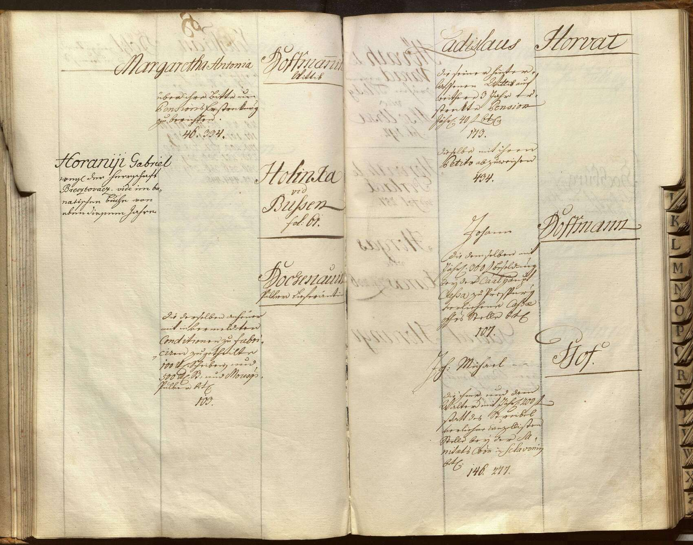

Jméno vdovy je vlevo nahoře. Johann Hoffmann je vpravo uprostřed.

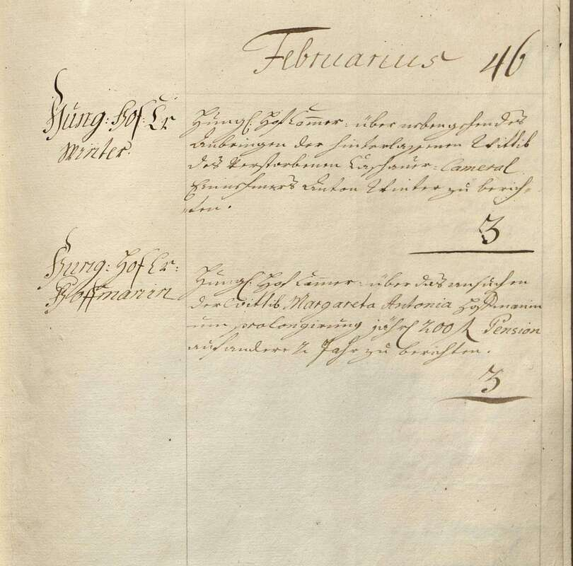

Druhá položka folia, částka 400 zl.

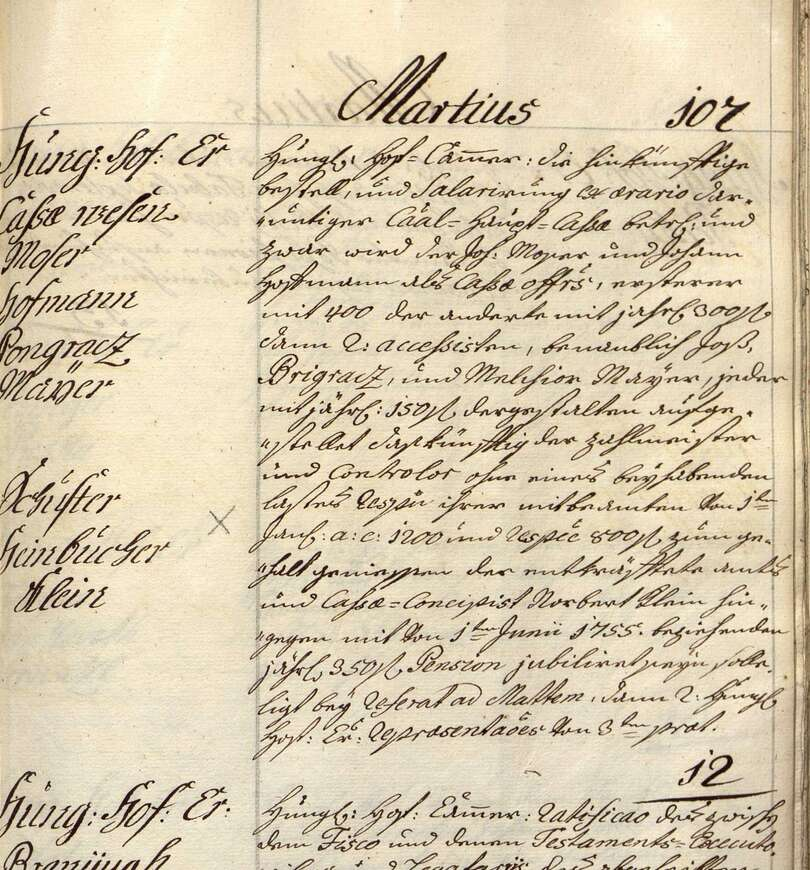

Horní záznam pravé strany, mezi margináliemi Johann Hoffmann.

## Rozsah hledání

Ve sloupci „obrazy“ uvádím pro Hungaricanu číslo ve veřejném odkazu `pg`, které se liší od skutečné foliace originálu. Rozsah výběru popisuje vizuální kontrolu hesel, nikoli souvislé čtení celého protokolu.

| Pramen a obec | Typ | Data a obrazy od–do | Způsob | Výsledek a mezery |
|---|---|---|---|---|
| Nymburk 07, Bor Bobnický | Křest | 23. 1. 1750, s. 82, sn. 47 | Cílené čtení originálu | N01. Nejisté střední jméno dcery a několik písmen u kmotrů. |
| FHKA 1220, Vídeň s českými a dalšími zeměmi | Index Expedit | 1749, pg 19–49, 113–128, 130–154, 198–205, 308–329 | Vizuální hledání v heslech B/Bo, F, G, I/J, Pa–Pu | N02–N03. Pod hledanými variantami v prohlédnutých heslech bez zásahu na Maximiliána. Nepročtena všechna jiná hesla a jejich dílčí texty. |
| FHKA 1222, Vídeň s českými a dalšími zeměmi | Index Registratur | 1749, pg 33–54, 119–170, 220–227, 349–377 | Vizuální hledání ve vybraných rubrikách jako výše | N02–N03. Pilsen je pozitivní kontrola. Pozor na odlišný základ textu a prosvítání inkoustu na prázdných stranách. |
| FHKA 1219, Vídeň / Trnava | Protokol Expedit | 1749, pg 1, 231–232 | Začátek knihy a fol. 390r–391r, cíleně podle odkazu 390 | Záznam Gillerin je na fol. 390v. |
| FHKA 1221, Vídeň / Plzeň, Cheb, Hradec Králové a Trnava | Protokol Registratur | 1749, pg 19, 360–361 | Cíleně podle odkazů 18 a 488 | Fol. 18r doloženo. Fol. 488 online přeskočeno, souběžný Expedit čten (N02). |
| FHKA 1216, 1218 a 1217 | Indexy Expedit a Registratur a protokol Registratur | 1748, 1216 pg 146–149, 1218 pg 158–162, 1217 pg 18–19 a 420–421 | Doplněk k písmenu G a referencím | N02 a N06. 1748 Registratur obsahuje i barona v. Gillern, ale bez myslivecké souvislosti. Plošná rešerše ročníku neprovedena. |
| FHKA 1224 a 1226 | Indexy Expedit a Registratur | 1750, 1224 pg 135–139, 1226 pg 129–135 | Rychlá kontrola hesel Ge/Gi/Go/Gü | Žádná jmenná stopa k nástupu. Jde o malé úseky indexu celého ročníku. |
| FHKA 1246 a 1245, Vídeň | Index a protokol Registratur | 1756, 1246 pg 48–55 a 111–118, 1245 pg 21–22 a 53 | Kontrola hesel Hoffmann a okolí a dvou odkazů | N07. Čtení vybraných stran. Jiná hesla, druhý odkaz k vdově a zbytek protokolu neověřeny. |
| ARON SOA Praha a eBadatelna, Velkostatek Poděbrady | Katalog fondu, inventární popis a veřejná nabídka digitalizátů | Fond 1352–1942, pomůcka z r. 1962, soupis 1745 | Katalog a kontrola veřejné dostupnosti | N04. Obraz výplaty, žádosti, seznamu, přísahy či převodu 1747–1750 se nepodařilo dohledat. |
| Studie Martínkové, Valenty a Vilimovské | Odborná práce s citacemi archiválií | s. 111–120, zejména 113–119 | Cílené čtení a verifikace signatur | N04. Listy ČDKM V kart. 20, Stará manipulace J 19, RA Clary a RA Kinských čteny zprostředkovaně prostřednictvím studie, hledání jejich veřejných obrazů bez výsledku. |
| Kladruby nad Labem, sign. 1776 | Sňatek | 17. 5. 1759, fol. 73v, sn. 64 | Cílené čtení originálu | N05. Svědkyně Anna je jmenovitě dcerou Maximiliána, datum narození neurčeno. |

Čtení konkrétní dřívější farnosti by vyžadovalo doložené nebo dostatečně pravděpodobné předchozí stanoviště. Z prověřených pramenů žádné nevzešlo, proto jsem hledání křtů v pracovních intervalech 3. 2. 1746–2. 2. 1747 a 13. 6. 1737–12. 6. 1738 nerozšířil o novou farnost.

## Co převzít a kde navázat

**Návrh pro profil Maximiliána i pro profil syna Josefa.** „Maximilián Josef Emanuel von Gyller je doložen 23. 1. 1750 jako myslivec z Boru Bobnického při křtu dcery (SOL-04-N01). Datum jmenování a příchodu zůstává otevřené. Pro rok 1749 se nenašel vlastní pramen. Jmenné shody z let 1748–1749 v prověřené části vídeňských knih Hoffinanz označují trnavskou poštmistrovou a dvorského komorního radu (SOL-04-N02 a N06).“

**První konkrétní krok.** V SOA Praha otevřít pomůcku 257, sign. II 132 a 132/1, oddíl hospodářské/lesní správy, a vyhledat nejprve ročník **1749**, dále 1748 a 1747 a navazující období leden 1750 pro panství Poděbrady, revír Bor Bobnický. V inventáři hledat jmenovité důchodní a výplatní knihy, platy myslivců a naturálie (*Besoldung, Sold, Deputat, Status personalis*), přijetí a přísahy (*Bestallung, Aufnahme, Diensteid*) a přesuny (*Versetzung, Translation*). Při čtení začít u jmen Johann Hoffmann, Leopold Kinský, Franz Karl Clary a u míst Bor/Bobnice/Bobnitz/Podiebrad. **První konkrétní list v lovecké korespondenci** představují dekrety Leopolda Kinského u RA Kinských, kart. 97, inv. 2030, fol. 2–3 (1750), spolu s ověřením rozsahu sign. J 19 v NA pro dobu Claryho. Na žádost o kart. 20 z let 1755–1757 navazuje zjištění, zda případný převod uvádí minulou službu. Teprve jmenovitý údaj poskytne podklad pro výběr nové matriky.
