# SOL-05 · Brandýs nad Labem č. 120, Houserovský a Borkovský dům

## Závěr

- **Přímo doložené bydlení a úmrtí.** Po Jakubu Fantovi v č. 120 (8. 8. 1781) je tam 4. 8. 1783 doložena sedmiměsíční Anna, dcera brandýského měšťana Jana, příjmení čtené předběžně Frawiger (?). Dne 19. 5. 1797 se v témže čísle narodila nemanželská Anna, dcera Marie Platové (?), služebné. Dítě v č. 120 zemřelo 2. 8. 1797. Oba nové nálezy zpřesňují domácnosti před a ke konci období držby připisovaného Gillernovým. Rodinné ani vlastnické vazby těchto obyvatel k Fantovi a Gillernovým nejsou doložené (SOL-05-N03 až N06).
- **Práškova zpráva o držbě a změně účelu domu.** Prášek označuje č. 14 zámeckého okresu za dům zvaný postupně Houserovský a Borkovský a oba názvy propojuje s č. 120. Na s. 252 doplňuje, že bývalý Borkovský dům sloužil v letech 1755–1777 jako úřední příbytek forštmistrů a byl odprodán. Na s. 254 zmiňuje jeho koupi k ubytování Kiliána Josefa Kalivody. Na s. 84 píše, že dům „držel“ v letech 1787–1798 Maximilián z Gilleru. Vzhledem k jeho úmrtí v roce 1789 zůstává právní povaha držby v následujících letech otevřená. Přesné datum koupě, kupní cena, kupující při odprodeji kolem roku 1777 a vlastnický přechod po Gillernových se nezjistily (SOL-05-N01–N02 a N08).
- **Číslo se zlomkem.** Dne 28. 4. 1798 je v brandýské matrice při smrti vdovy Barbory zapsáno **120 ½**. Archivní zápis tak rozlišuje číslo s a bez zlomku. Zda obě čísla představovala historicky související nemovitosti, může ukázat pozemková kniha nebo katastrální operát (SOL-05-N07).

Srovnáno se stavem deníku [7c02f35, č. 635 a navazující záznamy](https://github.com/jgillern/gillernrodokmen/blob/7c02f3528be438f49af80b0761b5653cdd3eee02/data/research_log.md). U matrik se níže cituje obraz dobového originálu SOA v Praze. U Práška jde o obraz tištěného díla. Rozšíření „(?)“ označuje nejisté čtení.

## SOL-05-N01 · Jeden dům, dva historické názvy a dvě čísla

Justin Václav Prášek, *Brandejs nad Labem: město, panství i okres*, díl I, s. 68 dole a s. 69 nahoře, kapitola o Vyšším Hrádku. [S. 68](https://ndk.cz/uuid/uuid:c91b0760-9fa9-11e6-89b1-5ef3fc9ae867) · [S. 69](https://ndk.cz/uuid/uuid:c951ced0-9fa9-11e6-89b1-5ef3fc9ae867)

> „nyní č. 14 zám. okresu, zvaný s počátku XVII st. Houserovský, později Borkovský.“

Na s. 70 Prášek uvádí, že dům kolem roku 1600 nabyl mlynář Viktorin Houser. Spor po smrti jeho vdovy Anny skončil roku 1613 přikázáním domu obci. Prášek odkazuje na **II pam. 216** a popisuje následný prodej roku 1614 Matiáši Bořkovi Lipnickému, důchodnímu písaři. Odlišný historický název tak souvisí se změnou držby. [S. 70](https://ndk.cz/uuid/uuid:c97a3e60-9fa9-11e6-89b1-5ef3fc9ae867)

V dílu II, s. 93, je v převodní tabulce číslo 120 u Jakuba Fanty vedle nového 14 zámeckého okresu. Na téže straně Prášek klade vznik samostatného číslování zámeckého okresu do roku 1828. Na s. 95 je při podání Bedřicha Schönfeldera z roku 1874 výslovně spojeno staré číslo 120 s číslem 14 z. o. Prášek na s. 94 dále dokládá pobyt Františka Schönfeldera v č. 14 v době, kdy byl v letech 1850–1861 členem městské rady. Z těchto pozdějších údajů nelze určit nejbližšího nabyvatele po Gillernových. [S. 93](https://ndk.cz/uuid/uuid:bd1852f0-a112-11e6-bfc2-001018b5eb5c) · [S. 94](https://ndk.cz/uuid/uuid:bd2dafb0-a112-11e6-bfc2-001018b5eb5c) · [S. 95](https://ndk.cz/uuid/uuid:bd80ffd0-a112-11e6-bfc2-001018b5eb5c)

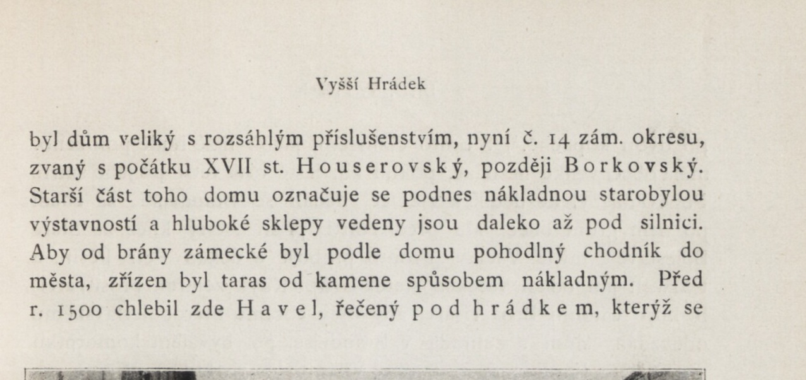

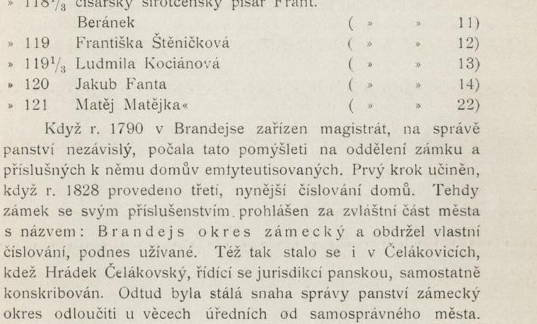

## SOL-05-N02 · Starší držba a odprodej úředního příbytku kolem roku 1777

Justin Václav Prášek, díl II, s. 252, poslední odstavec. Na stránce je v souvislosti s bývalým Borkovským domem č. 14 výslovně uveden „úředním příbytkem“ s rozmezím 1755–1777 a formulací „po jehož odprodání“. Poté se podle něj forštmistři opět přestěhovali do jágrhauzu ve Staré Boleslavi. Na s. 254 uvádí, že Borkovský dům byl zakoupen pro ubytování fořtmistra Kiliána Josefa Kalivody, uvedeného k roku 1748, a že nadlesní Vilkeding a Giller bydleli v jágrhauzu. Z data 1748 na s. 254 plyne rok působení Kalivody, samostatné datum koupě dům v textu nedostal. Ani rok 1777 zde není datem přečtené trhové smlouvy. [S. 252](https://ndk.cz/uuid/uuid:d1944fe0-a112-11e6-bfc2-001018b5eb5c) · [S. 254](https://ndk.cz/uuid/uuid:d23fab10-a112-11e6-bfc2-001018b5eb5c)

Díl II, s. 163, klade na dům Borkovský stejného čísla odkaz 100 zlatých chrámu sv. Pavla v závěti zámeckého hejtmana Jana Jaroslava Mezleckého z Palmlevů (1702), s citací **XX, 44 sld.** Na s. 87 Prášek zároveň říká, že Jan Josef, syn téhož hejtmana, držel v roce 1743 dům č. 14. V této pasáži je potřeba číst až do konce odstavce, protože je v ní také jiné číslo 12 z. o. [S. 163](https://ndk.cz/uuid/uuid:c658cb10-a112-11e6-bfc2-001018b5eb5c) · [S. 87](https://ndk.cz/uuid/uuid:bc0d99b0-a112-11e6-bfc2-001018b5eb5c)

Díl II, s. 84, označuje Maximiliána z Gilleru slovesem „držel“ a vymezuje roky 1787 až 1798 u č. 14 z. o. U jeho jména není poznámka ani odkaz na konkrétní vložku. Na s. 83 a 85 jde o pokračování abecedního soupisu obdobných šlechtických zmínek a žádná sousední poznámka citaci tohoto hesla nedoplňuje. [S. 83](https://ndk.cz/uuid/uuid:bba031e0-a112-11e6-bfc2-001018b5eb5c) · [S. 84](https://ndk.cz/uuid/uuid:bbd21750-a112-11e6-bfc2-001018b5eb5c) · [S. 85](https://ndk.cz/uuid/uuid:bbe52a20-a112-11e6-bfc2-001018b5eb5c)

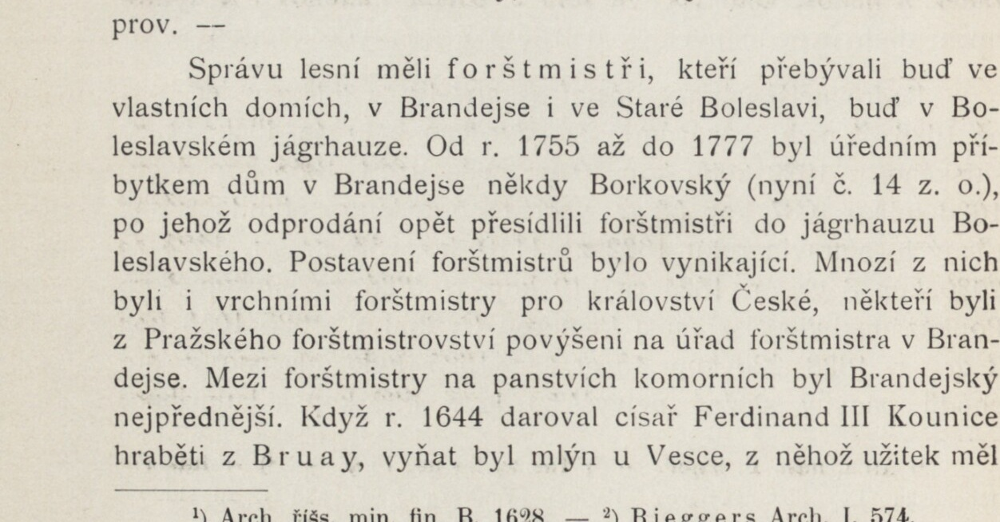

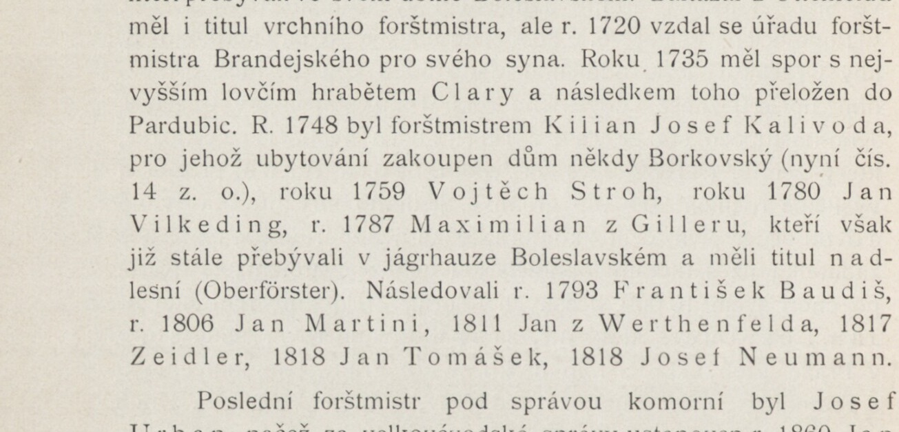

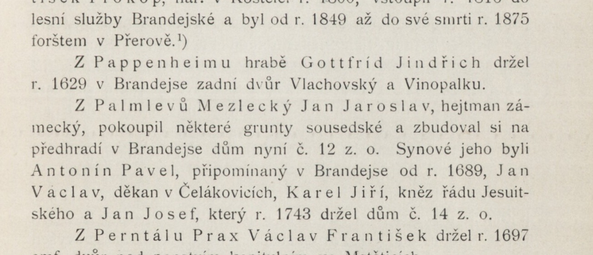

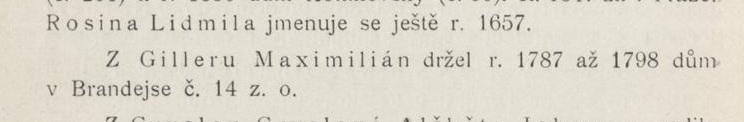

## SOL-05-N03 · Jakub Fanta, 8. 8. 1781

SOA v Praze, Sbírka matrik, Brandýs nad Labem 04, zemřelí s. 24 vlevo, druhý srpnový zápis. [Obraz, sn. 68](https://ebadatelna.soapraha.cz/d/4153/68) · [Index F, sn. 41](https://ebadatelna.soapraha.cz/d/4188/41)

> 8. | P. Mirtinz (?) [N. 2.] | […] D. Decanus [N. 1.] | Prenobilis D. Jacobus Fanta Jubilatus offic[iarius] Oeconomicus. | Cathol. | ad Kristum (?) | Brund. | [opraveno na] 120 | 76.

Překlad. V Brandýse č. 120 je k 8. srpnu 1781 veden urozený pan Jakub Fanta, penzionovaný hospodářský úředník, katolík, 76 let. Údaje v prvních sloupcích označují pohřbívajícího a zaopatřujícího kněze. Den úmrtí a pohřbu v tomto řádku odděleně napsány nejsou. Označení povolání je čitelné přímo v řádku, index zachycuje jméno, datum a svazek. Matrika sama nevypovídá o vlastnickém právu ani o dědictví.

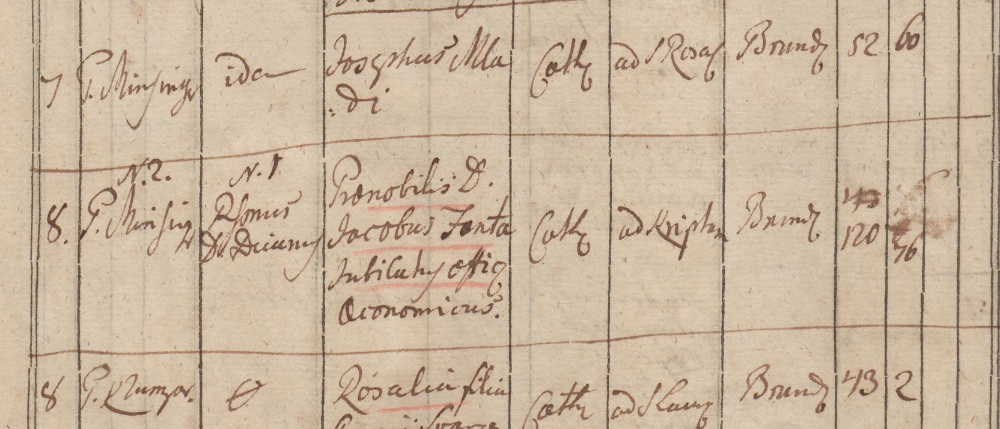

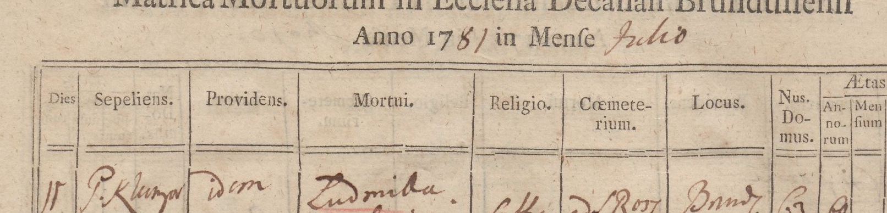

## SOL-05-N04 · Úmrtí Anny, dcery měšťana Jana, 4. 8. 1783

SOA v Praze, Sbírka matrik, Brandýs nad Labem 04, zemřelí s. 39 vpravo, první položka pod „In Augusto“. [Obraz, sn. 75](https://ebadatelna.soapraha.cz/d/4153/75)

> 4 | P. Martinez (?) | † | Anna filia D. Joannis Fra-/winger (?) civis | Cathol. | ad S. Laurentium | Brund. | 120 | [roky prázdné, měsíce] 7.

Překlad. K 4. srpnu 1783 je u Brandýsa č. 120 zapsána zemřelá katolička Anna, sedmiměsíční dcera pana Jana, měšťana. Pohřbena byla u sv. Vavřince. Otcovo příjmení je rozdělené mezi řádky a čtení Frawinger (?) zůstává pracovní. Otec i dítě jsou odlišné osoby od Fanty z roku 1781. Zápis dokládá jinou rodinu u čísla domu mezi Fantovým úmrtím a dobou, k níž Prášek klade držbu Maximiliána. Titul „civis“ sám o sobě nedokládá, že měšťan vlastnil tento konkrétní dům.

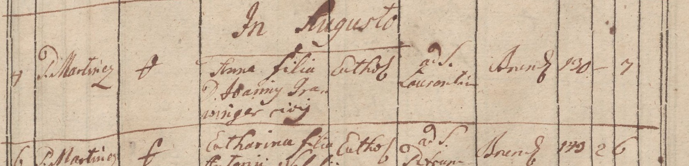

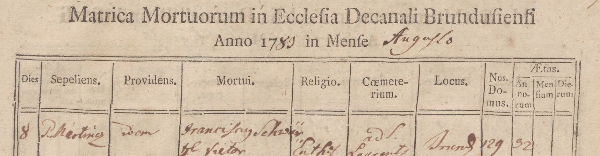

## SOL-05-N05 · Narození Anny, dcery služebné Marie, 19. 5. 1797

SOA v Praze, Sbírka matrik, Brandýs nad Labem 05, město, s. 152, poslední řádek vpravo. [Obraz, sn. 81](https://ebadatelna.soapraha.cz/d/4154/81)

> 19 Maj[i] | 120. | Ann. | [katolička, děvče, nemanželská] | [škrtnutá či vyprázdněná rubrika otce, znak ∅] | Maryj Plato-/wa. – Služebna. | Ana Přibylowska (?), Tochter des […] [Bürgers (?)]; George Elbas (?) […] | Baptisavit […].

Překlad. Dne 19. května 1797 je v Brandýse č. 120 zapsána katolická nemanželská Anna. Matka je Marie Platová (?), služebná. Otec není uveden. Příjmení kmotry a kmotra i jejich stavy jsou částečně nejisté. Zápis jmenuje profesní stav matky, jejího zaměstnavatele však neuvádí. Skutečnost, že rodila v tomto domě, nedokládá vztah k jeho držiteli.

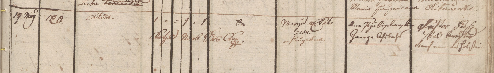

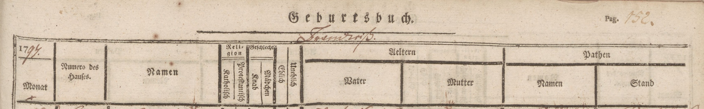

## SOL-05-N06 · Úmrtí téže Anny, 2. 8. 1797

SOA v Praze, Sbírka matrik, Brandýs nad Labem 24, město, s. 80 vpravo, druhý zápis shora. [Obraz, sn. 43](https://ebadatelna.soapraha.cz/d/4175/43)

> 2 August. | 120. | Anna Dcera Maryj Platowi (?) Swob. Osobi. [Podepsaná formule:] […] P. Pet […] Cap. | [katolička, ženského pohlaví] | woch. 10. | Psotnik (?).

Překlad. Dne 2. srpna zemřela v č. 120 deset týdnů stará Anna, dcera svobodné Marie Platové (?). U příčiny lze pravděpodobně číst „psotník“. Shodují se jméno dcery, jméno matky, adresa, rodinný stav matky a přibližný věk. Od 19. května do 2. srpna uplynulo 75 dní, tj. 10 týdnů a pět dní. Rok je čten podle souvislé posloupnosti záznamů za rok 1797. Na sn. 45 se nový rok výslovně uvádí až po prosincovém řádku. [Přechod do roku 1798, sn. 45](https://ebadatelna.soapraha.cz/d/4175/45)

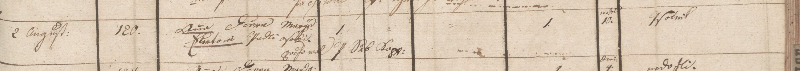

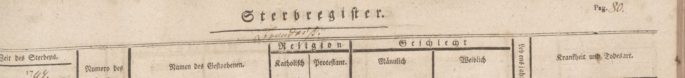

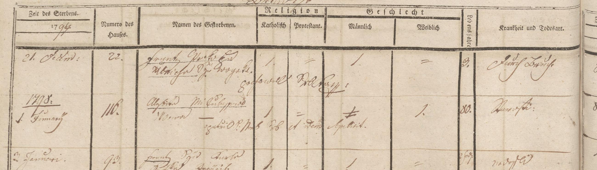

## SOL-05-N07 · Odlišné číslo 120 ½, 28. 4. 1798

SOA v Praze, Sbírka matrik, Brandýs nad Labem 24, město, s. 86 vpravo, druhý zápis shora. [Obraz, sn. 46](https://ebadatelna.soapraha.cz/d/4175/46)

> 28. April. | 120 ½. | Barbara Hammanin (?) Witwe. […] | [katolička, ženského pohlaví] | 72 (?) | Abzehrung.

Překlad. Dne 28. dubna 1798 zemřela vdova Barbora Hammanová (?), katolička z č. 120 ½, asi 72 let. Zapsanou příčinou je vyčerpání či souchotiny v dobovém širším významu slova *Abzehrung*. Číslo s výslovným zlomkem nepřiřazuji bez katastrálního dokladu k hlavnímu domu č. 120.

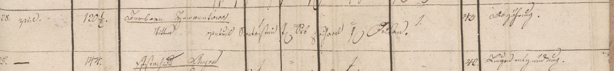

## SOL-05-N08 · Která evidence může obsahovat převod

Prášek na s. 92 popisuje vlastní pravomoc zámeckého příslušenství a evidenci domků na panské půdě na obou březích. Pro starší zápisy jmenuje volné vložené listy v purkrechtní knize staroboleslavské, **dominikální knihu panství založenou roku 1754, zkratku D. G.**, a pro konec 18. století samostatnou purkrechtní knihu. Tato pasáž popisuje praxi v daném okruhu domů, neposkytuje přímé folio domu 120. U doplnění na s. 93–94 jsou pozdější městské odkazy. Poznámka u jiného domu č. 12 z. o. prokazuje, že i některé pozdější zápisy těchto domů se objevují v městských knihách. Prášek v předmluvě k dílu III, s. VII, vysvětluje, že upustil od důsledného tištění folií. [S. 92](https://ndk.cz/uuid/uuid:bd02cf20-a112-11e6-bfc2-001018b5eb5c) · [S. 94](https://ndk.cz/uuid/uuid:bd2dafb0-a112-11e6-bfc2-001018b5eb5c) · [Díl III, s. VII](https://ndk.cz/uuid/uuid:6bf3c190-a2eb-11e6-9328-005056825209)

Městská digitalizovaná **Kniha památní gruntovní města Brandejsa**, č. 43, má titulek s rokem založení 1732 a v popisu portálu rozsah 1732–1769. Oddíly rejstříku obsahují osobní jména a předměty zápisů. V přečtených výběrech jsem nenašel jednoznačnou vložku přidělitelnou ke sledovanému domu. Správnou novější knihu či konkrétní příslušné folio se veřejně nepodařilo identifikovat. [Titul sn. 4](https://ebadatelna.soapraha.cz/a/7107/4) · [Popis a časový rozsah](https://ebadatelna.soapraha.cz/pages/ArchivaliePage/archivalieId/7107) · [Městský fond NAD 148](https://aron.soapraha.cz/apu/9962d34a-f388-4cbb-a501-d2f71e2ea600)

Z fondů je pro řešení první v pořadí [Velkostatek Brandýs nad Labem, NAD 513](https://aron.soapraha.cz/apu/24e44b34-02a6-43d8-99e3-741c7f11b75c), který výslovně zahrnuje úřad vrchnostenský i soudní a jeho pozemkové knihy. [Inventář Miroslava Volfa 193, II 83](https://aron.soapraha.cz/apu/350001ff-39b3-4d17-a597-5c2d34eb88cb) jsem dohledal na úrovni katalogu. Ve veřejném přehledu je digitalizovaná pozemková kniha pro jiný titul podle obcí, **Stará Boleslav, Hlavenec, Mečeříž a Chotětov (1716–1805)**. Rozsah let je relevantní, katalog ale samostatný Brandýs ani dům 120 neuvádí. Kvůli možnosti volných příloh je to doplňková stopa. [Digitalizovaná kniha a/1610](https://ebadatelna.soapraha.cz/a/1610/1)

Pro možný soudní spis jsem zkontroloval známý rejstříkový list Národního archivu, Zemský soud Praha, NAD 875, s. 332. Jména Maxmilián a Josef jsou doložena v rejstříku a příslušné inventární řady určují povahu a krajní data. Samostatný veřejný obraz pozůstalostního spisu **V 157, inv. č. 198, kart. 856** (1790–1791) nebo poručenského/opatrovnického spisu **VII A 385, inv. č. 200, kart. 1498** (1798) se nepodařilo doložit. Rejstříkový záznam sám účastníky rodinného převodu neuvádí. [Rejstřík](https://vademecum.nacr.cz/vademecum/permalink?xid=5b851c5062d7089c62e40f7ea7617967&scan=7edf8610-23bf-4fa6-a221-39956eb72070&parentType=10026) · [Pozůstalosti s. 67](https://vademecum.nacr.cz/vademecum/permalink?xid=bb3927d840d364c540e1cafef0816690&scan=5ce0976e-4421-47a2-9856-b760c9c6176d&parentType=10026) · [Poručenství s. 96](https://vademecum.nacr.cz/vademecum/permalink?xid=bb3927d840d364c540e1cafef0816690&scan=06ca9f14-2081-4f62-9b86-3d162f77e2d2&parentType=10026)

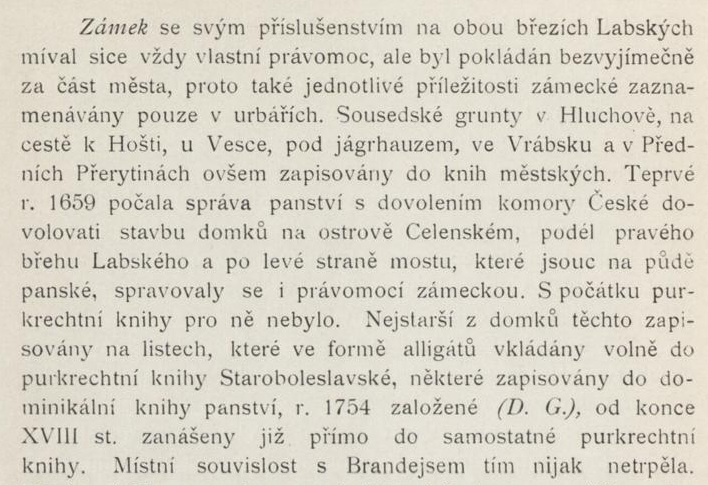

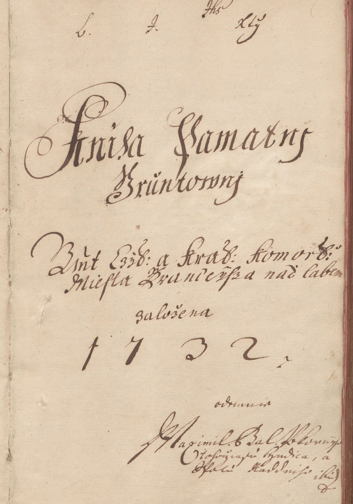

## Prohledané intervaly

| Pramen a obec | Typ | Data a snímky | Způsob čtení | Výsledek a mezery |
|---|---|---|---|---|
| Prášek, díl I–III, Brandýs a Stará Boleslav | Obraz tisku a OCR | I s. 68–70, II s. 83–87, 92–95, 113, 163, 252–254, III s. VII a 409 | Výběr stran a jmenné/číselné hledání v OCR, klíčové strany z obrazu | Historické názvy, starší držitelé, odprodej kolem 1777, stopy k evidenci. Fanta z dílu III s. 409 se vztahuje k jinému domu a pozdějšímu roku. |
| Archiv města Brandýs, kniha 43 | Městská gruntovní kniha | 1732–1769, sn. 2–4, 454–466 s archivními kopiemi 462, 468–471 | Vybrané titulní, koncové a rejstříkové strany, písmena B, F, G, H, J, K, M, S | Bez jednoznačného odkazu na sledovaný dům. Celek smluvních zápisů nebyl procházen. |
| Brandýs 04, město | Zemřelí | Srpen 1781 až srpen 1783, sn. 68–75 | Souvislá kontrola sloupce čísel, čtení dvou zásahů | N03, N04. Úsek po srpnu 1783 v tomto svazku nedočten. |
| Brandýs 04, město | Narození | Kontrolní sn. 24, 27, 30–33, hlavně jaro až prosinec 1783 | Výběr stran a adres | Odpovídající křest Anny z roku 1783 nezjištěn, okolí ledna není souvisle přečtené. |
| Brandýs 38, město a přifařené obce | Jmenný index úmrtí | Písmeno F, sn. 41–43, cíleně 1781–1783 | Hledání podle příjmení | Fanta v rejstříku. Pracovní čtení příjmení Frawinger (?) se tu nepodařilo potvrdit. |
| Brandýs 19, město | Oddaní | Výběr sn. 3, 7 a 27, krajní data 1784 a 1801 | Cílená kontrola domovních čísel a přibližné chronologie | Výběr bez zápisu pro dům 120. Roky mezi snímky nejsou vykázány jako prohledané. |
| Brandýs 05, město | Narození | Květen 1797, sn. 80–81 | Cílené listování podle adresy a věku při úmrtí | N05. Kvůli mezerám v získání dalších obrazů nelze odečíst souvislý širší interval. |
| Brandýs 06, město | Narození | 1798 a kontrolně sn. 14, sn. 3–4, 7–10 a 14 | Výběr stran, sloupec čísel | Bez jasné nové položky č. 120. Snímky mezi uvedenými nebyly souvisle přečteny. |
| Brandýs 24, město | Zemřelí | Výběr sn. 5, 35, 38. Souvisle sn. 40–46 od druhé poloviny 1796 do května 1798 | Domovní čísla, datace a přepis konkrétních řádků | N06 a N07. Polovina u čísla 120 odlišena od hlavního čísla. Po květnu 1798 nejsou zdejší obrazy souvisle přečtené. |
| ARON, eBadatelna, VadeMeCum | Katalogy, rejstřík a veřejné obrazy | Příslušné fondy, cíleně 1777–1798, soudní řady 1790–1791 a 1798 | Archivní fondy, pomůcky a obrazy rejstříku | Novější městská nebo zámecká kniha s konkrétním převodem nebyla otevřena. Soudní obsah za rejstříkem nezjištěn, N08. |

## Co převzít a kde navázat

> Brandýs č. 120, později č. 14 zámeckého okresu, je podle Práška starší Houserovský a později Borkovský dům. V letech 1755–1777 sloužil podle něj jako úřední příbytek forštmistrů a následně byl odprodán. Prášek uvádí držbu Maximiliána z Gilleru v letech 1787–1798, bez citace konkrétní smlouvy (SOL-05-N01–N02). V domě je doložen Jakub Fanta, penzionovaný hospodářský úředník, 8. 8. 1781. Dne 4. 8. 1783 tam zemřela dcera brandýského měšťana Jana s pracovním čtením Frawinger (?). V květnu a srpnu 1797 jsou v témže domě doloženy služebná Marie Platová (?) a její nemanželská dcera Anna při narození a úmrtí (SOL-05-N03–N06). Tyto záznamy dokládají domácnosti a adresy. Prodávající Maximiliánovi i následný dědic či nabyvatel zůstávají otevření.

První navazující jednotkou je dominikální kniha **D. G., založená 1754**, a samostatná purkrechtní kniha zámeckého okruhu v inventáři **II 83 Velkostatku Brandýs**, pokud se dochovala. Hledat dům Houserovský či Borkovský, staré č. 120 a samostatně zápisy se zlomkem. Začít odprodejem kolem roku 1777 a jeho platební agendou, pokračovat obdobím 1781–1787 a roky 1789–1798. Za účastníky hledat po jednom jména Fanta, Giller/Gillern/Güller, případně příbuzné, vdovu či správce pozůstalosti. Samostatná kontrola soudního spisu **V 157, kart. 856** může přinést soupis majetku a seznam dědiců. Ještě online lze pokračovat v matrice zemřelých **Brandýs 24 od sn. 47** a v matrice narozených **Brandýs 04 u sn. 28–29** pro první Annu.
