# SOL-06 · Giller před rokem 1650 ve vídeňských válečných protokolech

## Závěr

- **Přímo doloženo.** Dvorská válečná rada zařadila 8. května 1647 jméno **Giller** mezi adresáty výzvy k věrnosti a udržení postů i přes kolínské příměří. Rejstříkový odkaz jsem propojil s vlastním zápisem na f. 170v. Zápis uvádí samotné příjmení. Křestní jméno, hodnost, útvar a příbuzenství zůstávají neurčené (SOL-06-N01).
- **Přímo doloženo o pluku.** Wrbnova jednotka je v červnu 1645 uvedena mezi pěti pluky pod velením Montecuccoliho. V srpnu 1646 je se šesti kompaniemi jmenován plukovník Štěpán z Vrbna a Bruntálu a jedná se o doplnění tří kompanií. Ještě 31. července 1647 válečná rada stále píše o hraběti z Vrbna a jeho pluku ve Slezsku. Jsou to dílčí zprávy o pluku a jeho držiteli či představiteli. Neposkytují kompletní stav důstojníků ani jméno podplukovníka (SOL-06-N02, N05, N06).
- **Přímo doloženo o znění tradice.** Gotha výslovně klade rytmistra Johanna Christofa „im Regiment ‚Gallas‘“. Válečná rada ovšem mluví vedle gallasovských jezdců zvlášť o pěším pluku a o dragounech. První pracovní kandidát je proto Gallasovo jezdectvo. Rok služby, konkrétní kompanie a osobní totožnost jsou otevřené (SOL-06-N03, N04).
- **Pravděpodobné.** Kontext výzvy z 8. května ukazuje spíše na držitele vojenských postů nebo osoby odpovědné za ně. Písařovo shrnutí skupině nepřisuzuje společnou hodnost. Nelze určit, zda Giller byl plukovní či posádkový důstojník, nebo měl jiný druh odpovědnosti (SOL-06-N01).
- **Otevřené.** Není doloženo, že adresátem z roku 1647 byl jeden ze dvou mužů z Gotha. V rozhodujících záznamech nevystupuje Tschammer, Bartsch, Deschna, podpis ani pečeť. Otec a syn zůstávají vazbou uváděnou v pozdním rodopise. Z nalezených záznamů ani neplyne, kdy se funkce obou mužů měly překrývat (SOL-06-N01 až N07).

Proti stavu projektu v revizi 7c02f35 přibyl zejména konkrétní soudobý zápis jména, přesné znění Gotha a odkazy na původní protokoly k tam uváděným plukům. Zkontrolovány profily 2048, 2049, 4096 a 4097, související profil 1024 a deník č. 656, 658, 662, 682–694. Č. 656 a 662 podávají kontext rodů Tschammer a Bartsch a pozdního predikátu Sternegg. Č. 658 zachycuje negativní literární rešerši. Č. 682 a 683 vedou ke Gotha a k přehledu Wredeho. Č. 690 upřesňuje zacházení s predikátem, č. 691 dokládá jinou linii Gillerů z Lilienfeldu a č. 693–694 vymezují podklady k Deštnému a listu z roku 1700. Nejbližší paralelní práce je v deníku č. 683 a 694. [Deník ve výchozí revizi](https://github.com/jgillern/gillernrodokmen/blob/7c02f3528be438f49af80b0761b5653cdd3eee02/data/research_log.md#L663) · [Profily ve výchozí revizi](https://github.com/jgillern/gillernrodokmen/blob/7c02f3528be438f49af80b0761b5653cdd3eee02/data/osoby.py#L43) · [Pracovní větev](https://github.com/jgillern/gillernrodokmen/tree/claude/nice-dirac-8inizg)

## Jak číst odkazy

Fond Österreichisches Staatsarchiv, Kriegsarchiv, Hofkriegsrat, Protokolle. Expedit a Registratur mají vlastní rejstříky na konci knih a samostatné číslování. Písmena jsou vyříznuta do bočních záložek a dále členěna podle druhého písmene (např. *Ga, Ge, Gi, Go, Gu*, *Wi*, *Wu*). Čísla vedle hesla jsou odkazy na rukopisná folia, nikoli čísla položky ani snímku. Vyhledám příslušné číslo v obsahu knihy, ověřím je v pravém horním rohu snímku a otevřu i další snímek pro verso. U folia 170 je 170r vpravo na snímku 129, zatímco 170v vlevo na snímku 130. URL `?pg=` je nulová, číslo v tabulce o jedno vyšší. Vynechaná folia a vložené listy nedovolují plošný přepočet aritmetikou. [Archivní přehled](https://www.archivinformationsystem.at/detail.aspx?ID=4729) · [Digitální sbírka](https://library.hungaricana.hu/en/collection/austrian_state_archives_Hofkriegsrat/)

V přepisech ponechávám dobové znění a zkratky. (?) označuje nejisté čtení, […] nečitelné místo. Čísla položek v Expeditu nepřebírám jako den v měsíci.

## SOL-06-N01 · Giller ve výzvě po kolínském příměří

**8. května 1647, vídeňská dvorská válečná rada.** Místo Gillerova postu zápis nesděluje. Kriegsarchiv, Hofkriegsrat, Registratur 1647, kniha 297. Obraz rejstříku *Gi*, sn. 323, vpravo přibližně ve třetině. Obraz protokolu f. 170v, sn. 130, položka 90 úplně nahoře vlevo. [Rejstřík](https://library.hungaricana.hu/en/view/KA_HKR_297_1647R/?pg=322) · [F. 170r](https://library.hungaricana.hu/en/view/KA_HKR_297_1647R/?pg=128) · [F. 170v](https://library.hungaricana.hu/en/view/KA_HKR_297_1647R/?pg=129)

**Přepis.** Rejstřík „Giller. 170.“. Záhlaví zápisu „Maius. 8.“ Okraj „Wünzenhaimb (?) / Wahl / Westphal / Zehlen (?) / Lanz (?) / Giller“. Text „werden zur beständiger treu / und manuteni[e]rung ihrer Posten / ungeacht deß Chur Cöllni- / schen armistitij angemahnt.“ Ve slově *manuteni[e]rung* je hranaté *e* doplněním čtení zkratkového rukopisu.

**Překlad.** „Jsou napomenuti k trvalé věrnosti a k udržení svých postů bez ohledu na příměří kolínského kurfiřta.“

**Totožnost.** Giller je účastníkem skupinové věci. Podporu pro vojenskou interpretaci dává *Posten* a okolní agendy o velitelích a posádkách. U jeho jména není titul. Ve stejném snímku je v odlišné položce 93 a na f. 171r v položce 97 vrchní komisař Keller, jehož jméno má samostatný rejstříkový odkaz pod *Ke*. Shoda folia je náhodná pro účely identifikace. Rejstříky dalších pěti knih v prověřené části *Gi* druhý přesný odkaz *Giller* nepřinesly.

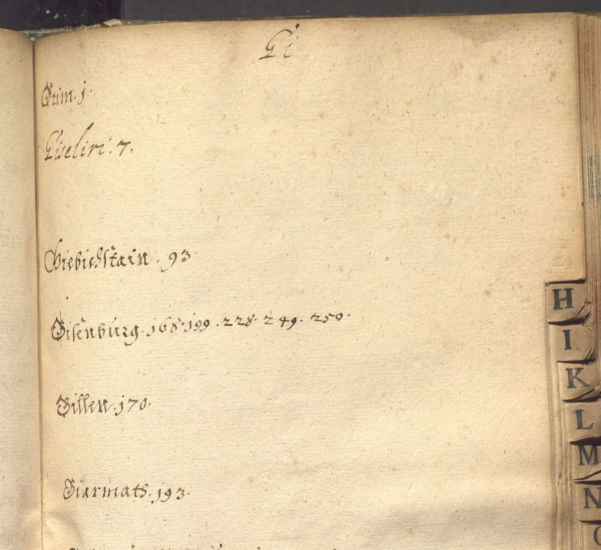

Pod nadpisem *Gi* je u jména jediný odkaz 170.

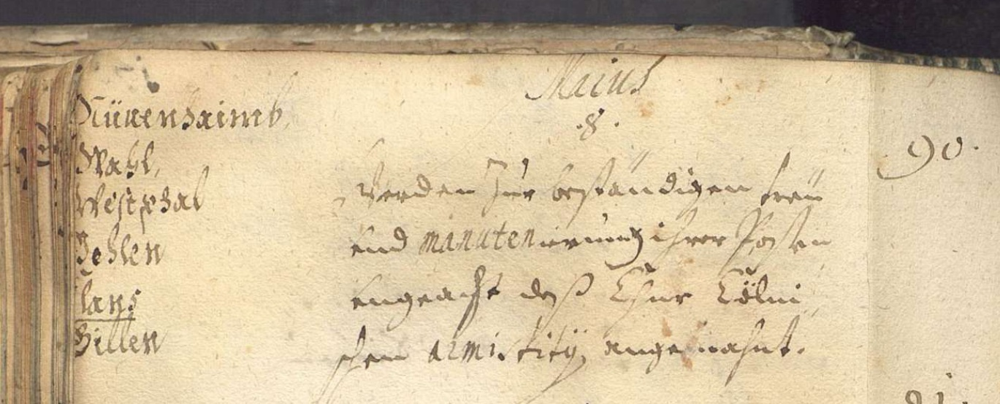

Nahoře vlevo na snímku 130 je hlas úřadu v množném čísle a Giller je posledním z okrajových hesel.

## SOL-06-N02 · Štěpán z Vrbna a Bruntálu a šest kompanií

**Srpen 1646, vídeňská dvorská válečná rada.** Kriegsarchiv, Hofkriegsrat, Expedit 1646, kniha 294. Obrazy rejstříku *Wi* sn. 467 a chronologického zápisu f. 317r, sn. 223, položka 26 vpravo v horní polovině. [Rejstřík](https://library.hungaricana.hu/en/view/KA_HKR_294_1646E/?pg=466) · [F. 317r](https://library.hungaricana.hu/en/view/KA_HKR_294_1646E/?pg=222)

**Přepis.** „Würbi 247. 284. 316. 317.“ Položka 26 „Stephan von Würben und Freudenthal / Obr. über die 6. Compagnien, darauß / Er 3. Complet machen solle, welchs / aber wegen aufgehebter Winter- / quartier nit vollzogen werden kön[n]e, / bitt abschriegen (?) umb die baare / werbgelder.“ Okraj „Würben und Freudenthal.“

**Překlad.** Plukovník Štěpán z Vrbna a Bruntálu jedná o šesti kompaniích, z nichž má tři uvést do plného stavu. Kvůli zrušenému zimnímu ubytování to však podle zprávy nelze provést. Žádá o peníze na verbování v hotovosti.

**Totožnost.** Jméno Štěpána a přídomek z Bruntálu identifikují důstojníka. Zkratka „Obr.“ v hlavním textu označuje plukovníka. Folio neobsahuje položku o obsazení funkce podplukovníka. Na f. 316v, vlevo sn. 223, položka 23 zmiňuje čtyři würbenské kompanie v jiné věci. Počty odkazují na odlišné úřední předměty. Na f. 247r, položka 36, je Wrbna mezi hesly k hlášení Montecuccoliho s odkazem na 11. a 12. června. Na f. 284r je jeho jméno v Gonzagově hlášení ve věci verbování a zimního ubytování. [F. 247r](https://library.hungaricana.hu/en/view/KA_HKR_294_1646E/?pg=173) · [F. 284r](https://library.hungaricana.hu/en/view/KA_HKR_294_1646E/?pg=200) · [F. 316v](https://library.hungaricana.hu/en/view/KA_HKR_294_1646E/?pg=222)

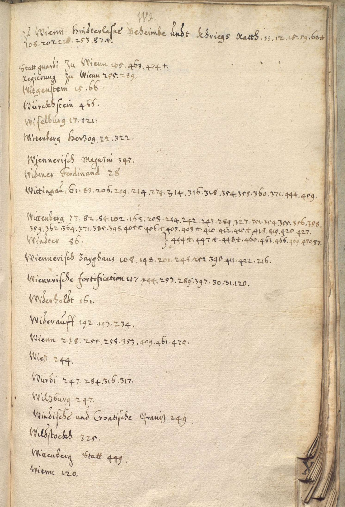

Řádek „Würbi“ je ve spodní čtvrtině pravé strany.

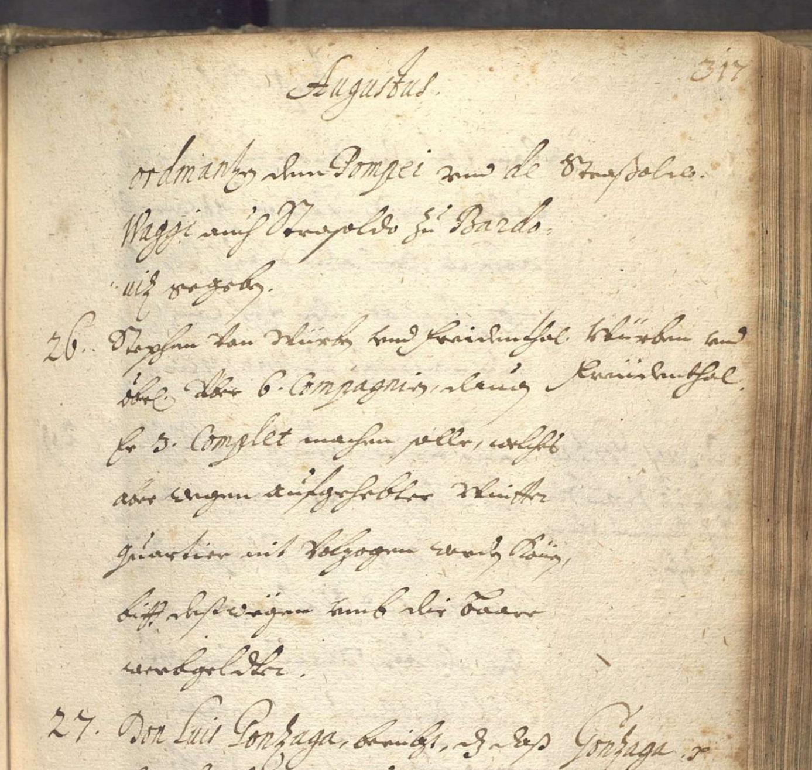

Položka 26 na pravé straně pod záhlavím *Augustus*.

## SOL-06-N03 · Gotha výslovně uvádí „im Regiment“

**Gotha, 1884.** *Gothaisches genealogisches Taschenbuch der freiherrlichen Häuser*, 34. ročník, Justus Perthes, s. 276, PDF sn. 302. Čten obraz tištěného vydání, heslo *Gillern*, druhý odstavec. [Strana 276](https://sbc.org.pl/Content/859298/i635235-1884-00-0001.pdf#page=302)

**Rozhodující znění.** „Heinrich Christof Giller, Kaiserl. Oberstleutnant im Regiment ‚Wrbna‘“ a „welcher Kaiserl. Rittmeister im Regiment ‚Gallas‘ war“. Zájmeno *welcher* odkazuje na Johanna Christofa, syna Heinricha. Ve stejném odstavci se píše, že Heinrich se v 17. století usadil ve vsi Deschna, byl dvakrát ženat, z prvního sňatku s rozenou von Tschammer měl Johanna Christofa a ten si vzal Susanne rozenou Bartsch von Sternegg. Tisk jim připisuje syny Christofa Heinricha a Friedricha Wilhelma.

**Překlad citovaných formulí.** „Heinrich Christof Giller, císařský podplukovník v pluku Wrbna“ a „který byl císařským rytmistrem v pluku Gallas“.

**Síla dokladu.** Čtení podporuje hledání v konkrétních útvarech nesoucích jméno Gallas. Tisk nepíše „pod Gallasem“ ani neudává přesný rok služby či druh pluku. U Susanne je dobová vyhledávací forma především Bartsch/Barsch/Partsch. Podle deníku č. 662 získal Jiří Antonín Barsch přídomek teprve 1695. Jména a varianty k hledání jsou *Johann/Johan/Hans/Joannes + Christof/Christoph/Christoff/Christophorus*, dále *Giller/Gillern/Gieler/Gieller/Giler/Gyller/Güller* a kontrolně *Killer/Killer(n)*. Hodnost *Rittmeister, Rittmaister, Ritmeister, Ritmaister*, latinsky *capitaneus equitum*. U Heinricha také *Heinrich/Henrich + Christof*, podplukovník pod *Obristlieutenant*, *Obrist Leutt.*, *Oberstleutnant*. Lokalizaci Deschna jako Deštného u Jakartovic podporuje dosavadní místopisná práce č. 683 a 694. Nové vojenské snímky toto místo nespojují s žádným Gillerem.

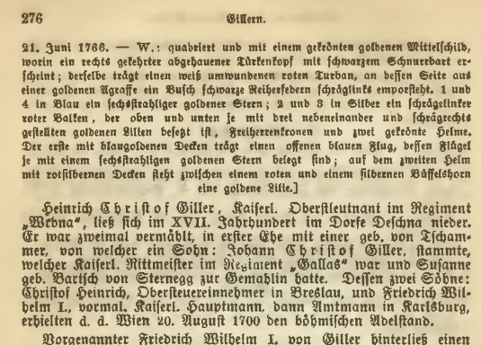

Čtěte odstavec pod koncem popisu erbu na s. 276.

## SOL-06-N04 · Gallasovi jezdci, pěší a dragouni v evidenci roku 1647

**Rok 1647, vídeňská dvorská válečná rada.** Registratur 1647, kniha 297. Obrazy rejstříku *Ga*, sn. 321, f. 9r na sn. 9 a f. 173r–v na sn. 132–133. Na f. 9r v dolní polovině jde o zápis pod dnem 6, měsíční nadpis z této reprodukce neberu jako jistý. Následující dva zápisy na f. 173r–v jsou z 11. května. [Rejstřík](https://library.hungaricana.hu/en/view/KA_HKR_297_1647R/?pg=320) · [F. 9r](https://library.hungaricana.hu/en/view/KA_HKR_297_1647R/?pg=8) · [F. 173r](https://library.hungaricana.hu/en/view/KA_HKR_297_1647R/?pg=131) · [F. 173v](https://library.hungaricana.hu/en/view/KA_HKR_297_1647R/?pg=132)

**Přepis a překlad.**

- **Opravené čtení f. 9r.** „Gallassischen Wittib“ označuje Gallasovu vdovu. V prvním průchodu bylo poslední slovo chybně přečteno jako „Reütter“. Čtení vdovy potvrzuje také jmenný rejstřík pod Ga. [Porovnání obou výřezů a přepis ve druhém kole](../../2026-11-25-kolo2/vojsko1647/README.md)
- F. 173r, položka 115 „Intimatur daß dem jungen / Ferdinand Ignatio dessel- / bige Regt conferirt worden, / soll ih[n] dessen conservation / bestens sein lassen.“ Okraj „Gallasischen / Obrist Leütt. zu / fueß / p Gallas“. Oznámení gallasovskému pěšímu podplukovníkovi, že pluk byl udělen mladému Ferdinandu Ignácovi a podplukovník má co nejlépe pečovat o jeho udržení. Podplukovník v tomto zápise zůstává bezejmenný.
- F. 173r, položka 116 „Intimatur daß selbiges Regt / dem Antonio Panzatio (?) Gr. / Gallas conferirt worden, soll / ihn dessen conservation lassen / angelegen sein.“ Okraj „Gallasischen / Dragoner Ob- / risten Leütt. / p Gallas.“ Oznámení gallasovskému dragounskému podplukovníkovi, že pluk byl udělen hraběti Antoniu Panzatiovi (?) Gallasovi, a výzva k jeho udržení. Podplukovník opět zůstává bezejmenný.
- F. 173v, položka 119 „Notificatur daß den Galla- / sischen 2. Söhn die Regter / gegeben worden, sollen ihnen / interim deren conservation / angelegen sein lassen.“ Okraj „Gallasischen / Obrist Leütt. zu / fueß et / Dragoner Obrist / Leütt. / p Gallas“. Společné oznámení oběma podplukovníkům o předání pluků dvěma Gallasovým synům.

**Totožnost a rozsah.** Jde o několik útvarů označovaných podle Gallase, proto je nutné rozlišovat Gallase coby vrchního velitele, plukovníka-majitele a jeho vojska v poli. Rytmistrova hodnost dává prioritu jezdectvu, zůstává však v pozdním prameni. Folio 9r patří Gallasově vdově. Na gallasovské sesednuté jezdce odkazuje [f. 243r č. 217](https://library.hungaricana.hu/en/view/KA_HKR_297_1647R/?pg=203). Folia 173r–v se týkají pěchoty a dragounů. V žádném z těchto výtahů není rytmistr pojmenován. Matyáš Gallas zemřel 25. dubna 1647, takže květnová oznámení zapadají do přechodu pluků po jeho smrti. Běžná dochovaná řada vojenských mustrlist a stavových tabulek začíná kolem roku 1740. Starší plukovní soupis je třeba hledat mezi jednotlivými polními a válečnými písemnostmi. [Matyáš Gallas](https://www.deutsche-biographie.de/sfz19825.html) · [Katalog řady mustrlist](https://archivinformationsystem.at/archivplansuche.aspx?ID=294948) · [Válečná kancelář Matyáše Gallase](https://dspace.cuni.cz/bitstream/handle/20.500.11956/191516/120479518.pdf?sequence=1)

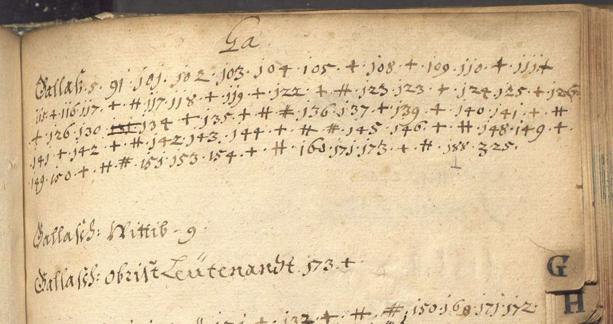

Pod souhrnným heslem pro Gallase jsou samostatné odkazy 9 a 173 s křížkem.

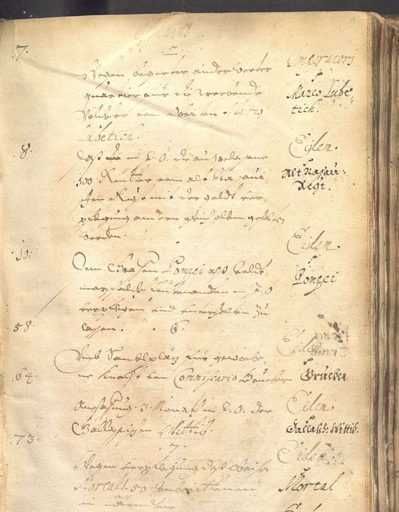

Předmětný záznam je za značkou dne 6. Čtení „Wittib“ v hlavním textu potvrzuje heslo v rejstříku.

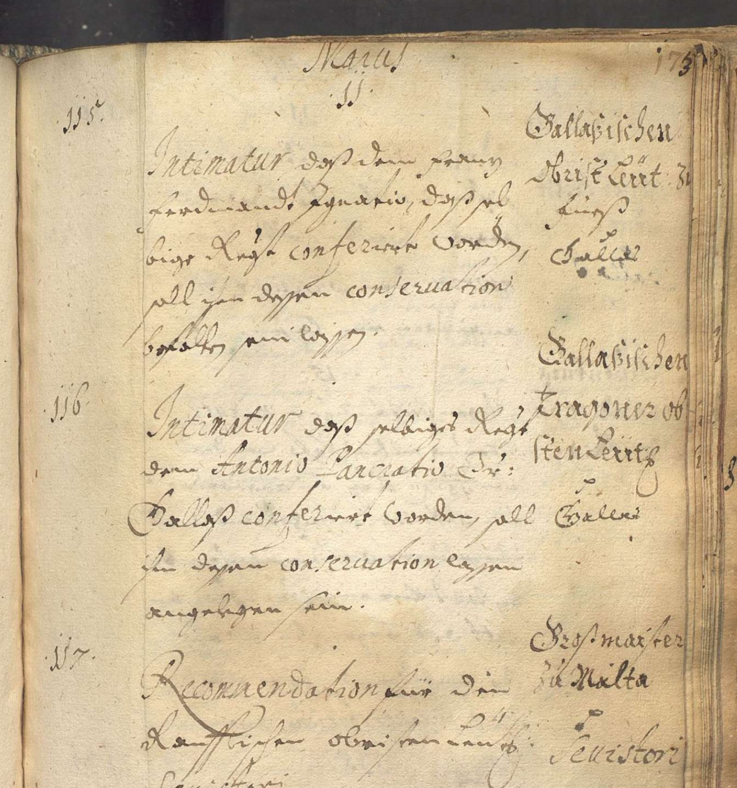

Na pravé straně f. 173r položky 115 a 116 s rozdílnými adresáty.

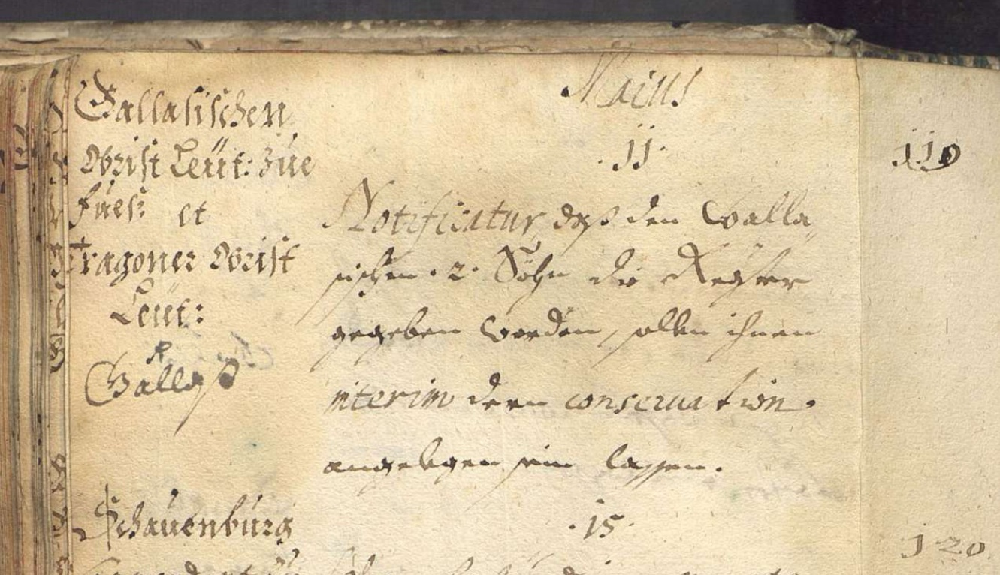

Položka 119 nahoře vlevo na f. 173v spojuje obě oznámení.

## SOL-06-N05 · Wrbnův pluk mezi Montecuccoliho jednotkami roku 1645

**Červen 1645.** Kriegsarchiv, Hofkriegsrat, Expedit 1645, kniha 292, obraz rejstříku *Wi* s odkazem „Wirben 227“ a obraz f. 227r–v, sn. 152–153, položka 24 vpravo dole s krátkým pokračováním vlevo nahoře. [Rejstřík](https://library.hungaricana.hu/en/view/KA_HKR_292_1645E/?pg=364) · [F. 227r](https://library.hungaricana.hu/en/view/KA_HKR_292_1645E/?pg=151) · [F. 227v](https://library.hungaricana.hu/en/view/KA_HKR_292_1645E/?pg=152)

**Přepis.** „Graff Raimund Montecuculi / bericht, daß Er mit denen 5. Regtern / als Passamier (?), Lüttich, Isen- / burg, Götz und Würben bey / […] angelangt und / nach gegebner ordinanz fort / marchiren werde.“ Okraj opakuje pět jmen.

**Překlad.** Hrabě Raimund Montecuccoli hlásí, že dorazil s pěti pluky označenými Passamier (?), Lüttich, Isenburg, Götz a Würben a podle rozkazu popochoduje dál. Místo v protokolním výtahu se mi nepodařilo bezpečně přečíst.

**Totožnost.** Würben označuje jeden z pěti pluků. Montecuccoli vystupuje jako velitel skupiny, jeho jméno proto nedoplňuje seznam vlastních důstojníků würbenské jednotky.

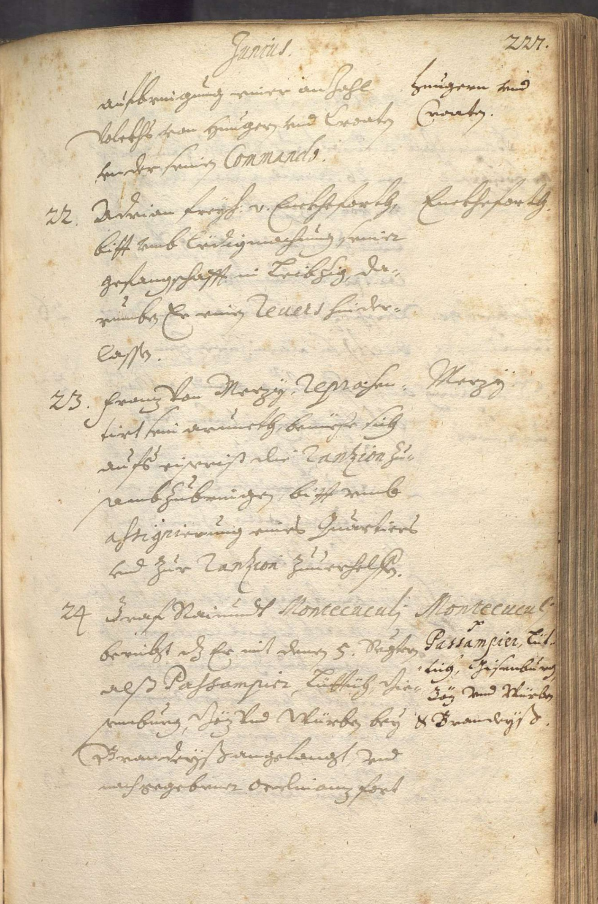

V dolní části folia 227r položka 24 s výčtem pluků.

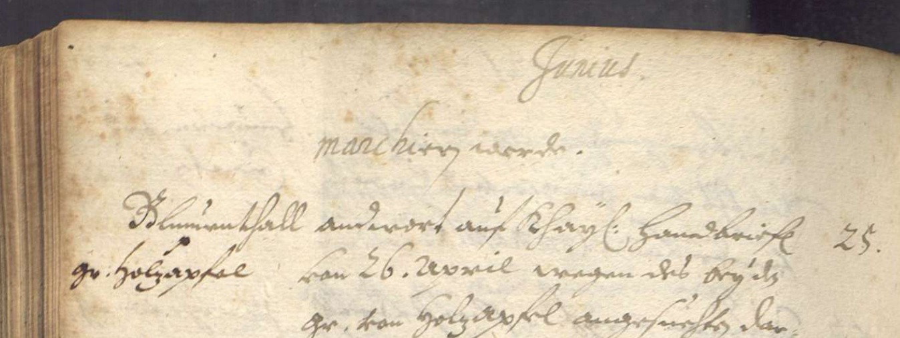

Nahoře na f. 227v poslední slova o pokračování v pochodu.

## SOL-06-N06 · Hrabě z Vrbna a pluk ve Slezsku v červenci 1647

**31. července 1647, vídeňská dvorská válečná rada, agenda Slezska.** Kriegsarchiv, Hofkriegsrat, Registratur 1647, kniha 297, rejstřík *Wu*, sn. 390. Obraz f. 220v, sn. 178, položky 117–118 vlevo, a související položka 109 na f. 219v, sn. 177. [Rejstřík](https://library.hungaricana.hu/en/view/KA_HKR_297_1647R/?pg=389) · [F. 219v](https://library.hungaricana.hu/en/view/KA_HKR_297_1647R/?pg=176) · [F. 220v](https://library.hungaricana.hu/en/view/KA_HKR_297_1647R/?pg=177)

**Přepis.** Rejstřík „Würbische Regt. 220. 243.“. Položka 117 „Soll information einziehen, was / das Graff Würbische Regt in / Schlesien empfangen, wievill / restierendt, darüber seinen / bericht mit guettachten Ihr / Kayl. Mayt einlieffern.“ Okraj „Traun p / Würbische Regt“. Položka 118 „Sollen berichten, was Graff / Würben auff sein Regt an / denen assignationen in Schle- / sien empfangen, wievill re- / stierendt, und welche von Ständ[en] / seines Regts reütter[en] [Ver-] / lust von feindt verursach[t] / haben (?)“. Okraj „General Commiss. / in Schlesien / p Würben“. Konec položky 118 je méně jistý.

**Překlad.** Traun má zjistit, co würbenský pluk ve Slezsku dostal a kolik zbývá, a doručit císaři zprávu s posudkem. Slezští generální komisaři mají oznámit, kolik z poukázaných prostředků ve Slezsku hrabě z Vrbna na pluk obdržel a kolik ještě zbývá. Závěr se zřejmě ptá také na ztráty způsobené nepřítelem. Předchozí položka 109 opakuje požadavek týkající se přijatých prostředků a obnovy jízdního stavu pluku.

**Totožnost a chronologie.** Jméno a přídomek Štěpána známe z N02. Zde čteme „Graff Würben“ v účetní a zásobovací věci roku 1647. Údaj Wredeho převzatý v deníku č. 683 o Georgu Creutzovi má roční rozlišení. Červencový zápis dokládá, že ještě tohoto dne úřad vyřizoval záležitost Vrbnova pluku pod jeho jménem. Rozhodnutí o převzetí jednotky Creutzem ani jeho datum se v citované položce nedokládají.

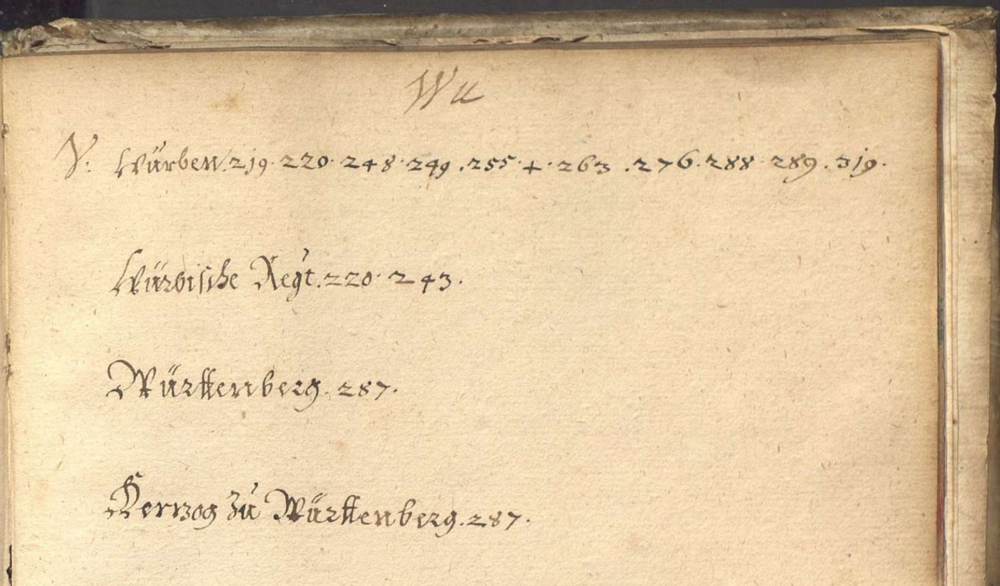

Rubrika *Wu*, druhý řádek dává odkazy 220 a 243.

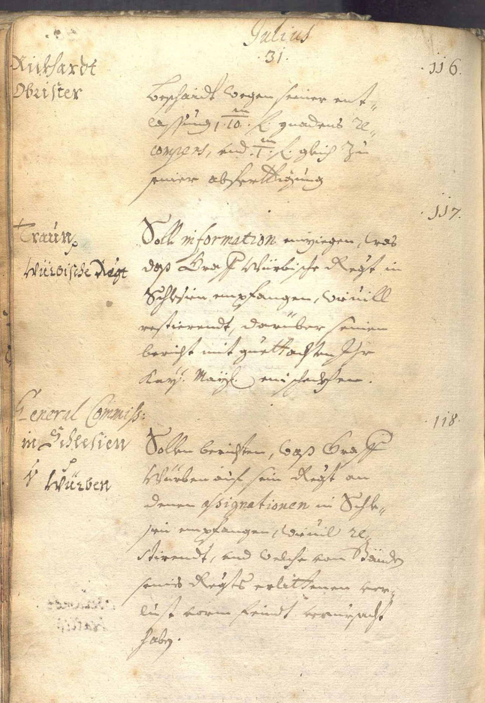

Na f. 220v jsou obě položky pod datem 31. července.

## SOL-06-N07 · Kontrola možné záměny Galler

**Květen 1646, vídeňská dvorská válečná rada.** Kriegsarchiv, Hofkriegsrat, Expedit 1646, kniha 294, obraz rejstříku *Ga* sn. 403 a obraz f. 216r sn. 153. Položka 109 vpravo dole. [Rejstřík](https://library.hungaricana.hu/en/view/KA_HKR_294_1646E/?pg=402) · [F. 216r](https://library.hungaricana.hu/en/view/KA_HKR_294_1646E/?pg=152)

**Přepis.** „Galler umb interpretation eines Tür- / kischen Schreibens.“ Okraj „Galler“.

**Překlad.** „Galler ve věci překladu či výkladu jednoho tureckého psaní.“

**Totožnost.** Čtení *Galler* se shoduje na obou místech a text neurčuje křestní jméno, hodnost ani jednotku. Samotná blízkost příjmení nestačí k identifikaci. Na f. 316r, sn. 222, má jméno královéhradeckého velitele v položce 21 odlišnou iniciálu a křestní jména *Andree Wilhelm*. Wurzbach zná Andrease Wilhelma Zeillnera jako císařského plukovníka a královéhradeckého velitele roku 1649. Shoda křestních jmen, funkce a posádky podporuje čtení Zeiller/Zeillner, nikoli spojení s Gillerem. [F. 316r](https://library.hungaricana.hu/en/view/KA_HKR_294_1646E/?pg=221) · [Wurzbach, s. 287–288](https://de.wikisource.org/wiki/BLK%C3%96:Zeillner,_Andreas_Wilhelm)

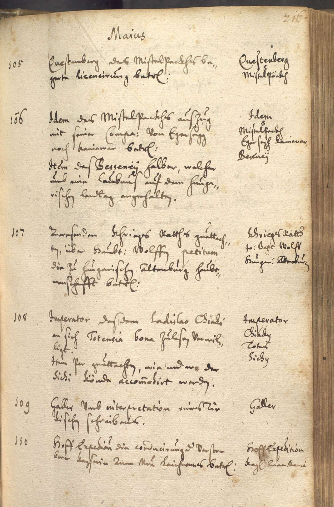

Pod záhlavím *Maius* je v dolní části pravé strany položka 109 i stejné marginální heslo.

## Tabulka prohledaného

U rozsahů rejstříků jde o vyjmenované rubriky, ne o průběžné čtení textu knihy. U hlavního textu jsou zapsány jen výslovně odečtené listy nebo jednotlivé položky. Další otevřené nebo technicky dosažitelné obrazy se nepočítají za přečtené.

| Pramen a místo | Typ záznamu | Datum a snímky od–do | Způsob čtení | Výsledek a mezery |
|---|---|---|---|---|
| [294, Expedit 1646](https://library.hungaricana.hu/en/view/KA_HKR_294_1646E/), Vídeň | Koncový rejstřík | 1646, G 403–407, W 465–469 | Zrakové hledání v rubrikách | *Würbi* 247, 284, 316, 317, *Galler* 216, *Gallas* s více odkazy. Všechny odkazy pod samotným Gallasem zatím nepřečteny. |
| 294, Vídeň | Protokolní výtahy | Květen–srpen, sn. 153, 174–175, 201–202, 222–224 | Výběr podle f. 216, 247, 284, 316 a 317 | N02, N07. Stav vedení pluku neuveden. |
| [295, Registratur 1646](https://library.hungaricana.hu/en/view/KA_HKR_295_1646R/), Vídeň | Koncový rejstřík a výběr textu | 1646, G 222–226, W 281–284. Text sn. 23 | Rejstříkové čtení a kontrola obrazu f. 27r | Pod Ga jsou Gallas a gallasovský štáb/zavazadla. Na f. 27r žádný osobní zápis Gillera. Celý odkaz 27 včetně pokračování a další gallasovské odkazy čekají. |
| [292, Expedit 1645](https://library.hungaricana.hu/en/view/KA_HKR_292_1645E/), Vídeň | Koncový rejstřík a text | 1645, G 299–303, W 363–367. Červen, sn. 152–154 | Rejstřík a výběr f. 227r–228v | N05. Rejstřík uvádí i podobný tvar *Galler* u odkazu 228, prohlídka f. 228 neumožnila bezpečně přiřadit heslo žádné položce. Vedle *Wirben 227* čeká druhé würbenské heslo s více odkazy. |
| [293, Registratur 1645](https://library.hungaricana.hu/en/view/KA_HKR_293_1645R/), Vídeň | Koncový rejstřík a text | 1645, G 276–280, W 339–343. Květen, sn. 168–169. Srpen, sn. 200 | Rejstřík a bodový výběr f. 228r–v a 262r | Gallasův polní štáb odkaz 67, dragouni odkaz 228 s pokračováním. Položku o dragounech na f. 228r–v se nepodařilo bezpečně izolovat. Odkaz s křížkem vyžaduje kontrolu následujících folií. |
| [296, Expedit 1647](https://library.hungaricana.hu/en/view/KA_HKR_296_1647E/), Vídeň | Koncový rejstřík a text | 1647, G 460–464, W 527–530, C 441–445, K 475–479. Únor, sn. 56–58. Prosinec, sn. 387–388 | Výběr rejstříků a čtení na f. 55–57 a 431r–v | V únoru Wrbna řeší mimo jiné sedm odňatých koní a dva tisíce říšských tolarů. Křestní jméno či hodnost Gillera z těchto položek neplynou. Řádek gallasovských dragounů vede na f. 295, 307, 313, 317. U *Wrbÿ* zůstává více nepročtených návratů. |
| [297, Registratur 1647](https://library.hungaricana.hu/en/view/KA_HKR_297_1647R/), Vídeň | Koncový rejstřík a text | 1647, G 321–325, K 336–340, W 386–390. Text sn. 9–10, 129–130, 132–133, 177–178, 204–205 | Rejstřík a výběr f. 9, 170, 173, 219v, 220v, 243 | N01, N04 a N06. Na f. 243 je zápis potřísněný a při zběžném čtení nebyl druhý odkaz na pluk bezpečně ztotožněn. U Gallase zbývá větší část obecných odkazů. |
| Gotha, Gotha | Tištěný rodopis | 1884, s. 276, PDF sn. 302 | Obraz rozhodujícího odstavce | N03. Sňatky a prvky rodové posloupnosti jsou tvrzení tisku z roku 1884. |
| Rakouský státní archiv, běžná řada mustrlist | Katalog | Přibližně od r. 1740 | Čten katalog | Roky 1645–1647 jsou mimo rozsah této řady. Samostatná dobová přehlídka Gallasova jezdectva zatím dohledána nebyla. |

## Co převzít a kde navázat

Navržená formulace deníku. „**Doloženo** je jméno *Giller* u skupinové výzvy k zachování věrnosti a postů bez ohledu na kolínské příměří (8. 5. 1647, AT-OeStA/KA, Hofkriegsrat, Registratur 297, f. 170v, č. 90, SOL-06-N01). **Otevřená** zůstává totožnost osoby i spojení s jednotkou Wrbna nebo Gallas. **Doloženo o jednotce** je vystoupení Štěpána z Vrbna a Bruntálu ve věci šesti kompanií v srpnu 1646 (SOL-06-N02) a agenda würbenského pluku ve Slezsku 31. 7. 1647 (SOL-06-N06).“

Pro profil 2048. „Podle Gotha 1884, s. 276, byl císařským rytmistrem v pluku označeném ‚Gallas‘ (SOL-06-N03, rodopisné podání). V soudobých protokolech se rozlišují gallasovští jezdci, pěší a dragouni (SOL-06-N04). Jeho vlastní kompanie není ztotožněna.“ Pro profil 4096 ponechat hodnost, pluk, Tschammer a Deschna jako údaj literatury. Záznam Giller z roku 1647 lze připojit jako dosud nezařazenou stopu.

**První zbývající průchod.** Pro Gillerovu totožnost otevřít 1647 *Registratur*, ověřit spoluadresáty z f. 170v a vyhledat jejich rejstříková hesla a květnová nařízení o kolínském příměří. Poté porovnat 1647 *Expedit* z května. Cílem je dohledat plné konceptní znění č. 90 nebo paralelní zprávu, která uvádí křestní jméno, post či pluk. Pro Heinricha začít na f. 243r–v z 28. srpna 1647 a projít další odkazy *v. Würben* z téhož rejstříku. Konfrontovat je s pozdějšími zápisy z téhož roku a s hesly Creutz/Kreutz/Creuz i zkratkami. Pro Johanna pokračovat přes spisy o gallasovských jezdcích. Při hledání individuálního soupisu zaměřit začátek roku 1647 a rozdělení jednotek po Gallasově smrti. Další konkrétní větev vede ke gallasovským dragounům v 1647 *Expedit*, f. 295, 307, 313, 317, a k 1645 *Registratur*, od f. 229. Kontrolní období pro službu Johanna lze po této sondě rozšířit před rok 1645. [F. 243r](https://library.hungaricana.hu/en/view/KA_HKR_297_1647R/?pg=203) · [Würben v rejstříku](https://library.hungaricana.hu/en/view/KA_HKR_297_1647R/?pg=389) · [Gallasovi dragouni v rejstříku](https://library.hungaricana.hu/en/view/KA_HKR_296_1647E/?pg=459) · [F. 228v](https://library.hungaricana.hu/en/view/KA_HKR_293_1645R/?pg=168)

Pokud zůstane online dostupný jen souhrn z f. 170v, lze v Kriegsarchivu poptat dochovaný koncept, přílohu nebo paralelní písemnost k datu a číslu zápisu. Jako další fond pro případné plukovní soupisy přichází v úvahu Gallasova válečná kancelář v historické sbírce Clam-Gallasů v Děčíně. Žádost jsem nepodával a profil ani deník projektu jsem v repozitáři neměnil.
