# SOL-07 · Dva Franzové Leopoldové? Hedvika Brinkmannová a Susanna

## Závěr k 25. listopadu 2026

- **Přímo doloženo v přečtených pramenech.** Dvorecký zápis v lednu 1712 jmenuje Franze Leopolda Gillera císařským poštmistrem a zdejším purkmistrem. Křest z května 1709 jmenuje téhož poštmistra a matku dítěte Susannu (N04–N05). Sabisch dokládá nástup jmenovce jako zemského písaře roku 1710 ve Frankensteinu. Sinapius uvádí písaře pod týmž titulem pro rok 1723 (N02–N03). Opis ząbkowické dedikace jmenuje Hedviku de Gillern rozenou de Brinkmann a její poslední vůli. Datace 1717 odpovídá polovině součtu označených písmen. Rok 1716 jako začátek prací se z přečtených pramenů nepodařilo samostatně doložit (N01).
- **Nově dohledaný starší opis.** Kopietz v roce 1885 zaznamenal před iniciálami čitelné „A:“ a popsal dva sdružené erby. Hedviku výslovně označil za dceru knížecího úředního sekretáře von Brinkmanna. Jeho křestní jméno ani archivní předlohu tohoto příbuzenského údaje neuvedl (N01).
- **Nejpravděpodobnější pracovní výklad.** Dvoreckého poštmistra a slezského písaře vést odděleně do získání průkazného propojení. Funkce se v čase překrývají, avšak dnešní prameny nedokládají fyzickou přítomnost obou mužů ve stejný den ani rodinný stav obou ve stejnou dobu. Manželství Hedviky s písařem je pravděpodobné podle místní tradice a dedikace, jeho přesný doklad zůstává otevřený (N01–N05, N08, N11).
- **Nová stopa k majetku.** Kopietz zaznamenává ve Frankensteinu dům, který před Kašparem von Dittel patřil někomu z von Gillerů. Roku 1723 dům koupil kníže a zřídil v něm vládní budovu. Kupní a předávací doklady mohou určit konkrétního Gillera i jeho případné dědice (N09).
- **Nová stopa k závěti.** Dochované *Landrechts Protocolla* (1701–1753, Vratislav, 82/11/0/4/214) pokrývají rozhodná léta. Podle Sabischa k agendě zemského soudu patřilo zveřejňování testamentů i potvrzování prodejů a svatebních ujednání (N10).
- **Otevřeno.** Převzatý pohřeb Susanny Gillerové z roku 1724 její rodinnou roli podle dřívějšího čtení neuvádí. Nové čtení obrazu se nepodařilo. Nedoloženy zůstávají Hedvičin pohřeb, závěť a případný sňatek, datum úmrtí písaře i doklad spojující obě funkce. Křty kandidátů na pozdějšího barona Karla Josefa uvádějí různé otce a matky. Přečtený Sinapius pro sekretáře Karla Josefa jmenuje otcem Friedricha Wilhelma, ale křest pozdějšího barona sám neurčuje (N03, N06–N10).

## Paralelní časová osa

| Rok | Dvorce / Karlovec | Frankenstein (Ząbkowice Śląskie) a knížectví |
|---|---|---|
| 1690 | 6. 2. Hans Carl, syn Franze Leopolda a Susanny (N06). | |
| 1693–1720 | Bergerův úhrnný údaj o purkmistrování (N11). | |
| 1696 | 25. 9. Carl Joseph (?), syn Fridricha Wilhelma a Anny Marie, Karlovec (N07). | |
| 1705–1709 | Roku 1705 při sňatku Marie Elisabeth uveden jako měšťan a poštmistr (převzato z č. 702), 2. 5. 1709 poštmistr při křtu dítěte se Susannou (N05). | |
| 1710 | | 29. 4. nástup zemského písaře před stavy, 13. 7. převzetí zemské kanceláře ve Frankensteinu (N02). |
| 1712–1713 | 18. 1. 1712 otec nevěsty, císařský poštmistr a místní purkmistr. Berger zaznamenal stejnou kombinaci úřadů pro purkmistra Gillera roku 1713 (N04, N11). | Bez nově dohledaného datovaného osobního výskytu přímo z let 1712–1713. |
| 1717 | | Hedvičina poslední vůle v dedikaci. Rok se týká památky (N01). |
| 1723 | Bergerův úhrn končí rokem 1720 (N11). | Sinapiův stav rodu k roku 1723 uvádí písaře, Kopietz k roku 1723 popisuje koupi dříve gillerovského domu od Kašpara von Dittel (N03, N09). |
| 1724 | 25. 4. pohřeb Susanny Gillerové, 60 let (N08). | |

## Nálezy

### SOL-07-N01 · Hedvika rozená Brinkmannová a fundace

**1717, Frankenstein / Ząbkowice Śląskie, u kostela sv. Anny a Křivé věže.** Čten historický opis nápisu z roku 1885, moderní online opis a prohlédnuta fotografie sochy (Casey, 5. 8. 2008). Na této fotografii text není spolehlivě čitelný. Významové členění a grafika se opírají o online opis. [Opis a popis památky](https://nepomuki.pl/nepomuk/dslask.htm#ZabkowiceSlaskie2) · [Přímo fotografie](https://nepomuki.pl/nepomuk/JN-DSlask-ziebickie-ZabkowiceSlaskie200_2008-08-05.jpg) · [Městský portál, oddíl Rzeźba św. Jana Nepomucena](https://zabkowiceslaskie.pl/kosciol-parafialny-pw-sw-anny)

```text
IVSTO AC MAGNÆ
SANCTITATIS VIRO APos
TOLICO ECCLESIASTICO
B. IOANNI NEPOMVCENo EX VLTIMA DISPOSITIONE
HEDWIGIS DE GILLERN
NATÆ DE BRINKMANN
ERECTA ET PRO
CVLTV FIDELIVM
POSITA […]
F: L: D: G: M: S:
```

**Překlad.** „Spravedlivému muži veliké svatosti, apoštolskému muži církve, blahoslavenému Janu Nepomuckému, [tato socha byla] podle poslední vůle Hedviky de Gillern, rozené de Brinkmann, vztyčena a postavena k úctě věřících.“ Poslední skupinu iniciál ponechávám nerozvedenou. Znak za POSITA je ve webovém opisu porušený kódováním.

V opisu zvýrazněná písmena dávají 2 M + D + 7 C + 4 L + 5 V + 9 I = 3434, tedy dvojnásobek 1717. Zkratka **B.** je součástí dedikace. Opis mluví o poslední vůli, ale neudává její datum, datum úmrtí ani křestní jména manžela v plném znění. První čtyři iniciály jsou slučitelné se jménem *Franciscus Leopoldus de Gillern*. Moderní městský popis a web Nepomuki označují Hedviku za manželku Franze Leopolda, kterého nazývají sekretářem knížectví. Stejná formulace může mít společnou předlohu. Žádný z obou popisů zde necituje sňatek ani závěť.

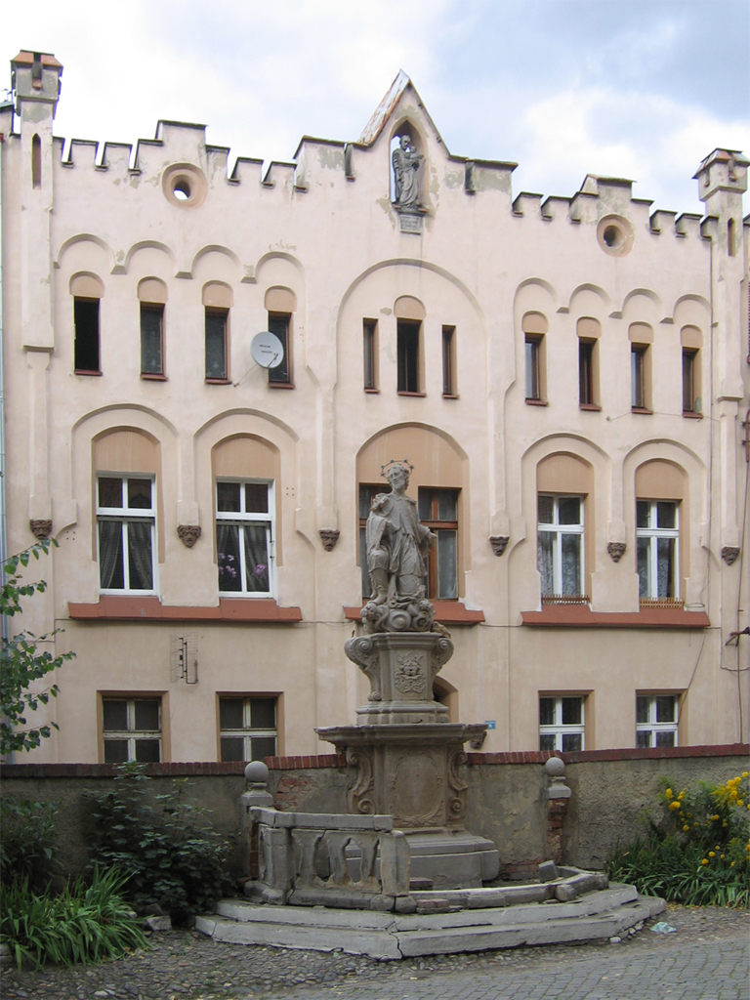

Fotografie zachycuje celé dílo a sokl. Pro čtení latinského textu použijte odkaz na opis.

**Starší opis a otcovská stopa.** Johannes Athanasius Kopietz, *Kirchengeschichte des Fürstentums Münsterberg und des Weichbildes Frankenstein* (1885), s. 169, digi sn. 178, nahoře u popisu severní ohradní zdi starého hřbitova. [Přímo sn. 178](https://dbc.wroc.pl/Content/4260/0178_0001.djvu) · [Záznam knihy, Dolnośląska Biblioteka Cyfrowa](https://dbc.wroc.pl/dlibra/publication/4422/edition/4260)

> Iusto ac Magnae Sanctitatis Viro Apostolico Ecclesiastico B. Ioanni Nepomuceno Ex Ultima Dispositione Hedwigis De Gillern Natae De Brinkmann Erecta et Pro Cultu Fidelium Posita A: F: L: D: G: M: S:

Kopietzův tisk doplňuje **A:** přesně na místě poškozeného znaku online opisu. Čte-li se latinsky jako předložka *a* s ablativem, gramaticky možný rozvoj zní *a F[rancisco] L[eopoldo] D[e] G[illern] m[arito] s[uo]*, tedy „jejím manželem Františkem Leopoldem de Gillern“. Jde o výklad iniciál. Text sám nevypisuje titul muže ani žádnou vazbu ke Dvorcům.

Kopietz po opisu popsal dva sdružené erby. V levém uvádí hvězdu a přerušené břevno, nad přilbou dvojici orlích křídel. V pravém jelena a ptáka, ve středním štítku znak připomínající S a v klenotu ptáka s tyčí v zobáku. Erby v tomto odstavci výslovně nepřiřazuje jménům. Bez kontroly barevné kresby nebo rodového erbu zůstává přiřazení otevřené.

> Die Statue wurde im Jahre 1717 nach einer Testamentsbestimmung der Frau Hedwig von Gillern, Tochter des fürstlichen Amtssekretärs von Brinkmann, errichtet.

**Překlad.** Socha byla postavena roku 1717 na základě ustanovení závěti paní Hedviky von Gillern, dcery knížecího úředního sekretáře von Brinkmanna. **Příbuzenský údaj je v Kopietzově výkladu pod nápisem.** Otcovo křestní jméno ani zdroj této informace autor v odstavci neuvádí. Nově tak lze hledat Brinkmanna i podle služební role a porovnat tuto stopu s Löfflerovým úředním přehledem (N02, N10).

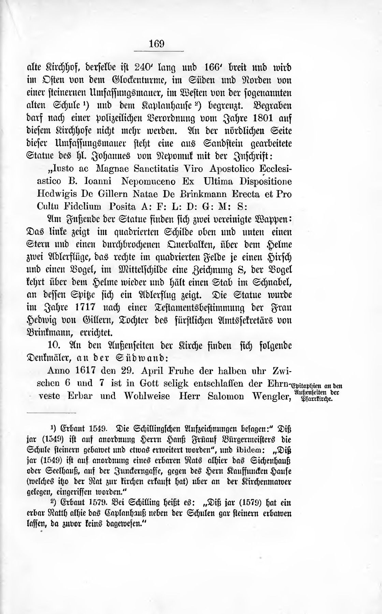

Na s. 169 je pod popisem severní ohradní zdi tištěný latinský opis. Pod ním následují oba erby a věta o Hedvičině otci.

### SOL-07-N02 · Zemský písař a předání kanceláře

**29. 4. a 13. 7. 1710, knížectví a Frankenstein.** Alfred Sabisch, *Der Regierungsantritt Franz Karls von Auersperg im Fürstentum Münsterberg-Frankenstein 1709/10*, *Zeitschrift des Vereins für Geschichte und Altertum Schlesiens* 67 (1933), s. 112, PDF sn. 124, první celý odstavec a pozn. 58–60. Čten obraz vydané studie, která podává zprávu o Löfflerově prameni. [Obraz s. 112](https://sbc.org.pl/Content/20556/PDF/ii4026-1933-00-0001.pdf#page=124)

**Rozhodující znění v tisku.** „sein Nachfolger wurde Franz Leopold von Giller“ a „der Amtssekretär Löffler und der Frankensteiner Bürgermeister Meisner die Landeskanzlei übergaben“. Pozn. 58 odkazuje na opis Löfflerovy zprávy knížeti v *Miscell.*, 22 a následující, s přehledem starých písemností kanceláře.

**Obsah rozhodujícího úseku česky.** Zemský písař Franz Dominik von Schellenberg odstoupil v dubnu 1710. Jeho nástupce Franz Leopold von Giller nastoupil 29. dubna na shromáždění stavů. Úřední sekretář Löffler a frankensteinský purkmistr Meisner mu předali zemskou kancelář 13. července. Volný post výběrčího zemské daně dostal Abraham von Kottwitz, který se stal i dvorským soudcem (pozn. 59). Notářem dvorského soudu byl Franz Ignaz Nierlich (pozn. 60).

Titulem Gillerovým je **Landschreiber**. **Amtssekretär** zde označuje Löfflera. Protokol 29. 4. 1710, historická signatura *Bresl. Staatsarch. Rep. 30 II, 6 k*, je v pozn. 59 u Kottwitze. Jde o dokument stejného dne, vhodný ke kontrole Gillerovy přítomnosti, nikoli o již přečtený podpis Gillera. Samostatný podpis ani finanční jednání vedené jeho jménem v této kontrole nedoloženy.

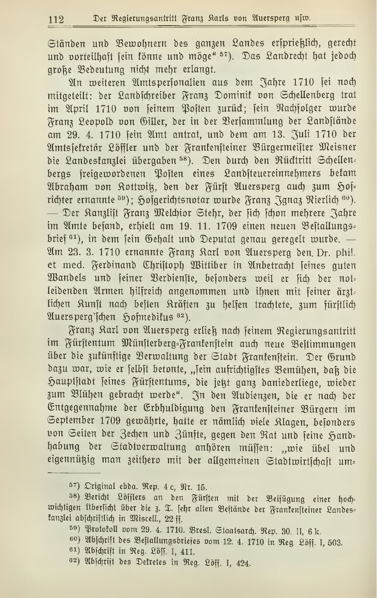

Odstavec začíná „An weiteren Amtspersonalien“. Poznámky 58–60 jsou dole.

### SOL-07-N03 · Rodopis ke stavu roku 1723

**1723, Minstrbersko a frankensteinský obvod.** Johannes Sinapius, *Des Schlesischen Adels anderer Theil oder Fortsetzung Schlesischer Curiositäten*, 1728, s. 641, levý sloupec „Die von Giller“, bod I, položky 1 a 5. Čten přímo obraz historického tisku. [Tisk, s. 641](https://books.google.com/books?id=ru1PAAAAcAAJ&pg=PA641)

> I. Herr Friedrich Wilhelm von Giller, Ihro Kays. Maj. Rath und Ober-Buchhalter der dreyen Fürstenthümer Lignitz, Brieg und Wohlau, annoch im Leben, dessen Herren Söhne An. 1723.\
> 1) Herr Frantz Leopold von Giller, des Fürstenthums Mönsterberg und Francksteinischen Weichbildes Land-Schreiber.\
> 2) Herr Friedrich Wilhelm von Giller, Ihro Kays. Maj. des löbl. Baron-Generischen Regiments in Siebenbürgen Hauptmann.\
> 3) Herr Johann Peter von Giller, unter eben diesem Regimente Fähnrich.\
> 4) Herr Carl Ludwig, Volontaire.\
> 5) Herr Carl Joseph, des Fürsten von Lichtenstein zu Troppau und Jägerndorff Secretarius.

**Překlad.** Friedrich Wilhelm von Giller, ještě žijící rada Jeho císařského Veličenstva a vrchní účetní Lehnice, Břehu a Volova, má ve výčtu synů k roku 1723 Frantze Leopolda, zemského písaře Minstrberského knížectví a frankensteinského obvodu, Friedricha Wilhelma, hejtmana pluku barona Genera v Sedmihradsku, Johanna Petera, praporčíka téhož pluku, Carla Ludwiga, dobrovolníka, a Carla Josepha, sekretáře knížete z Lichtenštejna v Opavě a Krnově.

Položky 1 a 5 jsou bratři v autorově rodovém přehledu. Tentýž úřad a správní obvod silně spojují písaře s N02. Výčet k roku 1723 není údaj o úmrtí. Při porovnání s N06–N07 je třeba oddělit doklad křestního rodičovství od dokladu pozdější kariéry a pozdějšího baronátu.

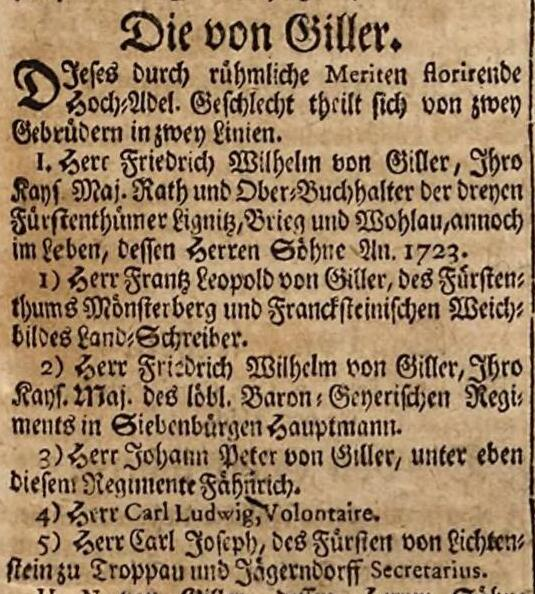

Za nadpisem „Die von Giller“ čtěte bod I, zejména položky 1 a 5.

### SOL-07-N04 · Císařský poštmistr a purkmistr ve Dvorcích

**18. 1. 1712, Dvorce (Hoff).** ZA Opava, pobočka Olomouc, Sbírka matrik Severomoravského kraje, řím.-kat. fara Dvorce, Dv I 1, inv. 6166, oddaní s. 35, sn. 569, 1. zápis. Původní přepis převzat z projektu a titul znovu zkontrolován na publikovaném výřezu obrazu matriky. Měsíc a den podle rejstříku Dv I 20 a projektové evidence. [Přímý snímek archivu](https://digi.archives.cz/da/showZoomifySeparate?imageNumberSeparate=569&myEntityUuid=be96a71e-f13c-102f-8255-0050568c0263&myImageUuid=9b617cbcd7374bfdaffe8ce139cd7aae)

> Hoff | 18 (?) | Sponsus der wohl Edle Herr Johann Antony Knapp wohl Verordneter Haubtman zu Tropau, Sponsa Mit der Edl Tugent Reichen Jungfraw Anna Rosina, deß Wohl Edl Gestrengen Herrn Frantz Leopoldt Gillers, Jhre Röml: Kayß: Maytt: wohl Verordneten H: Postmaisters, wie auch burgermaisters alhir Eheleibl: tochter, Testes Ludwig Maÿern (?) et Hans Georg Molußký (?).

**Překlad.** Ženich urozený Johann Antony Knapp, ustanovený hejtman v Opavě, a nevěsta ctnostná panna Anna Rosina, manželská dcera urozeného pana Frantze Leopolda Gillera, ustanoveného poštmistra Jeho Římského císařského Veličenstva a rovněž zdejšího purkmistra. Svědci Ludwig Mayer (?) a Hans Georg Molußký (?).

Otec nevěsty je jmenován celým jménem a oběma úřady. Matka nevěsty zde jmenována není. Otec v textu nefiguruje mezi svědky. Záznam tedy ukazuje, jak byl v lednu 1712 titulován, a ponechává jeho fyzickou přítomnost otevřenou.

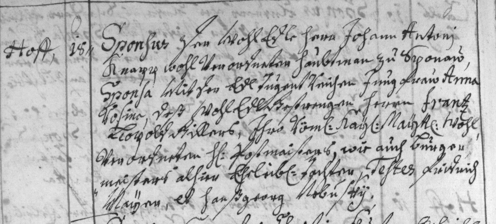

V levém okraji čtěte „Hoff“ a datum. Oba úřady jsou v řádcích pod „Leopoldt Gillers“.

### SOL-07-N05 · Susanna u křtu poštmistrova dítěte

**2. 5. 1709, Dvorce.** ZA Opava, pobočka Olomouc, řím.-kat. fara Dvorce, Dv I 1, inv. 6166, křty s. 37, sn. 39, 4. zápis. Převzatý přepis a nový odečet jména matky a otcova titulu z publikovaného výřezu. [Přímý snímek archivu](https://digi.archives.cz/da/showZoomifySeparate?imageNumberSeparate=39&myEntityUuid=be96a71e-f13c-102f-8255-0050568c0263&myImageUuid=07bc7cd7a6764bd8b9bc7d38c2f6d5e3)

> Hoff | 2 | Pa: der herr Frantz Leopoldt Giller Postmeister Ma: Susanna. Inf: Frantz Philipp, Comp: Matthäus zimer, et Rosina heinrich Maÿerin.

**Překlad.** Dvorce, 2. května. Otec pan Frantz Leopoldt Giller, poštmistr. Matka Susanna. Dítě Frantz Philipp. Kmotři Matthäus Zimer a Rosina, podle projektového čtení manželka Heinricha Mayera.

Jméno **Susanna** a titul **Postmeister** jsou na výřezu zřetelné. Matčino rodné příjmení zde uvedeno není.

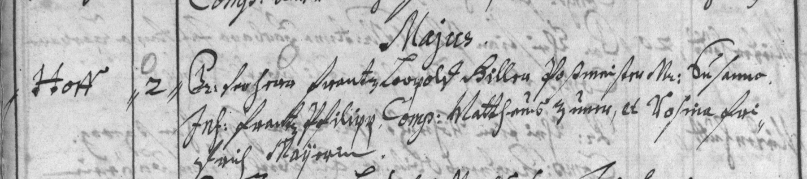

Pod nadpisem „Majus“ je celý zápis včetně kmotrů. Susannino jméno je na konci prvního řádku.

### SOL-07-N06 · Hans Carl, syn Franze Leopolda a Susanny

**6. 2. 1690, Dvorce.** ZA Opava, pobočka Olomouc, řím.-kat. fara Dvorce, Dv I 1 O 2, tabulkový opis, s. 16, sn. 18, 2. zápis. Převzatý přepis a publikovaný výřez. [Přímý snímek archivu](https://digi.archives.cz/da/showZoomifySeparate?imageNumberSeparate=18&myEntityUuid=29e3f91ac933f2f4%3a-64ab7bf1%3a1503c0399c5%3a-7ff4&myImageUuid=5b351663a36d40dab22e657ac2d01a3a)

> 6 | Frantz leopold Giller | Susanna | hans Carl | heinrich Poltzer, Rosina Loserthin (?).

**Překlad.** Dne 6. pokřtěn Hans Carl, syn Frantze Leopolda Gillera a Susanny. Kmotři Heinrich Poltzer a Rosina Loserthová (?).

Křestní jméno syna zní **Hans Carl**. N05 spojuje stejně pojmenované rodiče s poštmistrovskou domácností. Přiřazení dítěte ke konkrétnímu dospělému Karlu Josefovi vyžaduje další doklad.

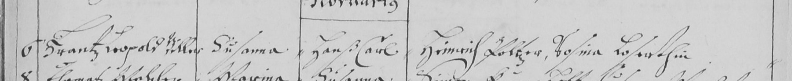

Převzatý výřez tabulkového řádku od data po kmotry. Měsíc zůstává mimo výřez.

### SOL-07-N07 · Karlovecký křest, odlišní rodiče

**25. 9. 1696, Karlovec.** ZA Opava, pobočka Olomouc, řím.-kat. fara Dvorce, Dv I 1 O 2, tabulkový opis, rub s. 79, sn. 80, 1. zápis. Převzaté čtení z č. 702 a publikovaný výřez. [Přímý snímek archivu](https://digi.archives.cz/da/showZoomifySeparate?imageNumberSeparate=80&myEntityUuid=29e3f91ac933f2f4%3a-64ab7bf1%3a1503c0399c5%3a-7ff4&myImageUuid=9f575934abea40f0867faa42bbf8f161)

> 25 | Fridrich Wilhelm Giller / Haubtman alhir | Anna Maria | Carl Joseph (?) | hans Rotter (?), Maria Theresia Kü[…]lin.

**Překlad.** Dne 25. pokřtěn Carl Joseph (?), syn Fridricha Wilhelma Gillera, zdejšího hejtmana, a Anny Marie. Kmotři Hans Rotter (?) a Maria Theresia Kü[…]lin.

Deník č. 702 eviduje i návrh čtení „Carl Franz“. Ponechávám dosavadní upřednostněné čtení „Carl Joseph“ s otazníkem. Rozlišující údaje jsou jména rodičů a Karlovec. Sinapiův výčet (N03) se s otcovstvím Friedricha Wilhelma u sekretáře Karla Josefa shoduje na úrovni jména otce. Matriční křest pozdějšího barona zůstává otevřený.

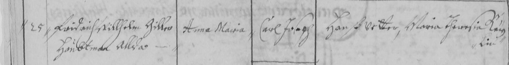

Jména jsou v jednotlivých sloupcích. Měsíc zůstává mimo výřez.

### SOL-07-N08 · Kandidátní pohřeb Susanny Gillerové

**25. 4. 1724, Dvorce.** ZA Opava, pobočka Olomouc, řím.-kat. fara Dvorce, Dv I 1, inv. 6166, zemřelí, sn. 826 podle č. 612. [Svazek Dv I 1](https://digi.archives.cz/da/permalink/be96a71e-f13c-102f-8255-0050568c0263) · [Katalog fary, panel Dv I 1](https://probelauf.data.matricula-online.eu/de/CZ/cz-zao/dvorce-rimskokatolicky/#details-872555) · [Projektové čtení, č. 612, 630, 702](https://github.com/jgillern/gillernrodokmen/blob/7c02f3528be438f49af80b0761b5653cdd3eee02/data/research_log.md)

**Převzaté čtení.** Dochované shrnutí čte „Susanna gillerin“, 60 let, stav prázdný. Úplný diplomatický přepis, polohu na straně, rubriku a okrajové poznámky bez obrazu nelze ověřit. Prohlížeč zobrazil ověřovací stránku archivu. V odpovídajících výřezech a zdrojových obrázcích obou zkontrolovaných revizí repozitáře není sn. 826. Matricula poskytla popis knihy a odkázala na tentýž archivní prohlížeč.

**Význam.** Překlad jména a věku je „Susanna Gillerová, 60 let“. Podle dosavadního čtení u ní není uvedeno, že byla něčí manželkou či vdovou. Současně je třeba odlišit Susannu, dceru Christiana Gillera, provdanou 15. 11. 1689 (převzato z č. 702). Společné jméno a obec připouštějí shodu s matkou z N05–N06. Nemohou ji doložit.

### SOL-07-N09 · Dům po von Gillerech na Schloßfreiheit

**1723, Frankenstein.** Johannes Athanasius Kopietz, *Geschichte der deutschen Kultur und ihrer Entwickelung in Frankenstein und im Frankensteiner Lande*, Breslau 1910, s. 324, PDF sn. 330, první odstavec, střed strany. Čten obraz historické práce a prohledán text celé digitální kopie. [Přímo s. 324](https://protzan.de/wp-content/uploads/2021/10/1910_Kopietz_Geschichte_der_dt_Kultur_in_Frankenstein.pdf#page=330)

> „das Caspar von Dittelsche, früher von Gillersche Haus auf der Schloßfreiheit“

**Překlad a kontext.** „Dům Kašpara von Dittel na zámecké svobodě, dříve dům von Gillerů.“ Kopietz v téže větě uvádí, že úřední a zemská kancelář zůstaly na zámku do roku 1723, kdy dům koupil kníže Heinrich a upravil jej na vládní budovu Auerspergů. Pokračování dává další identifikátor nemovitosti: roku 1797 přešla na Münsterbersko-kladskou stavovskou instituci od hraběte Ludwiga Friedricha Wilhelma von Schlabrendorf. Poznámka odkazuje na Dittelův náhrobek při vstupu do kaple Nanebevzetí v kostele sv. Anny. Uvádí jeho plné jméno Caspar Ignaz von Dittel, úmrtí 6. 12. 1747 a manželku Karoline rozenou von Moschau.

**Totožnost.** Pramen popisuje nemovitost a sled držitelů, konkrétního staršího vlastníka z rodu von Giller nejmenuje. Stopa dovoluje hledat převody před rokem 1723 a kupní doklad z roku 1723 podle domu, prodávajícího a kupujícího. V této kontrole nebyl přečten příslušný originál.

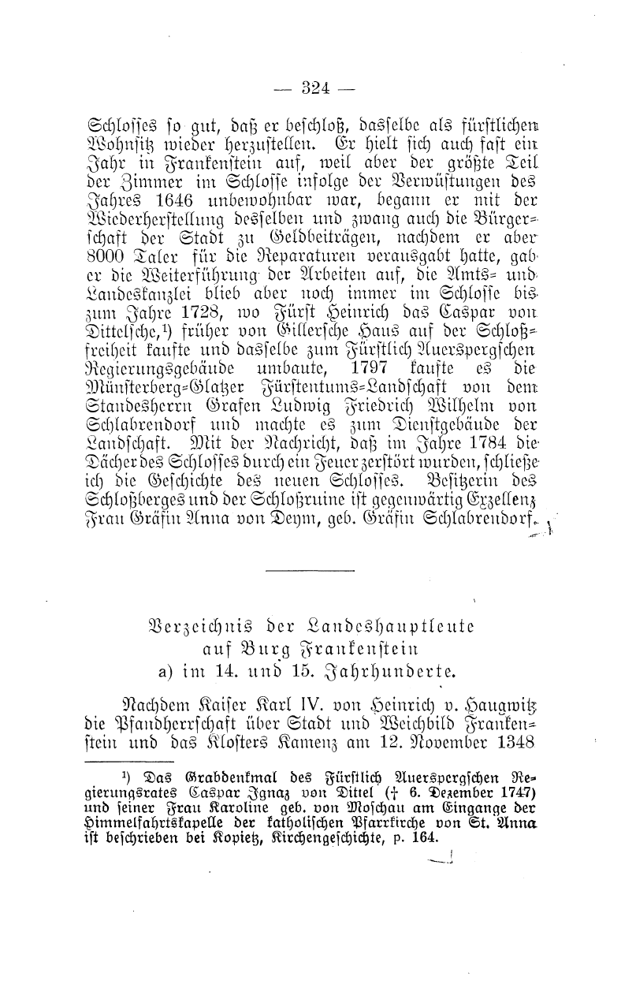

Čtěte první odstavec, od „zum Jahre 1723“, a poznámku dole k Dittelovu náhrobku.

**Ověření odkazu u sv. Anny.** Kopietzův starší soupis *Kirchengeschichte des Fürstentums Münsterberg und des Weichbildes Frankenstein* (1885), s. 164, digitální sn. 173, bod 4, uvádí v opisu náhrobku plnou totožnost prodávajícího z N09. [Vratislavská digitální knihovna, sn. 173](https://dbc.wroc.pl/Content/4260/0173_0001.djvu) · [Záznam knihy](https://dbc.wroc.pl/dlibra/publication/4422/edition/4260)

> Hier liegen begraben Caspar Ignatz von Dittel gewesener Regirungs Rath und Secretarius nebst seiner Eheconsortin Carolina von Dittel gebor. von Moschau, welche sich beyder seiths von denen Mit-Brüdern Ein Vatter unszer in gutten Andencken auszbitten den 6. Decemb. 1747.

**Překlad.** Zde leží pohřben bývalý vládní rada a sekretář Caspar Ignatz von Dittel se svou manželkou Carolinou von Dittel, rozenou von Moschau. Oba prosí spolubratry o jeden Otčenáš na dobrou památku. Dne 6. prosince 1747. Nad tímto opisem je epitaf Frantze Dominica von Schellenberg, který jeho úřady označuje „Landt Schreiber und Ober Steuer Einnehmer“ a jmenuje také rok 1710. To potvrzuje rozlišení písaře od sekretáře v N02.

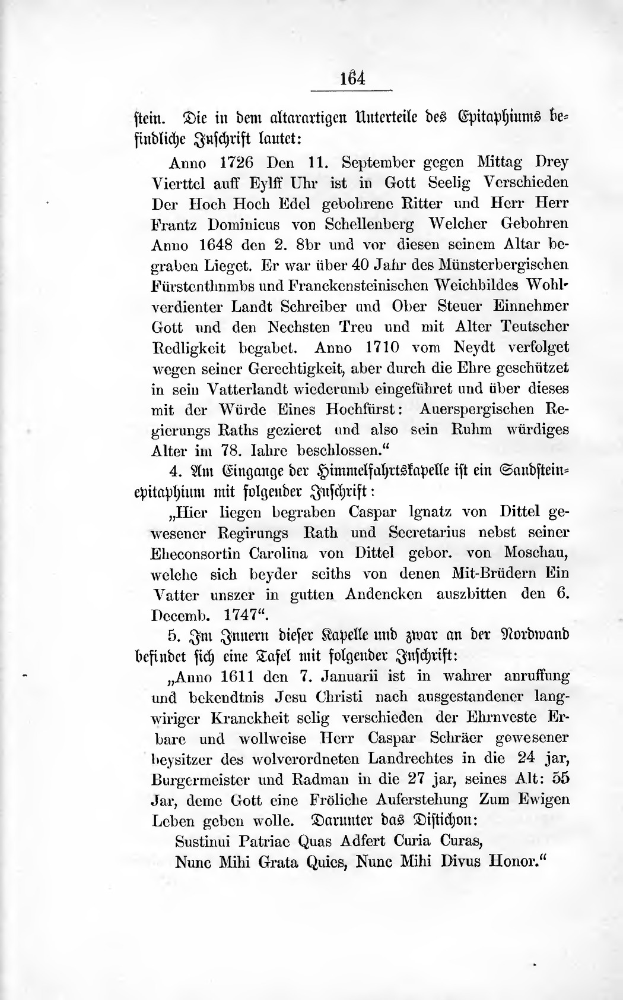

Uprostřed je celý Dittelův epitaf v bodu 4. Bezprostředně nad ním je text o Schellenbergových úřadech.

### SOL-07-N10 · Kde hledat Hedvičinu závěť

**Frankenstein a knížectví, kompetence roku 1710, kniha z let 1701–1753.** Sabisch, s. 111, PDF sn. 123, odstavec o zemském soudu a pozn. 55–56. Čten obraz vydané studie a katalog Archiwum Państwowe we Wrocławiu. [Sabisch, s. 111](https://sbc.org.pl/Content/20556/PDF/ii4026-1933-00-0001.pdf#page=123) · [Landrechts Protocolla, 82/11/0/4/214](https://www.szukajwarchiwach.gov.pl/ru/jednostka/-/jednostka/11034136) · [Seznam jednotek 201–280, včetně počtu snímků](https://www.szukajwarchiwach.gov.pl/en/zespol/-/zespol/88311?_Zespol_cur=3&_Zespol_delta=100&_Zespol_javax.portlet.action=zmienWidok&_Zespol_nameofjsp=jednostki&_Zespol_resetCur=false) · [Fond Auersperg, Vídeň](https://www.archivinformationssystem.at/detail.aspx?ID=1227)

**Obsah česky.** Podle Sabischa roku 1710 do působnosti zemského soudu patřilo potvrzování prodejů statků příslušníků stavů, doživotních zaopatření a manželských ujednání, „Veröffentlichungen von Testamenten“ (zveřejňování závětí), sepisování hypotečních listů a osvědčování práv. Na s. 111 uvádí i opisové svazky *Miscellanen* a *Regesten Löffler*.

**Katalog.** Vratislavský fond *Księstwo Ziębickie* 82/11/0 zahrnuje staré písemnosti Rep. 30 a Rep. 4c. Jednotka **82/11/0/4/214 – Landrechts Protocolla**, 1701–1753, je zapsána s nulou skenů. Jde o konkrétní cestu k prověření publikace Hedvičiny poslední vůle nebo příslušného majetkového řízení, nikoli o potvrzení, že se v ní záznam skutečně nachází. Nabytí domu N09 může vést stejnou nebo vrchnostenskou evidencí. Městský fond 84/560/0 má časový rozsah 1641–1945/1946. Státní archiv dokládá ztráty městského archivu při požáru roku 1858. [Městský fond](https://www.szukajwarchiwach.gov.pl/en/zespol/-/zespol/85216) · [Zpráva státního archivu](https://www.wroclaw.ap.gov.pl/aktualnosci/cenne-znalezisko-w-zabkowicach-slaskich)

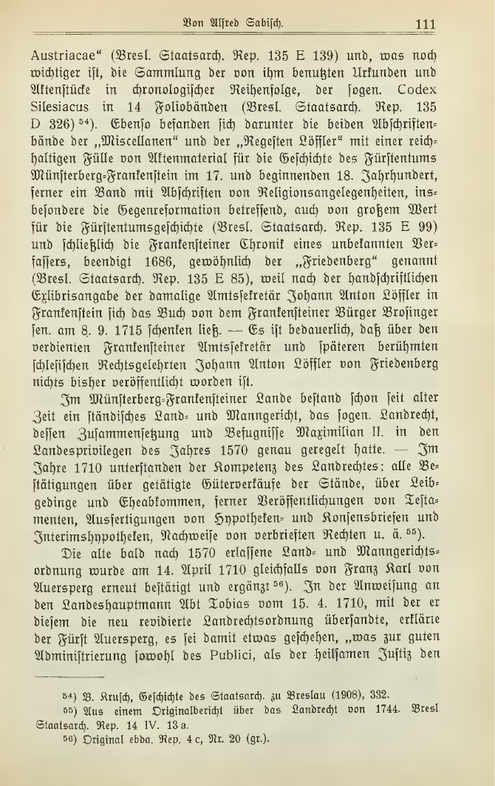

Ve spodní polovině stránky čtěte odstavec od „Im Münsterberg-Frankensteiner Lande“.

### SOL-07-N11 · Jak silný je dvorecký doklad pro léta 1713 a 1720

**1713 a období 1693–1720, Dvorce.** Karl Berger, *Geschichte der Stadt Hof*, *Zeitschrift des deutschen Vereines für die Geschichte Mährens und Schlesiens*, roč. 12 (1908), s. 41 a 46, PDF sn. 49 a 54. Čteny oba obrazy tisku a související text *Liechtensteinische Zeit*. Dosavadní deník č. 689 ověřen z tohoto jiného veřejného digitalizátu. [Obraz s. 41](https://sbc.org.pl/Content/923172/PDF/B%C5%9A-III4206-1908-01_04.pdf#page=49) · [Obraz s. 46](https://sbc.org.pl/Content/923172/PDF/B%C5%9A-III4206-1908-01_04.pdf#page=54)

> „Bürgermeister durch ein volles Menschenalter ist Franz Leopold Giller von 1693–1720“ (s. 41).\
> „1713 wird als ‚kaiserlicher‘ Postmeister der damalige Bürgermeister Giller genannt“ (s. 46, pozn. 1).

**Překlad a kontext.** Podle Bergera byl Franz Leopold Giller purkmistrem po celou jednu generaci, od roku 1693 do roku 1720. V poznámce k odstavci o ubytování důstojníků na poště roku 1741 autor připomíná, že v roce 1713 byl tehdejší purkmistr Giller jmenován jako císařský poštmistr. Na s. 41 Berger jako dochovaný podklad daného úseku uvádí obecní účty. Na s. 42 účty z roku 1708 mluví o půjčce od **Christiana** Gillera, tedy jiné osoby.

**Totožnost.** Stejné dva úřady a příjmení v témže městě úzce spojují rok 1713 s matričním zápisem 1712 (N04). Rok 1720 je konec Bergerova souhrnného období, nikoli konkrétní mnou nalezený podpis nebo dochovaný úkon Franze Leopolda z tohoto roku.

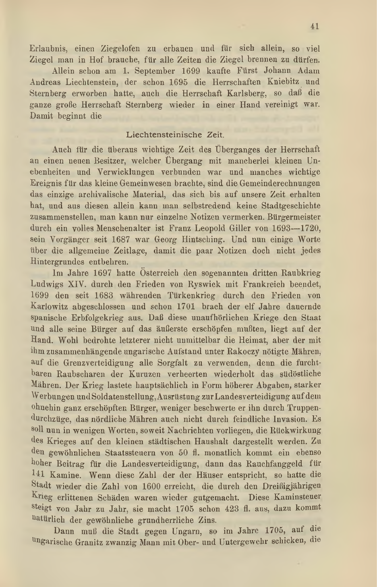

Čtěte odstavec pod nadpisem „Liechtensteinische Zeit“.

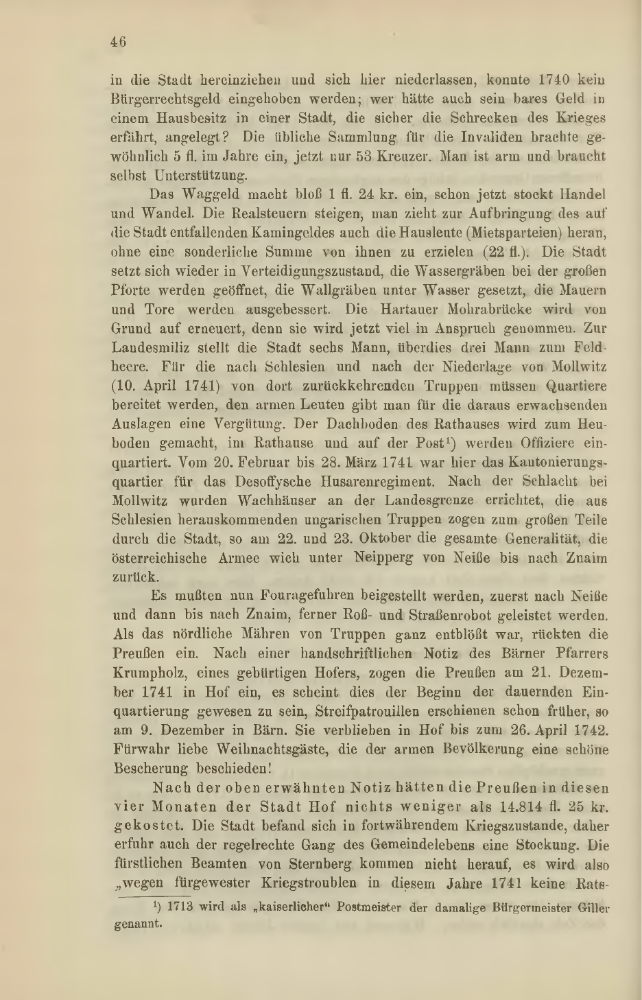

Čtěte pozn. 1 na konci stránky, pod hlavním textem o roce 1741.

## Vyhodnocení totožnosti

| Vysvětlení | Co je s ním slučitelné | Co by je rozhodlo |
|---|---|---|
| Dva muži stejného jména | Časový překryv různých úřadů ve dvou odlišných správních prostředích a dvě odlišně doložené ženské identity. U písaře navíc Sinapiova konkrétní příbuzenská vazba. Samotný zápis s tituly roku 1712 ani Bergerův souhrnný interval nedokládají denní výkon úřadu. | Současné prokazatelné osobní jednání obou, dvě odlišná úmrtí s identifikujícími údaji nebo souběžné dokumenty s manželkami a tituly. |
| Jediný muž, postupné sňatky | Matrika jmenuje Susannu u poštmistra ještě v květnu 1709 a Hedvičina dedikace má datum 1717. To ponechává prostor pro pořadí Susanna → Hedvika, pokud první manželství doložitelně zaniklo a pohřeb roku 1724 patří jiné Susanně. Souběh titulů nebo časový posun skutečného výkonu funkcí zůstává možný. | Záznam ukončující manželství se Susannou po květnu 1709, druhý sňatek s Hedvikou a dokument, který bezpečně spojí obě funkce nebo obě domácnosti. |
| Jediný muž a pohřbená Susanna je matka z roku 1709 | Pouhá shoda jména to připouští. Pokud byla tatáž Susanna naživu roku 1724 a Hedvika byla již před fundací jeho manželkou, běžná posloupnost, ve které druhý sňatek následoval po smrti první ženy, časově nevychází. Případný zánik prvního svazku za života nebo nesprávné přiřazení Hedviky by vyžadovaly vlastní doklad. | V N08 ověřit celý řádek a odlišit stejnojmenné ženy. Rozhodnout podle dokumentu, který Susannu přímo jmenuje s manželem nebo výslovně určuje její rodný původ. |

Nejsou tu doloženy obě funkce v jednom dokumentu, dva rozlišující pohřby ani dva datované výskyty téhož dne. Podobnost jména dovoluje testovat případnou totožnost. Doložené časové údaje a rozdílné ženské identity dávají přednost dvěma pracovním profilům při zachování otevřeného vztahu mezi nimi.

## Tabulka prohledaného

| Pramen a obec | Typ záznamu | Data a snímky od–do | Způsob čtení | Výsledek a mezery |
|---|---|---|---|---|
| Kostel sv. Anny, Frankenstein, Nepomuki a městský portál | Dedikace a popis díla | 1717, celý opis, fotografie 2008 a srovnávací fotografie 2014 | Celé znění online opisu, srovnání graficky vyznačených písmen, fotografie sochy | N01. Fotografie dokládá objekt a umístění textu. Diplomatická kontrola přímo proti čitelnému kameni chybí. |
| Sabisch, Frankenstein a knížectví | Předání kanceláře, stavovská a soudní agenda | 1709–1710, s. 111–113, PDF 123–125 | Výběr stran, snímky tisku. Doplňkově prohledán OCR úsek s. 105 a násl. | N02, N10. Löfflerův opis ani originál nebyly zpřístupněny. |
| Sinapius, Slezsko | Soudobý rodopis | Stav 1723, s. 641, levý sloupec | Obraz tisku, bod I | N03. Bez manželky, data narození nebo úmrtí. |
| ZA Opava, Dv I 1 O 2, Dvorce a Karlovec | Křestní opisy | 1690 sn. 18, 1696 sn. 80 | Výběr řádků z uložených výřezů, převzatá čtení | N06–N07. Bez nového souvislého čtení knihy. |
| ZA Opava, Dv I 1, Dvorce | Křest a sňatek | 1709 sn. 39 a 1712 sn. 569 | Obrazy relevantních zápisů z uložených výřezů | N04–N05. Kontrola Susanny a otcova titulu. |
| ZA Opava, Dv I 1, Dvorce | Pohřeb | 25. 4. 1724, sn. 826 podle č. 612 | Kontrola katalogu, projektové evidence a pokus otevřít knihu | N08, pouze převzaté čtení. Archivní prohlížeč zůstal u ověření přístupu. |
| Berger, Dvorce | Městské dějiny, výtahy z účtů | s. 40–42 a 46, PDF 48–50 a 54 | Výběr stran tisku | N11. K jednotlivému účtu z roku 1713 chybí archivní signatura, rok 1720 je souhrnný. |
| Kopietz, sv. Anna, Frankenstein | Církevní dějiny, opisy nápisů | 1885, výběr digi sn. 147–188, výslovná čtení sn. 173 a 178 (tištěná s. 164 a 169) | Hledání v OCR vybraných snímků a přímé čtení rozhodujících stran | N01, N09. Dva opisy epitafů a starší opis dedikace s popisem dvou erbů a Hedvičina otce. Závěť ani sňatek touto cestou nezískány. |
| Kopietz, Frankenstein | Městské dějiny | Celá kniha 1910, ověřeno na obraze s. 324, PDF 330 | Hledání v OCR Giller/Gillern, Brinkmann/Brinckmann, Nepomuk a rok 1717, dotyčný odstavec přečten | N09. Dům po Gillerech. Další přímý doklad k Hedvice v prohledaném textu nevzešel. OCR může část výskytů vynechat. |
| *Kronika miasta Ząbkowic Śląskich i księstwa ziębickiego* | Městská kronika, edice a překlad | Rozsah rukopisu 1021–1821, četl jsem veřejnou ukázku, zejména úvod s. 9–13 | Ukázka v PDF a hledání jmen v jejím textu | Ukázka popisuje rukopis GStA PK, XVII. HA, Rep. 135, Nr. 1449, a výslovně upozorňuje na soupis zemských písařů a knížecích sekretářů na s. 462–475 rukopisu. Ukázka nemá souvislé heslo let 1714–1717. Negativní výsledek pro samotnou kroniku z ní neplyne. [Ukázka](https://books.akademicka.pl/publishing/en/catalog/download/563/1820/2246) · [Záznam edice](https://books.akademicka.pl/publishing/pl/catalog/book/563) |
| Szukaj w Archiwach, státní archiv Vratislav a Kamenec | Archivní katalogy | Roky 1710–1724, fondy 82/11/0 a 84/560/0, výběr jednotek | Vyhledání úřední, soudní a majetkové agendy v názvech | N09–N10. V evidenci konkrétní protokoly, bez čtení rukopisných záznamů. |
| Frankenstein, sv. Anna, FamilySearch a Schlesierland | Pohřby a náhradní opisy | Pohřby 1715–1732, DGS 8016205 a 8020425. Hledaný rok 1714 je před uváděným počátkem této knihy. | Dostupnost převzata z č. 717. Kontrola nabídky opisů na jiném portálu. | [Schlesierland](https://www.schlesierland.de/orte/kreis-frankenstein/frankenstein/archiv/index.html) nabízí knihy 1578–1592 a 1793–1795, mimo hledané období. Cílová kniha zůstala nepřečtena. |
| Münsterberg / Ziębice, FamilySearch | Pohřby, vedle nich křty | DGS 8246428, film 1335038, podle č. 717 pohřby 1706–1751, křty 1721–1733 | Otevření přímého odkazu na film | Prohlížeč přesměroval na přihlášení. Žádný úsek snímků nebyl nově přečten. Dřívější přístup po přihlášení v č. 717 zůstává relevantní. [Katalog](https://www.familysearch.org/search/catalog/324983) · [Film](https://www.familysearch.org/ark:/61903/3:1:3Q9M-CSPJ-53Q7-R?cat=324983) |
| Veřejné vyhledávání, Frankenstein / Ząbkowice a Münsterberg | Jmenná rešerše závětí, epitafů a pohřebních tisků | Především 1714–1717, podpůrně 1710–1724 | Vyhledávání kombinací Hedwig, Hedvigis/Hedwigis, Jadwiga, Brinkmann/Brinckmann, Giller/Gillern, s místním názvem a variantami testamentu či pohřbu | Vrací především stejnou dedikaci a její moderní popisy. Nepodařilo se získat samostatný pohřební tisk, opis závěti ani matriku se jménem Hedviky a manžela. Nález tisku ani jeho neexistenci tím nelze uzavřít. |

Výchozí stav [větev projektu](https://github.com/jgillern/gillernrodokmen/tree/claude/nice-dirac-8inizg) a [revize 7c02f35](https://github.com/jgillern/gillernrodokmen/tree/7c02f3528be438f49af80b0761b5653cdd3eee02) v místním klonu odpovídají témuž commitu. Č. 689, 702, 716 a 717 jsou použity s výslovným rozlišením převzatých a nově kontrolovaných údajů.

## Co převzít a kde navázat

**Navržený zápis do deníku**

> Potvrzeno na výřezech dvoreckých matrik: 2. 5. 1709 Frantz Leopoldt Giller, poštmistr, a Susanna jako rodiče syna Frantze Philippa (SOL-07-N05). Dne 18. 1. 1712 uvádí oddací zápis téhož jména císařského poštmistra a zdejšího purkmistra, otce nevěsty (N04). Bergerův rok 1713 je údaj historika z městské agendy a 1720 konec uváděného úřadování (N11). Ve Frankensteinu doložen nástup zemského písaře Franze Leopolda von Giller roku 1710 a u Sinapia titul ke stavu roku 1723 (N02–N03). Hedvičina fundace a rodné příjmení doloženy opisy dedikace. Kopietz 1885 uvádí jejího otce jako knížecího úředního sekretáře von Brinkmanna. Manželství s písařem pravděpodobné (N01). Pohřeb Susanny roku 1724 převzat bez určené rodinné role (N08). Pracovní rozlišení dvou mužů, vztah otevřený. Nově ke kontrole bývalý dům von Gillerů ve Frankensteinu a zemské protokoly ke zveřejnění poslední vůle (N09–N10).

**První přesný krok.** V *Landrechts Protocolla* **82/11/0/4/214** začít rejstříkem a roky **1714–1717**. Hledat Hedwig/Hedvigis/Hedwigis, Brinkmann/Brinckmann, Giller/Gillern a oddíly *Testament*, *letzter Wille*, *Publication*, *Verlassenschaft*. Při absenci v těch letech rozšířit dozadu k roku 1710 a do konce roku 1718, protože dedikace datuje výstavbu a datum soudní publikace může být jiné. Ve stejné jednotce a v auersperských písemnostech hledat před rokem 1723 **Schloßfreiheit**, **Caspar Ignaz von Dittel** a převod domu von Gillerů. Město hledat jako Frankenstein/Ząbkowice Śląskie, správní rámec jako Münsterberg-Frankenstein. U Brinkmanna hledat vedle jména titul *fürstlicher Amtssekretär* v soupisech úředníků a kancelářských písemnostech, případně jmenovací dekret a služební převod. V úplné edici městské kroniky nejprve vyhledat Gillera v osobním rejstříku od s. 287 a následně ověřit léta 1714–1717 a úřednický seznam na s. 462–475 originálu, GStA PK XVII. HA, Rep. 135, Nr. 1449.

**Matriční ověření.** V Archiwum Archidiecezjalne we Wrocławiu sv. Anna, *Tote 1715–1732*, nejprve 1715–1717 a kontrola, zda nemají předchozí pohřební svazek pro rok 1714. V případě dostupného přístupu v Ziębicích na filmu 8246428 identifikovat začátek pohřebního oddílu a číst 1714–1717 cíleně na Hedviku. Pak 1722–1724 na písaře. Ve Dvorcích přednostně **Dv I 1, sn. 826** a okolní záznamy se stejným formulářem pro stav a rodinnou roli. Pro Karla Josefa má vysokou rozlišovací hodnotu výslovně uvedený otec či prarodič v nobilitačním spise nebo v listu k baronátu. Deník č. 716 eviduje **ÖStA RAA 143.35** s pořízenou digitální kopií dostupnou na objednávku.
