# SOL-08 · Lukáš Giller z Lilienfeldu a příbuzenstvo Amanda Polana

25. listopadu 2026

## Závěr

- **Přímo doloženo oproti deníku a předchozí revizi.** Dobový životopis sepsaný Johannem Jakobem Grynaeem potvrzuje oba Amandovy rodiče, jeho narození v Opavě a jmenuje obě jeho manželky. Předmluva téhož tisku výslovně označuje basilejského měšťana Jacoba Rüdina za Polanova švagra (N03). Květnový koncept z roku 1600 jmenuje Amandova synovce Jindřicha jako syna jeho bratra (N04). Jan Richter ze Sudic sám v dopise roku 1613 označuje Amanda za svého strýce z matčiny strany (N05). Guetlinův dopis z roku 1610 uvádí sestru jménem Rosamunda a spojuje doručení rodinného dopisu s opavským lékárníkem Allerheiligenem (N06).
- **Pravděpodobné.** Synovec Jindřich z N04 odpovídá stejnojmennému synovi opavského městského písaře podle Zukalovy identifikace. Basilejské švagrovství N03 lze pravděpodobně vysvětlit druhým sňatkem, pokud jsou Jacob Rüdin a Salome Wasserhun sourozenci po matce Apollonii Zill, jak ukazují dvě tabule Ulricha Strouxe. Matkou Jana Richtera byla podle Zukala a edice Rozina Polanová (N05). Totožnost Rosamundy z N06 zůstává sporná.
- **Otevřené.** Lukášův bratr zůstává bezejmenný. Dopis z roku 1605 dokládá společnou cestu do Vratislavi a zvlášť jmenuje přítele Petra Kirstenia (N01). Polanovo *cognatus* potvrzuje vztah k Lukášovi, konkrétní článek nebo stupeň zůstává neurčený (N02). Rodinné zprávy N03–N06 a N08 Gillery nejmenují. Doklad o totožnosti s Matyášem ani spojení s větví z Preichau jsem nedohledal.

Porovnáno se stavem repozitáře [7c02f35](https://github.com/jgillern/gillernrodokmen/tree/7c02f3528be438f49af80b0761b5653cdd3eee02), zejména s deníkem č. 606, 626 a 678 a profilem Lukáše a Matyáše v `data/rod_gillernu.json`. Přímé doklady N01 a N02 a řezenský zápis N07 už uváděla revize z 25. 11. 2026.

Doplněk SOL-08-N09 na konci zprávy obsahuje dva přímo přečtené zápisy Lukáše z basilejské fakultní matriky.

## SOL-08-N01 · Lukášův dopis Casparu Bauhinovi

**Opava, 27. 3. 1605 (gregoriánsky).** Autograf Lukáše Gillera, podpis *Lucas Gillorus D.*, adresovaný Casparu Bauhinovi do Basileje. Universitätsbibliothek Basel, G2 I 5, fol. 12r–v. Přečten obraz líce i rubu. [Líc 115054](https://www.e-manuscripta.ch/bau/content/pageview/115054) · [rub 115055](https://www.e-manuscripta.ch/bau/content/pageview/115055) · [katalog](https://doi.org/10.7891/e-manuscripta-5414)

**Přepis líce, začátek vyprávění po úvodní zdvořilostní pasáži.** „Cum non ita pridem Vratislaviam, unà cum fratre meo, venissem, ibidemq[ue] præter cæteros invisissem Dn. D. Petrum Kirstenium, amicum mihi à teneris conjunctissimum, de varijs cum ipso collocutus, nescio quo modo in sermonem de cordis structura incidi.“

**Překlad.** „Když jsem nedávno přišel do Vratislavi společně se svým bratrem a tam kromě jiných navštívil pana doktora Petra Kirstenia, mně od mládí nejbližšího přítele, hovořil jsem s ním o různých věcech a ani nevím, jak jsem se dostal k hovoru o stavbě srdce.“

Další partie líce popisuje spor o průchod krve skrz přepážku, Kirsteniův příslib demonstrace, která se pro jeho předčasný odjezd neuskutečnila, a Gillerova vlastní anatomická pozorování. V závěru uvozuje přílohu z Helmstedtu „Mitto hic unà catalogum plantarum aliquot Helmæstadij uno illo anno, quo illic fui, collectarum“ a uvádí „et ad literas Ex[cellentiæ] Tuæ nihil nuper respondisse“. Posílá seznam některých rostlin sbíraných během svého roku v Helmstedtu a doslechl se, že úředník tamní akademie v poslední době na Bauhinův dopis neodpověděl. Úředníkovo jméno zde chybí. K dopisu se nedochoval připojený obraz seznamu rostlin. Na konci prosí, aby Bauhin vyřídil pozdrav „Gratiosissimum Asclepiadarum Senatum“, tedy ctěnému sboru lékařů. Nepřipomíná vlastní předchozí výměnu dopisů, kterou by šlo datovat.

**Rub, adresa.** „Nobili, Clarissimo atq[ue] Excellentissimo Viro, D[omi]no Caspari Bauhino, Philosophiæ et Medicinæ Doctori, Anatomiæ et Botanices Professori in Academia Basileensi celeberrimo, D[omi]no, amico et patrono ut patri colendo. Basel.“ Česky: „Vznešenému, slovutnému a znamenitému muži, panu Casparu Bauhinovi, doktoru filozofie a medicíny, proslulému profesoru anatomie a botaniky na basilejské akademii, pánu, příteli a patronovi ctěnému jako otec. Basilej.“ List mimo adresu a pečetní stopy obsahuje zejména průsvit písma z líce. Oslovení „jako otec“ je poctou adresátovi. *Meo* označuje pisatelova bratra, zatímco *amicum* stojí v akuzativu jako rozvití Kirsteniova jména.

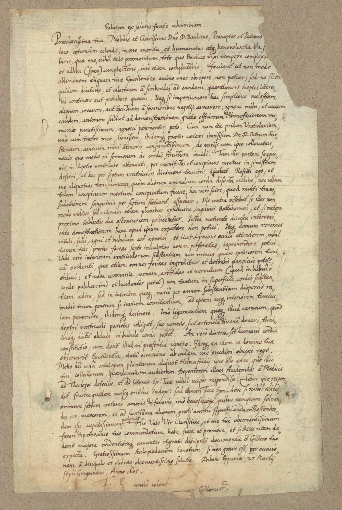

O bratrovi čti přibližně v horní čtvrtině. Údaj o rostlinách a korespondenci je v dolní části.

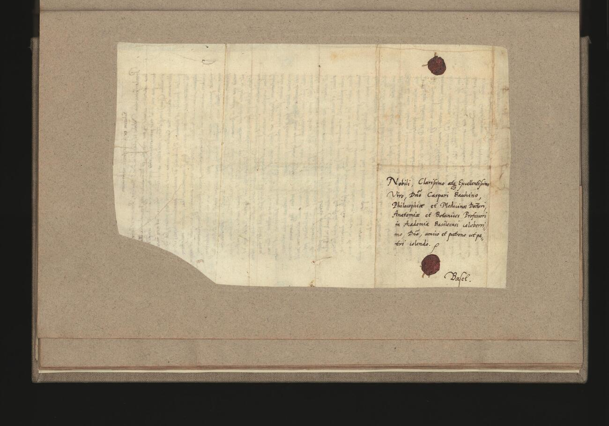

Adresa a dvě pečetní stopy, jméno Bauhina vpravo.

## SOL-08-N02 · Polanovo věnování při Gillerově promoci

**Basilej, 24. 7. 1604.** Amand Polan autor básně a věnování, Lukáš Giller adresát. Herzog August Bibliothek, Wa 5880 (51s), *Laurea Apollinea*, sign. A2r, sn. 00003, dole pod básní „Aliud“. Přečten obraz dobového tisku. [Obraz](https://diglib.hab.de/drucke/wa-5880-51s/00003.jpg)

„In gratiam Lucæ Gilleri cognati sui charissimi, felicitatem ei à Jehova ter Optimo precans / Amandus Polanus à Polansdorf f.“ Česky: „Na počest svého nejdražšího příbuzného Lukáše Gillera, jemuž vyprošuje štěstí od trojnásobně nejlepšího Jehovy, složil Amand Polan z Polansdorfu.“ Zájmeno *sui* míří k podepsanému autorovi, *ei* k Lukášovi. V horní části téhož listu je samostatný příspěvek Jaroslava Smiřického, jehož titul výslovně gratuluje Lukáši Gillerovi k doktorátu medicíny. Polanův text umožňuje hledat příbuzenskou vazbu, rodovou větev však nevybírá.

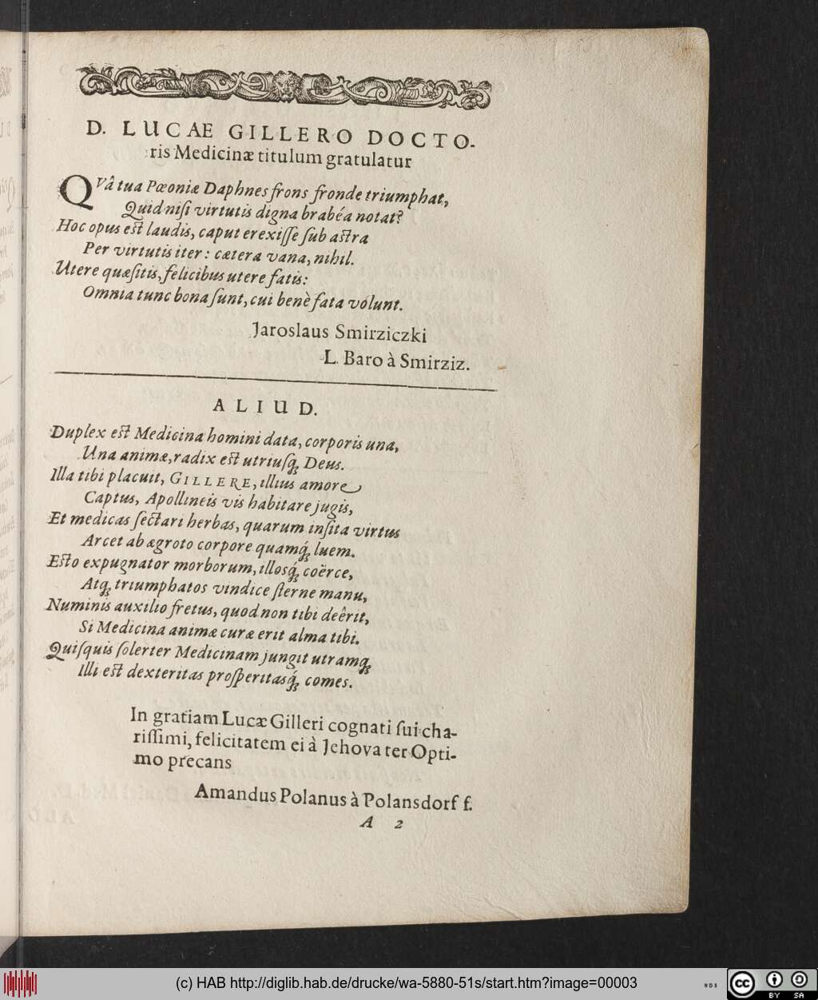

Rozhodující dedikace a podpis jsou v dolní třetině.

## SOL-08-N03 · Polanovi rodiče, dvě manželství a basilejský švagr

**Basilej, 1610, pohřeb 20. 7.** Heinrich Justus, *Trost und Ermanungs Predigt*, tisk Conrad Waldkirch, UB Basel, KiAr G X 1:48. Justus je autor předmluvy a kázání. Polanův tchán Johann Jakob Grynaeus je autor připojeného životopisu, podepsán na s. 21. Čteno z obrazu tisku, u zbytku textu použito OCR k vyhledávání. [Katalog](https://www.e-rara.ch/bau_1/content/titleinfo/17879876)

**Rodiče, s. 18, sn. 21, dolní polovina.** „Es ist Doctor Amandus zu Troppaw in Schlesien geboren / im Jar Christi 1561. den 16. Tag Christmonats. Ehrliche Leute hat er zu Elteren gehabt: namlich / Herren Henricum Polanum von Polansdorff / Syndicum Reipub. vnd Fraw Martham Cominiam.“ Česky: „Doktor Amandus se narodil v Opavě ve Slezsku roku Kristova 1561 dne 16. prosince. Za rodiče měl vážené lidi, totiž pana Jindřicha Polana z Polansdorfu, městského syndika, a paní Martu Komínovou.“ Dobový rodinný svědek potvrzuje Martino jméno. Jejího otce zde nejmenuje. [Snímek](https://www.e-rara.ch/bau_1/content/pageview/17879897)

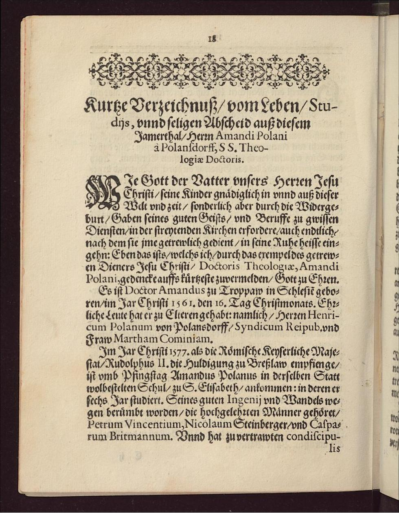

Čti odstavec od „Es ist Doctor Amandus“ pod úvodem životopisu.

**Švagr, s. 1, sn. 4, adresát a první odstavec.** „Dem Ehrnvesten vnnd Vorgeachten Herren Jacob Rüdin / Burgern vnd des Stattgerichts zu Basel / meinem lieben Gevattern“. V návaznosti „in wärender schwärer Kranckheit ewers vielgeliebten Herren Schwagers säligen Doctoris Amandi Polani, Compatris mei honorandi, ein lebendig Exempel gesehen an euch / wie auch an ewerer Ehrenden Haußfrawen / meiner Frawen Gevatterin / die jhr jhm so trewlich gedient habt biß in Tod / daß ich nicht wüßte was leibliche Geschwysterte einandern in solchem Fall mehr thun könten oder solten.“ Česky: „Váženému panu Jacobu Rüdinovi, basilejskému měšťanu a členu městského soudu, mému milému kmotrovi.“ Během těžké nemoci „vašeho velmi milovaného zesnulého švagra doktora Amanda Polana, mého ctěného kmotra“, viděli živý příklad přátelství na Rüdinovi i jeho manželce, kmotře Justovy ženy. Věrně o něj pečovali do smrti a ani vlastní sourozenci by sotva dokázali udělat víc. Přirovnání k vlastním sourozencům popisuje péči. Předmluva vzápětí jmenuje Rüdinovu dceru Valerii a uvádí její úmrtí. [Snímek](https://www.e-rara.ch/bau_1/content/pageview/17879880)

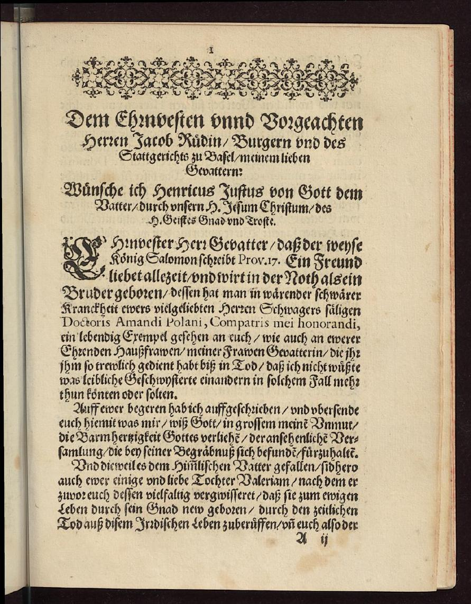

Čti oslovení nahoře a řádek se slovem „Schwagers“ uprostřed.

**Manželky, s. 20, sn. 23, prostřední odstavec.** „Im Ehestand hat er friedlich gelebet: Erstlich / mit meiner Johan. Jacobi Grynæi lieben Tochter / Maria. Als diese / wie Rachel / doch an vnnd mit einem Kind / gestorben: vertrawet jme Doctori Polano, Gott der Herre / welchem er dienete / zwey Jar hernaher meine liebe Taufftochter / Jungfrawen Salome / weiland des Ehrnvesten Frantz Ulrich Wasserhuns säligen Eheliche Tochter: Die jn vbergelebet hat / nach dem sie vber drey Jar mit einandern im Ehestand gelebet hatten.“ Česky: „V manželství žil pokojně, nejprve s Marií, milou dcerou mou, Johanna Jakoba Grynaea. Když jako Ráchel zemřela při porodu i s dítětem, o dva roky později svěřil Bůh, jemuž sloužil, doktoru Polanovi mou milou kmotřenku, pannu Salome, manželskou dceru zesnulého Franze Ulricha Wasserhuna. Ta jej přežila poté, co spolu žili v manželství přes tři roky.“ Vyjádření o dítěti je konkrétnější než Zukalova věta o bezdětných manželstvích (s. 119). [Snímek](https://www.e-rara.ch/bau_1/content/pageview/17879899)

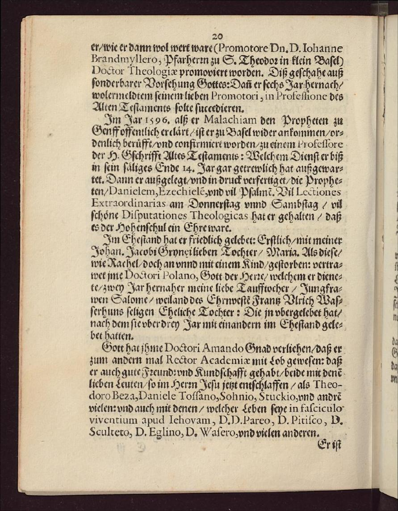

Čti prostřední odstavec od „Im Ehestand“. Pro švagrovství kolem roku 1610 odpovídá matka Apollonia Zill v [tabuli Rüdinů](https://www.stroux.org/patriz_f/stQV_f/Ru_f.pdf) a [tabuli Wasserhunů](https://www.stroux.org/patriz_f/stQV_f/WhAf.pdf). Jde o pracovní genealogické sestavy, v tabuli Wasserhunů je navíc Salomino datum úmrtí problematické. Ověření vazby vyžaduje matriky. Podle chronologie tisku vzniklo druhé manželství po gratulaci Gillerovi z července 1604.

## SOL-08-N04 · Jindřich, syn Amandova bratra

**Basilej, květen 1600.** Amand Polan Karlu staršímu ze Žerotína. UB Basel, G2 I 28b, fol. 38–39r, koncept podle katalogu. Čtena edice Františka Hrubého, *Etudiants tcheques aux écoles protestantes*, Brno 1970, č. 36, s. 87–89, rozhodující odstavec na s. 89, sn. PDF 58. [Obraz edice](https://digilib.phil.muni.cz/sites/default/files/pdf/120370.pdf#page=58) · [Kalliope](https://kalliope.staatsbibliothek-berlin.de/ead?ead.id=CH-002121-2-991170452901005501) · [Historická korespondence](https://historicka-korespondence.cz/en/projects/the-correspondence-of-amand-polan-von-polansdorf/correspondence-catalogue/?letter=1f164a4a-b0d7-427c-87c0-b363a58a11d4)

„Quod Henricum, fratris mei filium, pupilo et consanguineo tuo Bohemiae marischallo praeceptorem dare non dubitasti, ut ex Timini etiam nostri literis intellexi, quantas possum maximas ago gratias. Non deero partibus meis in illo salutaribus praeceptis instruendo exhortandoque ad officium bona fide faciendum, ut exspectationi tuae respondeat.“

Česky: „Co nejvřeleji ti děkuji, že ses nerozpakoval dát Jindřicha, syna mého bratra, za učitele svému svěřenci a pokrevnímu příbuznému, českému maršálkovi, jak jsem se dozvěděl také z listu našeho Tymína. Neopomenu svůj díl, totiž poučit ho prospěšnými radami a povzbudit ho, aby svůj úkol svědomitě vykonával a splnil tvé očekávání.“

*Mei* míří k Polanovu bratrovi, *tuo* k Žerotínovu svěřenci, podle editorů Pertoldu z Lipé. O několik odstavců dále *duo consanguinei Bukuwkovii* označuje dva vzájemně příbuzné Bukůvky, kteří dostali za učitele Johanna Jakoba Burckhardta. Zukal s. 110 a 121 ztotožňuje prvního Jindřicha se synem opavského městského písaře Jindřicha Polana, Amandova staršího bratra. Jeho s. 118 používá jednou římské číslo IV, zatímco oddíl VII a s. 110 používají III. Rozlišuj osoby podle funkce a vztahu, pořadová čísla jsou autorská.

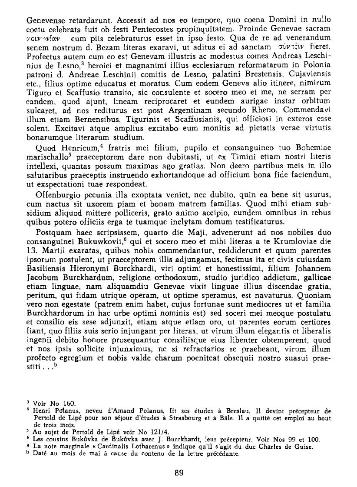

Čti „Quod Henricum“ přibližně uprostřed a odkaz na poznámku 4.

## SOL-08-N05 · Jan Richter ze Sudic jako syn sestry Amanda

**Marburg, 1. 10. 1613.** Jan Richter ze Sudic píše Johannovi Jakobu Grynaeovi do Basileje. UB Basel, G II 10, fol. 63 podle edice. Čtena edice Hrubý, č. 116, s. 193–194, PDF sn. 23. [Obraz edice](https://digilib.phil.muni.cz/sites/default/files/pdf/120371.pdf#page=23)

„Cum Regio his autumnalibus nundinis de nova operum avunculi mei editione amice transegissem, si opera ista mihi, prout edoctus literis d. Buxdorfii fueram, transmissa fuissent. Enitar tamen, ut brevi, quamprimum ea accepero, ita cum eo conveniam, ut postulat christiana tum prudentia, tum charitas. Laborem in perlustrandis et seligendis iis, quae ad novam editionem operum omnium ornandam atque locupletandam faciunt, mihi sumam, certo mihi persuadens, te consilio pio in hoc proposito neutiquam mihi defuturum.“

Česky: „Na tomto podzimním trhu bych s Regiem přátelsky dojednal nové vydání děl svého strýce z matčiny strany, kdyby mi díla byla doručena, jak jsem byl zpraven listem pana Buxtorfa. Vynasnažím se však, abych se s ním brzy, hned jak je obdržím, dohodl tak, jak vyžaduje křesťanská rozvážnost i láska. Vezmu na sebe práci projít a vybrat to, co nové vydání všech děl obohatí, v jistotě, že mi v tomto záměru poskytneš zbožnou radu.“

Dále „De historia vitae d. avunculi mei conscribenda aliquoties cogitavi“ („Několikrát jsem uvažoval o sepsání životopisu pana strýce z matčiny strany“). *Mei* označuje Richterův vztah. Edice v pozn. 2 a Zukal (s. 106 a 119) identifikují strýce jako Amanda Polana a matku jako Rozinu Polanovou. Zukal ji jmenuje jako manželku Hanuše Richtera Jakartovského ze Sudic a později Jiříka Příborského. Předmět dopisu vysvětluje, proč další případné Richterovy dopisy nebo pozůstalost mohou obsahovat informace přímo od Polanovy rodiny.

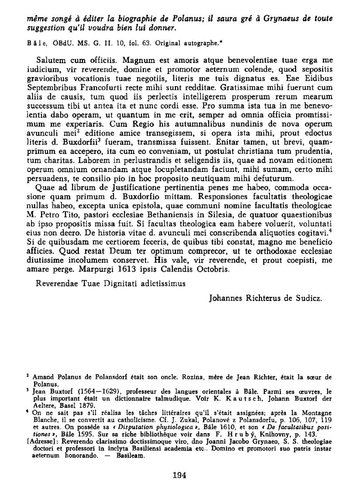

Hledej „avunculi mei“ v prvním i druhém odstavci, přiřazení jmen v pozn. 2 dole.

## SOL-08-N06 · Guetlin jmenuje sestru Rosamundu v Opavě

**Hrušovany, 12. 7. 1610 podle edice, svatba při dřívější cestě do Opavy.** Jakob Guetlinus Amandu Polanovi. UB Basel, G II 5, fol. 199 podle edice. Čtena edice Hrubý č. 173, s. 256–257, PDF sn. 87–88. [Obraz edice](https://digilib.phil.muni.cz/sites/default/files/pdf/120371.pdf#page=87)

„S. P. Clarissime et excellentissime domine doctor Amande, amice omni observantia colende, literas tuas, quas ante annum ad me Argentinam misisti, sero quidem, sed certo ipsemet pharmacopolae Allerheiligen Oppaviae, et quidem eo ipso tempore, quo soror tua d. Rosamunda jam jam nuptias erat celebratura, tradidi, quibus etiam interfuissem, nisi rhedarius noster tam praeceps discessum maturasset, quam humanissime enim praedictus pharmacopola ad eas me invitaverat.“

Česky: „Zdravím. Slovutný a nejznamenitější pane doktore Amande, příteli hodný veškeré úcty, tvůj dopis, který jsi mi před rokem poslal do Štrasburku, jsem sice pozdě, ale spolehlivě sám odevzdal lékárníku Allerheiligenovi v Opavě, a to právě v době, kdy se tvoje sestra paní Rosamunda chystala slavit svatbu. Byl bych se jí i zúčastnil, kdyby náš vozka s odjezdem tak nespěchal, neboť zmíněný lékárník mě na ni velmi laskavě pozval.“

Jméno v ručně psaném originálu nebylo porovnáno. Edice v poznámce uvádí Rozinu, manželku Hanuše Richtera. Zukal na s. 119 předpokládal rodinnou přezdívku Zuzany, dcery Zachariáše Golče a Marty, Amandovy polosestry. Pro Zukalovu úvahu mluví, že podle zápisu, který cituje, byl Allerheiligen roku 1610 manželem Zuzany, ale Guetlin v uvedeném odstavci označuje lékárníka výslovně pouze za příjemce a zvoucího. Ediční datum 12. 7. a Zukalovo 2. 7. se liší o deset dní, bez autografu zůstává způsob datace otevřený.

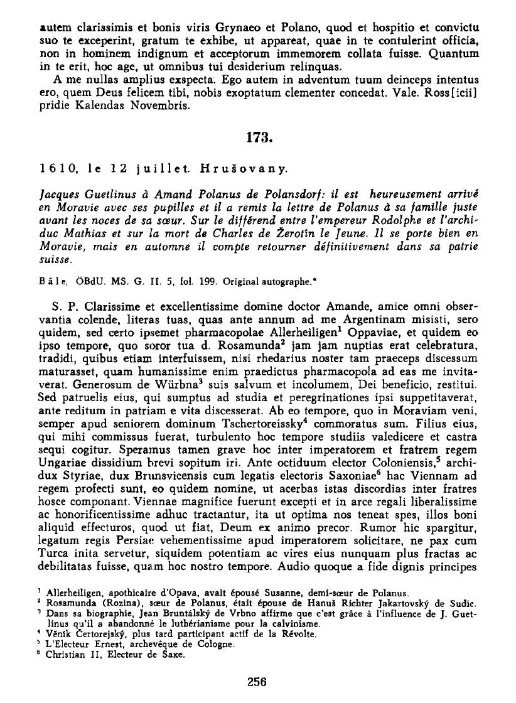

Rozhodující je první odstavec pod signaturou, dvě různé identifikace viz poznámky a Zukal.

## SOL-08-N07 · Lukášův řezenský památníkový zápis

**Řezno, 18. 10. 1625 juliánsky (28. 10. gregoriánsky).** Lukáš Giller v památníku Matthäuse Schmolla, Society of Antiquaries of London, MSS/0436, fol. 136r/137r. Čten obraz edice Heinricha Schmidt-Bäumlera, *Blätter für fränkische Familienkunde* 51 (1988), s. 28, PDF sn. 16. [Obraz edice](https://www.blf-online.de/sites/default/files/blf_quellen_dateien/bblf_jahrgang_51_1988.pdf#page=16) · [katalog originálu](https://collections.sal.org.uk/mss.0436)

„136r/137r 18. 10. 1625 ‚die D. Lucae sacro‘ R., Lucas Giller à Lilienfeld, Doktor der Medizin in R., seines Alters 45 († sanft entschlafen R. 1632)“. Česky: „18. října 1625, na svátek svatého Lukáše, v Řezně, Lukáš Giller z Lilienfeldu, doktor medicíny v Řezně, ve věku 45 let (pokojně skonal v Řezně roku 1632).“ Edice odděluje zprávu o úmrtí závorkou jako doplněk. Záznam jména, přídomku i profese umožňuje spolehlivé přiřazení a vylučuje dříve uváděné úmrtí roku 1618.

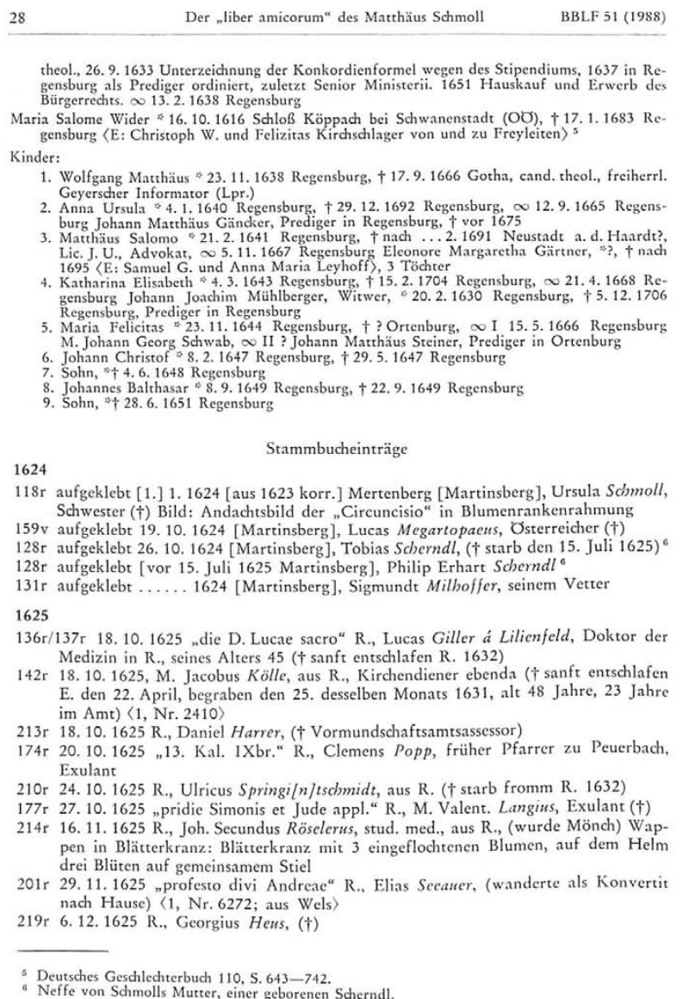

Čti první položku pod rokem 1625, v dolní polovině.

## SOL-08-N08 · Dopis Jeremiáše Sohna Polanovi

**21. 7., rok a místo v katalogu neurčeny, text hovoří o Ženevě.** Jeremias Sohn Amandu Polanovi, UB Basel, Frey-Gryn Mscr I 19, č. 68. Rozhodující pozdrav v posledních řádcích. Čten obraz líce, na rubu je adresa a průsvit. [Líc 4852634](https://www.e-manuscripta.ch/bau/content/pageview/4852634) · [rub 4852635](https://www.e-manuscripta.ch/bau/content/pageview/4852635) · [katalog](https://www.e-manuscripta.ch/bau/content/titleinfo/4852633)

„Optimè vale, Magnifice Vir, fautor & præceptor æternùm colende, cum honestissima conjuge (quam officiosissimè, ut et Venerandum Dn. parentem Grynæum, unà cum uxore saluto) ing[ue] (?) impenso illo erga me amore obsecro persiste. 21 Julij.“ Česky: „Buď zdráv, vznešený muži, patrone a učiteli navždy ctěný, spolu se svou ctihodnou manželkou (kterou co nejuctivěji zdravím stejně jako ctihodného pana otce Grynaea s jeho manželkou). Prosím, vytrvej ve své velké přízni vůči mně. 21. července.“ Oslovení odpovídá Polanovu prvnímu manželství a Grynaeovi v roli tchána, doložené v N03. Formulace sama neurčuje ročník. Dva šlechtici hledající učitele latiny v úvodu zůstávají beze jmen. Dopis Gillerovy nejmenuje.

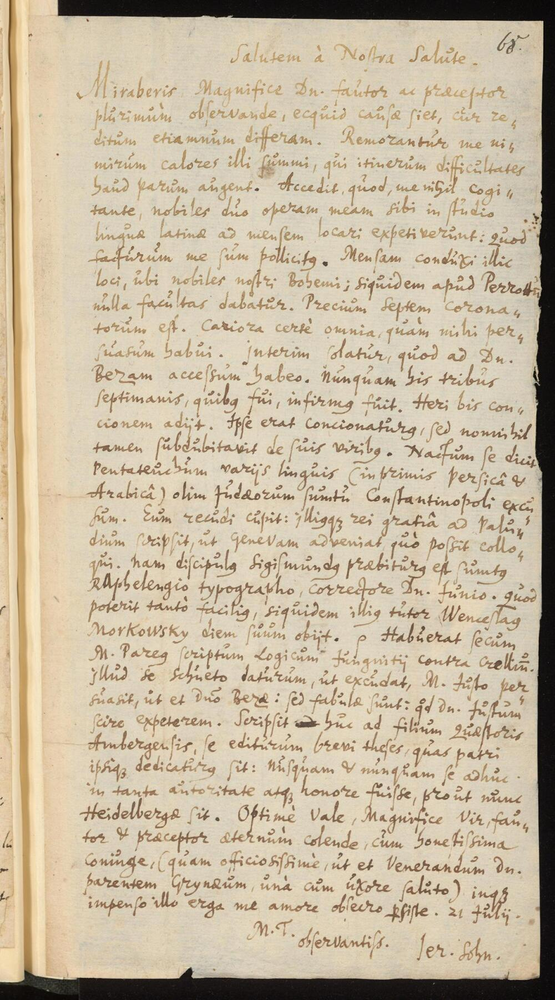

Čti posledních pět řádků nad signaturou.

## Skutečně prohledaný rozsah

| Pramen a obec | Typ | Data a snímky od–do | Způsob čtení | Výsledek a mezery |
|---|---|---|---|---|
| UB Basel, G2 I 5, dopis z Opavy | Autograf a adresa | 27. 3. 1605, 115054–115055 | Četba líce i rubu | N01. Katalog samostatné jednotky ukazuje dva obrazy. Bezpečně přiřazené katalogové záznamy bezprostředních fol. 11 a 13 se nepodařilo získat, číselně sousední webové adresy vracely 404 a nejsou foliací. |
| HAB, *Laurea Apollinea*, Basilej | Promoční tisk | 1604, 00003 | Četba výběru | N02. Zbytek svazku bez souvislé četby. |
| UB Basel, KiAr G X 1:48, Basilej | Pohřební tisk | 1610, sn. 4 a 21–23, výběr | Obraz 4, 21 a 23, doprovodné OCR včetně s. 21 a jmenné hledání v dostupném OCR | N03. Jméno Giller ve vyhledávaném OCR nezachyceno. |
| UB Basel, KiAr G X 1:29, Basilej | Pohřební tisk Marie Grynaey | 1605, PDF 1–73 | Jmenné hledání v OCR, nikoli souvislá četba obrazů | Giller a Lilienfeld bez zásahu. Dobový životopis obou manželek ověřen v N03. [Tisk Marie](https://www.e-rara.ch/bau_1/content/titleinfo/13438445) |
| e-manuscripta, Kalliope, EMLO / Historická korespondence, Ärztebriefe | Jmenné indexy a soupisy | Cílové období 1595–1632, u historické korespondence i širší | Hledání kombinací Lucas/Lukas, Gillorus/Gillerus/Giller/Güller, Lilienfeld, Oppavia/Troppau a Bauhin/Kirsten/Polan. V Polanově soupisu zvlášť hledané Giller, Gillor, Kirsten, Komin, Comini, Oppavia a Troppau a latinská příbuzenská slova | Žádný nový indexovaný zásah pro Gillerovy v Polanově soupisu. Databázové hledání pokrývá jen indexovaný text, viz případ *fratris* na papíře v N04. [Polanův katalog](https://historicka-korespondence.cz/en/projects/the-correspondence-of-amand-polan-von-polansdorf/correspondence-catalogue/) · [Lukášův profil v Ärztebriefe](https://aerztebriefe.kallimachos.de/Lucas_Giller_von_Lilienfeld) |
| UB Basel, G2 I 28b, edice Hrubého | Korespondence s Karlem starším | Květen 1600, ed. č. 35–36, s. 87–89, výběr | Edice a metadata | N04. Obraz rukopisu jsem nenašel, náhradou je veřejný obraz edice. |
| UB Basel, G II 10 a G II 5, edice Hrubého | Rodinné zmínky | 1610 a 1613, č. 173 a 116 | Výběr edice, text a obraz rozhodující strany | N05–N06. Další varianty jmen a odkazy v edičních poznámkách. |
| UB Basel, Frey-Gryn Mscr I 19, č. 68 | Dopis Sohn–Polan | 21. 7., rok neurčen, 4852634–4852635 | Četba obrazu a adresy | N08. |
| UB Basel, AN VI 16, a univerzitní matrika III | Památník a matrika | Červenec 1603 a červenec 1604, fol. 62v a matrika III, s. 28, č. 10 | Ověření odkazů v sekundární studii Martina Holého, s. 195, pozn. 47 | Přesná signatura a citované jméno *Lucas Gillerus Oppaviensis Silesius*. Holý uvádí 27. 7. 1604 u památníku. Datum „1607 Dr. med.“ v téže poznámce odporuje datovanému tisku a studii samotné. Obraz basilejského památníku ani matriky jsem neověřil. [Studie](https://karolinum.cz/data/clanek/12310/HUCP_63_1_0187.pdf) |
| Vratislav, škola sv. Alžběty | Školní prameny | Konec 16. století | Katalogové a bibliografické hledání, doplněné biografií N03 | Biografie určuje Polanovu školu od r. 1577, N04 v ediční poznámce uvádí i vratislavská studia synovce Jindřicha. Sérii školních matrik jsem nečetl. |
| Society of Antiquaries of London, MSS/0436 | Řezenský památník | 1625 s dodatkem k 1632, s. 28, PDF sn. 16 | Obraz edice | N07. [Řezenskou matriku pohřbů 1628–1634](https://www.archion.de/de/alle-archive/bayern/landeskirchliches-archiv-der-evangelisch-lutherischen-kirche-in-bayern/dekanat-regensburg/regensburg-gesamtgemeinde/40353) jsem nečetl. |
| Josef Zukal, *Polanové z Polansdorfu*, Opava | Historická studie | s. 105–106, 110, 118–121 | Pro dodané strany a pokračování použit strojový text projektu, k určení rodičů ověřen nezávislý dobový obraz N03 | Sekundární identifikace pro N04–N06. Jakub jako možný Martinin otec zůstává otevřený. [S. 105](https://www.digitalniknihovna.cz/mzk/uuid/uuid:86b99050-9ba4-11e8-b814-5ef3fc9bb22f) · [s. 106](https://www.digitalniknihovna.cz/mzk/uuid/uuid:86d15e10-9ba4-11e8-b814-5ef3fc9bb22f) |

## Co převzít a kde navázat

**Do deníku.** „Lukášův dopis z Opavy 27. 3. 1605 dokládá cestu do Vratislavi s nejmenovaným bratrem, zatímco Petr Kirstenius je jmenován samostatně jako přítel od mládí (SOL-08-N01, přímo doloženo). Roku 1604 byl Lukáš označen Amandem Polanem za příbuzného bez určení stupně (SOL-08-N02). Dobové prameny dodávají doložené osoby Polanovy rodiny: rodiče Jindřicha Polana a Martu Komínovou, manželky Marii Grynaeus a Salome Wasserhun, švagra Jacoba Rüdina, synovce Jindřicha po bratrovi a Jana Richtera po sestře (SOL-08-N03 až N05). Guetlinus jmenuje sestru Rosamundu, její přiřazení zůstává otevřené (SOL-08-N06).“

**První konkrétní obraz pro navázání.** Basilej, UB Basel AN VI 16, fol. 62v a sousední folia památníku Caspara Bauhina, Lukášův zápis 27. 7. 1604. Zkontrolovat celý autograf, připojená jména a přípis majitele. Pro opavskou větev pokračovat dopisem Amanda nevlastnímu otci Zachariáši Golčovi ze 6. 5. 1603, který Zukal na s. 118 cituje podle Thommena, a opavskou svatojiřskou matrikou kolem sňatku Zuzany 17. 9. 1612. Rodinné přípisy a svědci mohou ukázat, jak se rodiny stýkaly. Pro rok 1632 je samostatným přímým pramenem uvedená řezenská kniha pohřbů, kde má smysl ověřit přesné datum a případná jména pozůstalých.

## SOL-08-N09 · Lukáš ve dvou zápisech basilejské lékařské fakulty

**Doplněno při společné kontrole.** Martin Holý u hesla Lucas Giller uvedl dvě folia lékařské matriky. Obě strany originálu jsou dostupné online a byly přečteny přímo na obraze. Univerzitní knihovna v Basileji, sign. AN II 21, *Matricula facultatis medicae II, 1570–1814*. [Popis a úplný faksimile](https://www.e-codices.unifr.ch/en/list/one/ubb/AN-II-0021) · [Martin Holý, Die Universität Basel und die Böhmischen Länder, heslo Giller](https://shop.verlagsgruppe-patmos.de/media/medien/pdf/ebook/9783799521253_ebook.pdf)

**Zápis studenta.** Fol. 117r, číslo 496, předposlední jméno dole. Pod záhlavím šestého děkanátu Johanna Nicolause Stupana, od letního slunovratu 1603 do letního slunovratu 1604. Samotný řádek den zápisu neuvádí. Přepis řádku s rozlišením u/v zní „496. Lucas Gillerus Oppaviensis Silesius.“ Česky „496. Lukáš Giller, Slezan z Opavy.“ [Folio 117r](https://www.e-codices.unifr.ch/en/ubb/AN-II-0021/117r) · [Obraz folia 117r](https://media.e-codices.ch/iip/ubb/ubb-AN-II-0021/ubb-AN-II-0021_0117r.jp2/full/1350,/0/default.jpg)

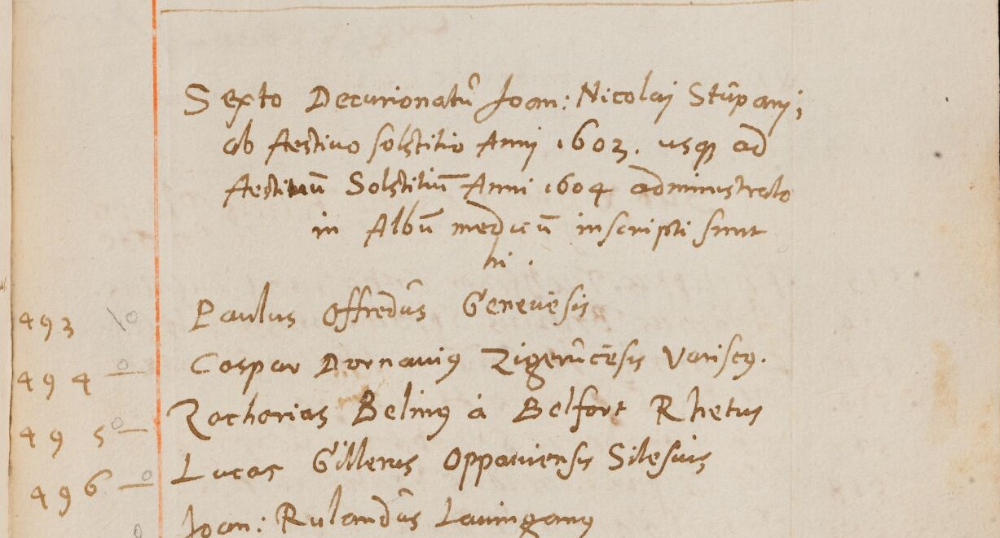

**Promoce.** Fol. 19v, číslo 416, třetí jméno po datu ve spodní polovině stránky. Záhlaví „Sub Felicis Plateri Decanatu / A° 1604“, datový řádek „Ad Iulij 24. Ioan. Nicolao Stupano“. Přepis osobního řádku se stejným rozlišením u/v zní „416. Lucas Gillerus Oppaviensis Silesius.“ Česky „Za děkanátu Felixe Platera, roku 1604. Ke dni 24. července, za Johanna Nicolause Stupana. 416. Lukáš Giller, Slezan z Opavy.“ Mezi promovanými téhož dne je výše také Caspar Dornavius. Obě folia potvrzují, jak fakulta zapsala Lukášův původ. U jeho jména chybí predikát i rodinné údaje. Vazbu na větev z Preichau zatím nelze určit. [Folio 19v](https://www.e-codices.unifr.ch/en/ubb/AN-II-0021/19v) · [Obraz folia 19v](https://media.e-codices.ch/iip/ubb/ubb-AN-II-0021/ubb-AN-II-0021_0019v.jp2/full/1350,/0/default.jpg)

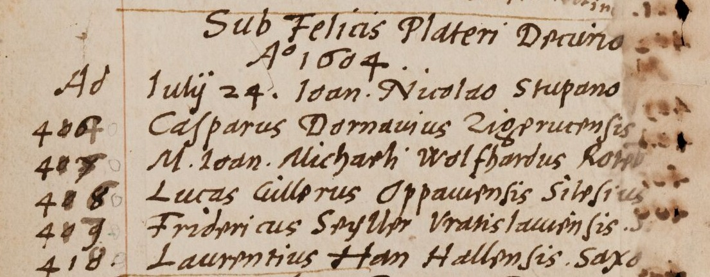

Oba výřezy pocházejí z Universitätsbibliothek Basel / e-codices, AN II 21. Snímky poskytuje sbírka pod CC0. Výřezy zachovávají sousední jména a společné záhlaví.
