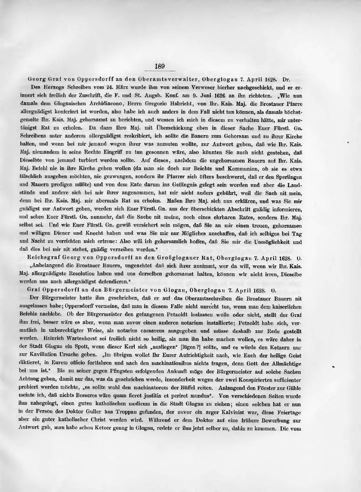
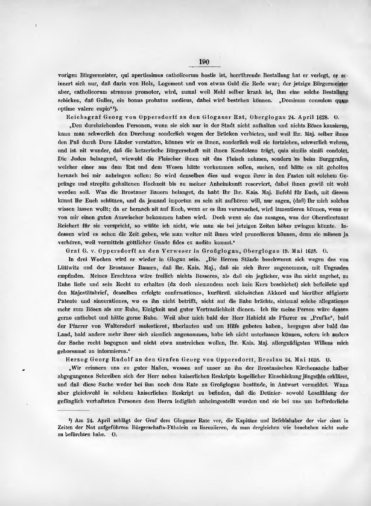
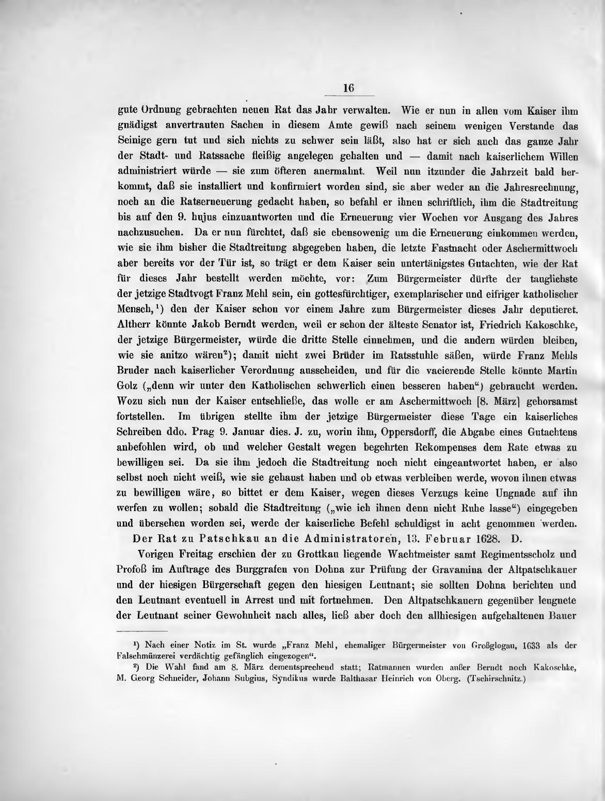
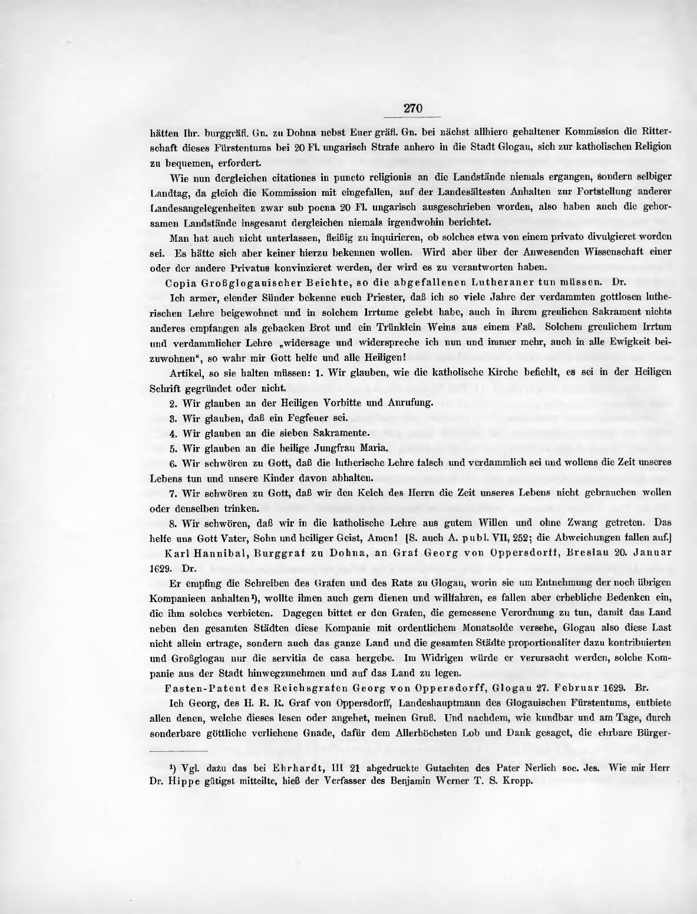
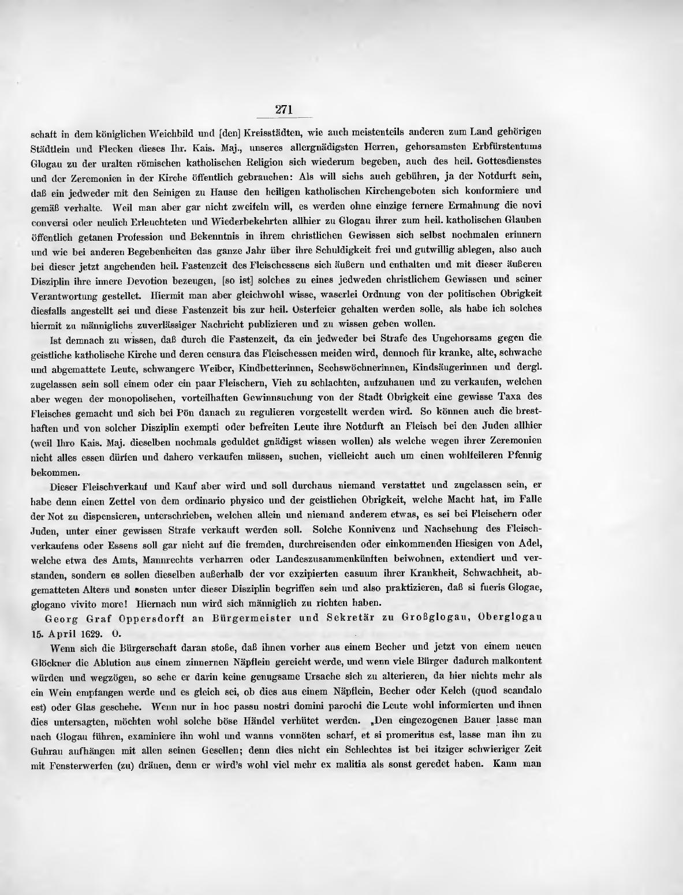
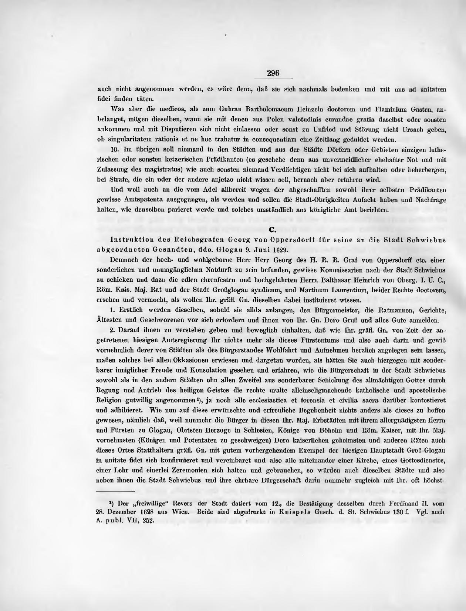
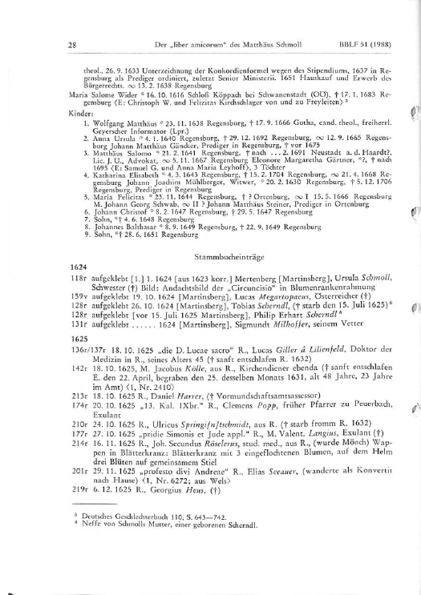
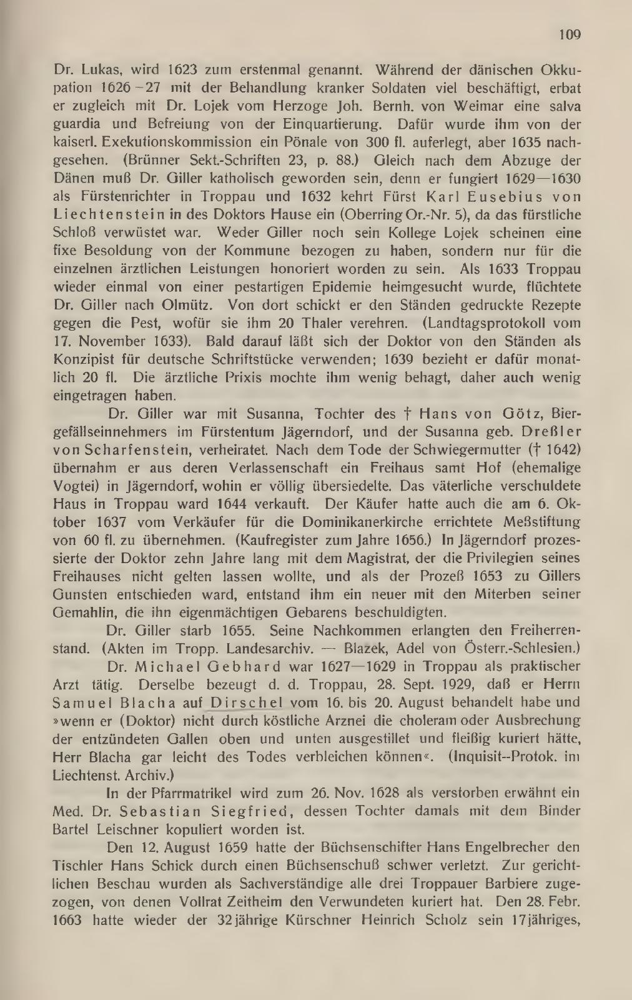
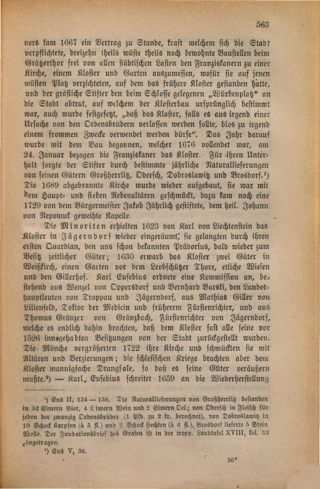

# SOL-09 · Doktor Guller a místo ve Velkém Hlohově, 1628–1632

## Závěr

- **Doloženo.** Dne 7. 4. 1628 Jiří z Oppersdorfu doporučil opavského doktora Gullera a očekával, že purkmistr zašle jmenovací podmínky. Adresáta lze určit jako **Franze Mehla** z textu a z dalších dokladů téhož svazku. Předchůdcem, od něhož pocházela založená *Bestallung*, byl podle sledu jednání pravděpodobně Friedrich Kakoschke. Původ regestu je vyznačen jako oppersdorfský zámecký archiv v Horním Hlohově. Předchozí revize již znala doporučení a oba možné lékaře (SOL-09-N01, N04, N05).
- **Nový navazující doklad.** Oppersdorfův postní patent z 27. 2. 1629 počítá se souhlasem **řádného lékaře** a duchovní vrchnosti při prodeji masa osobám s výjimkou z půstu. Patent rekapituluje situaci v knížectví, ale praktická ustanovení o prodeji mluví o poměrech „zde v Hlohově“. Pramen předepisuje postup a žádného lékaře nejmenuje. Obsazení konkrétního úřadu ani Gullerův nástup z této formule určit nelze (SOL-09-N02).
- **Otevřeno.** Poslední bezpečně doložená fáze přímo u Gullera je doporučení 7. 4. 1628. V edicích ani v prohlédnutých dějinách města se nepodařilo najít jeho přijetí, platbu, přísahu či pobyt. Dva jiní lékaři z roku 1629 se týkají města Guhrau a doktor Laurentius byl právník. Matyáš měl v letech 1629–1630 doloženou opavskou dráhu podle historické literatury a u Lukáše je nejbližší nezávislá stopa v Řezně. Krátkou cestu v roce 1628 nelze vyloučit ani u jednoho. Hlohovská domácnost a pokrevní návaznost na Preichau zůstávají otevřené (SOL-09-N02 až N07).

Východisko: stav [7c02f35](https://github.com/jgillern/gillernrodokmen/tree/7c02f3528be438f49af80b0761b5653cdd3eee02), [deník č. 606 a 678](https://github.com/jgillern/gillernrodokmen/blob/7c02f3528be438f49af80b0761b5653cdd3eee02/data/research_log.md) a [předchozí revize](../vychozi_revize.md).

## Nálezy

### SOL-09-N01 · Doporučení a adresát Franz Mehl

**7. 4. 1628, Horní Hlohov (Oberglogau, Głogówek) → Velký Hlohov (Glogau, Głogów).** Jiří hrabě z Oppersdorfu píše hlohovskému purkmistrovi. Julius Krebs (ed.), *Acta publica* VII, Breslau 1905, s. 189 od posledního tučného záhlaví, s. 190 nahoře a pozn. 1 dole. Digitální strany 203–204. Předmluva na s. IV (PDF 4) vykládá „O.“ jako „das reichsgräflich Oppersdorffsche Schloßarchiv in Oberglogau“. Četl jsem obrazy publikované edice. Zde je tištěný německý regest s vloženými citacemi, plný rukopis dopisu ani jeho dnešní uložení a signatura v edici uvedeny nejsou. [S. 189](https://sbc.org.pl/Content/8998/PDF/8998.pdf#page=203) · [S. 190](https://sbc.org.pl/Content/8998/PDF/8998.pdf#page=204) · [Značka provenience O.](https://sbc.org.pl/Content/8998/PDF/8998.pdf#page=4).

**Doslovný přepis celého regestu, včetně záhlaví a poznámky** (sjednoceny zlomy slov na koncích řádků):

> Graf Oppersdorff an den Bürgermeister von Glogau, Oberglogau 7. April 1628. O.\
> Der Bürgermeister hatte ihm geschrieben, daß er auf das Oberamtsschreiben die Brostauer Bauern nit ausgelassen habe; Oppersdorff vermeine, daß man in diesem Falle nicht unrecht tue, wenn man dem kaiserlichen Befehle nachlebe. Ob der Bürgermeister den gefangenen Petzoldt loslassen wolle oder nicht, stellt der Graf ihm frei, besser wäre es aber, wenn man zuvor einen anderen notarium installierte; Petzoldt habe sich, vermutlich in unberechtigter Weise, als notarius caesareus ausgegeben und müsse deshalb zur Rede gestellt werden. Heinrich Wartenhorst sei freilich nicht so heilig, als man ihn habe machen wollen, es wäre daher in der Stadt Glogau ein Spott, wenn dieser Kerl sich „ausliegen“ [lügen?] sollte, und es würde den Ketzern nur zur Kavillation Ursache geben. „Im übrigen wollet Ihr Eurer Aufrichtigkeit nach, wie Euch der heilige Geist diktieret, in Eurem officio fortfahren und nach den machinationibus nichts fragen, denn Gott der Allmächtige bei uns ist.“ Bis zu seiner gegen Pfingsten erfolgenden Ankunft möge der Bürgermeister auf solche Sachen Achtung geben, damit nur das, was da geschrieben werde, insonderheit wegen der zwei Konspirierten sufficienter probiert werden möchte, „es sollte wohl den machinatorem der Büffel reiten. Anlangend den Förster zur Gühle meinte ich, daß nichts Besseres wäre quam fieret justitia et periret mundus“. Von verschiedenen Seiten wurde ihm nahegelegt, einen guten katholischen medicum in die Stadt Glogau zu ziehen; einen solchen hat er nun in der Person des Doktor Guller aus Troppau gefunden, der zuvor ein arger Kalvinist war, diese Feiertage aber ein guter katholischer Christ werden wird. Während er dem Doktor auf eine frühere Bewerbung zur Antwort gab, man habe schon Ketzer genug in Glogau, redete er ihm jetzt selber zu, dahin zu kommen. Die vom vorigen Bürgermeister, qui apertissimus catholicorum hostis ist, herrührende Bestallung hat er verlegt, er erinnert sich nur, daß darin von Holz, Logement und von etwas Geld die Rede war; der jetzige Bürgermeister aber, catholicorum strenuus promotor, wird, zumal weil Mehl selber krank ist, ihm eine solche Bestallung schicken, daß Guller, ein bonus probatus medicus, dabei wird bestehen können. „Dominum consulem quam optime valere cupio“¹).
>
> ¹) Am 24. April schlägt der Graf dem Glogauer Rate vor, die Kapitäne und Befehlshaber der vier einst in Zeiten der Not aufgeführten Bürgerschafts-Fähnlein zu lizenzieren, da man dergleichen wie geschehen nicht mehr zu befürchten habe. O.

**Překlad.** Purkmistr hraběti napsal, že po dopisu zemského vrchního úřadu nepropustil brostovské sedláky. Hrabě soudí, že poslušností k císařskému rozkazu se v tomto případě nepochybí. Purkmistrovi ponechává rozhodnutí, zda má vězněný Petzoldt vyjít na svobodu, považuje však za lepší nejdřív ustanovit jiného notáře. Petzoldt se zřejmě neprávem vydával za císařského notáře a má být volán k odpovědnosti. Heinrich Wartenhorst není tak svatý, jak jej chtěli líčit. Hlohovu by bylo k smíchu, pokud by se tento člověk vymluvil lží (?), a kacíři by dostali záminku k námitkám. Purkmistr se má dál řídit svým svědomím a Duchem svatým, vykonávat úřad a nevšímat si úkladů, neboť Bůh je s nimi. Do hraběcího příjezdu o Letnicích má na věc dohlédnout, aby se tvrzení, zejména o dvou spiklencích, dala dostatečně prokázat. Původce úkladů má být potrestán. Ve věci lesníka z Gühle hrabě žádá, aby bylo učiněno spravedlnosti zadost, i kdyby měl zaniknout svět. Z několika stran mu doporučili získat pro Hlohov dobrého katolického lékaře. Našel jej v doktoru Gullerovi z Opavy, dříve zatvrzelém kalvinistovi, jenž se o těchto svátcích má stát dobrým katolíkem. Když se doktor ucházel dříve, hrabě odpověděl, že v Hlohově už je kacířů dost. Nyní jej sám přemlouvá, aby přišel. Ustanovení od předchozího purkmistra, otevřeného nepřítele katolíků, založil a pamatuje si jen dřevo, ubytování a jakési peníze. Nynější purkmistr, horlivý podporovatel katolíků, mu má zejména vzhledem k Mehlově vlastní nemoci poslat takové podmínky, aby z nich Guller jako dobrý a osvědčený lékař mohl vyžít. Hrabě přeje purkmistrovi nejlepší zdraví. Ediční poznámka se týká návrhu propustit velitele čtyř dříve postavených měšťanských oddílů, nikoli lékaře.

**Identifikace.** Záhlaví uvádí funkci adresáta, v závěru je „Mehl“. Ve stejném svazku na s. 15–16 Oppersdorf navrhuje císaři za nového purkmistra dosavadního městského fojta Franze Mehla a uvádí dosavadního purkmistra Friedricha Kakoschkeho. Ediční poznámka s. 16 výsledek volby datuje 8. 3. 1628. Kakoschke podle únorového dopisu sám nastoupil po Melchioru Gollehnovi koncem roku 1627. Založený dokument mohl být i starší. V regestu z 30. 12. 1628 na s. 238 je „dem Bürgermeister Franz Mehl“ uvedeno celým jménem. Výběr Gullera a očekávání nabídky jsou jisté. Předchozí *Bestallung* v dubnu hrabě neměl po ruce, takže její adresu, výši platu a závaznost z regestu vyčíst nelze. [Volba, s. 16](https://sbc.org.pl/Content/8998/PDF/8998.pdf#page=30) · [Mehl v pozdějším regestu, s. 238](https://sbc.org.pl/Content/8998/PDF/8998.pdf#page=252).

Regest začíná třetím tučným záhlavím odshora. Informace o Gullerovi začíná v poslední šestině stránky.

Prvních pět řádků pokračuje podmínkami pro lékaře a čtením „Mehl“. Související ediční poznámka je dole.

V hlavním odstavci uprostřed jméno Franz Mehl a dole v pozn. 2 výsledek volby z 8. března.

### SOL-09-N02 · Řádný lékař jako schvalovatel postní výjimky

**27. 2. 1629, Velký Hlohov.** Vydal Jiří z Oppersdorfu, hejtman hlohovského knížectví. *Acta publica* VIII, ed. Julius Krebs, Breslau 1906, s. 270 dole a s. 271, digitální snímky 284–285. Edice klade „Br.“ k prameni z městského archivu Vratislavi. Čteno z obrazu edice. Folio a dnešní signatura se nezjistily. [Záhlaví patentu](https://sbc.org.pl/Content/9000/PDF/9000.pdf#page=284) · [Ustanovení o lékaři](https://sbc.org.pl/Content/9000/PDF/9000.pdf#page=285).

**Přepis rozhodujícího odstavce:**

> Dieser Fleischverkauf und Kauf aber wird und soll durchaus niemand verstattet und zugelassen sein, er habe denn einen Zettel von dem ordinario physico und der geistlichen Obrigkeit, welche Macht hat, im Falle der Not zu dispensieren, unterschrieben, welchen allein und niemand anderem etwas, es sei bei Fleischern oder Juden, unter einer gewissen Strafe verkauft werden soll. Solche Konnivenz und Nachsehung des Fleischverkaufens oder Essens soll gar nicht auf die fremden, durchreisenden oder einkommenden Hiesigen von Adel, welche etwa des Amts, Mannrechts verharren oder Landeszusammenkünften beiwohnen, extendiert und verstanden sein, sondern es sollen dieselben außerhalb der vor exzipierten casuum ihrer Krankheit, Schwachheit, abgematteten Alters und sonsten unter dieser Disziplin begriffen sein und also praktizieren, daß si fueris Glogae, glogano vivito more! Hiernach nun wird sich männiglich zu richten haben.

**Překlad.** Prodej a nákup masa není dovolen nikomu bez lístku podepsaného řádným lékařem a duchovní vrchností, která může v nouzi udělit výjimku. Pod trestem mají řezníci i židovští prodejci prodávat pouze držitelům takového potvrzení. Úleva se obecně nevztahuje na cizí, projíždějící a přicházející místní šlechtice, kteří čekají na úřední či soudní jednání nebo se účastní zemských shromáždění. Kromě výše vyjmenovaných případů nemoci, slabosti, sešlého věku a dalších výjimek mají dodržovat kázeň podle pravidla „Jsi-li v Hlohově, žij po hlohovsku“. Tím se má každý řídit.

V úvodu stojí „in dem königlichen Weichbild und [den] Kreisstädten“ a rovněž další městečka a místa z knížectví. Bezprostřední důvod a mechanismus opatření míří k „novi conversi … allhier zu Glogau“, místním prodejcům a ceně stanovené městskou vrchností, s formulí o pobytu v Hlohově. Jde o normativní předpis, který předpokládá roli řádného lékaře při udělení výjimky. Neobsahuje podpis lékaře, jméno, potvrzení o jeho nástupu ani výkaz činnosti. Doklad proto umožňuje cílit na postní lístky z roku 1629 a podpůrné záznamy o městském lékaři. Totožnost s Gullerem zůstává neověřena.

Název postního patentu, autor, místo a datum jsou nad spodní poznámkou.

Územní rámec je v prvních řádcích. Podmínka s „ordinario physico“ je v posledním odstavci před dopisem z 15. dubna.

### SOL-09-N03 · Jiné jmenovité osoby z téhož ročníku

**Hlohovsko, 1629.** *Acta publica* VIII, s. 272, 294–296 (PDF 286, 308–310), obrazy s. 272 a 296, text edice k okolním instrukcím. V dopisu purkmistrovi z 20. 4. 1629 Oppersdorf slibuje přičinit se o povýšení „D. Laurentius“. Instrukce vyslancům do Schwiebusu z 9. 6. téhož roku uvádí souběžně syndika Balthasara Heinricha von Oberg a „Martinum Laurentium, beider Rechte doctorem“ („Martina Laurentia, doktora obojího práva“). Titul D. v dopisu proto nelze vykládat jako doklad o lékaři. [Dopis s. 272](https://sbc.org.pl/Content/9000/PDF/9000.pdf#page=286) · [Instrukce s. 296](https://sbc.org.pl/Content/9000/PDF/9000.pdf#page=310).

Instrukce z téhož souboru k provádění náboženského statutu uvádí na s. 296 další dvě jména:

> Was aber die medicos, als zum Guhrau Bartholomaeum Heinzein doctorem und Flaminium Gasten, anbelanget, mögen dieselben, wann sie mit denen aus Polen valetudinis curandae gratia daselbst oder sonsten ankommen und mit Disputieren sich nicht einlassen oder sonst zu Unfried und Störung nicht Ursach geben, ob singularitatem rationis et ne hoc trahatur in consequentiam eine Zeitlang geduldet werden.

„Co se týče lékařů, například doktora Bartholomaea Heinzeho a Flaminia Gasta v Guhrau, mohou být po nějaký čas strpěni, když tam nebo jinam přijdou s lidmi z Polska za účelem léčení a nepouštějí se do disputací ani nedávají příčinu k nepokojům. Jde o zvláštní případ, který se nemá stát precedentem.“ Pramen mluví o **Guhrau (Góra)** a o dočasné toleranci. Bez dalšího podkladu je nelze pokládat za nástupce v Hlohově nebo jméno Gullerova konkurenta. [S. 296, nahoře](https://sbc.org.pl/Content/9000/PDF/9000.pdf#page=310).

Lékaři z Guhrau jsou nahoře a doktorát obojího práva u Laurentia v prvním odstavci pod oddílem C.

### SOL-09-N04 · Lukáš Giller v Řezně

**18. 10. 1625 juliánsky (28. 10. gregoriánsky), Řezno.** Heinrich Schmidt-Bäumler, „Der ‚liber amicorum‘ des Matthäus Schmoll“, *Blätter des Bayerischen Landesvereins für Familienkunde* 51 (1988), s. 28, PDF 16, první zápis pod 1625. Četl jsem obraz novodobé edice. Originál Society of Antiquaries of London, MSS/0436, f. 136r/137r podle publikace. [Obraz s. 28](https://www.blf-online.de/sites/default/files/blf_quellen_dateien/bblf_jahrgang_51_1988.pdf#page=16) · [Katalog originálu](https://collections.sal.org.uk/mss.0436).

> 136r/137r 18. 10. 1625 „die D. Lucae sacro“ R., Lucas Giller á Lilienfeld, Doktor der Medizin in R., seines Alters 45 († sanft entschlafen R. 1632)

„18. října 1625, v den zasvěcený sv. Lukáši, Řezno. Lukáš Giller z Lilienfeldu, doktor medicíny v Řezně, 45 let. (Zesnul pokojně v Řezně roku 1632.)“ Poznámka v kulatých závorkách je podle edičních pravidel přeložený pozdější Schmollův přípis. Samostatný záznam o pohřbu nebyl čten. Řezenská stopa omezuje možnost dlouhodobého přesídlení do Hlohova a dovoluje krátký pobyt v mezidobí. [Řezenská kniha pohřbů 1628–1634, katalog](https://www.archion.de/de/alle-archive/bayern/landeskirchliches-archiv-der-evangelisch-lutherischen-kirche-in-bayern/dekanat-regensburg/regensburg-gesamtgemeinde/40353).

V dolní třetině první řádek pod rokem 1625 a pokračování na následujícím řádku.

### SOL-09-N05 · Matyášova opavská dráha a meze Zukalovy interpretace

Josef Zukal, „Troppauer Ärztewesen im 16. und 17. Jahrhundert“, v časopise *Zeitschrift für Geschichte und Kulturgeschichte Österreichisch-Schlesiens*, roč. 1910/11, sešit 3/4, s. 108–109, PDF 18–19. Četl jsem obraz a textovou vrstvu dobového odborného tisku. Na s. 108, v odstavci o Lukášovi, autor odkazuje přímo na *Acta publica* VII, s. 189. Pro totožnost Gullera s Lukášem nepřipojuje nezávislý jmenovitý pramen. Věta tvrdící, že Žerotínův osobní lékař odešel do Slezska a konvertoval, je Zukalův výklad této souvislosti. [S. 108](https://obc.opole.pl/Content/7764/PDF/D8272-34.pdf#page=18).

**Přepis rozhodujícího místa k Matyášovi, s. 108–109:**

> Dr. Mathias Giller von Lilienfeld, ein naher Verwandter des Dr. Lukas, wird 1623 zum erstenmal genannt. Während der dänischen Okkupation 1626–27 mit der Behandlung kranker Soldaten viel beschäftigt, erbat er zugleich mit Dr. Lojek vom Herzoge Joh. Bernh. von Weimar eine salva guardia und Befreiung von der Einquartierung. Dafür wurde ihm von der kaiserl. Exekutionskommission ein Pönale von 300 fl. auferlegt, aber 1635 nachgesehen. (Brünner Sekt.-Schriften 23, p. 88.) Gleich nach dem Abzüge der Dänen muß Dr. Giller katholisch geworden sein, denn er fungiert 1629–1630 als Fürstenrichter in Troppau und 1632 kehrt Fürst Karl Eusebius von Liechtenstein in des Doktors Hause ein (Oberring Or.-Nr. 5), da das fürstliche Schloß verwüstet war.

„Doktor Matyáš Giller z Lilienfeldu, blízký příbuzný doktora Lukáše, se poprvé připomíná roku 1623. Za dánské okupace 1626–1627 se hojně věnoval léčbě nemocných vojáků. Spolu s doktorem Lojkem si od vévody Jana Bernarda z Výmaru vyžádal ochranný glejt a osvobození od ubytování vojska. Císařská exekuční komise mu za to uložila pokutu 300 zlatých, která byla roku 1635 prominuta. Hned po odchodu Dánů se musel stát katolíkem, neboť v letech 1629–1630 působil jako knížecí sudí v Opavě a roku 1632 se kníže Karel Eusebius z Lichtenštejna ubytoval v doktorově domě na Horním náměstí č. 5, protože byl knížecí zámek zpustošen.“

Konverzi zde Zukal odvozuje z úřadu. Přímý doklad o konverzi jsem nezjistil. Později v témže článku uvádí Matyášovu manželku Zuzanu z Götzu, dceru Hanse z Götzu a Zuzany rozené Dresslerové. Tento údaj se týká Matyášovy známé rodiny v Opavě a Krnově bez vazby na Gullerovo hlohovské jednání. Zukal na s. 108 uvádí rovněž Matyáše, syna jiného lékaře (*Matyáše Ungera*), v Ratiboři roku 1638. Tuto větu nelze přisoudit Matyáši Gillerovi. [S. 109, údaje o úřadu a rodině](https://obc.opole.pl/Content/7764/PDF/D8272-34.pdf#page=19).

Začátek stránky navazuje na jméno Matyáše z konce předchozí strany. Knížecí úřad a dům jsou v prvním odstavci. Manželka je v druhém.

### SOL-09-N06 · Hlohovské archivní stopy podle konkrétních jednotek

**Velký Hlohov.** Archiwum Państwowe w Zielonej Górze, *Królewski Urząd Księstwa Głogowskiego*, 89/1289/0. Čteny názvy jednotek a počty snímků v katalogu. Portlet jednotlivých jednotek 8, 11 a 12 při otevření hlásil nedostupnost, BaSIA vrací odkazy do téhož portálu. Folia a konkrétní snímky proto nejsou ověřeny. [Úplný soupis Ratswesen](https://www.szukajwarchiwach.gov.pl/de/seria?_Seria_delta=200&_Seria_id_serii=337066&_Seria_nameofjsp=jednostki&_Seria_resetCur=false&p_p_id=Seria&p_p_lifecycle=0&p_p_mode=view&p_p_state=normal) · [BaSIA](https://basia.famula.pl/skany.php?placeid=753).

| Jednotka | Katalogový titul nebo jeho překlad | Data a skeny v katalogu | Vztah k pátrání |
|---|---|---|---|
| [89/1289/0/1.3/8](https://www.szukajwarchiwach.gov.pl/de/jednostka/-/jednostka/6800706) | *Einzelne Schreiben an den Rath zu Glogau* (Jednotlivé dopisy radě v Hlohově) | 1591–1666, 7 | První místo k ověření příchozí korespondence z dubna 1628. |
| [89/1289/0/1.3/11](https://www.szukajwarchiwach.gov.pl/de/jednostka/-/jednostka/6800619) | *Bittschrift des convertiten Rathsherrn zu Glogau Subgius um Verdoppelung seines Gehalts* (Žádost konvertovaného hlohovského radního Subgia o zdvojnásobení platu) | 1628, 5 | Pomocný kontext platů a konverze, osoba je radní Subgius, nikoli lékař. |
| [89/1289/0/1.3/12](https://www.szukajwarchiwach.gov.pl/de/jednostka/-/jednostka/6800620) | Spor o způsob správy města mezi radou a purkmistrem Franzem Mehlem | 1629–1635, 33 | Druhý cíl. Přednostně dokumenty z let 1629–1630 o personálních rozhodnutích či městských výdajích. |
| [89/1289/0/1.4/26](https://www.szukajwarchiwach.gov.pl/de/seria?_Seria_id_serii=337067&_Seria_nameofjsp=jednostki&p_p_id=Seria&p_p_lifecycle=0&p_p_mode=view&p_p_state=normal) | Vysvětlení bývalého purkmistra Friedricha Kokoschky, proč úřadoval po skončení funkčního období | 1628, 8 | Zpřesnění sledu úřadu v roce 1628, obraz nečten. |
| [89/1289/0/6.1/332](https://www.szukajwarchiwach.gov.pl/de/seria?_Seria_id_serii=337088&_Seria_nameofjsp=jednostki&p_p_id=Seria&p_p_lifecycle=0&p_p_mode=view&p_p_state=normal) | *Bemängelung der Stadtrechnung* (Výhrady k městskému účtu) | 1627, 15 | Předchází doporučení. Další datovaná jednotka v soupisu pod číslem 333 je až z roku 1646, účet 1628–1630 se v této řadě nepodařilo určit. |

Další konkrétní rukopisná možnost je [AP Wrocław, 82/28/0/1/86, *Acta publica oder Verhandlungen der Schlesischen Fürstentage*](https://www.szukajwarchiwach.gov.pl/en/web/guest/jednostka/-/jednostka/11070270?refererPlid=20136), 1627–1632, katalogově 570 snímků. Přímá jednotka opět hlásila nedostupný portlet. Svazek je rukopisná paralela pro zemské písemnosti a umožňuje postoupit za konec tištěné edice v roce 1629, pokud se otevře. Samostatné [Akta miasta Głogów, 89/13/0](https://www.szukajwarchiwach.gov.pl/zespol/-/zespol/63046) mají podle popisu finanční správu 1729–1866. V části nezpracovaných akt datované souhrnně 1600–1940 nebyl početní rok 1628–1630 rozpoznán. Místní muzeum uvádí ztrátu historického oppersdorfského zámeckého archivu a existenci soukromých rodových materiálů. Osud konkrétního doporučujícího listu se nepodařilo potvrdit. [Rozhovor o zámeckém archivu v Głogówku](https://radiopark.fm/wiadomosci/bliska-kultura-audycja-opolskie-jedna-historia-odc-6/).

### SOL-09-N07 · Matyáš Giller a komise pro krnovské minority

**Krnov, kontext majetkových obnov po roce 1630.** Gottlieb Biermann, *Geschichte der Herzogthümer Troppau und Jägerndorf*, Teschen 1874, s. 563, Bayerische Staatsbibliothek, sign. Austr. 633 c, sn. 0577, odstavec začínající „Die Minoriten“. Čteno z obrazu tisku. [Biermann, s. 563](https://api.digitale-sammlungen.de/iiif/image/v2/bsb11181592_00577/full/1300,/0/default.jpg).

> 1630 erwarb das Kloster zwei Güter in Weißkirch, einen Garten vor dem Leobschützer Thore, etliche Wiesen und den Gillerhof. Karl Eusebius ordnete eine Kommission an, bestehend aus Wenzel von Oppersdorf und Bernhard Barski, den Landeshauptleuten von Troppau und Jägerndorf, aus Mathias Giller von Lilienfeld, Doktor der Medicin und früherem Fürstenrichter, und aus Thomas Gränzer von Gränzbach, Fürstenrichter von Jägerndorf, welche es endlich dahin brachten, daß dem Kloster fast alle seine vor 1526 innegehabten Besitzungen von der Stadt zurückgestellt wurden.

„V roce 1630 získal klášter dva statky ve Weißkirchu, zahradu před Hlubčickou bránou, několik luk a Gillerův dvůr. Karel Eusebius ustanovil komisi, v níž byli Václav z Oppersdorfu a Bernard Barski, zemští hejtmané Opavy a Krnova, Matyáš Giller z Lilienfeldu, doktor medicíny a bývalý knížecí sudí, a Tomáš Gränzer z Gränzbachu, knížecí sudí v Krnově. Dosáhli nakonec toho, že město vrátilo klášteru téměř všechny statky, které držel před rokem 1526.“

**Totožnost.** Celé jméno, predikát, povolání i bývalý soudní úřad odpovídají Matyášovi u Zukala. Text výslovně datuje nabytí majetku klášterem do roku 1630, samotné jmenování členů komise v následující větě přesným dnem či rokem nedatuje. Jmenovaný Oppersdorf je zde Václav, hejtman opavský. Dopis v SOL-09-N01 psal Jiří, hejtman hlohovský. Jméno „Gillerhof“ samo nedokládá Matyášovo vlastnictví ani dědictví. Faustin Ens, *Das Oppaland*, sv. IV, Vídeň 1837, s. 37–38, potvrzuje ve vyprávění o krnovských minoritech název dvora „den Gillertschen Hof“. Rok 1630 připojuje přímo ke dvěma selským usedlostem ve Weißkirchu, které odlišuje od ostatních nabytých nemovitostí. Členy komise v tomto úseku neuvádí. [Ens, s. 37](https://api.digitale-sammlungen.de/iiif/image/v2/bsb10009434_00047/full/1400,/0/default.jpg) · [Ens, s. 38](https://api.digitale-sammlungen.de/iiif/image/v2/bsb10009434_00048/full/1400,/0/default.jpg).

V druhé polovině strany čtěte odstavec „Die Minoriten“, od údaje 1630 po výčet členů a výsledek práce komise.

## Krátká časová osa

| Datum | Lukáš | Matyáš |
|---|---|---|
| 1618 | U Karla st. ze Žerotína jako lékař podle Zukalova odkazu na korespondenci. | – |
| 1623–1627 | Řezno 18. 10. 1625 (SOL-09-N04). | Poprvé připomínán 1623, jako lékař v Opavě za dánské okupace 1626–1627 podle Zukala (SOL-09-N05). |
| 7. 4. 1628 | Zukalovo ztotožnění je hypotéza. | Jméno v regestu chybí. Původ a povolání souhlasí, pobyt v Hlohově otevřený (SOL-09-N01, N05). |
| 1629–1630 | Bez nového jmenovitého dokladu k Hlohovu či Řeznu. | Knížecí sudí v Opavě podle Zukala, což snižuje pravděpodobnost trvalého přesunu do Hlohova (SOL-09-N05). |
| 1632–1633 | Pozdější přípis uvádí úmrtí v Řezně roku 1632 (SOL-09-N04). | Roku 1632 je doložen jeho opavský dům v historické literatuře. Zukal pak uvádí práci z Olomouce za moru roku 1633 (SOL-09-N05). |

## Tabulka prohledaného

| Pramen a místo | Typ záznamu | Data a strany/snímky | Způsob | Výsledek a mezery |
|---|---|---|---|---|
| *Acta publica* VI, Slezsko | Edice zemské korespondence | 1626–1627 a starší dodatky, obsah PDF 6–8, rejstřík 343–357 | Rejstřík a hledání v OCR | Příprava Gullerova hlohovského nástupu jmenovitě nenalezena. [Sv. VI](https://sbc.org.pl/Content/8997/PDF/8997.pdf) |
| *Acta publica* VII, Velký a Horní Hlohov | Regesty a edice korespondence | 1628, obsah PDF 5–13, rejstřík PDF 287–301, obrazy PDF 30, 203–204, doplňkový text PDF 252 | Kontrola obrazů, rejstřík, OCR a vybrané sousední dopisy | Doporučení, volba a jméno adresáta (N01). Záznamy téhož dne a 24. 4. se týkají jiných věcí. Odpověď purkmistra a jmenovací list nenalezeny. |
| *Acta publica* VIII, zejména Velký Hlohov | Úřední patent, korespondence a instrukce | 1629, obsah PDF 5–14, rejstřík 323–338, obrazy 284–286, text 294–310 pro související úseky | Kontrola obrazů, rejstřík, OCR hesel a čtení vybraných souvislostí | Postní patent s anonymní lékařskou rolí (N02). Laurentius a lékaři z Guhrau v jiných rolích (N03). Tištěná řada končí rokem 1629. |
| AP Zielona Góra, 89/1289/0/1.3 | Hlohovská městská rada | 1591–1666, 1628, 1629–1635, jednotky 8, 11, 12 | Celý katalogový soupis a otevření jednotek, žádný obraz rukopisu | Jednotky vymezeny, data jednotlivých snímků zůstávají neznámá (N06). |
| AP Zielona Góra, 89/1289/0/6.1 a 89/13/0 | Účty a městská správa | Cíl duben 1628–konec 1630, žádný účetní obraz | Katalog | Časově vhodný účetní svazek se nepodařilo určit (N06). |
| AP Wrocław 82/28/0/1/86 | Rukopisná zemská jednání | 1627–1632, 570 snímků podle katalogu, žádný obraz | Katalog a pokus o otevření | Rukopisná svodka zůstává k projití (N06). |
| Ferdinand Minsberg, *Geschichte der Stadt und Festung Groß-Glogau*, díly I a II | Dějiny města a přílohy | Díl I, titul, předmluva a výběr z orientačních stran. Díl II, obsah a přehled oddílů (sn. 0577–0593) a s. 75, 80, 85 a 88–120, BSB snímky 0083, 0088, 0093 a 0096–0128 | Výběr obrazů a OCR fraktury, kontrola jmen a funkcí | Díl II popisuje rekatolizaci a pevnostní stavby. Údaj o dvorním lékaři Bartholomäu Schwäbovi na s. 119 se vztahuje k letům 1596 a 1598, ne k obsazení v roce 1628. Zadaná katovická kopie nemá s. 1–160 dílu II. [Díl I v BSB](https://www.digitale-sammlungen.de/de/details/bsb10013651) · [Díl II v BSB](https://www.digitale-sammlungen.de/en/details/bsb10013652) · [S. 119](https://api.digitale-sammlungen.de/iiif/image/v2/bsb10013652_00127/full/1150,/0/default.jpg). |
| Julius Blaschke, *Geschichte der Stadt Glogau und des Glogauer Landes* | Dějiny města | S. 246–268, PDF 254–277, zvláště s. 260–264 a 265–268 | OCR fraktury z těchto obrazů a kontrola odkazů k době 1628–1632 | Vyprávění o rekatolizaci (mimo jiné s odkazy na Minsberga) a opevňování. Pobyt u „evangelického doktora Wilperta“ (s. 255) se týká krále Fridricha roku 1620, autor zde neurčuje obor doktorátu. Doklad ke Gullerovi nebyl nalezen. [Digitalizát SBC, s. 260](https://sbc.org.pl/Content/17564/PDF/tmp3d30.pdf?handler=pdf#page=268) · [Katalog FU Berlin](https://refubium.fu-berlin.de/handle/fub188/24544). |
| Schmidt-Bäumler, Řezno | Edice památníku | 18. 10. 1625 s přípisem 1632, s. 28, PDF 16 | Obraz edice, jeden jmenovitý řádek | Lukáš, lékař v Řezně, pozdější přípis o smrti (N04). |
| Zukal, Opava a Hlohov | Odborný tisk | S. 107–109, PDF 17–19 | Výběr stran, obraz a textová vrstva | Opavská dráha Matyáše a přejatý regest k Lukášovi (N05). |
| Biermann a Ens, Opava a Krnov | Dějiny knížectví a místopis | Biermann s. 562–564, sn. 0576–0578. Ens s. 37–38, sn. 0047–0048 | Výběr z obrazů a OCR | Matyáš jako doktor medicíny a bývalý knížecí sudí v komisi, souběžná zmínka o dvoře (N07). |

Při strojovém hledání byly využity tvary Guller/Güller/Giller/Gillerus, Lilienfeld, Troppau, Oppersdorff, Mehl, medicus, physicus, Arzt, Stadtarzt, Bestallung a Besoldung, včetně obvyklých překlepů rozpoznávání. Výsledek z OCR je omezený kvalitou rozpoznání fraktury. Ve svědectví o doporučení a u postního patentu byly rozhodující pasáže přečteny přímo z obrazů.

## Co převzít a kde navázat

**Formulace do deníku.** „SOL-09-N01: Dne 7. 4. 1628 Oppersdorf z Horního Hlohova doporučil Franzi Mehlovi, purkmistrovi Velkého Hlohova, doktora Gullera z Opavy a žádal přípravu podmínek pro službu. Ediční provenience O. odkazuje na oppersdorfské zámecké archiválie. SOL-09-N02: Postní patent z 27. 2. 1629 výslovně přikazuje dvojí potvrzení o výjimce, od řádného lékaře a duchovní vrchnosti. Lékař je anonymní a doložen je předpis, bez potvrzení Gullerova nástupu. SOL-09-N04/05/07: Lukáš má řezenskou a Matyáš v této době opavskou či krnovskou stopu. Křestní jméno hlohovského uchazeče a jeho vazba na Preichau zůstávají otevřené.“

1. V AP Zielona Góra začít sedmi snímky **89/1289/0/1.3/8**, zejména dubnovou či květnovou korespondencí k roku 1628. Hledat odpověď Franze Mehla, *Bestallung*, potvrzení přísahy, výdaj na ubytování nebo dřevo. Poté číst **89/1289/0/1.3/12**, nejdříve dokumenty 1629–1630 a finanční kontext sporu rady s Mehlem. Při případné žádosti o reprodukci přesně označit město **Groß-Glogau/Głogów** a přiložit data a odkaz na regest.
2. Pro rok 1629 zacílit na *Fasten-Patent*, originál s proveniencí „Br.“ a vydané lístky k postní výjimce. Podpis, výkaz odměn nebo jmenovací podmínky jsou potřebná jmenovitá pojítka. Pro rok 1630 projít rukopisný soubor **82/28/0/1/86** od konce roku 1629.
3. Pro doplnění Lukášovy časové osy prověřit originál památníku **MSS/0436, f. 136r/137r** a řezenskou knihu pohřbů za rok 1632, včetně variant Giller/Güller a predikátu. Teprve po jmenovitém dokladu o hlohovském pobytu sledovat místní domácnost, manželku, děti či dědice.
