# SOL-10 · Friedrich z Hammeru a služba před rokem 1751

## Závěr

- **Doloženo.** Nejstarší nalezený doklad o Friedrichovi z pallaviciniovské linie v konkrétním útvaru je **červenec 1751**. Friedrich von Gillern už byl granátnickým nadporučíkem Pallaviciniho pěšího pluku (pozdější IR 15). Žádal o dva měsíce dovolené **do Vratislavi (Breßlau)** a císařsko-královské rozhodnutí dovolenou povolilo. Zápis důvod cesty, její uskutečnění ani přesný den neuvádí (SOL-10-N01).
- **Velmi pravděpodobné.** Jde o pozdějšího hejtmana Friedricha barona Gillerna, rodáka z Hammeru ve Slezsku. Shoduje se jméno a titul, pluk je stejný a hodnosti na sebe časově navazují. Přehlídka roku 1756 uvádí 13 let služby, tedy přibližný začátek kolem roku 1743. Započtená služba neidentifikuje první útvar nebo první posádku. Závěr deníku č. 711 o nástupu k Pallavicinimu až roku 1753 odporuje zápisu z roku 1751. Rok 1753 je dosud doloženým rokem, kdy je ve službě u téhož pluku zachycen jako hejtman (SOL-10-N01–N02).
- **Odlišené osoby.** Ve starších rejstřících se zápisy pojí s Platzovým podplukovníkem Gillerem a s hejtmanem hrabětem Gillerem z Darmstadtského pluku. V Platzově pozůstalostní agendě se objevují bývalý nadporučík Friedrich a Christian ze Sincèrova pluku. Projektové přehlídky IR 43 odlišují mladšího člena Platzova pluku od rodáka z Hammeru původem, věkem a sledem služby. Zápis z roku 1752 sám místo narození Friedricha neobsahuje (SOL-10-N03–N08).
- **Otevřeno.** V prohlédnutých rejstříkových rubrikách a ověřených foliích jsem nenalezl starší bezpečný doklad o Friedrichovi z Hammeru v určitém útvaru. Vratislav je doložený cíl jeho plánované dovolené roku 1751. U Maximiliána, Johanny a Josefa nebyla nalezena žádná jmenovitá vazba ani pobyt v předpokládaném období Josefova narození **3. 2. 1746–2. 2. 1747**. Pro otevření konkrétní matriky ke křtu Josefa proto nevznikl nový pramenný podklad (SOL-10-N01, N05–N08, tabulka pokrytí).

**Redakční doplnění k SOL-10-N03 a N04.** Červnový záznam výslovně uvádí Friedricha jako syna zesnulého podplukovníka Gillera. Červencový záznam uvádí stejného otce u nadporučíka Christiana. Otcovo celé jméno, Friedrich Wilhelm von Giller, zachycuje srpnový protokol téže pozůstalosti. [Opravené čtení níže](#sol-10-n03--friedrich-bývalý-nadporučík-u-platze) · [Srpnový protokol, kn. 876, fol. 717v, č. 502](https://library.hungaricana.hu/hu/view/KA_HKR_876_1752J/?pg=201).

## Dvě časové osy

| Datum | Friedrich u Pallaviciniho | Platzův pluk a jeho pozůstalostní agenda |
|---|---|---|
| Kolem 1743 | Přibližný začátek započítané služby podle přehlídky z roku 1756. Útvar otevřený (N02). | |
| 3. 4. 1748 | | Podplukovník Giller u Platze a návrh na jeho zastoupení (N05). |
| Srpen 1749 | | Platzův podplukovník u pluku v Lucemburku, vyřizovaná dovolená do Budína a lázní (N06). Deník č. 714 klade odchod mladšího Friedricha (Wilhelma) od Platze „zu Pandurn“ na konec dubna. |
| Duben a 5. 5. 1750 | | V dubnu návrh na penzionování Platzova podplukovníka Gillera, nezpůsobilého polní služby. V květnu ochrana vdovy a dětí v podplukovníkově pozůstalosti (N07). |
| Červenec 1751 | Granátnický nadporučík. Povolená dovolená do Vratislavi (N01). | |
| Červen a červenec 1752 | | Friedrich, bývalý nadporučík Platzova pluku, žádá o vydání písemností z řízení o pozůstalosti svého otce, zesnulého podplukovníka Gillera (redakční oprava čtení N03). Christian ze Sincèrova pluku žádá o převzetí pozůstalosti svého otce, zesnulého podplukovníka u Platze (N03–N04). |
| 1753 a 20. 5. 1756 | Hejtman (deník č. 714 a N02). Přehlídka 1756 uvádí narození v Hammeru. | |

Výchozí údaje z [projektového deníku č. 648, 710, 711 a 714](https://github.com/jgillern/gillernrodokmen/blob/7c02f3528be438f49af80b0761b5653cdd3eee02/data/research_log.md#L655). Přepisy níže zachovávají dobové tvary, zkratky a vyznačují nejistotu. Značka `pg` odkazuje na číslo snímku v prohlížeči Hungaricana. [Řada protokolů HKR](https://library.hungaricana.hu/en/collection/ausztriai_leveltarak_Hofkriegsrat/).

## SOL-10-N01 · Žádost a rozhodnutí o dovolené do Vratislavi

Červenec 1751, agenda Dvorské válečné rady. Vratislav je cíl žádosti. Výchozí posádka není v zápisu pojmenována. ÖStA, Kriegsarchiv, Hofkriegsrat, Expedit sv. 859, fol. 1114v vlevo pod středem, č. 258, a fol. 1115r vpravo pod horní třetinou, č. 261. Čteno z obrazu originálu. [Dvoustrana, sn. 384](https://library.hungaricana.hu/hu/view/KA_HKR_859_1751E/?pg=384).

> **258** [okraj] v. Gillern. Freyherr Friedrich Gren: Oberleuth: von Pallavicinisch: Regiment; langet an Ihme auf zwey Monathe die Licenz nach Breßlau zu ertheilen.
>
> **261** und Kayß: Königl: Resolution; daß dem Pallavicinisch: Regmts Oberleuth: Bar: Giller nacher Breßlau, und dem Marchallisch: Regiments Fähnrich Bila die Licenz nach Sachsen zu ertheilen seye.

Překlad č. 258. Svobodný pán Friedrich, granátnický nadporučík Pallaviciniho pluku, žádá, aby mu byla udělena dovolená na dva měsíce do Vratislavi. Překlad rozhodujícího úseku č. 261. Císařsko-královské rozhodnutí, aby byla nadporučíkovi baronu Gillerovi od Pallaviciniho pluku udělena dovolená do Vratislavi a praporčíkovi Bilovi od Marchallova pluku do Saska. Pokračování č. 261 řeší samostatnou věc pluku Damnitz. Dvouměsíční lhůta stojí v žádosti, rozhodnutí její délku neopakuje.

Tvar Giller v rozhodnutí a Gillern na okraji žádosti spojuje výjimečně přesná kombinace hodnosti, pluku, titulu a cíle. Č. 258 a 261 představují dva kroky téže žádosti. Měsíc Julius uveden v záhlaví. Zmínka o červnovém odvodu rekrutů v sousedních položkách patří k jiným podáním.

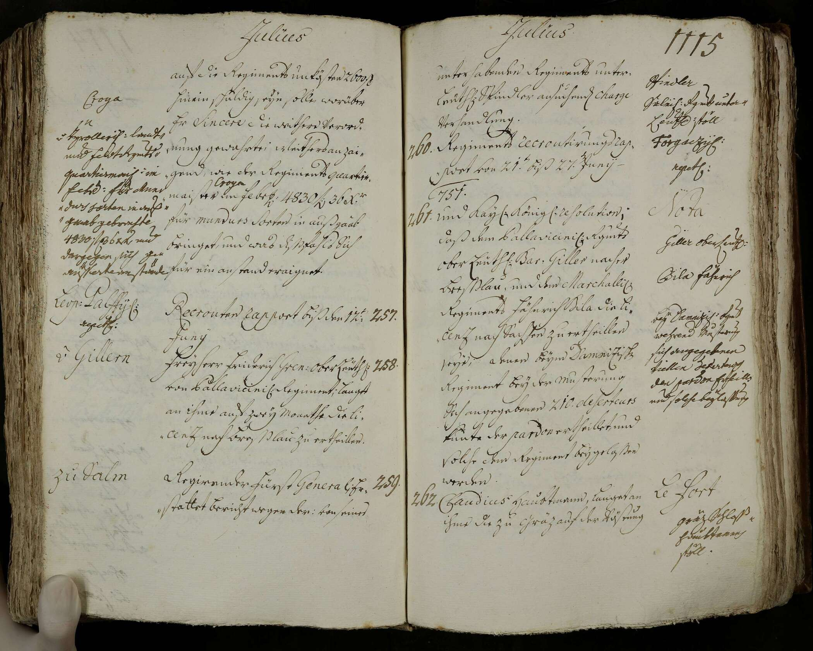

Vlevo řádek č. 258 s „v. Gillern“, vpravo č. 261 s „Bar: Giller“ a slovem Breßlau.

## SOL-10-N02 · Hejtman z Hammeru ve slezském původu

20. 5. 1756, přehlídka Pallaviciniho pěšího pluku, pozdější IR 15. ÖStA, Kriegsarchiv, Musterlisten und Standestabellen, DGS 7607065, sn. 504, prima plana, záhlaví setniny. Četl jsem projektový výřez originálu a jeho širší popis v deníku č. 648. Plný obraz FamilySearch v tomto průchodu vyžadoval přístup, proto je přiložen dostupný projektový výřez. [FamilySearch, sn. 504](https://www.familysearch.org/search/film/007607065?i=503) · [ARK](https://www.familysearch.org/ark:/61903/3:1:3QS7-L9VM-LP4F) · [Deník č. 648](https://github.com/jgillern/gillernrodokmen/blob/7c02f3528be438f49af80b0761b5653cdd3eee02/data/research_log.md#L655).

> Hauptmann / Fridrich Baron Gillern, gebürtig von Hammer aus Schlesien alt 31 Jahr, Cath., ledig, dient 13 Jahr.

Hejtman Friedrich baron Gillern, narozený v Hammeru ve Slezsku, 31 let, katolík, svobodný, slouží 13 let. Věk je slučitelný s křtem Johanna Friedricha Rudolpha 29. 12. 1724 v Krehlau v rodině z Hammeru (deník č. 601). Vztah k Maximiliánovi zůstává pravděpodobný podle více záznamů projektu. Přehlídka sourozenecký vztah neuvádí. Praporčík Franz Anton Giller z Hammeru je v přehlídce IR 15 z 29. 1. 1745 zapsán s jinými křestními jmény. Kvůli podobnému věku, rodišti i délce služby zůstává otevřená dřívější hypotéza deníku č. 648 o variantních jménech. Praporčíkův vstup 21. 3. 1744 zde nepřebírám jako datum služby Friedricha bez pramene, který jména propojí.

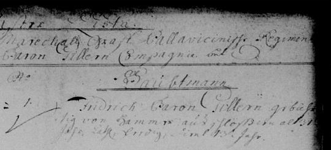

Projektový výřez s titulem, jménem, rodištěm, věkem a délkou služby. [Deník č. 601](https://github.com/jgillern/gillernrodokmen/blob/7c02f3528be438f49af80b0761b5653cdd3eee02/data/research_log.md#L608).

## SOL-10-N03 · Friedrich, bývalý nadporučík u Platze

Červen 1752 (6. 6. podle datace výchozího zadání), agenda Dvorské válečné rady. ÖStA, Kriegsarchiv, Hofkriegsrat, Judizial sv. 876, fol. 481r, spodní část pravé strany. V položce samotné den výslovně rozepsán není. Čteno z obrazu originálu. [Snímek 7](https://library.hungaricana.hu/hu/view/KA_HKR_876_1752J/?pg=7).

> Friderich gewester Oberleut. d. Plazischer Regts. et angebettener gnädigen extradierung seiner Acten als verstorbenen Obrist Leut. Giller Verlass[enschafft]: Abhandlung, und deßwegen Auflag an die Löbl. Canzley betr. / Exp. Fiat der Canzley gegen quittung auszufolgen wie gebetten.

Věc Friedricha, bývalého nadporučíka Platzova pluku, který žádá o laskavé vydání písemností k projednání pozůstalosti zesnulého podplukovníka Gillera a příslušný pokyn kanceláři. Kancelář je má vydat proti potvrzení podle žádosti.

Zadání jej spojuje s mladším Friedrichem, synem podplukovníka. Tento výtah nezmiňuje jeho původ a nepoužívá výslovné slovo „otec“. Společný pluk a pozůstalost ukazují na Platzovu rodinnou větev. Druhou oporou je odlišný původ a služební dráha Platzova mladšího Friedricha v dříve prohlédnutých kmenových listech (deník č. 714). Samotné slovo *gewester* označuje někdejší službu u Platze.

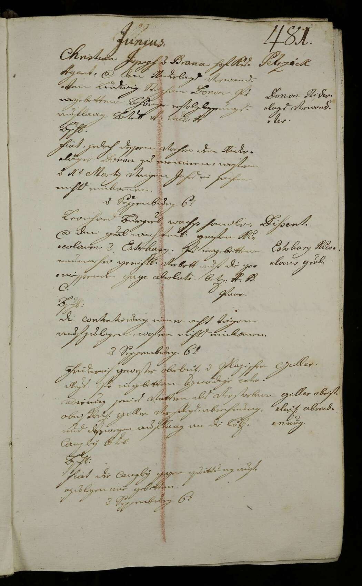

V dolní části čti hodnost a příslušnost v prvních dvou řádcích. Pod „Exp.“ následuje pokyn kanceláři.

**Redakční oprava přepisu SOL-10-N03.** Ve třetím řádku položky je „seines Vatters als verstorben[en] Obrist Leut. Giller …“. Původní přepis výše čte „seiner Acten“. Žádost se týká vydání písemností z projednání pozůstalosti **jeho otce**, zemřelého podplukovníka Gillera. Příbuzenský vztah Friedricha k podplukovníkovi je v červnové položce doložen stejně výslovně jako Christianovo synovství v červencové položce N04. Křestní jméno otce dodává srpnový protokol.

## SOL-10-N04 · Christian a výslovně uvedený otec

18. 7. 1752, agenda Dvorské válečné rady. ÖStA, Kriegsarchiv, Hofkriegsrat, Registratur sv. 873, fol. 1241r, č. 259, horní část pravé strany. Adresát plukovník Guldenhof. Čteno z obrazu originálu. [Snímek 388](https://library.hungaricana.hu/hu/view/KA_HKR_873_1752R/?pg=388).

> Remittitur das Gesuch des Sincerischen Ober: Leutts Christian Giller wegen Überkom[m]ung der von seinem als Obrist: Leutth: bey dem Plazischen Rgmte gestandenen, und verstorbenen Vattern Giller nachgebliebenen Verlassenschafft. Jedoch zur deßen Abfertigung solle eben gleichwohlen über erwehnte Verlassenschafft Abschrifft von dem Testament, Inventario, und Abhandlung Bericht einsenden, auch allenfals die gegen obiges Gesuch habende Anstände anzeigen.

Postupuje se žádost Christiana Gillera, nadporučíka Sincèrova pluku, o převzetí pozůstalosti po jeho zesnulém otci Gillerovi, který sloužil jako podplukovník Platzova pluku. K vyřízení má adresát zaslat opis závěti, inventář a zprávu o projednání a oznámit případné překážky.

Potvrzuje otcovství výslovně pro Christiana. Původ a jméno otce nad rámec příjmení dodávají kmenové listy (deník č. 631). Společný adresát a její předmět umožňují pravděpodobně propojit s pozůstalostí z 5. 5. 1750 (N07).

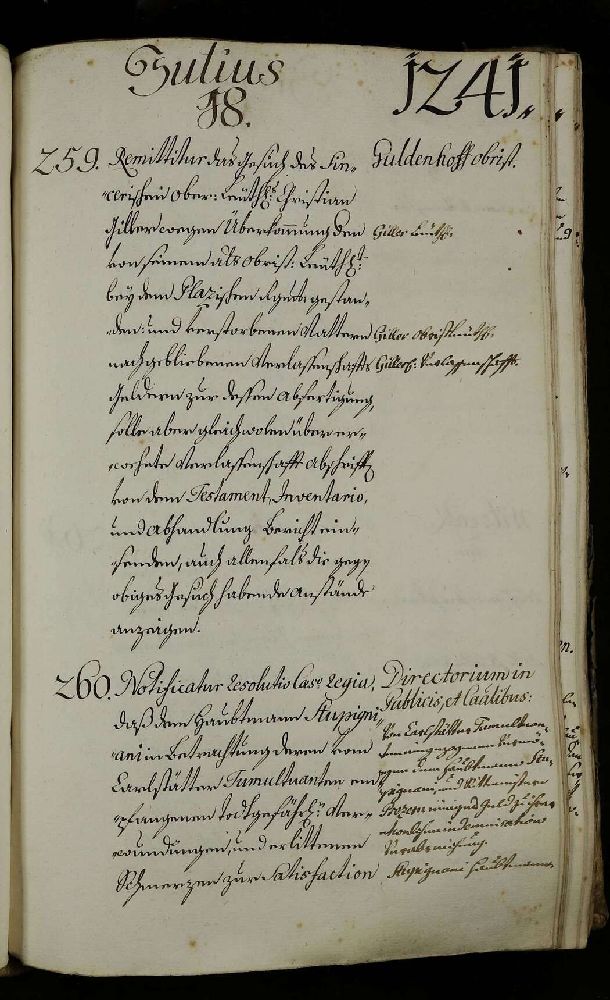

Vpravo nahoře č. 259. Výrazy „Vattern Giller“ a „Plazischen“ jsou uprostřed záznamu.

## SOL-10-N05 · Platzův podplukovník, 3. 4. 1748

ÖStA, Kriegsarchiv, Hofkriegsrat, Registratur sv. 832, fol. 556r, č. 42, vpravo ve středu. Adresát Batthyány, Platzův podplukovník Giller a Fabricius jako potenciální náhradník. Čteno z obrazu originálu po odkazu v rejstříku 831. [Protokol, sn. 411](https://library.hungaricana.hu/en/view/KA_HKR_832_1748R/?pg=411) · [Rejstřík, sn. 217](https://library.hungaricana.hu/en/view/KA_HKR_831_1748R/?pg=217).

> 42. Sollen anzeigen, ob der Plazis: Obristleutth. Giller zur Vertrettung ferner Feldzugs-Diensten gänzlich unfähig, und, in so dann ob der Obristwachtmeister Fabricius als Obristleuth. an dessen dermahlen (?) zu obigem Regmt aggregiret werden könne.

Mají oznámit, zda je podplukovník Giller od Platzova pluku zcela neschopen další polní služby a zda by v tom případě mohl být k uvedenému pluku jako podplukovník přidělen Fabricius. Hodnost, pluk a zdravotní okolnost se kryjí se zápisem o penzionování z dubna 1750 (N07). Zápis nerozšiřuje časovou osu Friedrichovy služby u Pallaviciniho.

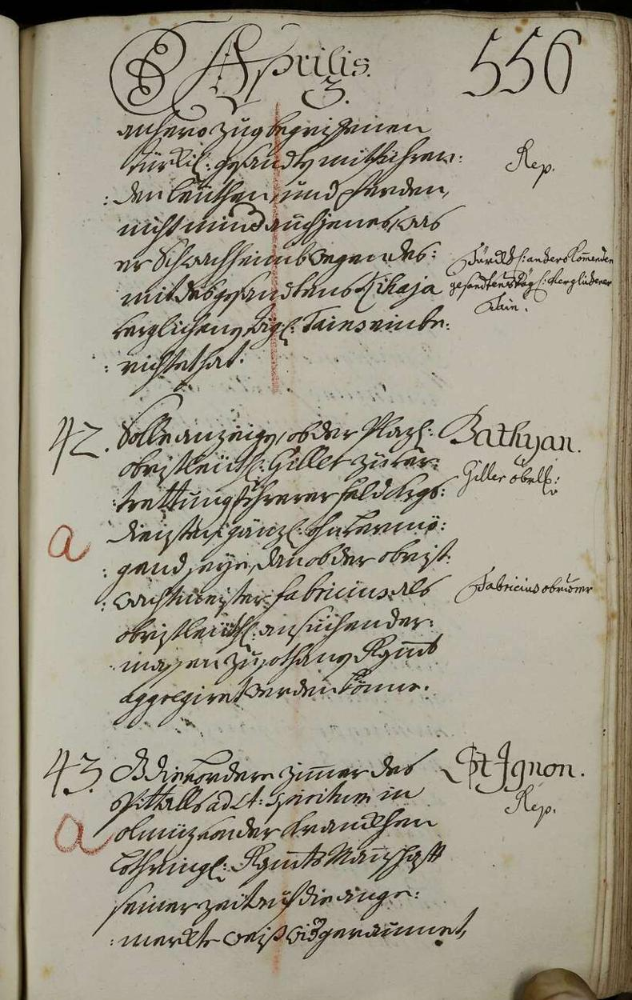

Č. 42 v prostřední části. Nadpis uvádí 3. duben a folio 556.

## SOL-10-N06 · Jiná dovolená, z Lucemburku k Budínu

Srpen 1749, místo služby Lucemburk a zamýšlená cesta do Budína a lázní. ÖStA, Kriegsarchiv, Hofkriegsrat, Expedit sv. 839, fol. 1138v, pokračování nahoře vlevo. Čteno z obrazu originálu po rejstříkové stopě „Giller licenz“. Číslo hlavní položky se v tomto pokračování neopakuje. [Snímek 457](https://library.hungaricana.hu/en/view/KA_HKR_839_1749E/?pg=457) · [Rejstřík, sn. 197](https://library.hungaricana.hu/en/view/KA_HKR_837_1749E/?pg=197).

> […] daß, wie dem Plazis: Regmts Obristleuth. Giller in Luxemburg stehenden nach Ofen und Baad aus nembsten (?) wahrsch. Ursachen (?) […] Lothring Carl und Herzog Arenberg die Licenz ertheilet worden seye.

V rozhodujícím úseku se uvádí, že podplukovníku Gillerovi od Platzova pluku, stojícího v Lucemburku, byla udělena dovolená do Budína a lázní. Část mezi určením cíle a uvedením jmen čtu nejistě. Proto z ní nevyvozuji důvod cesty nebo její trvání. Ofen je německé jméno Budína. Pluk i hodnost oddělují tuto cestu od dovolené z roku 1751. Další odkaz rejstříku pod „Giller licenz“ vykládaný jako fol. 1863 jsem ověřil na protějších obrazech sv. 840. Čitelný prosinec na uvedeném foliu a nejbližším sousedním zápisu obsahuje dovolené jiných důstojníků. Přiřazení druhé reference k určitému Gillerovi zůstává otevřené. [Fol. 1863r, sn. 553](https://library.hungaricana.hu/en/view/KA_HKR_840_1749E/?pg=553) · [Fol. 1863v, sn. 554](https://library.hungaricana.hu/en/view/KA_HKR_840_1749E/?pg=554).

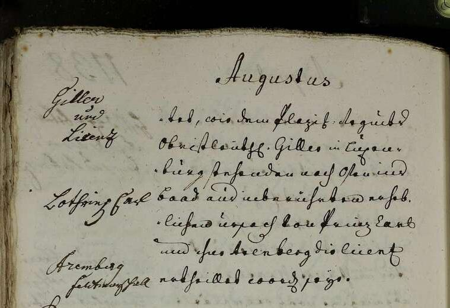

Nahoře srpnové záhlaví a levé okrajové heslo „Giller und Licenz“. V textu jsou čitelné rozhodující výrazy „Plazis:“, „Luxemburg“ a „Ofen und Baad“.

## SOL-10-N07 · Platzův podplukovník, penzionování a časnější pozůstalost

Duben 1750, ÖStA, Kriegsarchiv, Hofkriegsrat, Expedit sv. 848, fol. 509r, č. 173 (?), vpravo dole. Platz, hrabě a generál, podává zprávu o svém podplukovníkovi. Čteno z obrazu originálu. [Snímek 457](https://library.hungaricana.hu/en/view/KA_HKR_848_1750E/?pg=457) · [Rejstřík, sn. 189](https://library.hungaricana.hu/en/view/KA_HKR_847_1750E/?pg=189).

> Graf Gral: zeigt an auf waß weiß der Obristleuth: Giller, welcher zu Feld Dienst invalid ist, mit dem Genuß einer Compagnie jubilirt werden könte, folgsamb hiedurch dem Kayß. Erario kein onus zuwachsete.

Hrabě a generál oznamuje, jak by mohl být penzionován podplukovník Giller, nezpůsobilý polní služby, s příjmy z jedné setniny a bez nové zátěže pro císařskou pokladnu.

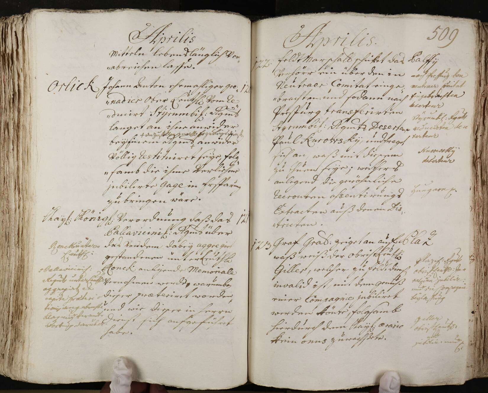

Vpravo dole pod heslem „Plaz“, na pravém okraji „Giller Obristleuth: und jubilierung“.

5. 5. 1750, ÖStA, Kriegsarchiv, Hofkriegsrat, Registratur sv. 853, fol. 796v, č. 45, vlevo nahoře. Adresát plukovník Guldenhof. Čteno z obrazu originálu. [Snímek 18](https://library.hungaricana.hu/en/view/KA_HKR_853_1750R/?pg=18) · [Rejstřík, sn. 205](https://library.hungaricana.hu/en/view/KA_HKR_851_1750R/?pg=205).

> Guldenhof Obrist. / Was wegen der Obristleuth: Gillerischen Verlassenschafft zur Sicherheit der Wittib, und Kindern vorgekehret werden wolle, betr. / [okraj] Giller obristl. / Gillerische Wittib, und Kinder.

Věc opatření v pozůstalosti po podplukovníku Gillerovi k ochraně vdovy a dětí. Jde o projednávání jeho pozůstalosti. Křestní jména a pluk v tomto konkrétním výtahu chybí. Pozůstalost po Platzově podplukovníkovi Gillerovi je výslovně uvedena pod stejným adresátem 18. 7. 1752 (N04). Shodují se příjmení, hodnost, typ případu i adresát. Deník č. 631 identifikuje podplukovníka Friedricha Wilhelma z moravského Karlovce v kmenových listech Platzova pluku a uvádí, že byl 13. 3. 1750 nemocen a od 7. 4. již zastával místo jiný podplukovník. Souhrn podporuje **pravděpodobné úmrtí Friedricha Wilhelma nejpozději 5. 5. 1750**, v rozporu s údajem 1751 připisovaným v projektu Gothě 1884, s. 275–277. Den 5. května je datum jednání. Místo ani přesné datum úmrtí zůstávají otevřeny. [Deník č. 510](https://github.com/jgillern/gillernrodokmen/blob/7c02f3528be438f49af80b0761b5653cdd3eee02/data/research_log.md#L517) · [Deník č. 631](https://github.com/jgillern/gillernrodokmen/blob/7c02f3528be438f49af80b0761b5653cdd3eee02/data/research_log.md#L638).

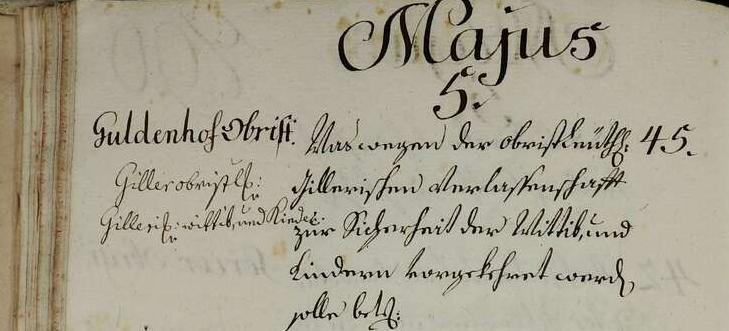

Horní levá strana s datem, číslem případu, adresátem a textem o pozůstalosti.

**Redakční příloha k dataci.** *Gothaisches genealogisches Taschenbuch der freiherrlichen Häuser*, 1884, s. 276, uvádí Friedricha Wilhelma II. v odstavci „Vorgenannter Friedrich Wilhelm I.“ jako syna a uvádí jeho úmrtí v Lucemburku roku 1751. Květnový jednací protokol z roku 1750 je soudobá opora pro dřívější úmrtí při pravděpodobném ztotožnění pozůstalosti. [Strana 276, PDF sn. 302](https://sbc.org.pl/Content/859298/i635235-1884-00-0001.pdf#page=302).

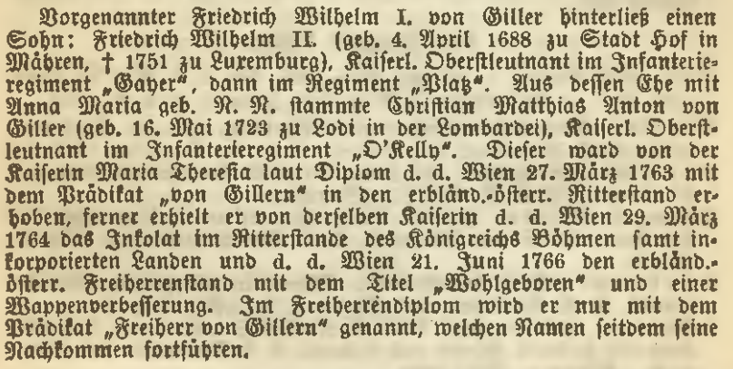

## SOL-10-N08 · Hejtman hrabě Giller u Darmstadtského pluku

Duben 1750. ÖStA, Kriegsarchiv, Hofkriegsrat, Expedit sv. 848, fol. 487r–v, č. 57 dole vpravo a pokračování nahoře vlevo, a fol. 606r nahoře vpravo. Dvě věci téhož důstojníka. Čteno z obrazů originálu. [Fol. 487r, sn. 435](https://library.hungaricana.hu/en/view/KA_HKR_848_1750E/?pg=435) · [Fol. 487v, sn. 436](https://library.hungaricana.hu/en/view/KA_HKR_848_1750E/?pg=436) · [Fol. 606r, sn. 554](https://library.hungaricana.hu/en/view/KA_HKR_848_1750E/?pg=554) · [Rejstřík, sn. 190](https://library.hungaricana.hu/en/view/KA_HKR_847_1750E/?pg=190).

> Graf Haubtmann v. Darmstättischen Regiment, langet an das Beförige an das Commissariat zu erlassen, auf daß Ihme seine Gage von Ende Aug. 749 an nicht vorenthalten, sondern verabfolgt werde, massen seine Abwesenheit in deme bestehe, daß er bey denen beeden Erzherzogen Joseph und Carl dermalen die Cammerherrn Dienste vertretten muß.

Hrabě, hejtman Darmstadtského pluku, žádá o pokyn komisariátu, aby mu byl vyplacen plat od konce srpna 1749. Nepřítomnost vysvětluje svými komornickými povinnostmi u arcivévodů Josefa a Karla. Okrajové příjmení je Giller.

> […] des Darmstättischen Infanterie Regmts Haubtmann Graf Giller wegen seiner bey beeden Durchlauchtigsten Erzhertzogen zu verrichten habenden Cammerherrs Dienste die Licenz […] auf ein Jahr allzeit gustehlen (?) wäre.

Druhý zápis spojuje žádost o roční dovolenou se stejnou komornickou službou u obou arcivévodů. Příjmení je stejné, ale titul hraběte, hodnost a Darmstadtský pluk se liší od barona a nadporučíka u Pallaviciniho. Výtažky neuvádějí křestní jméno.

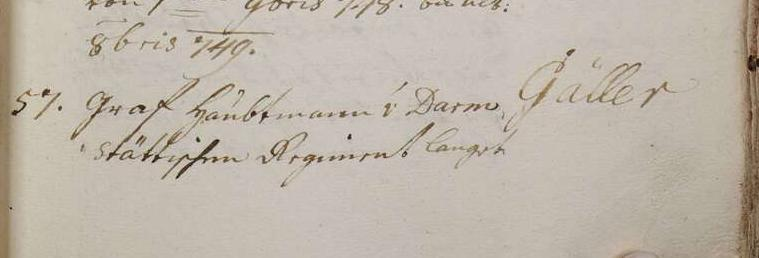

Č. 57, podstatné je „Graf Haubtmann“ a příjmení vpravo na okraji.

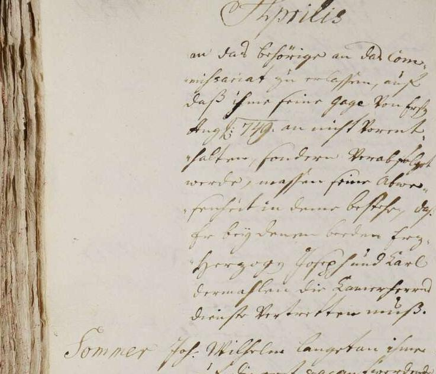

Nahoře na levé straně. V posledních řádcích žádosti je důvod nepřítomnosti.

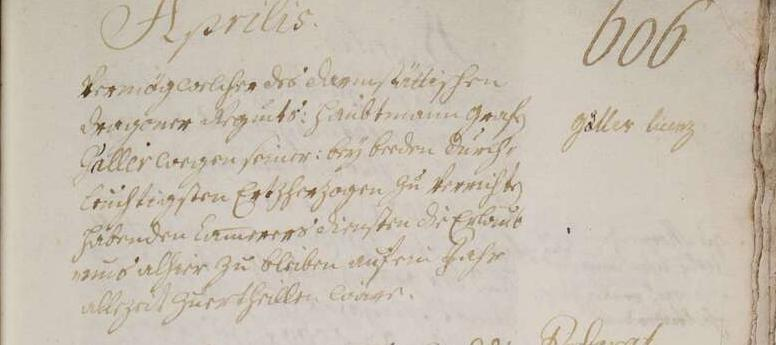

Nahoře na fol. 606r, text a okrajové heslo „Giller licenz“.

## SOL-10-N09 · Dvě další plukovní reference z roku 1750

Duben 1750, ÖStA, Kriegsarchiv, Hofkriegsrat, Expedit sv. 848, fol. 605v, konec č. 437 na levé straně. Čteno z obrazu originálu. [Protokol, sn. 553–554](https://library.hungaricana.hu/en/view/KA_HKR_848_1750E/?pg=554) · [Rejstřík, sn. 386](https://library.hungaricana.hu/en/view/KA_HKR_847_1750E/?pg=386).

> Der Darsi (?), der zu Browne als Unterleutth. aggregiret, solle zu Pallavicini komen.

Darsi (nejistý pravopis), dosud přidělený jako podporučík k Browneovu pluku, má přejít k Pallavicinimu. Okraj a text nesou totéž příjmení, odlišné od Gillera.

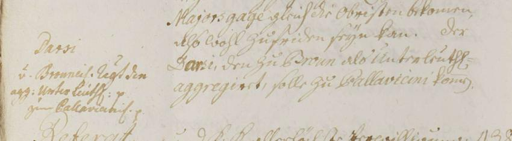

Vlevo od středu je závěr delší položky a její okrajový zápis.

Říjen 1750, ÖStA, Kriegsarchiv, Hofkriegsrat, Expedit sv. 850, fol. 1546r–v, č. 266, dole vpravo a pokračování nahoře vlevo. Podání velitele O’Reillyho. Čteno z obrazu originálu. [Protokol, sn. 228](https://library.hungaricana.hu/en/view/KA_HKR_850_1750E/?pg=228) a [229](https://library.hungaricana.hu/en/view/KA_HKR_850_1750E/?pg=229) · [Rejstřík, sn. 385](https://library.hungaricana.hu/en/view/KA_HKR_847_1750E/?pg=385).

> Obrister und Comendant des Pallavicinisch: Regiments, zeiget an die von dem Oberleutth: Hoffmann gethane Resignation seiner Charge.

Plukovník a velitel Pallaviciniho pluku oznamuje, že se nadporučík Hoffmann vzdal své hodnosti. Giller ani jmenování nástupce v položce uvedeny nejsou.

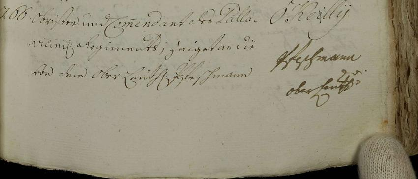

Č. 266 je vpravo dole, podání O’Reillyho.

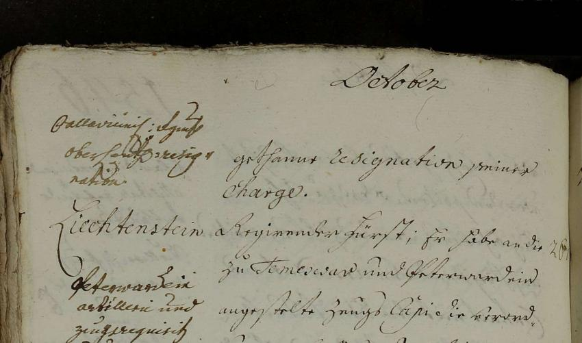

Nahoře vlevo pod říjnovým záhlavím.

## Přehled skutečného pokrytí

Hledal jsem jmenné rubriky Gi/Gü a pluková hesla Pa v obou řadách, včetně zkratek hodnosti a variant jména. Předložka *von* se může objevit u hesla i v originále. Proto nelze z nepřítomnosti pod G odvodit úplnost. Rubrika Pa mísí agendu generála Pallaviciniho s vlastní agendou pluku a žádný z těchto rejstříků nenahrazuje jmenné přehlídky.

| Pramen a místo | Typ záznamu | Data a snímky od–do | Způsob čtení | Výsledek a mezery |
|---|---|---|---|---|
| [HKR 847, Vídeň](https://library.hungaricana.hu/en/view/KA_HKR_847_1750E/?pg=189) | Expedit, rejstřík | 1750, pg 189–190 a [385–386](https://library.hungaricana.hu/en/view/KA_HKR_847_1750E/?pg=385) | Gi/Gü, Giller, Pallavicini a odkazované hodnosti, ruční výběr | Platz 509 a Darmstadt 487/606. Pod Pa vybrány reference přeložení a povýšení. |
| [HKR 848 a 850, Vídeň](https://library.hungaricana.hu/en/view/KA_HKR_848_1750E/?pg=435) | Expedit, protokol | 1750, sv. 848 pg 435–436, 457–458, 553–555, sv. 850 pg 88–89, 120–121 a 228–229 | Čtení odkazovaných folií; u sg. 850 cíleně odkaz „Pallavicini promotion“ na 1384 a 1416 | N07–N09. Povýšení generála do správy Milánska a jeho správní souvislosti na [fol. 1384](https://library.hungaricana.hu/en/view/KA_HKR_850_1750E/?pg=88) a [fol. 1416](https://library.hungaricana.hu/en/view/KA_HKR_850_1750E/?pg=120). Další odkaz na povýšení psaný dodatečně patrně 1277 se na přechodu od folií před koncem sv. 849 nepodařilo spolehlivě přiřadit. |
| [HKR 851, Vídeň](https://library.hungaricana.hu/en/view/KA_HKR_851_1750R/?pg=205) | Registratur, rejstřík | 1750, pg 205–206 a [404](https://library.hungaricana.hu/en/view/KA_HKR_851_1750R/?pg=404) | Gi/Gü a Pa, ruční výběr | Giller podplukovník a vdova s dětmi, obojí fol. 796. |
| [HKR 853, Vídeň](https://library.hungaricana.hu/en/view/KA_HKR_853_1750R/?pg=18) | Registratur, protokol | 1750, pg 17–18 | Čtení fol. 796r–v | N07, č. 45 je na versu, přesné datum jednání. |
| [HKR 837, Vídeň](https://library.hungaricana.hu/en/view/KA_HKR_837_1749E/?pg=197) | Expedit, rejstřík | 1749, pg 197–198 a [414–415](https://library.hungaricana.hu/en/view/KA_HKR_837_1749E/?pg=414) | Gi/Gü a Pa, ruční výběr | Platzův podplukovník, dovolená pod Giller. Pod Pa pluková agenda bez přímé jmenné vazby. Ověření vybraných referencí. |
| [HKR 839 a 840, Vídeň](https://library.hungaricana.hu/en/view/KA_HKR_839_1749E/?pg=457) | Expedit, protokol | 1749, sv. 839 pg 456–457, sv. 840 pg 553–554 | Čtení obou stran odkazů „Giller licenz“ | Fol. 1138v potvrzuje Platze (N06). Druhý odkaz čtený jako 1863 zůstává nejistý, fotografie prohlédnuty. |
| [HKR 841, Vídeň](https://library.hungaricana.hu/en/view/KA_HKR_841_1749R/?pg=218) | Registratur, rejstřík | 1749, pg 218–219 a [426](https://library.hungaricana.hu/en/view/KA_HKR_841_1749R/?pg=426) | Gi/Gü a Pa, ruční výběr | Giller podplukovník. Další folia, některá v digitální řadě bez jednoznačného folia, ponechána k pokračování. |
| [HKR 827, Vídeň](https://library.hungaricana.hu/en/view/KA_HKR_827_1748E/?pg=197) | Expedit, rejstřík | 1748, pg 197–198 a [410](https://library.hungaricana.hu/en/view/KA_HKR_827_1748E/?pg=410) | Gi/Gü a Pa, ruční výběr | V cíleném výběru není bezpečně rozpoznán Friedrich z Hammeru. Podobné heslo Gillon. Bez plošného čtení protokolů. |
| [HKR 831, Vídeň](https://library.hungaricana.hu/en/view/KA_HKR_831_1748R/?pg=217) | Registratur, rejstřík | 1748, pg 217–218 a [440](https://library.hungaricana.hu/en/view/KA_HKR_831_1748R/?pg=440) | Gi/Gü a Pa, ruční výběr | Giller podplukovník se souborem odkazů, z nich ověřeno fol. 556r. Jiné hodnosti v okolí patří podobně psaným příjmením. |
| [HKR 832, Vídeň](https://library.hungaricana.hu/en/view/KA_HKR_832_1748R/?pg=411) | Registratur, protokol | 3. 4. 1748, pg 411–412 | Čtení fol. 556r–v | N05, Platzův podplukovník na rektu. |
| [HKR 859, Vídeň](https://library.hungaricana.hu/en/view/KA_HKR_859_1751E/?pg=384) | Expedit, protokol | Červenec 1751, pg 384 | Čtení obou položek a záhlaví | N01, povolena dovolená do Vratislavi. Důvod neuveden. |
| [HKR 876 a 873, Vídeň](https://library.hungaricana.hu/en/view/KA_HKR_876_1752J/?pg=7) | Judizial a Registratur, protokol | Červen a červenec 1752, pg 7 a [388](https://library.hungaricana.hu/en/view/KA_HKR_873_1752R/?pg=388) | Čtení dvou konkrétních zápisů | N03–N04. Dvě podání synů v otcově pozůstalosti (po redakční opravě čtení N03). |
| [IR 15, DGS 7607065](https://www.familysearch.org/search/film/007607065?i=503) | Plukovní přehlídka | 20. 5. 1756, sn. 504 | Projektový výřez a jeho popis, plný obraz vyžaduje přístup | N02, původ z Hammeru, věk a délka služby. Přehlídky 1746–1752 v uvedeném filmu chybějí podle deníku č. 648. |

## Co převzít a kde navázat

**Text pro deník.** „Doloženo v protokolu HKR Expedit 859, červenec 1751, fol. 1114v–1115r, č. 258 a 261. Friedrich von Gillern sloužil jako granátnický nadporučík Pallaviciniho pluku nejpozději v červenci 1751. Požádal o dvouměsíční dovolenou do Vratislavi a obdržel souhlas c. k. rozhodnutím. Velmi pravděpodobně jde o pozdějšího hejtmana Friedricha barona Gillerna z Hammeru, v IR 15 doloženého ještě roku 1756. První útvar a začátek služby u Pallaviciniho zůstávají neznámé. Cesta nepřináší přímý doklad o Maximiliánovi ani o rodišti Josefa (SOL-10-N01–N02).“ Pro profil Platzova podplukovníka odděleně „5. 5. 1750 jedná HKR o ochraně vdovy a dětí v pozůstalosti podplukovníka Gillera. Shoda s adresátem jednání o výslovně Platzově pozůstalosti v roce 1752 činí velmi pravděpodobným, že Friedrich Wilhelm zemřel nejpozději 5. 5. 1750. Údaj † 1751 prověřit proti původním listinám (SOL-10-N04, N07).“

**Nejbližší neuzavřený krok pro službu.** V [rejstříku Expedit 847, pg 385](https://library.hungaricana.hu/en/view/KA_HKR_847_1750E/?pg=385) následovat plukové heslo „Pallavicinisch: Regmts aggregirte Unterleuth: nach seiner Rang in die Wirklichkeit Vorrückung“ do [sv. 849, fol. 1068r–v, sn. 382–383](https://library.hungaricana.hu/en/view/KA_HKR_849_1750E/?pg=382). Další přesně vymezený úsek je leden–červen 1751 pod hesly Giller a Pallavicini v [Expedit 857](https://library.hungaricana.hu/en/view/KA_HKR_857_1751E/). Pro Platzovu větev je samostatným konkrétním krokem dohledat písemnosti přikázané k zaslání 18. 7. 1752 pod č. 259, zejména testament, inventář a zprávu, které mohou obsahovat datum úmrtí a výčet dětí. Vratislav podle č. 258 a 261 zatím ponechat v profilu jako cíl dovolené.
