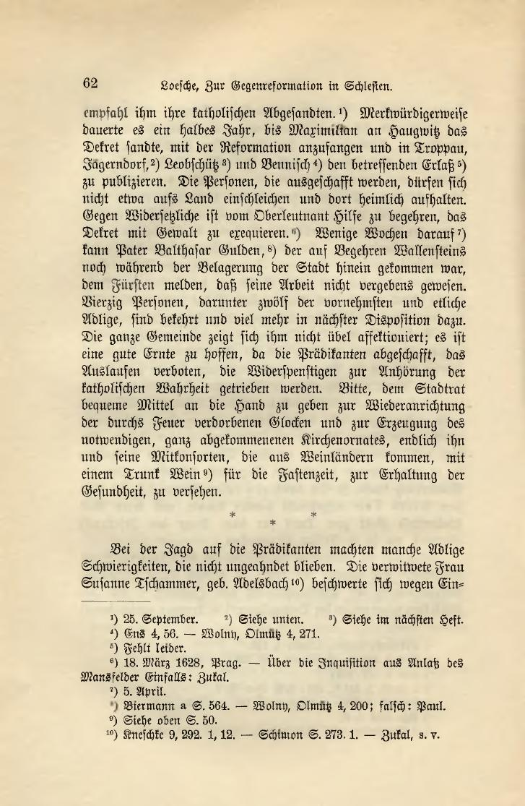
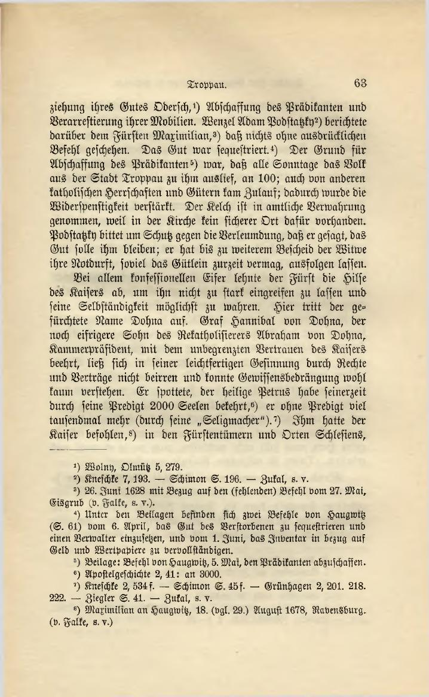
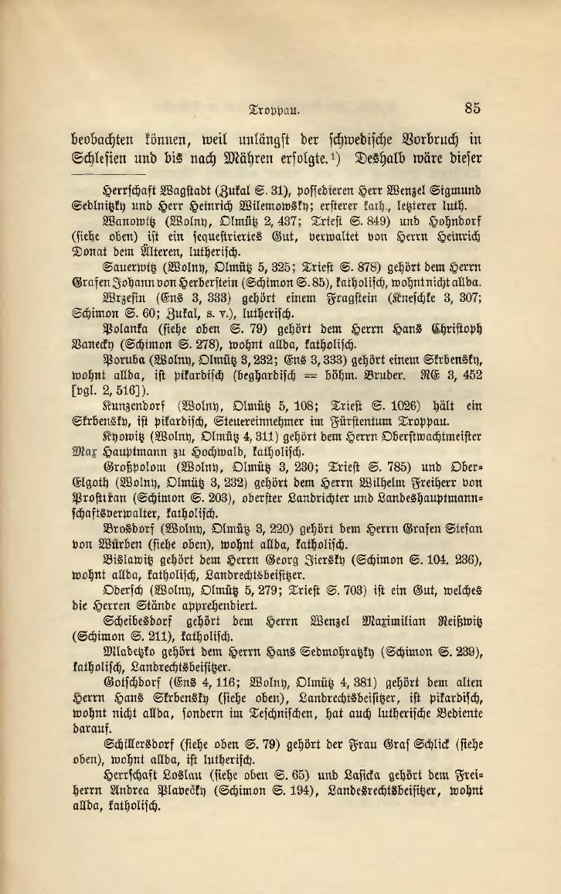

# Přímá linie Gillern · Hlubčice, Žopovy a Oldřišov

**Novým dokladem pro nástupnictví je knížecí soupis z roku 1652, který uvádí Oldřišov mezi statky a v příslušné položce zaznamenává převzetí stavy.** Kontrola knížecí korespondence známé z osmého kola zpřesnila její obsah o příkaz z 5. 5. 1628 k odstranění kazatele a doložila obraz poznámek ke všem třem přílohám. Závěť z roku 1635, děti Čamrových a křest v Gillerově rodině zůstávají otevřené.

## Oldřišov · nová archivní cesta k pozůstalosti

Georg Loesche, *Zur Gegenreformation in Schlesien*, díl I, Leipzig 1915, s. **62–63**, PDF sn. **76–77**, uvádí jmenovitě vdovu Susanne Tschammer, geb. Adelsbach a její statek Odersch. Zuzana si stěžovala proti záboru statku, odstranění kazatele a obstavení movitostí. Václav Adam Podstatský v dopise knížeti Maxmiliánovi z **26. 6. 1628** uvádí, že statek byl v sekvestraci, vdova zatím dostávala nezbytné prostředky k živobytí z výnosu statku. Loesche odkazuje také na související, v jeho souboru chybějící příkaz z **27. 5. 1628**, vydaný v Lednici (Eisgrub). Jde o Loescheho výtah z dobové korespondence. Text jednotlivých rukopisů v úplnosti nemáme. [Loesche, s. 62–63](https://sbc.org.pl/Content/210873/PDF/ii135792_01.pdf#page=76)

| Příloha ke zprávě | Obsah podle s. 63, pozn. 4–5 |
|---|---|
| **6. 4. 1628**, Haugwitz | Obstavení „das Gut des Verstorbenen“ a ustanovení správce. Jde o pevný mezní den, nezávislý na Zukalově přesnějším údaji „koncem roku 1627“ (s. 99). |
| **5. 5. 1628**, Haugwitz | Příkaz k odstranění kazatele. Jméno v Loescheho výtahu chybí. |
| **1. 6. 1628**, Haugwitz | Doplnění inventáře co do hotovosti a cenných listin. Existence příkazu neprokazuje dochování inventáře. |
| **26. 6. 1628**, Podstatský → Maxmilián | Odpověď o provedeném zajištění a zaopatření vdovy. Jména dětí, poručníků a dědiců v příslušné tištěné pasáži nejsou. |

Předmluva s. VI a seznam zkratek s. VII vysvětlují, že při absenci jiného údaje použil Loesche **Hausarchiv Liechtenstein, Wien**, zkratka HZ, mezi jinými balíky *Troppau* a *Jägerndorf*. Citace na s. 63 dává adresáta, odesílatele, den a data tří příloh. Dnešní signaturu u zprávy neuvádí. Vídeňské uložení starších archiválií potvrzuje oficiální přehled. Pro hledání jmen je samostatným cílem inventář či jeho doplnění k 1. 6. 1628 vedle opavské závěti. [Loesche, předmluva](https://sbc.org.pl/Content/210873/PDF/ii135792_01.pdf#page=9) · [Oficiální přehled archivu](https://www.llv.li/de/landesverwaltung/amt-fuer-kultur/landesarchiv/faq)

V dalším výtahu z knížecího soupisu opavských statků a stavů **z roku 1652**, Loesche s. 82–85, sn. 96–99, se na s. 85 uvádí, že Oldřišov převzali stavové. Položka nejmenuje soukromého držitele ani jeho právní titul. Údaj sám nevypovídá o dědicích vdovy a neřeší rozsah majetku v její závěti. [Zahájení soupisu, pozn. 7](https://sbc.org.pl/Content/210873/PDF/ii135792_01.pdf#page=96) · [Položka Odersch](https://sbc.org.pl/Content/210873/PDF/ii135792_01.pdf#page=99)

## Žopovy a závěť 28. 4. 1635

| Prověřená citace či edice | Výsledek |
|---|---|
| **ZA Opava, Slezský stavovský archiv, krnovské desky 1581–1619, inv. 947, sign. 3, fol. 24 r/v** | Citace od Josefa Zukala, *Slezské konfiskace*, s. 105, pozn. 2, potvrzena proti dnešnímu číslu ve sborníku *Krnovsko*, s. 101, pozn. 43. Oznámení ZA potvrzuje digitalizaci stavovského archivu. Předchozí přímé otevření DigiArchivu zůstalo na kontrolní stránce a aktuální přístup k prohlížeči skončil chybou spojení. Obraz folia ani přepis jsem v tomto kole nezískal. Publikovaná Prixova edice první krnovské knihy obsahuje roky **1403–1522**, mimo zkoumanou signaturu. [Zukal, s. 105](https://kramerius.lib.cas.cz/view/uuid:cb8d6447-3772-4544-bba0-b78be61baaba) · [Krnovsko](https://kulturni-dejiny.slu.cz/data/uploads/publikace/krnovsko.pdf) · [Digitalizace ZA](https://www.archives.cz/web/aktualne/index.php?post_id=31&title=fond-slezskY-stavovskY-archiv-zp%C5%99istupn%C4%9Bn-digitaln%C4%9B) |
| **Krnovsko, s. 98–99 a 105–106** | „Sirotci na Žopovech“ patří do rejstříku **1573–1574**, přibližně o půl století před smrtí Bedřicha Čamra. Srovnávací seznam roku **1619** podle Adolfa Turka (*Časopis Slezského muzea B* 24/1975, s. 84–86) uvádí na Krnovsku mimo jiné rody Cetrys, Frakštejn i Lichnovský, zatímco Čamr v tomto sloupci není. Tabulka sama nepřiřazuje Žopovy jednotlivci a nedokáže rozhodnout mezi rozdílným podáním Zukala a Weltzela o převodu v letech 1618–1619. [Krnovsko](https://kulturni-dejiny.slu.cz/data/uploads/publikace/krnovsko.pdf) |
| **Oldřišov, závěť 28. 4. 1635; Zukal s. 99** | Zukal uvádí Jiříka Vranínského jako dědice po přijetí na spolek a místo pramene pouze „arch. z. op.“. Přesná moderní signatura kšaftu, plný text ani samostatný opis se ve zkoušených veřejných zdrojích nepodařilo doložit. Slezský stavovský archiv a fondy opavsko-krnovského zemského práva a hejtmanského úřadu zůstávají fondy k ověření. Nově lokalizované vídeňské písemnosti zachycují řízení o sedm let dříve. Žádná z čtených pasáží nezmiňuje provdanou dceru ani zetě Gillera. [Zukal, s. 99](https://kramerius.lib.cas.cz/view/uuid:ffdc99ae-8b89-4c67-ab4e-ad9a0c915887) |

Je doložena historická Zuzana z Adelsbachu a její vdovství, které souhlasí s pozdějším sňatkem s Vranínským. Ani držba Žopov, ani soupis v roce 1652 nepropojují její domácnost s Heinrichem Christofem Gillerem. Pro takové spojení je potřeba osoba jmenovaná současně jako dcera Čamrových a jako Gillerova žena nebo odpovídající kombinace dvou nezávislých záznamů.

[Hlubčice a ověřené náhradní městské zdroje](hlubcice.md)
