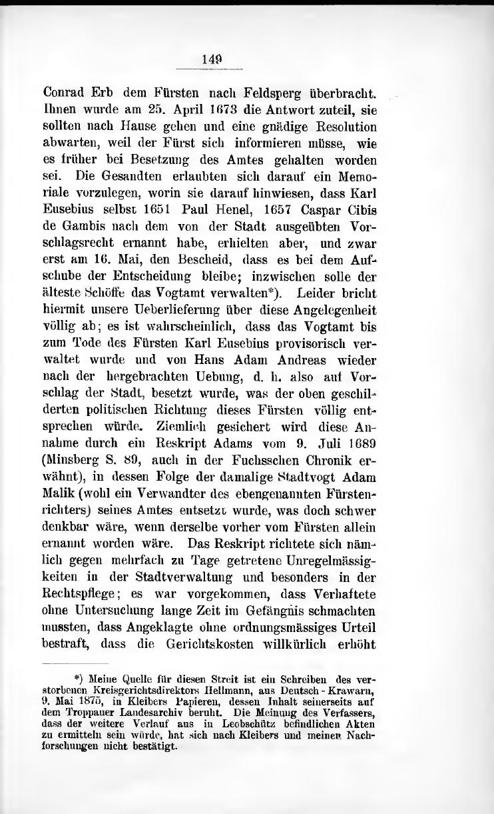

# Hlubčice · křty 1648–1655 a městské písemnosti

**Stránku hlubčických křtů 1651 se nepodařilo otevřít a žádné DGS jsem nemohl spolehlivě přiřadit k prvním ročníkům.** Čtený městský výtah přináší jméno rychtáře v roce 1651 a umožňuje vyřadit některé zdánlivě relevantní knihy podle jejich skutečných začátků. Je bez záznamu o Johannu Christofovi a Zuzaně Gillerových.

## Rozsah a dostupnost knihy

| Cesta | Co je ověřeno |
|---|---|
| **Farní originál a dnešní stav** | *Kalendarz Głubczycki* 1998, s. 124, PDF sn. 125, inventarizace od 25. 7. do 12. 8. **1997** v katolické farnosti Nanebevzetí Panny Marie. Tisk popisuje **N/O/Z 1648–1679** a reprodukuje jednu stránku s vročením 1648. Jde o doklad tehdejšího fyzického originálu v místní farnosti. Jeho současné uložení, případná změna správce a stav listů 1649–1655 nejsou ověřené. [Fotografie a popisek](https://sbc.org.pl/Content/12564/PDF/1998a.pdf#page=125) |
| **Kopie FamilySearch** | Německý soupis odkazuje na zfilmovanou katolickou řadu **1648–1948**. Roku 2012 je stejný rozsah zmíněn v genealogickém fóru. Oba staré odkazy míří na katalog a jeden uvádí parametr **subjectId=389501**. Tento parametr je starý identifikátor předmětu vyhledávání a neposkytuje číslo filmu ani dnešní ID titulu. Původní odkaz končí chybou 404. Veřejnému vyhledávači se nepodařilo otevřít ani zkušební adresu moderního katalogu. Čísla **008201914** a **008022196** jsou pracovní odkazy předchozího deníku č. 698. Přímé veřejné adresy pro filmy nevrátily katalogový řádek nebo čitelný obraz a dostupný prohlížeč skončil chybou spojení. Čísla skupin tedy nelze bezpečně vztáhnout k ročníkům 1648–1655, určit položku filmu ani vymezit snímky. [Soupis](https://www.christoph-www.de/kbsilesia3) · [Fórum a původní odkazy](https://forum.ahnenforschung.net/forum/thread/53682-standesamt-kirchenbücher-leobschütz/) · [DGS 008201914](https://www.familysearch.org/en/search/film/008201914) · [DGS 008022196](https://www.familysearch.org/en/search/film/008022196) |
| **Nezávislé sbírky a jména** | ZA Opava: **POL VI 1, kart. 8135**, první zápisy 1689. Leipzig, **21962, 04.25 Kreis Leobschütz**, jediný **D 1130 Gläsen**, 1727–1766 (Klisino). OFB Uweho Befferta bylo při vydání v roce 2012 souvislé jen pro oddané 1900–1931, ostatní údaje selektivní. Zpřístupněný souvislý rejstřík či jmenný přepis do roku 1655 jsem neidentifikoval. [ZA Opava, přehled](https://www.archives.cz/web/DA_resources/DA_info/matriky_info/done.pdf) · [Leipzig, seznam této větve](https://www.archiv.sachsen.de/digitalisate/bestandsdaten/bestaende/21962/250754.html) · [Autor OFB](https://discourse.genealogy.net/t/aktualisierung-der-ofb-groebnig-babitz-leisnitz-und-dittermau-und-neues-ofb-der-stadt-leobschuetz-in-oberschlesien/191360) |

K provedení přímého testu je potřeba obraz začátku každého ročníku knihy, především **1648–1655**, a souvislá kontrola všech dochovaných křtů mezi nimi. U kandidáta je třeba zachytit den, jména obou rodičů, kmotry, místo či postavení a sousední snímky. Pro samotného Johanna Christofa jsou důležitá i starší léta, pro syna Friedricha Wilhelma je rok 1651 pracovní odhad. Predikát Sternegg do vyhledávací podmínky nepatří, povýšení je doloženo až 25. 2. 1695 a Gotha uvádí manželku pod pozdějším rodovým tvarem. [Doerr, s. 174](https://archive.org/details/deradelderbhmi00doeruoft/page/174/mode/2up) · [Gotha, s. 276](https://sbc.org.pl/Content/859298/i635235-1884-00-0001.pdf#page=302)

## Kontrola městských zdrojů

1. **1687 jsem nepoužil jako náhradu za 1651.** Ferdinand Troska, *Geschichte der Stadt Leobschütz*, 1892, **s. 148–149, PDF sn. 158–159**, uvádí přímo obsah městského memoria podaného roku **1673** ke jmenování rychtáře. Rychtářem se roku **1651** stal na návrh města **Paul Henel**, roku **1657 Caspar Cibis de Gambis**. Městští vyslanci roku 1673 byli radní Johann Scherer a písař magistr Conrad Erb. Poznámka na s. 149 uvádí skutečnou provenienci Troskova výtahu, dopis ředitele soudu Hellmanna z Kravař v Kleiberových písemnostech z roku 1875, opřený o Zemský archiv v Opavě. Giller ani Bartsch v tomto konkrétním výtahu nevystupuje. Rozsah je personální obsazení úřadu; o složení domácností nic nevypovídá. [Troska, s. 148–149](https://sbc.org.pl/Content/14528/PDF/14528.pdf#page=159)
2. **Městské kupní knihy mají pozdní začátek.** Troska s. **163–164**, PDF sn. **173–174**, popisuje městské *Libri contractuum civitatis Leobschicensis* v tehdejším vratislavském archivu **od roku 1690** do konce 18. století. Knihy obsahovaly převody, svatební a dědické smlouvy. Moderní katalogový záznam městského fondu **45/9/0/2/67** má ještě užší rozsah **1775–1815** a vykazuje 0 snímků. Troskův OCR text jsem prohledal na Giller/Gil(l)ern a Bartsch/Partsch/Barsch a přečetl dotčené pasáže roku 1651 v tištěném vydání. Žádný obraz knihy kolem 1650 tím nebyl prověřen. [Troska, s. 163–164](https://sbc.org.pl/Content/14528/PDF/14528.pdf#page=173) · [Archivní jednotka 45/9/0/2/67](https://www.szukajwarchiwach.gov.pl/en/jednostka/-/jednostka/7019527)
3. **Dobově nejbližší dochované jednotky.** Oficiální katalog eviduje **45/9/0/1/61**, listinu **17. 5. 1649** o náboženské svobodě pro **Petera Müllera z městské rady**, pět snímků, první katalogový snímek 52310258. Jde o konkrétní jméno měšťana jen dva roky před pracovní datací křtu. Souseda či příbuzného rodiny z něj vyvodit nelze. Jednotka **45/9/0/1/62** podle katalogu obsahuje doklady o městských dluzích **1660–1665**, 58 snímků. U obou vycházím z veřejně indexovaných popisů. Obrazy nebyly v tomto kole prohledány. [Jednotka 45/9/0/1/61](https://www.szukajwarchiwach.gov.pl/jednostka/-/jednostka/7019511) · [Fond Akta miasta Głubczyce](https://www.szukajwarchiwach.gov.pl/zespol/-/zespol/44118?_Zespol_cur=2&_Zespol_delta=60&_Zespol_javax.portlet.action=zmienWidok&_Zespol_nameofjsp=jednostki&_Zespol_resetCur=false)
4. **Knížecí městská korespondence má vlastní archivní oddíl.** Georg Loesche, *Zur Gegenreformation in Schlesien*, 1915, předmluva s. VI, výslovně říká, že akty *Leobschütz* v Hausarchiv Liechtenstein leží zvlášť od Opavy a Krnova. Věnoval jim díl II, Leipzig 1916, 96 s. Ověřena bibliografická položka polského katalogu a soupis ediční řady č. 123, samostatný veřejný obraz tohoto svazku se nepodařilo ověřit. Jde o konkrétní archivní sérii v jiném fondu, obsah kolem 1651 zatím nečtený. [Loesche, předmluva](https://sbc.org.pl/Content/210873/PDF/ii135792_01.pdf#page=9) · [Katalog svazku II](https://platforma.bk.pan.pl/en/search_results/1065899)

