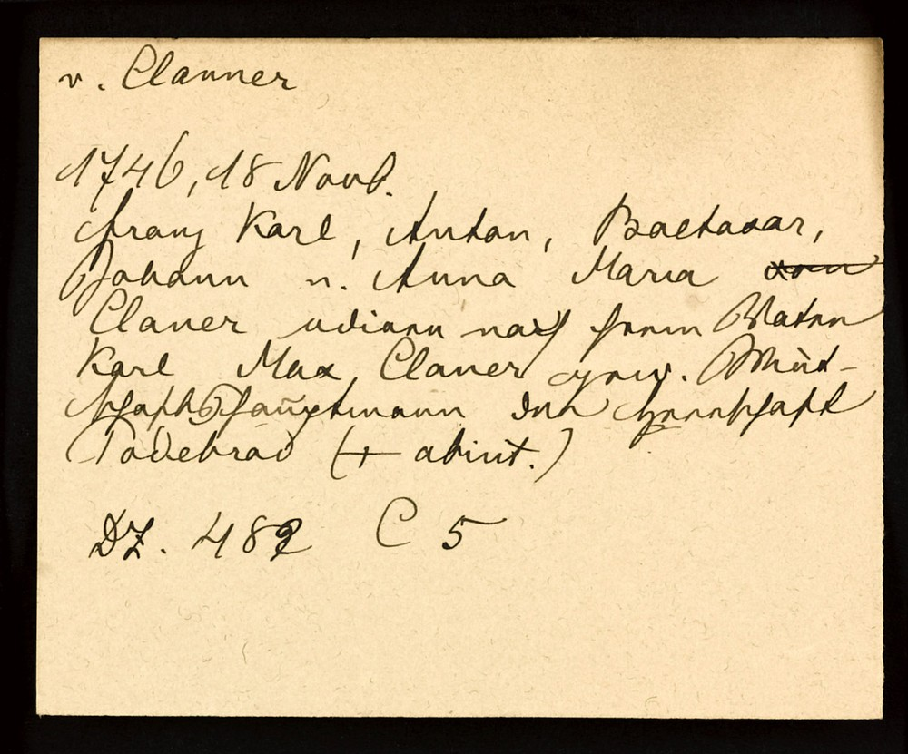
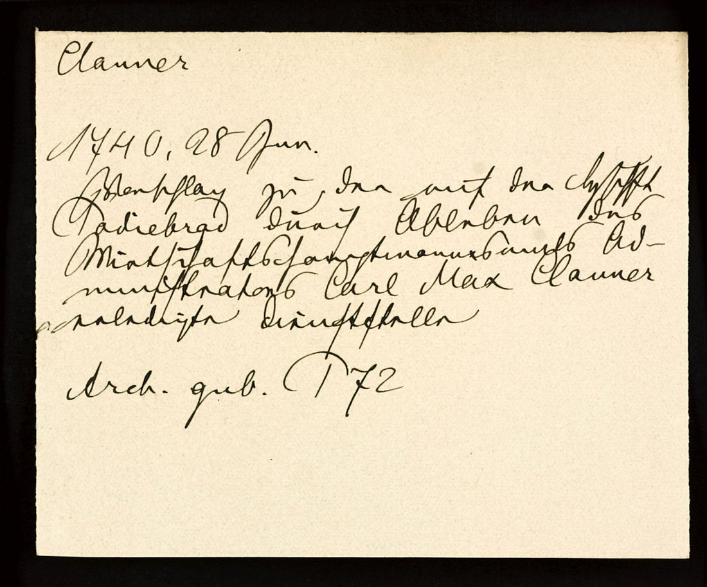

# Giller, Clanner, Bartsch a Tschammer v genealogických sbírkách

Přečetl jsem čtyři původní Sedláčkovy lístky pro Clannery. Dva obsahují nové přesné archivní odkazy k dosud nečteným dokumentům. **DZ 482 C 5** je dědický zápis po Karlu Maxmiliánovi z roku 1746. **Arch. gub. P 72** odkazuje na návrh na obsazení Karlova místa v Poděbradech z roku 1740. Sedláčkovy lístky jsou výpisky z těchto písemností. Přímý důkaz o společné službě Baltazara a Maximiliána jsem v nich nenašel.

## Skutečně čtené obrazy Sedláčkových lístků

| Lístek | Čtení na obraze a význam |
| --- | --- |
| **A09A č. 357, ID 69726**, **18. 11. 1746** | František Karel, Antonín, Baltazar, Jan a Anna Marie Clannerovi nastupují dědictví po svém otci Karlu Maxmiliánovi, označeném za bývalého hospodářského hejtmana panství Poděbrady. Pod textem stojí **„DZ. 482 C 5“**. Na rubu není další zápis. Lístek potvrzuje jmennou skupinu a počet pěti vypsaných dědiců. Zda původní akt uvádí jejich bydliště, věk, povolání, poručníky či podíly, zůstává k ověření. Sedláček neuvádí líc nebo rub C 5. [Líc](https://imagines.aipberoun.cz/loris/HUAVCR/HUAVCRA09A________0UBRSV8/N3/A09A________0UBRSV8N30713P.JPG/full/1000,/0/default.jpg) · [Rub](https://imagines.aipberoun.cz/loris/HUAVCR/HUAVCRA09A________0UBRSV8/N3/A09A________0UBRSV8N30714P.JPG/full/1100,/0/default.jpg) · [Manifest](https://www.augustsedlacek.cz/apis/formatter-api/?mode=as_kartoteka_manifest&id=A/A09/A09A/69726) |
| **A09A č. 356, ID 69725**, **28. 6. 1740** | Návrh k obsazení služebního místa na panství Poděbrady po smrti Karla Maxmiliána Clannera, zde hospodářského hejtmana a administrátora. Sedláčkův zdroj je přímo **„Arch. gub. P 72“**. Jde o historické označení, jeho převod na nynější fond, inventární číslo a karton jsem nepotvrdil. Jméno navrženého nástupce lze zkoušet v samotném spise. Lístek je bez jména kandidáta. [Líc](https://imagines.aipberoun.cz/loris/HUAVCR/HUAVCRA09A________0UBRSV8/N3/A09A________0UBRSV8N30711P.JPG/full/1100,/0/default.jpg) · [Manifest](https://www.augustsedlacek.cz/apis/formatter-api/?mode=as_kartoteka_manifest&id=A/A09/A09A/69725) |
| **A09A č. 345, ID 69714**, **11. 1. 1721** | Sedláček píše „1721, 11 Jan.“, „Bap. Baltazar“, otce Karla Maxmiliána Clannera z Engelshofenu, hejtmana hořického panství, a matku **Lidmilu**. Vlastní předloha je uvedena jako matrika v Hořicích. Dřívější literatura uvádí 12. leden. Rozpor vyžaduje kontrolu prvopisu křtů **Hořice 47-2 (1691–1730)**, popřípadě originálního indexu **47-18**. [Líc](https://imagines.aipberoun.cz/loris/HUAVCR/HUAVCRA09A________0UBRSV8/N3/A09A________0UBRSV8N30689P.JPG/full/1100,/0/default.jpg) · [Popis matriky 47-2](https://www.rodovod.cz/matriky/soa-zamrsk/horice/3314) · [Index 47-18](https://www.rodovod.cz/matriky/soa-zamrsk/horice/3347) |
| **A09A č. 344, ID 69713**, **24. 1. 1715** | Kolínská matrika zachycuje úmrtí dvouměsíčního **Karla Baltazara**, syna rytíře Karla Clannera z Engelshofenu, purkrabího na kolínském zámku. Jde o jiného Baltazara než o pokřtěného v Hořicích roku 1721. Výpisky zároveň lokalizují otcovo působení zvlášť ke Kolínu v roce 1715, k Hořicím v roce 1721 a později k Poděbradům. [Líc](https://imagines.aipberoun.cz/loris/HUAVCR/HUAVCRA09A________0UBRSV8/N3/A09A________0UBRSV8N30687P.JPG/full/1100,/0/default.jpg) · [Manifest](https://www.augustsedlacek.cz/apis/formatter-api/?mode=as_kartoteka_manifest&id=A/A09/A09A/69713) |

[Obraz hořického výpisku č. 345](vyrezy/sedlacek-a09a-345.jpg) · [Obraz kolínského výpisku č. 344](vyrezy/sedlacek-a09a-344.jpg). Obrazy všech čtyř lístků pocházejí z kartotéky Augusta Sedláčka, Historický ústav AV ČR.

V inventáři Antona Blaschky a Václava Letošníka, s. 40, jsem ověřil, že **Desky zemské větší, NAD 172/1, inv. č. 482** jsou **pátý modrozlatý trhový kvatern adirování od roku 1743**. Jde o řadu zápisů o ujímání se dědictví. Lístek 357 tím dostává nezávisle potvrzený časově i věcně odpovídající svazek. Ve veřejném Vademecu jsem otevřel i **přímou inventární kartu 482**, kde je skutečný rozsah zápisů **1744–1753**. Výsledek i detail jsou bez nabídky skenů. Ve veřejně indexovaném katalogu FamilySearch jsem při hledání pod *Desky zemské*, *Landtafel*, číslem 482 a dobou 1744–1753 nenašel ověřené číslo filmu nebo DGS. Samotný C 5 proto zůstává bez čtení. [Přímá karta DZV 482](https://vademecum.nacr.cz/vademecum/permalink?xid=a95078fa-d5ef-4363-bb38-8953f604fdfb) · [FamilySearch, katalog](https://www.familysearch.org/en/search/catalog) · [Inventář 1944, s. 40](https://www.rbmonline.cz/portal/book/1413?lpage=40) · [Fond DZV](https://vademecum.nacr.cz/vademecum/permalink?xid=ce3b120e1966066243716436d47c6234)

## Jmenné hranice a stav fondů Národního archivu

Ve veřejném rozhraní ARON Národního archivu se otevřela fondová karta i strom každé ze tří sbírek. Všechny tři vracejí prázdné pole podřízených jednotek a na fondové úrovni nemají publikovaný digitální objekt ani přílohu. To omezuje jmennou kontrolu pomůcky, jejíž jednotlivé řádky se tímto způsobem nezobrazily.

| Fond | Ověřený lokátor a výsledek |
| --- | --- |
| **Wunschwitz, NAD 98** | Fondová karta uvádí **56 inventarizovaných kartonů**. Jmenný inventář identifikuje publikovaná citace **Dáša Šmerdová, *Sbírka Wünschwitz (1480) 1678–1741 (1936)*, 1973, ev. č. 1152, sign. 001207/00**. Její vlastní archivní karta se otevřela, má nula příloh a digitálních objektů. Hledání „Wünschwitz“ ve Vademecu vrátilo čtyři katalogové výsledky bez digitálních příloh, včetně fondu a pomůcky. Pro Gillery, Clannery, Bartsche a Tschammery jsem vlastní inventární řádek nebo sousedy ve strojopisu nenašel. Repozitář UK zastavil po HTTP 429 čtení disertace s dílčími katalogy do 22:18 podle projektové brzdy. [Fond](https://portal.nacr.cz/aron/apu/b877ad5e-6e75-4cb6-bec2-fa4921df40f8) · [Strom](https://portal.nacr.cz/aron/api/aron/apu/b877ad5e-6e75-4cb6-bec2-fa4921df40f8/tree) · [Karta inventáře 1152](https://portal.nacr.cz/aron/apu/4bb0cddc-76dd-4b85-b06e-3b2e89aefb6c) · [Citace inventáře, s. 125, pozn. 21](https://www.matice-moravska.cz/files/magazine-numbers/cmm-2016-1.pdf) · [Disertace](https://dspace.cuni.cz/handle/20.500.11956/22400?locale-attribute=cs) |
| **Dobřenský, NAD 88** | Otevřený fond ani strom nevrátil jmenný oddíl nebo archivní pomůcku s obrazy. Dříve doložené nasnímání části fondu neposkytuje veřejnou adresu konkrétního hesla. [Fond](https://portal.nacr.cz/aron/apu/ecbb5ec3-3f46-48f7-ba72-02e3e3985b6c) · [Strom](https://portal.nacr.cz/aron/api/aron/apu/ecbb5ec3-3f46-48f7-ba72-02e3e3985b6c/tree) |
| **Doerr, NAD 89** | Otevřený fond ani strom nevrátil jmenný oddíl. Tisk *Der Adel der böhmischen Kronländer* je samostatný vydaný pramen, k rodové složce Doerrovy sbírky jsem nezískal lokátor. [Fond](https://portal.nacr.cz/aron/apu/d3f18138-fdea-42ed-abc4-f2b6dabb71be) · [Strom](https://portal.nacr.cz/aron/api/aron/apu/d3f18138-fdea-42ed-abc4-f2b6dabb71be/tree) |

V Sedláčkově veřejném souborném indexu jsem vedle dřívějšího hledání Giller, Gillern, Gyller, Güller, Clanner, Klanner, Claner a Klaner prohledal i prefixy **Bartsch, Partsch, Tschammer, Czam, Sternegg, Sterneck, Engelshof** a pravopisné varianty. Dotaz vrátil **76** karet. Výskyty s predikátem Sternegg nebo Sterneck patří mj. k **Güntherům** a **Khossům**. Samostatný nález na Susannu Bartschovou ani rod Tschammerů jsem v tomto výsledku nepotvrdil. [Odpověď jmenného indexu](https://www.augustsedlacek.cz/castor/huavcr_as/search/solrSearch?coreId=huavcr_as&query=globIndex%3A%28Bartsch%2A%20OR%20Partsch%2A%20OR%20Tschammer%2A%20OR%20Czam%2A%20OR%20Sternegg%2A%20OR%20Sterneck%2A%20OR%20Engelshof%2A%20OR%20Engelho%2Af%2A%29&rows=200)

Hranice řady Giller v zásuvce **A05D** jsem ověřil v obrazech sousedních karet. Před č. **22**, s Karlem Gillerem ve Vídni roku 1722, je č. **21, ID 39037**, „Gilleis“, křest Marie Franzisky Johanny 4. 9. 1691. Po č. **30**, s Janem Gillerem v Těchníči roku 1894, je č. **31, ID 39047**, „Gilthea“, záznam k Arnoldu roku 1669. Mezi č. 22–30 jsou v indexu dva Gillery do roku 1800, Karel 1722 a Bedřich 1765. Býchorský Josef, Maximilián z Boru ani nejstarší dva hledaní Gillerové v této doložené řadě nevystupují. Pozdější karta č. 24 z roku 1815 jmenuje coby manžela Barbory Kirchkowské jiného možného Josefa stejného příjmení. [Předchozí lístek 21](vyrezy/sedlacek-a05d-21-gilleis.jpg) · [Následující lístek 31](vyrezy/sedlacek-a05d-31-gilthea.jpg) · [Lístek 24, ID 39040](https://www.augustsedlacek.cz/apis/formatter-api/?mode=as_kartoteka_manifest&id=A/A05/A05D/39040)
