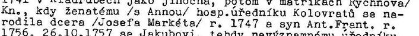

# Rychnov nad Kněžnou · Gönttnerovi roku 1747

**26. listopadu, pozdější průchod.** Josefův křest zůstává hledaný. U Josefy Markéty máme už přímo v matrice datum **14. dubna 1747**, s. 228, sn. 115, rodiče a svědky. [Přepis, výřez a srovnání s rejstříkem](../../2026-11-26-jedenacte-kolo/rychnov.md)

Petr Gundermann výslovně odkazuje na **rychnovské matriky** u narození **Josefy Markéty v roce 1747** a **Antonína Františka v roce 1756**. Otcem obou byl **Jakub Kristián Gönttner**, hospodářský úředník Kolovratů, matkou jeho manželka **Anna**, v rodokmenu na s. 9 **Anna Marie**. Četl jsem Gundermannův původní zveřejněný tisk. Autor u Josefy nepíše přesný den, folio, jméno kmotra ani matčino rodné příjmení. V tomto údaji nejmenuje Gillernovy. [Gundermann, *Kladrubský hřebčín – jeden z hřebčineckých mistrů*, GHL 1969/2, s. 9–10](https://www.genealogie.cz/assets/2025/03/lghsp01rada-02.pdf#page=10)

## Kniha, rejstřík a dosažitelné obrazy

| Pramen | Co bylo ověřeno |
| --- | --- |
| **Rychnov nad Kněžnou, 142-7, ukn 8403, poř. č. 9807, N/O/Z 1734–1771** | Katalog uvádí přímo město Rychnov nad Kněžnou a současně obvody Javornice, Liberk a Lukavice. Pro Josefu Markétu je to konkrétní kniha k roku 1747. Čitelný veřejný obraz z téže knihy je nezávisle publikovaný dvojlist **s. 16–17** s křty z roku 1734. V zápisech jsou vidět obec, otec, matka a označení kmotrů. Tento dvojlist jsem otevřel, obraz roku 1747 v publikované výběrové kopii není. Číslo strany, datum a kmotry Josefy jsem zatím nezjistil. [Popis knihy 142-7](https://www.rodovod.cz/matriky/soa-zamrsk/rychnov-nad-kneznou/9807) · [Veřejný obraz s. 16–17](https://commons.wikimedia.org/wiki/File:František_Martin_Pelcl,_matrika_N.jpg) |
| **Rychnov nad Kněžnou, 142-30, poř. č. 9857, index N 1734–1770 a O 1712–1770** | Pokrývá Josefu Markétu, mladšího bratra z roku 1756 i obě Josefova věková okna. Je to nejkratší cesta k číslu zápisu a foliu. Hledat tvary **Gönttner, Gonttner, Göttner, Gö(n)tner**, u sňatku i podle nevěsty, pokud má index takovou rubriku. Členění a úplnost konkrétního rukopisného indexu jsem neověřil. [Popis indexu 142-30](https://www.rodovod.cz/matriky/soa-zamrsk/rychnov-nad-kneznou/9857) |
| **Rychnov nad Kněžnou, 142-8, N/O/Z 1771–1784** | Gundermann na s. 11 uvádí úmrtí Anny **6. 8. 1772** a dcery Anny **4. 9. 1772** v Rychnově. První zápis by mohl přidat titul či bydliště rodiny. Obě data pocházejí z publikovaného výtahu. Prvopisy jsem neotevřel. [Gundermann, s. 11](https://www.genealogie.cz/assets/2025/03/lghsp01rada-02.pdf#page=11) · [Přehled farnosti](https://www.rodovod.cz/matriky/soa-zamrsk/rychnov-nad-kneznou) |

Rodovod poskytuje veřejný katalog a uvádí, že své obrazy neukládá. Obě tlačítka „Otevřít skeny“ v provedeném testu vrátila přesměrování na přihlášení k Rodovodu, takže jsem z nich nezískal jednotlivé snímky. Projektová brzda měla ARON Východočeských archivů pozastavený do **27. 11. 01:40** po HTTP 503 a FamilySearch do **27. 11. 04:15** po HTTP 403. Na tyto služby jsem neposílal požadavky. V nezávislém soupisu je doložen veřejně nabízený starší soubor **142-00007.zip**, cca **1325 MB**. Pouhý test HTTP HEAD na tam uvedené adrese nedostal během 12 sekund žádná data. Jiné veřejně dohledané reprodukce knihy 142-7 cílily na jiné jednotlivé zápisy. [Starý soupis knih a ZIPů](https://genealogicke-pomucky.webnode.cz/digitalizovane-matriky/soa-zamrsk/rychnov-nad-kneznou/rychnov-nad-kneznou/)

## Stav výzkumu Gillernových

Z projektového deníku a dosavadních zpráv mi nevyšlo dřívější čtení rychnovských křtů ani oddavek pro Gillernovy. Jiný **Nový Rychnov** opakovaně zmiňují zprávy o majetkových pramenech z úplně jiné provenience. Rychnov nad Kněžnou je tedy otevřený test pro hlavní křty **13. 6. 1737–12. 6. 1738** a **3. 2. 1746–2. 2. 1747** i pro oddavky Maximiliána s Johannou před lednem 1750. Kniha 142-7 a index 142-30 zahrnují všechny tyto termíny. Prioritu má konkrétní zjištění kmotrů Josefy Markéty roku 1747 a případně Antonína Františka roku 1756, aby se oddělila profesní souvislost od přímého rodinného dokladu. Gundermann na s. 8 navíc uvádí službu Jakubova otce Kristiána Arnošta u rychnovských Kolovratů už roku 1724. Tím je v literatuře doložen vztah rodiny Gönttnerů k Rychnovu ve dvou generacích. [Gundermann, s. 8](https://www.genealogie.cz/assets/2025/03/lghsp01rada-02.pdf#page=8)

## Kterou vrchnost a správu máme v roce 1747 zkoušet

Panství Rychnov, Černíkovice a Borohrádek bylo společným rodovým majetkem Libštejnských z Kolovrat. **František Karel II. Libštejnský z Kolovrat** vydal 13. března 1747 v Rychnově privilegium pro Vamberk. Získáváme tím konkrétního soudobého majitele pro porovnání s označením zaměstnavatele Jakuba Gönttnera v rodopise. V oficiálním seznamu SOA Hradec Králové je **Velkostatek Rychnov nad Kněžnou, NAD 395**, uložený v Zámrsku, se sídly správy Černíkovice a Rychnov. Nezjistili jsme položkové číslo jmenného seznamu personálu právě pro roky 1737–1747. Majitelova listina pro město sama Gönttnera ani Gillera nejmenuje. [Dějiny pozemkového majetku rodu](https://www.kolowrat.com/cs/nase-cinnosti/lesni-hospodarstvi/historie-majetku) · [Vamberecký zpravodaj, březen 2022, přehled výročí](https://www.vamberk.cz/modules/file_storage/download.php?file=203f6cf9%7C807&inline=1) · [Oficiální seznam fondů, řádek 395](https://vychodoceskearchivy.cz/wp-content/uploads/2022/07/Fondy_Hradec_Kralove_Zamrsk_20220715_pro_web_PUBLIKOVANO_ver36.pdf)
