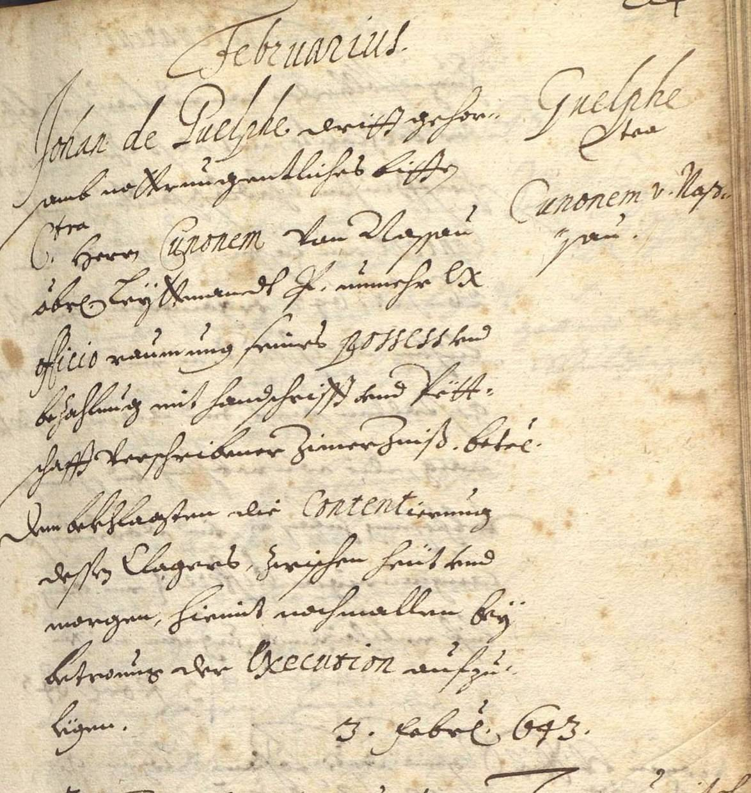
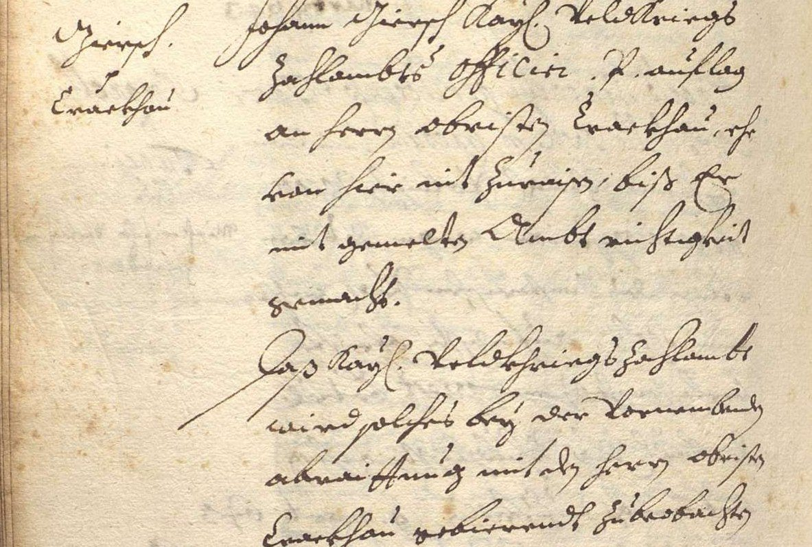
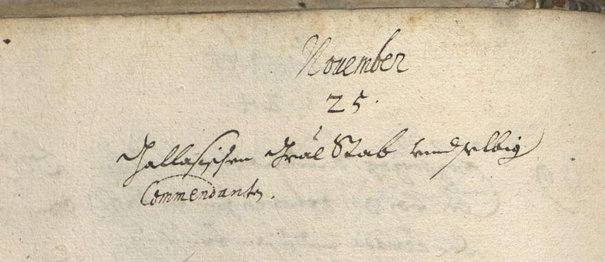
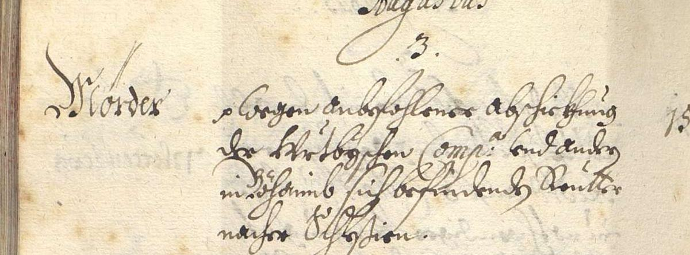
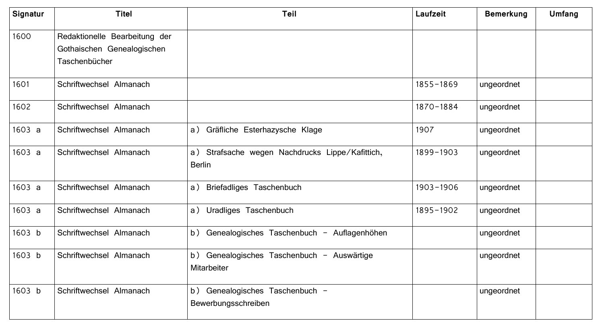

# Desáté kolo · Sparrův soupis a blízká vojenská jména

Nově ověřený paralelní dopis **Otto Christopha Sparra Matyáši Gallasovi z Würzburgu 17. dubna 1645** řeší jednání s franckými knížaty, včetně bamberského biskupa, a situaci v Meiningen a Schweinfurtu. Má konkrétní ediční číslo **DBBTI VII, č. 578**. Neobsahuje v dostupném výtahu jmenný přehled a zatím nelze doložit, že je předlohou či kopií dopisu s přílohou v Meiningen. Z vlastních dobových snímků dva zdánlivě vhodné starší rejstříkové odkazy rozřešeny jako **Johan de Guelphe** a **Johann Giersch**, oba již roku 1643 a se samostatnými záležitostmi. Žádný nově přečtený záznam neurčil křestní jméno hledaného důstojníka Gillera, datum jeho narození nebo otce.

## Meiningenské listy a paralely ve Frankách

V úplném veřejném HTML inventáře **Landesarchiv Thüringen – Staatsarchiv Meiningen, GHA Sektion II 4-10-1020, sign. 166 „Tag in Bamberg“**, je samostatná karta s interním ID **1241242**. Obsahuje rané pozvánky k bamberskému sněmu a výslovně popsaný Sparrův dopis se seznamem důstojníků na **f. 22–23**. Karta nemá odkaz na prohlížečku, digitální reprezentaci ani přílohu. Vedle fyzického uložení je tak doložena veřejná dostupnost popisu. Jmennou přílohu se nepodařilo otevřít v tomto inventáři ani jako přesně datovaný paralelní digitalizát přes německé souborné portály. [Karta uvnitř veřejného inventáře](https://www.archive-in-thueringen.de/de/findbuch/view/bestand/23474/vorwort/1/systematik/53072)

**DBBTI VII č. 578, 17. 4. 1645.** Výtah s citační poznámkou [214] uvádí, že Sparr tři dny před dopisem (14. dubna) jednal s knížaty o velení ve Frankách a přesunu mužstva od Magdeburgu. Bamberský biskup měl zájem, ale pochyboval, zda lze postupovat bez císařova souhlasu. Sparr hlásí nedostatek proviantu a střeliva v Meiningen a Schweinfurtu a žádá o jízdu, nebo aspoň pěchotu. Tím získáváme konkrétní datum a okruh účastníků pro paralelní pátrání po přípisu. Soubor v Meiningen nese jen rok v záhlaví, doručovací list či datum onoho přípisu není z veřejného popisu čitelné. Zpráva 17. dubna má za adresáta samotného Gallase a její dostupný regest neuvádí přiložený seznam. [Výtah a přesné číslo edice v poznámce 214](https://www.schweinfurtfuehrer.de/pers%C3%B6nlichkeiten-familienchroniken-stammb%C3%A4ume/milit%C3%A4rische-personen-des-30-j%C3%A4hrigen-krieges-in-schweinfurt/sparr-otto-christoph-freiherr-von/) · [Knihovní záznam svazku VII](https://katalog.soalitomerice.cz/Record/SOA.146833)

Karta 166 jmenuje **Cornelia Gobelia (Göbela), Johanna Müllera a Tobiase Oelhafena** na f. 84–96. Nezávislá odborná edice jednání o míru dokládá jejich zastupování jako vyslance bamberského biskupství, obou braniborských markrabství, resp. říšského města Norimberku a franckých hrabat. Veřejný bavorský inventář u srovnatelné braniborské řady **StABa MBKB, GLReg 953–955** skáče z norimberského recesu 1643 na deputaci 1647 a repertorní zlomek 1649. Soubor ANSBACH, Fränkischer Kreis, **Rep. 137/II (Kreiskonvent) a 137/III (Kreisakten)** je v přehledu z roku 2022 výslovně uváděn s údajem o převodu z Bamberku a dočasném fyzickém uložení při sanaci StA Nürnberg. Jde o identifikátor paralelních fondových řad, nikoli o nalezenou položku z dubna 1645. Pro Göbela a Oelhafena jsem přesně označený online opis Sparrovy přílohy nenašel. [Edice a vyslanci](https://nasg.publia.org/nasg/article/download/1137/953/998) · [Bamberský inventář](https://www.gda.bayern.de/gvl/archive.xhtml?id=Vz++++++DA63C8EE-4DB5-4BC6-842A-37490342A0F0) · [Rozpis norimberských fondů](https://www.gda.bayern.de/mam/typo3/user_upload/Medien_fuer_Aktuelles/2022/stan-sanierung_standortuebersicht-ausgelagerte-bestaende.pdf)

## Vlastní čtení starších vídeňských snímků

| Ověřený snímek a osoba | Přepis, čin a rozlišení |
| --- | --- |
| HKR Expedit 288 (1643), f. 224r a 241v–242r, **Johan de Guelphe** | F. 224r „Johan de Guelphe … Herrn Caronem van Napoi Obr. Leuttenandt …“, datum „3. febr. 643“. Podání proti podplukovníku Caronovi van Napoi se týká domu a závazku, který se má řešit zaplacením, v zápisu se hrozí exekucí. F. 241v je znovu výslovné „Johan de Guelphe Contra Herrn Caronem van Napoi Obr. Leüt.“. Podplukovnická hodnost se vztahuje ke Caronovi. [F. 224r](https://library.hungaricana.hu/en/view/KA_HKR_288_1643E/?pg=145) · [F. 241v–242r](https://library.hungaricana.hu/en/view/KA_HKR_288_1643E/?pg=163) · [Výřez f. 241v](288_1643E-163.jpg) |
| HKR Expedit 288 (1643), f. 287v, **Johann Giersch** | Rejstřík „Giersch Johan 287.“ Hlavní zápis „Johann Giersch Kay[s.] Veldtkriegs / Zahlam[b]ts Officier“ dne 9. března. Úředník císařské polní válečné pokladny žádá o započtení peněz vydaných na zálohu plukovníkovi. Rozhodující identifikace stojí na rukopisném příjmení a výslovném úřadu. [F. 287v](https://library.hungaricana.hu/en/view/KA_HKR_288_1643E/?pg=209) |
| HKR 288 a 289, 1643, rejstříky *Gi/Ki* | Vlastní kontrola sn. 656 a 671 (Expedit) a 371 a 386 (Registratur). Gi obsahuje samostatné tvary Gill de Haes a Conte Ghisellieri, Expedit navíc Giersch a výše rozřešený odkaz k de Guelphemu. V kontrolovaných Ki není čitelné heslo Killer. Rozsah jsou vyjmenované rubriky, ne celý ročník. [Expedit Gi](https://library.hungaricana.hu/en/view/KA_HKR_288_1643E/?pg=656) · [Místní výřez Gi](288_1643E-656.jpg) · [Expedit Ki](https://library.hungaricana.hu/en/view/KA_HKR_288_1643E/?pg=671) · [Registratur Gi](https://library.hungaricana.hu/en/view/KA_HKR_289_1643R/?pg=371) · [Místní výřez Gi](289_1643R-371.jpg) · [Registratur Ki](https://library.hungaricana.hu/en/view/KA_HKR_289_1643R/?pg=386) |
| HKR 292 a 293, 1645, rejstříky *Gi/Ki* | Po dřívější nedostupnosti získány snímky obou knih. Vlastní kontrola sn. 300 a 315 (Expedit) a 277 a 291 (Registratur). Pod Ki není čitelné heslo Killer. Pod Gi je v Registratuře mimo jiné samostatné heslo hraběte Gis(il)ieriho s odkazem f. 126. [Expedit Gi](https://library.hungaricana.hu/en/view/KA_HKR_292_1645E/?pg=300) · [Expedit Ki](https://library.hungaricana.hu/en/view/KA_HKR_292_1645E/?pg=315) · [Registratur Gi](https://library.hungaricana.hu/en/view/KA_HKR_293_1645R/?pg=277) · [Registratur Ki](https://library.hungaricana.hu/en/view/KA_HKR_293_1645R/?pg=291) |

**Přímé kontroly gallaských hesel roku 1645.** Registratur 293 má pod *Ga* samostatně „Gallassische Gen[era]l Stab. 67.“ a „Gallasische Dragoner. 228.+“. Dne 25. listopadu na f. 67v opravdu stojí „Gallassischen Gen[era]l Stab und etliche Commendanten.“ Je to krátká poznámka o Gallasově generálním štábu a několika velitelích, beze jmen a bez dalšího textu na listu. V květnové pasáži u f. 228r–229r (23.–26. 5.) se dá přímo přečíst Gallasova položka č. 113 o stížnosti Johanna Keriho na jednání plukovníka psaného *Hamberger* s Keriho sluhou a vrácení odňatých věcí. V č. 113 samotném není pluk určen. Samostatné znění odpovídající rejstříkovým dragounům ani Gillerovo jméno se zde nepodařilo vyčíst. Ve stejné knize na f. 126r č. 45, 11. ledna, zřetelně „… dem Conte Giscelieri“ v peněžní položce, vedle samotný titul hraběte. To potvrzuje samostatné jméno, které bylo v roce 1644 Ghisillieri. V Expeditu 292 indexové „Galler. 228.“ zkontrolováno na f. 228r a 228v. V textech obou stran jsem přesné pojmenování Galler nepotvrdil, souvislost s rodem tudíž nevyvozuji. [Ga v Registratuře](https://library.hungaricana.hu/en/view/KA_HKR_293_1645R/?pg=275) · [F. 67v](https://library.hungaricana.hu/en/view/KA_HKR_293_1645R/?pg=38) · [F. 126r](https://library.hungaricana.hu/en/view/KA_HKR_293_1645R/?pg=68) · [F. 228r](https://library.hungaricana.hu/en/view/KA_HKR_293_1645R/?pg=167) · [F. 228v–229r](https://library.hungaricana.hu/en/view/KA_HKR_293_1645R/?pg=168) · [Ga v Expeditu](https://library.hungaricana.hu/en/view/KA_HKR_292_1645E/?pg=298) · [Expedit f. 228r–v](https://library.hungaricana.hu/en/view/KA_HKR_292_1645E/?pg=152)

**Upřesnění jména u Wrbnovy kompanie z 3. 8. 1644.** Rukopisný okraj „Mörder“ z HKR 291 f. 317v č. 15 má nyní konkrétního, silně pravděpodobného adresáta: Johanna svobodného pána von Mörder (také Mäder). K témuž datu už velel operacím ve Slezsku. DBBTI VII č. 310 dokládá Mörderovu zprávu Montecuccolimu ze 3. 7. 1644 o slezských blokádách. Opolí mu kapitulovalo 1. 8. 1644, pouhé dva dny před rozkazem odeslat do Slezska Wrbnovu kompanii. DBBTI VII č. 590 pak dokládá pokyn z 11. 5. 1645 k předání slezského velení Mörderovi a č. 615–616 jeho hlášení z léta 1645 o směru od Jablunkova, mj. původní dopis z 25. 6. 1645, který Leopold Vilém předal Gallasovi. Funkce a sled dat vysvětlují, proč dostal oznámení o Wrbnově jednotce. Mörderovo jméno neposkytuje jméno Wrbnova vlastního podplukovníka. [Zápis HKR 291](https://library.hungaricana.hu/en/view/KA_HKR_291_1644R/?pg=201) · [Mörder, věcné výtahy a čísla edice v pozn. 315, 326, 327 a 333](https://www.30jaehrigerkrieg.de/morder-mader-johann-freiherr-von/) · [Titul a křestní jméno v aparátu editovaného deníku](https://diglib.hab.de/edoc/ed000228/print/1632_all.pdf)

[Výřez účtu zaopatření, Conte Giscelieri](293-f126r-c45.jpg) · [Výřez Ga v Registratuře](293-ga-gallas.jpg) · [Výřez „Galler. 228.“ v Expeditu](292-ga-galler.jpg)

## Gotha. Redakční korespondence SPA ARCH Gen 1602

Oficiální pomůcka Forschungsbibliothek Gotha označuje **SPA ARCH Gen 1602** jako *Schriftwechsel Almanach*, **1870–1884**, v oddílu „Korrespondenz der Gothaischen Genealogischen Taschenbücher“, s poznámkou *ungeordnet* (neuspořádáno). **V pomůcce tedy máme obecný korespondenční celek, žádnou doloženou samostatnou jmennou obálku Gillern.** Na stejné straně je **SPA ARCH Gen 1603 b**, pododdíl *Genealogisches Taschenbuch – Bewerbungsschreiben* (žádosti či přihlášky do genealogické ročenky), opět neuspořádaný, rozsah ani doba u této podčásti v inventáři nevyplněny. Tato druhá jednotka je další věcně přesně určený prostor pro původ žádosti. Jméno Gillern se v textu inventáře ani v cílených veřejných dotazech do DHB a Kalliope s označením obou jednotek neobjevilo. Katalog neobsahuje evidenci jednotlivých příloh a zveřejněné digitalizační projekty Perthes dokládají zejména kartografickou produkci a obecné katalogy. Obrazy vlastní korespondence nebo přihlášek se dohledat nepodařilo. [Oficiální inventář, s. 20](https://www.uni-erfurt.de/fileadmin/einrichtung/WissenGlobal/Dokumente/Sammlung_Perthes/Findbuch_zum_Bestand_Gothaische_Genealogische_Taschenbuecher.pdf#page=20) · [Přehled digitalizace FB Gotha](https://www.uni-erfurt.de/forschungsbibliothek-gotha/forschung/projekte/digitalisierung)

## Vratislavský regest a možné vojenské prostředí

Modelhartův regest tištěný roku 1917, s. 89, u Karla Josefa Gillera uvádí „Sein Großvater diente im schwedischen Krieg und in bayrischen Kriegen“. Doslovně „Jeho děd sloužil ve švédské válce a v bavorských válkách.“ Který děd to byl, komu sloužil a v kterém roce, jsou tři samostatné otevřené otázky. Předložka *in* tu označuje účast na válce. Válka označená podle Bavorska může souviset s válčením v zemi, za ni či proti ní. Například v posledních letech třicetileté války se po březnovém ulmském příměří změnilo bavorské postavení vůči císaři a později bylo spojenectví obnoveno. Zcela jiným kandidátním kontextem výrazu „bavorské války“ je počátek 18. století, kdy byl bavorský kurfiřt na francouzské straně ve válce o španělské dědictví. Druhý příklad ilustruje šíři označení, neposouvá dataci ani identifikaci tohoto děda. Původní spis, generační chronologie a samostatný dobový důstojnický doklad musí být posouzeny společně. [Regest s. 89, snímek 96](https://sbc.org.pl/Content/128006/PDF/128006.pdf#page=96) · [Ulmské příměří](https://www.leo-bw.de/de/web/guest/themenmodul/dreissigjaehriger-krieg/friedensschlusse/ulmer-waffenstillstand) · [Historisches Lexikon Bayerns k počátku 18. století](https://www.historisches-lexikon-bayerns.de/Lexikon/Beziehungen_zu_Spanien_%28Mittelalter_und_Fr%C3%BChe_Neuzeit%29)
