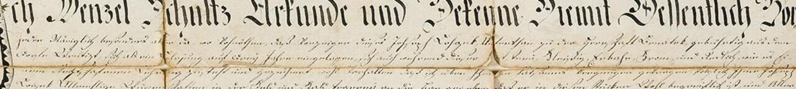

# Lesnický výuční list, přísaha a předání revíru

Český lesnický výuční list Josefa Loschka z roku **1792** výslovně uvádí obec narození a příslušnou vrchnost. Obdobný list by mohl přímo rozhodnout o rodišti Josefa Emanuela Gillera. Jeho vlastní list ani služební záznam Maximiliána jsem v tomto kole nedohledal. U Josefa tak zůstávají otevřené oba intervaly odvozené z věku při oddavkách a pohřbu, **13. 6. 1737–12. 6. 1738** a **3. 2. 1746–2. 2. 1747**. [Oddavky](https://ebadatelna.soapraha.cz/d/11863/7) · [Pohřeb](https://ebadatelna.soapraha.cz/d/10801/8)

## Co jsem četl v originále

**Výuční list Josefa Loschka, 1792.** Landessammlungen Niederösterreich, **LK2489/28**. V úvodu se jmenuje vystavitel Wenzel Schultz. Hned za jménem žáka stojí „Unterthan zu der Herrschaft … gebürtig aus dem Dorfe …“. Dále list uvádí tříletou dobu učení. Na spodním okraji jsou tři pečeti. Četl jsem celý dostupný obraz a ověřil, že jde o dvě geografické informace. Čtení vlastního místního jména zůstává nejisté. Katalog uvádí u panství nejisté „Lehmateck (?)“ a obec nepřepisuje. List je zachován v rodinné sbírce Loschkových. Rodinný životopis z roku 1928 uvádí tradici „Benedikt in Böhmen“ a dochování německého propouštěcího listu (*Freibrief*). K určení obce ve výučním listu samotném tato zpráva nestačí. [Katalog originálu](https://online.landessammlungen-noe.at/objects/1259153) · [Celý obraz](https://www.online.landessammlungen-noe.at/internal/media/dispatcher/207586/full) · [Rodinný životopis, LK2489/41](https://online.landessammlungen-noe.at/objects/1259166)

Výřez z LK2489/28. Landessammlungen Niederösterreich, [CC BY-NC 4.0](https://creativecommons.org/licenses/by-nc/4.0/).

**Předepsané zkušební vysvědčení rakouského arcivévodství, 1766.** Patent Marie Terezie z **15. 9. 1766** pro Rakousy pod a nad Enží, č. 228 v Beinhauerově vydání, tisk s. **303**, příloha **365–366**. Na obou stranách přílohy jsem četl prázdná místa pro jména, období učení, odbornou způsobilost, zkoušku a potvrzení o vyučení. Formulář nemá rubriku pro rodiště. Územní působnost je ve vlastním patentu vymezena výslovně. Pro české Gillery tedy při případném nálezu rozlišovat vlastní výuční list s individuálním úvodem od prostého osvědčení o vykonání zkoušky. [Patent, s. 303](https://www.digital.wienbibliothek.at/content/pageview/2588565) · [Příloha, s. 365](https://www.digital.wienbibliothek.at/content/pageview/2589651) · [Závěr přílohy, s. 366](https://www.digital.wienbibliothek.at/content/pageview/2588628)

Další české doklady jsem četl jako katalogové popisy. V **Dobříši roku 1763** vystavil vrchní lesmistr Johann Josef Swoboda výuční list pro Johanna Swobodu. Regest jmenuje také pojezdného Josepha Franze Rzesoua a vrchního lovčího Franze Swobodu. Dokládá, která jména může přinést podpisová část. Popis neposkytuje rodiště ani příbuzenský vztah mezi Swobody. Regest listu z **23. 2. 1796** pro Vinzenze Schwaba uvádí „aus Zwittau“ a vystavitele Johanna Wenzla Kammela, lesmistra ve službě Valdštejnů z Vartenberka. Z regestu nelze rozlišit rodiště od poslední příslušnosti. [Dobříš, kat. 35681](https://www.zvab.com/manuskripte-papierantiquitaeten/Deutsche-Urkunde-Pergament-J%C3%A4ger-Lehrbrief/32445084621/bd) · [Schwab, s. 18, pol. 56](https://www.autographen.org/fileadmin/user_upload/pdf/Osterglocken2009.pdf#page=18)

## Kde jsou doloženy přísahy a personální nástupní spisy

Na s. **197** veřejného inventáře Archivu města Domažlice, SOkA Domažlice, **NAD 101**, pomůcka **554**, jsou tyto položky. Četl jsem inventář. K jednotlivým dokumentům ani jejich osobním rubrikám jsem se nedostal. Datace označuje celý karton. [Inventář, s. 197](https://www.inventare.cz/api/aron/file/ace37f79-c331-4678-b4b1-c064498dcf1c#page=197)

| Řada | Co inventář skutečně uvádí |
| --- | --- |
| **Inv. 1146, Diaet. 1, kart. 300, 1/301–381, 1789–1846** | Přijetí do služby zahrnuje obsazení místa hajného ve falckém revíru, protokoly o předávání revírů a přísahy lesního personálu. V témže kartonu jsou pod **1/342–364** spisy bývalého komorního úřadu, mj. lesní personál. Inventář neurčuje folio přísahy ani přesný rok jednotlivých lesnických listů. |
| **Inv. 1147, Diaet. 2, kart. 303, 2/41–62, 1786–1840** | Oddíl služného a platů zahrnuje regulaci a systemizaci odměn lesního personálu. Katalog neposkytuje jmenné členění lesních položek ani jejich samostatná data. |

Pro Gillerovy je užitečné ověřit, zda vlastní přísaha, předání revíru a kvalifikační doklady mohou být přílohami jedné nástupní složky. Domažlický inventář potvrzuje společnou registraturu těchto typů písemností. Pro Poděbrady a Kolín zůstává položkové číslo a existence příslušného spisu k jejich letům neověřená. [Poděbrady, pomůcka 257](https://aron.soapraha.cz/apu/178006b2-3e38-4fb1-940a-cb14b8d8a3cd) · [Kolín, pomůcka 339](https://aron.soapraha.cz/apu/7eef756c-b153-4e71-9d00-5db1d9dfb67e)

## Co přesně má cenu hledat v již známých fondech

- **Josef, Býchory mezi roky 1784 a 1789.** Zachytit nástup Josefa, případně poslední placené období a odchod Františka Höfera, který je v myslivně č. 11 doložen roku 1784. Hledat složku převzetí revíru pod oběma jmény i pod místem, s hesly *Aufnahme, Bestallung, Eid, Übergabe, Versetzung* a s případnými přílohami *Lehrbrief, Zeugnis*. Výplatní zápis by doložil datum, osobní nástupní příloha může uvádět předchozí službu nebo rodiště. Jmenný rejstřík konkrétní kolínské řady jsem neověřil. Jako nezávislý vstup do centrální registratury je již doložena řada **Camerale, NAD 203/1, inv. 22–25** s příslušnými elenchy **18–21**. Skutečný odkaz na jmenování nebo přílohu zatím v indexech doložen není. [Inventář Camerale](https://vademecum.nacr.cz/vademecum/permalink?xid=9ca109db21635ab921f0bb6347460da8) · [Höfer v č. 11](https://ebadatelna.soapraha.cz/d/10801/3) · [Josef v Býchorech roku 1789](https://ebadatelna.soapraha.cz/d/10790/6)
- **Maximilián, Bor/Bobnice před 23. 1. 1750.** Pro rozhodnutí mezi příchodem podle slezské rodinné stopy a časnější českou službou má větší hodnotu příloha k přijetí nebo přesunu. V dosavadním poděbradském soupisu poddaných roku 1745 nebyla na fol. 219–228 identifikována domácnost Gillerových. Účetní předobraz komorního panství z roku 1741, **Velkostatek Pardubice, NAD 377, inv. 227**, v publikovaném pardubickém oddílu skutečně obsahuje jména zaměstnanců i položky bez jmen. Jmenné výplatní pásmo Boru 1747–1750 zůstává nedoložené. Ani známý případ přesunu ze spisů ČDKM V, kart. 20, z roku 1756 není osobním dokladem Maximiliána. [Bobnice, fol. 219–228](https://ebadatelna.soapraha.cz/a/4908/221) · [Siglová, účetní výtah](https://www.vcm.cz/en/documents/168/siglova_vcsh08_1999.pdf) · [Případ přesunu, s. 117](https://www.vcm.cz/documents/1194/martinkova-valenta-vilimovska_vcsh14-2007.pdf#page=9)
- **Zkoušky a podání lesního referátu po roce 1788.** Vedle dříve identifikovaných imatrikulačních fasí lze v téže instituci prověřit samostatnou agendu kvalifikací, doporučení a obsazování míst. Karel Špork je v odborné práci doložen v čele lesního referátu od roku 1788, od roku 1789 jsou jmenováni rovněž Ehrenwerth, Friedl a Jánský. Pro správná léta jsou v inventáři VHS Praha, **NAD 638**, 47/02, protokol schůzí **III, 1785–1794**, a pomocný index rozhodnutí **1770–1815**, štítek **22**. Četl jsem popisy evidenčních knih a citovanou studii. Věcný nebo jmenný zápis o Gillerovi ve vlastním indexu zatím přečten nebyl. [Hronský, s. 16–17](https://dspace.cuni.cz/bitstream/handle/20.500.11956/17155/BPTX_2007_2_11210_ASZK00306_123635_0_61664.pdf?isAllowed=y&sequence=1) · [Inventář, s. 16](https://vademecum.nacr.cz/vademecum/permalink?xid=88ec3f678b982944bc265411e2f4bbe8&scan=7438b3cb-124c-4761-9188-baee204e2015)

Při vymezení jsem prošel dosavadní poděbradský matriční audit, přehled býchorských předchůdců, pardubickou služební stopu, šesté kolo k výučním listům a sedmé až osmé kolo k rejstříkům, pozůstalosti a katastru. Novým osobním pramenem je Loschkův originál a novým archivním srovnáním domažlická registratura. Na jmenování, přísahu či mzdovou položku kteréhokoliv Gillera tyto doklady samy neodkazují.
