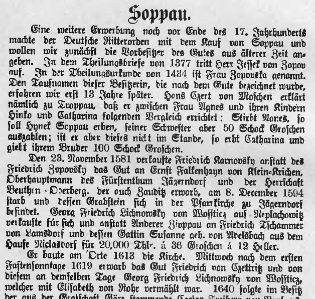
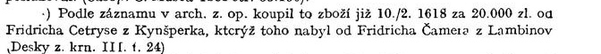

# Oldřišov a Žopovy · Bedřich Čamr z Lambinova

Deváté kolo lokalizovalo dobový deskový zápis k druhému statku Bedřicha a Zuzany, v krnovské knize **inv. č. 947, sign. 3, fol. 24**. Dva skutečně přečtené starší tisky dávají rozdílnou chronologii převodu Žopov a umožňují přesně zacílit ověření v rukopisu. Originál závěti Zuzany Adelsbachové ani jmenovitý seznam potomků Oldřišovských se zatím nepodařilo dohledat. Křest Johanna Christofa ani příbuzenství Gillera s touto rodinou nejsou doložené.

## Žopovy (Zopowy, Soppau) a dohledatelný dobový vklad

**Augustin Weltzel**, *Besiedelungen des nördlich der Oppa gelegenen Landes*, II, Leobschütz 1891, strana a snímek **110**. V tištěném obraze je Bedřich „Friedrich Tschammer von Lamsdorf“ a Zuzana jeho „Gattin Susanne geb. von Adelsbach aus dem Hause Nicklasdorf“. Weltzel uvádí, že Jiří Bedřich Lichnovský z Voštic na Neplachovicích prodal Žopovy jim oběma za 20 000 tolarů. Připisuje Bedřichovi stavbu či úpravu tamního kostela v roce 1613 a popisuje dva převody v týž den roku 1619, nejprve na Bedřicha Cetryse a pak na Lichnovského. Pasáž o Čamrovi nemá připojenou foliaci. [Obraz s. 110](https://sbc.org.pl/Content/12551/PDF/12551.pdf#page=110)

**Josef Zukal**, *Slezské konfiskace 1620–1630*, Praha 1916, s. **105, pozn. 2**. Odkazuje na „Desky z. krn. III. f. 24“ a vykládá posloupnost **Bedřich Čamr z Lambinova → Bedřich Cetrys z Kynšperka → Bedřich Fragstein z Načeslavic**. Poslední převod datuje **10. 2. 1618**, cena **20 000 zl.** Částka u Zukala patří ke koupi Fragsteina, částka u Weltzela ke koupi Čamrových. Údaje o nabyvatelích a datech se rozcházejí. Deskový zápis může odlišit datum smlouvy od data vkladu, rozsah převodu a další účastníky. Žádný z obou výtahů v této pasáži neuvádí děti Čamrových. [Obraz s. 105](https://kramerius.lib.cas.cz/view/uuid:cb8d6447-3772-4544-bba0-b78be61baaba)

Zukalova starší citace odpovídá svazku **Zemský archiv v Opavě, Slezský stavovský archiv, krnovské zemské desky 1581–1619, sign. 3, inv. č. 947, fol. 24**. Současné číslo a rozsah potvrzuje sborník *Krnovsko*, s. 101, pozn. 43, a rovněž pozn. 8 v *Historica 5*. Stranu folia (r/v) Zukal nerozlišuje. V přímém běžném prohlížeči zůstala elektronická pomůcka po opakovaném otevření na obrazovce Radware „Verifying your browser before proceeding…“. Obě strany fol. 24 jsem proto nečetl. [Krnovsko](https://kulturni-dejiny.slu.cz/data/uploads/publikace/krnovsko.pdf) · [Historica 5](https://dokumenty.osu.cz/ff/journals/historica/1993-2009/Historica05.pdf) · [Oznámení archivu o digitalizaci a odkazy](https://www.archives.cz/web/aktualne/index.php?post_id=31&title=fond-slezskY-stavovskY-archiv-zp%C5%99istupn%C4%9Bn-digitaln%C4%9B)

## Oldřišov · závěť, spolek a majetkové nástupnictví

- **1629 a 1635.** Platí závěr osmého kola. Zukal s. 99 popisuje Zuzaninu pohledávku ze dne **1. 9. 1629**, sňatek s Jiříkem Vranínským dne **6. 3. 1631** a její „poručenství“ z **28. 4. 1635**. Jiříka uvádí jako dědice Zuzanina majetku po přijetí na spolek. Originál může pojmenovat dědice, jiné příjemce či příbuzné. Samotný termín „poručenství“ v tomto kontextu označuje závěť a z formulace o dědictví manžela nelze bezpečně určit počet přeživších dětí. Zukalovo „arch. z. op.“ je údaj o archivu, dnešní fond a jednotka zůstávají otevřené. [Zukal s. 99](https://kramerius.lib.cas.cz/view/uuid:ffdc99ae-8b89-4c67-ab4e-ad9a0c915887)
- **Variantní přístup k aktu.** Do seznamu pro ověření patří vedle kšaftu i přijetí manžela na spolek a případný vklad následného převodu. Archiv výslovně uvádí kšafty mezi listinami Slezského stavovského archivu, pozůstalostní spisy jsou doloženy i ve fondech **Zemské právo opavsko-krnovské v Opavě** a **Hejtmanský úřad knížectví opavsko-krnovského**. Pro hledání starého opisu či původní signatury existuje v osobním fondu **Zukal Josef** skupina **inv. č. 195–208** (šlechtické rody), přičemž studie v *Historica 5* cituje konkrétně **inv. č. 201** jako šlechtické rodiny Opavska. Příslušná písmena Č/C, A, V/W ani název Oldřišov jsem v těchto svazcích neověřil. [ZA Opava – obsah stavovského fondu](https://www.archives.cz/web/aktualne/index.php?post_id=31&title=fond-slezskY-stavovskY-archiv-zp%C5%99istupn%C4%9Bn-digitaln%C4%9B) · [Metodika NPÚ – fondy](https://www.zamek-kratochvile.cz/publikace/metodika-stavebnehistorickeho-pruzkumu.pdf) · [Solnický–Tesař s. 203, pozn. 2](https://www.archives.cz/web/resources/za_opava/Sbornik_ZAO_2017.pdf) · [Historica 5, pozn. 7](https://dokumenty.osu.cz/ff/journals/historica/1993-2009/Historica05.pdf)
- **Údaj k 1640 je zatím kontrolní, nikoli průkazný.** České místopisné podání uvádí Annu Vranínskou rozenou Vlčkovou, německé naopak Annu von Wilczek rozenou Wraninska. Směr sňatku, právní titul držby i vztah k Jiříkovi vyžadují skutečný vklad. Tuto Annu nelze zařadit mezi děti Zuzany ani Bedřicha. [Český místopis](https://www.mistopisy.cz/pruvodce/obec/10357/oldrisov/historie/) · [Německé místopisné podání](https://de.wikipedia.org/wiki/Old%C5%99i%C5%A1ov)

## Rozlišení větví a matriční rozsah

- Predikát **von Lamsdorf / z Lambinova / z Łambinowic** a společné uvedení Zuzany v souvislosti s **Oldřišovem nebo Žopovy** tvoří pracovní identifikaci páru. Herbář uvádí oldřišovského držitele k 24. 7. 1621 jako **Jerzy Fryderyk**. V obou starších výtazích stojí v příslušných pasážích jen Friedrich/Fridrich. V edici Acta publica IV pro rok 1621 jsem v OCR sondě PDF sn. 190–204, kolem 24. 7., nenašel pojmenování oldřišovského držitele. Sonda neověřuje úplnost edice ani citaci herbáře. Druhé jméno ponechávám otevřené. Samotný predikát nerozliší jednotlivé členy lambinovské větve. Těšínská větev má jiné sídlo a predikát **z Jiskřičína / von Iskritschin**, který například nezávisle vystupuje u Rudolfa Gottlieba kolem zakládání evangelického sboru v Těšíně. Podobnost jména ani konfese nevytváří vazbu mezi větvemi. [Herbář, Czambor](https://obc.opole.pl/Content/19267/PDF/herbarzXI.pdf) · [Acta publica IV, PDF sn. 200](https://sbc.org.pl/Content/8151/PDF/8151.pdf#page=200) · [Slezští a hornouherští luteráni, s. 125–126](https://www.academia.edu/143791271/Spolupr%C3%A1ca_slezsk%C3%BDch_a_hornouhorsk%C3%BDch_luter%C3%A1nov_v_17_18_storo%C4%8D%C3%AD)
- V opavské sbírce je dochovaná **protestantská oddací** kniha sv. Jiří **Op I 97**, **1601–1627**, znovu nalezená roku 2014. Může zachytit dřívější sňatek nebo role svědků v čamrovském okruhu. Po únoru 1622 se zde obnovují zápisy až v lednu 1627 a končí v červnu 1627, takže druhý sňatek Zuzany z roku 1631 ani křest Johanna nevypoví. Zukalovy výpisky **inv. č. 211** a Doerrovy excerpta v opisu Kloskeho **SOkA Opava, Farní úřad u Panny Marie, inv. č. 238** mají známé mezery. Tyto rukopisy jsem v devátém kole neprošel. [Solnický–Tesař, s. 203–210](https://www.archives.cz/web/resources/za_opava/Sbornik_ZAO_2017.pdf)
- Oldřišovská vlastní katolická kniha **H XIII 1** začíná roku **1671**. Starší katalogový záznam „Oldřišov 1627“ se vztahuje k **Opavě u P. Marie**, křty **Op I 1** (obsahuje také Služovice), sňatky **Op I 8** a sňatkový rejstřík **Op I 11**. V předchozích kolech byly křty v Op I 1 kontrolovány po snímcích **3–204** (1627–1643) a **204–316** (1644–1653), včetně hledání Johanna Christofa a jeho dětí podle rodové tradice. Jde o doložený negativní rozsah předchozí práce, ne o plošnou kontrolu evangelických křtů nebo o nové čtení devátého kola. Pro Zuzanin sňatek hledej v oddací samostatně pod jménem ženicha Vranínský/Wraninsky, nikoli jen ve starším výběru pod Giller. [Matricula – Oldřišov](https://probelauf.data.matricula-online.eu/de/CZ/cz-zao/oldrisov-rimskokatolicky/) · [Matricula – Opava u P. Marie](https://probelauf.data.matricula-online.eu/de/CZ/cz-zao/opava-u-p-marie-rimskokatolicky/) · [Oddací Op I 8](https://www.rodovod.cz/matriky/za-opava/farni-urad-u-p-marie-opava/be81e720-f13c-102f-8255-0050568c0263)

K potvrzení vazby je třeba jmenovitý záznam, který současně označí ženu za dceru Bedřicha nebo Zuzany a spojí ji s Heinrichem Christofem. Samostatný doklad o kompletním okruhu jejich dětí a sňatcích by umožnil hypotézu vyvrátit. Chybějící zmínka ve stručném výtahu takovou sílu nemá. Pro původ a křest Johanna Christofa zůstává samostatným testem zápis s jeho jménem a rodiči. V devátém kole nevznikla žádná nová datace jeho narození.
