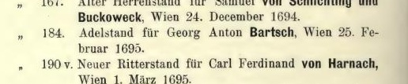
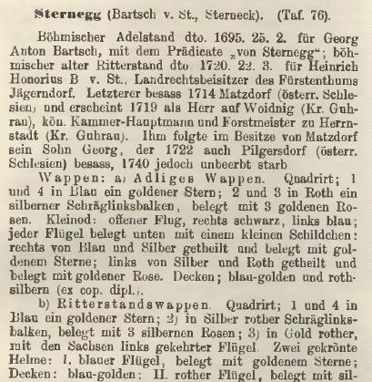
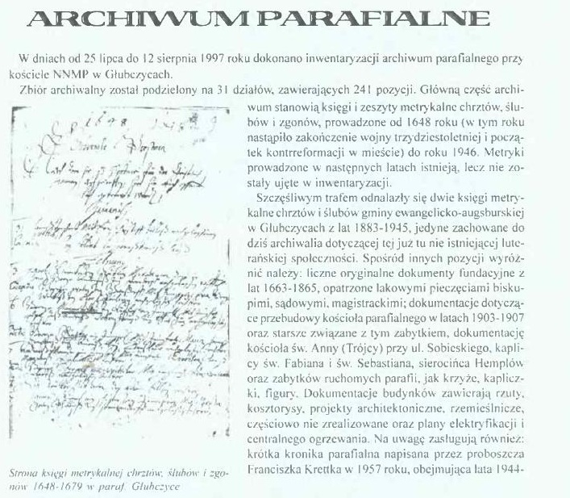

# Zuzana Bartschová · původ predikátu a test pro Hlubčice

**Predikát „von Sternegg“ je pro tuto rodinu doložen až od povýšení Jiřího Antonína Bartsche 25. února 1695 ve Vídni.** Přesná cesta k dobovému opisu vede do **českého sálbuchu č. 101, fol. 184** podle Doerrova číslování. Pro hledání Zuzany ve 40. a 50. letech 17. století je vhodné jméno **Bartsch / Barsch / Partsch** bez predikátu. Svatba s Johannem Christofem, rodiče Zuzany a příbuzenský vztah k Jiřímu Antonínovi zůstávají nedoložené.

## Šlechtický akt a pozdější rodopis

- **25. 2. 1695.** August von Doerr, *Der Adel der böhmischen Kronländer*, Praha 1900, na obraze **s. 174, PDF sn. 190**, u fol. 184 tiskne „Adelstand für Georg Anton Bartsch, Wien 25. Februar 1695.“ Číslo svazku 101 je v záhlaví na předchozí **s. 173, sn. 189**. OCR jiné kopie uvádí 1696, ale přímá kontrola tisku potvrzuje konečnou číslici 5. Jde o regest z českých sálbuchů. Opsaný diplom s případnou rodovou preambulí se v tomto kole získat nepodařilo. Doerr zde neuvádí predikát ani dalšího příjemce. [Doerr, obraz s. 174](https://archive.org/details/deradelderbhmi00doeruoft/page/174/mode/2up) · [Kopie PDF, sn. 190](https://upload.wikimedia.org/wikipedia/commons/c/cc/Der_Adel_der_b%C3%B6hmischen_Kronl%C3%A4nder_%28IA_deradelderbhmi00doeruoft%29.pdf#page=190) · [Katalog PNP k provenienci sálbuchů](https://arl.pamatniknarodnihopisemnictvi.cz/arl-pnp/cs/detail-pnp_us_cat-036976-Der-Adel-der-Bohmischen-Kronlander-Mahren-und-Schlesien/)
- **Text predikátu.** Konrad Blážek, *Der abgestorbene Adel der Preussischen Provinz Schlesien*, I, 1887, s. 105 (PDF sn. 111) v hesle „Sternegg (Bartsch v. St., Sterneck)“ výslovně připojuje k témuž českému šlechtickému aktu predikát „von Sternegg“. Popisy obou erbů označuje „ex cop. dipl.“, tedy z opisu diplomu. Následné povýšení syna Jindřicha Honoria do starého rytířského stavu je samostatný akt z **22. 3. 1720**. Tato pozdější stopa a křestní doklad z roku 1718 byly vyřešeny ve čtvrtém kole. [Blážek s. 105](https://sbc.org.pl/Content/3934/PDF/3934.pdf#page=111)
- **Herbář a Pilnáček.** *Herbarz szlachty śląskiej*, I, s. 122, uvádí měšťanský původ v Hlubčicích, patnáct let v radě, následný úřad zemského komisaře v Krnově a koupi Pilgersdorfu roku **1694**. Jmenuje dva syny **Jindřicha Honoria** a **Jiřího Eustacha** (* 1693) a dceru čtenou **Zafira (?)** (* 1695), vdova měla zemřít kolem 1711. Otce a sestry Jiřího Antonína heslo nejmenuje. Dřívější kontrola Pilnáčkova hesla **Barschové ze Šterneku**, *Rody starého Slezska*, č. 572, potvrzuje směr Hlubčice–Krnov, povýšení roku 1695 a rodinu Jindřicha Honoria, spojku ke Gillerům nenašla (badatelský deník č. 662). Plný obraz Pilnáčkova hesla jsem v tomto kole znovu nezískal. [Herbarz I, s. 122](https://obc.opole.pl/Content/15871/PDF/16776sI.pdf)
- **Co z názvu plyne.** Pokud tradované roky narození synů Johanna Christofa 1646 a asi 1651 odpovídají skutečnosti, předcházejí povýšení o zhruba 49 a 44 let. Žena uváděná Gothou jako jejich matka nemůže být dcerou narozenou Jiřímu Antonínovi roku 1695. Ztotožnění se starší příbuznou z jeho měšťanského okruhu je otevřené. Dokud se neobjeví doklad, nelze z pouhého pozdějšího predikátu stanovit místo narození, rodiče ani dobu sňatku. Samostatný podobný predikát dal císař už roku 1629 Matthiasovi Khossovi v Kraňsku a roku 1704 Johannu Antonu Inamovi v Tyrolsku. Konkrétní příjmení a místo jsou při rozlišení rozhodující. [Khoss, ÖStA](https://www.archivinformationssystem.at/detail.aspx?ID=4303484) · [Inama, ÖStA](https://www.archivinformationssystem.at/detail.aspx?ID=2474457)

## Hlubčice · nový archivní bod a přímý test

**Krnov, 26. 2. 1687.** Státní archiv v Opolí, *Akta miasta Głubczyc*, **45/9/0/1/117**. Katalog identifikuje Jiřího Antonína Bartsche jako **starostu Hlubčic**. Spolu se zeměpanským soudcem Lorenzem Ludwigem Müllerem nařizuje vložit statek Kaltenhaus se všemi povinnostmi do zemských desk (*Landtafel*). Místem vydání je podle přepisu regestu Krnov, funkce starosty se vztahuje k Hlubčicím. Jde o nový jmenovitý dobový archivní doklad z období před povýšením. Evidováno pět obrazů, první ID **52309868**. Obrazy se přes spojení nepodařilo otevřít, takže přednobilitační tvar jména, datum a úřad zde vycházejí z archivního popisu. Kaltenhaus je předmětem úředního aktu, držbu Bartschovi z něj nepřipisuji. [Státní archiv v Opolí, jednotka](https://www.szukajwarchiwach.gov.pl/en/jednostka/-/jednostka/4606219) · [Datace v soupisu fondu](https://www.szukajwarchiwach.gov.pl/zespol/-/zespol/44118?_Zespol_delta=100&_Zespol_javax.portlet.action=zmienWidok&_Zespol_nameofjsp=jednostki&_Zespol_resetCur=false) · [Úplnější regest v místním indexu](https://bindweed.man.poznan.pl/skany.php?placeid=1071)

**Katolická fara Nanebevzetí Panny Marie, Hlubčice, společná kniha křtů, oddaných a zemřelých 1648–1679.** Je doložena inventarizací na faře v červenci a srpnu 1997. *Kalendarz Głubczycki* 1998 s. 124 (PDF sn. 125) otiskl malý obraz stránky s vročením **1648** a výslovně označil celou knihu za N/O/Z **1648–1679**. Vyobrazení nestačí k systematickému čtení jmen. Úplné obrazy této jednotky jsem nepřečetl. V dohledaném státním fondu katolické fary 45/3326/0/1.6 jsou výrazně mladší výpisy a duplikáty. Nenalezení v nich nevypovídá o originálu z roku 1648. [Reprodukce a popis s. 124](https://sbc.org.pl/Content/12564/PDF/1998a.pdf#page=125) · [Státní archiv, duplikáty](https://www.szukajwarchiwach.gov.pl/de/web/guest/seria?_Seria_id_serii=431620&_Seria_nameofjsp=jednostki&p_p_id=Seria&p_p_lifecycle=0&p_p_mode=view&p_p_state=normal&refererPlid=2144199)

- **Přímý test:** v prvé knize vypsat všechny Bartsch/Barsch/Partsch v křtech, sňatcích, pohřbech i jako kmotry a svědky. Tím lze dohledat otce Jiřího Antonína, případné sestry a přímý zápis o manželství s Gillerem, případně křest pozdějšího syna kolem 1651. Rok **1646** a případný sňatek před ním jsou mimo doložený rozsah knihy. Pro léta před 1648 jsou vhodnější městské majetkové a soudní písemnosti pod jménem bez predikátu. Krnovské a opavské matriky mají již doložené negativní úseky z předchozích kol, které samy Hlubčice nepokrývají.
- **Opavský jmenovec:** dne **19. 8. 1647** je podle předchozího ověření v Opavě, Panny Marie, **Op I 8 sn. 68**, ženich **Hanns Bartsch**, kožešník a syn Christoffa Bartsche, s nevěstou **Susanou**. Jde o konkrétního jmenovaného otce Bartsche v odpovídající době. Susana je zde nevěsta muže jménem Bartsch, a není uvedena jako nevěsta Johanna Gillera. Samostatný záznam o případné sestře Hannse, jejím sňatku či otcovském dědictví by teprve dovolil rodiny porovnat. [Op I 8](https://www.rodovod.cz/matriky/za-opava/farni-urad-u-p-marie-opava/be81e720-f13c-102f-8255-0050568c0263) · Badatelský deník č. 624.
- **Pelhřimovy/Pielgrzymów:** nákup roku 1694 z herbáře lze testovat v deskových vkladech z let 1694–1695 podle **Bartsch, Pilgersdorf/Poruba**. Obec byla rozdělena mezi vrchnosti. Biskupské léno Hrozová–Pelhřimovy má pro rok 1694 samostatně doloženou koupi pána Lva. Proto je nutné nejprve určit podíl, ke kterému se vztahuje Bartschův akt. S hledáním v příslušných krnovských zemských deskách pomůže krnovská úřední provenience v listu z roku 1687. Konkrétní folio ke koupi roku 1694 jsem neověřil. [Místní historie a biskupský díl, 1694](https://infosystem.cz/encyklopedie/objekty1.phtml?id=134671) · [Herbář s. 122](https://obc.opole.pl/Content/15871/PDF/16776sI.pdf)

