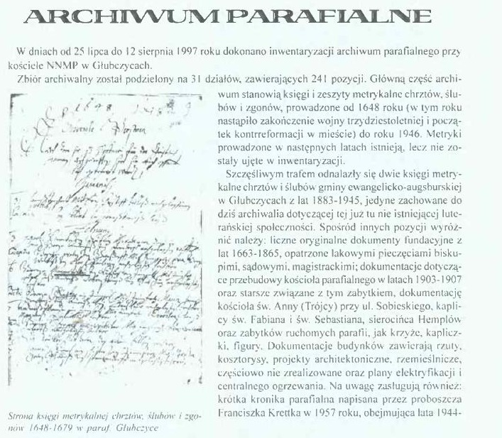
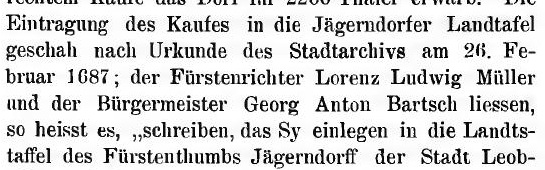
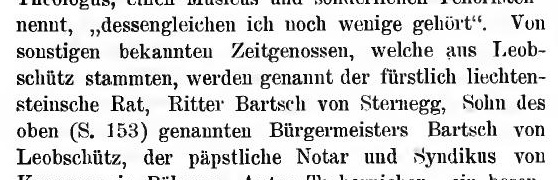

# Hlubčice/Leobschütz · přístup ke křtům kolem 1651

**Hlubčická katolická kniha křtů, oddaných a zemřelých 1648–1679 je doložená farní inventarizací z roku 1997 a reprodukcí jedné stránky.** Německý soupis uvádí existenci kopie FamilySearch, ale nepodařilo se ověřit konkrétní film ani otevřít příslušné listy. Řada ZA Opava začíná 1689. Pro roky kolem 1651 tedy výsledek zůstává **nepřečteno**, bez záporného závěru o páru Johann Christof Giller × Susanne nebo o výskytu Bartschů.

| Prověřená cesta | Výsledek a přesný rozsah |
|---|---|
| **Farní originál** | *Kalendarz Głubczycki* 1998, s. 124 (PDF sn. 125), uvádí inventarizaci archivu kostela Nanebevzetí Panny Marie 25. 7.–12. 8. 1997. Fotografie ukazuje jednu stránku s čitelným vročením 1648. Rozsah **N/O/Z 1648–1679** pochází z popisku pod fotografií a z popisu inventarizace. Jednu malou reprodukci nelze použít jako seznam jmen ani k ověření spojitosti ročníků. [Obraz a popisek](https://sbc.org.pl/Content/12564/PDF/1998a.pdf#page=125) |
| **Starší stav evidence** | Tištěný soupis *Die Kirchenbücher Schlesiens beider Confessionen* (1902), s. 36, PDF sn. 52, uvádí pod **Leobschütz, Kreisstadt** pro křty, sňatky i pohřby shodně **1609–1634**, mezeru **1635–1646** a opět **1647–1731**. Farní inventarizace z roku 1997 doložila počátek od 1648. Starší údaj svědčí o rozsahu tehdejší evidence, současnou dostupnost ranějších let a přesnou dochovanost 1647 neověřuje. Ani podle něj není k dispozici rok 1646. [Soupis 1902, obraz s. 36](https://protzan.de/wp-content/uploads/2021/10/1902_Kirchenbuecher_Schlesiens_beider_Confessionen.pdf#page=52) |
| **Zemský archiv v Opavě** | Čtyři knihy řady **POL VI**. První **POL VI 1, karton 8135, N/O/Z 1689–1766**, další knihy až do 1843. Ověřeno v archivním přehledu a v Matricula. První kniha je relevantní pro děti Jiřího Antonína v 90. letech, ale ročník 1651 nepokrývá. [Matricula](https://probelauf.data.matricula-online.eu/de/CZ/cz-zao/glubczyce-rimskokatolicky/) · [Oficiální seznam digitalizátů ZA](https://www.archives.cz/web/DA_resources/DA_info/matriky_info/done.pdf) |
| **FamilySearch** | Německý *Findbuch Schlesische Kirchenbücher* pod **Leobschütz (Glubczyce), Kreis Leobschütz** výslovně uvádí katolickou řadu **1648–1948** ve FamilySearch. Rozlišuje mladší evangelické knihy a katolické duplikáty 19. století. Zkoušel jsem veřejné vyhledání katalogu podle současného i původního názvu a dat, soubor sbírky 4110912 a odkazy na obě DGS ze starší práce **008201914 a 008022196**. Odkazy nevrátily veřejné zobrazení a prohlížeč měl chybu spojení. Podle dřívějšího deníku č. 698 byly obě označené jako zamčené a bez jmenného rejstříku. Přesný typ, interval a příslušnost každého DGS k první knize zůstávají neověřené. Nelze je zaměnit s doloženým civilním registrem Hlubčic **FHL 2035194–2035199**, 1874–1884. [Soupis, heslo Leobschütz](https://www.christoph-www.de/kbsilesia3) · [DGS 008201914](https://www.familysearch.org/search/film/008201914) · [DGS 008022196](https://www.familysearch.org/search/film/008022196) · [Civilní filmy](https://www.werelate.org/wiki/Source:Leobsch%C3%BCtz,_Schlesien,_Preu%C3%9Fen,_Germany._Zivilstandsregister,_1874-1884) |
| **Staatsarchiv Leipzig** | V přesné větvi **21962, 04.25 Schlesien, Kreis Leobschütz** jsem ověřil přímo publikovaný katalogový seznam. Je v ní jediná položka **D 1130, Gläsen (katolické), 1727–1766**, tj. Klisino, nikoli město Hlubčice. V této větvi tedy samostatná hlubčická kopie není. [Katalog, konkrétní větev](https://www.archiv.sachsen.de/archiv/bestand.jsp?bestandid=21962&oid=13.01&syg_id=250754) · [Přímo seznam jednotek větve](https://www.archiv.sachsen.de/digitalisate/bestandsdaten/bestaende/21962/250754.html) |
| **Jmenný rejstřík / Ortsfamilienbuch** | Uwe Beffert popisuje své OFB Leobschütz jako výběr osob z města i z jiných míst okresu. Při vydání v roce 2012 bylo podle autora souvisle zpracováno pouze katolické oddací **1900–1931**. Veřejná adresa OFB byla při ověření nedostupná. Úplný rejstřík křtů 1648–1679 jsem nedohledal. [Autorův popis](https://discourse.genealogy.net/t/aktualisierung-der-ofb-groebnig-babitz-leisnitz-und-dittermau-und-neues-ofb-der-stadt-leobschuetz-in-oberschlesien/191360) · [Adresa OFB](https://ofb.genealogy.net/leobschuetz) |

## Jméno Bartsch před povýšením a znění Gothy

Ferdinand Troska, *Geschichte der Stadt Leobschütz* (1892), **s. 153, sn. 163**, cituje archivní listinu o vkladu Kaltenhausu do krnovských desek z **26. 2. 1687**. V jeho uvedení čtu „der Bürgermeister Georg Anton Bartsch“, bez predikátu. Citovaný vlastní text říká, že statek byl majetkem města. Na **s. 162, sn. 172** Troska s odkazem na dobového kronikáře Meylandského uvádí rytíře a lichtenštejnského radu Bartsche ze Sterneggu výslovně jako **syna starosty** ze s. 153. Pasáž neudává synovo křestní jméno. Otec ani sestry starosty v příslušných pasážích jmenováni nejsou. [Troska s. 153](https://sbc.org.pl/Content/14528/PDF/14528.pdf#page=163) · [Troska s. 162](https://sbc.org.pl/Content/14528/PDF/14528.pdf#page=172)

Znovu jsem porovnal obrazy. **Doerr s. 174** čte **25. Februar 1695**, svazek **101, fol. 184**. **Blážek s. 105** nezávisle popisuje stejné povýšení a dodává predikát. **Gotha 1884, s. 276** uvádí o Johannovi Christofovi, že měl za manželku „Susanne geb. Bartsch von Sternegg“, a jmenuje dva syny, ale jejich narození 1646 a 1651 zde nedatuje. Jestliže hledáme původní zápis kolem roku 1651, rozhodující jsou jména rodičů, povolání či bydliště. Později doložený predikát ze zápisu nevyžaduji. Základní hledaný rozsah je **1648–1655** kvůli nejistému roku narození Friedricha Wilhelma. Pokud se podaří identifikovat dostupnou první knihu, lze přečíst i další Bartschovy výskyty až do 1679 a sestavit domácnosti se svědky a kmotry. [Doerr s. 174](https://archive.org/details/deradelderbhmi00doeruoft/page/174/mode/2up) · [Blážek s. 105](https://sbc.org.pl/Content/3934/PDF/3934.pdf#page=111) · [Gotha s. 276](https://sbc.org.pl/Content/859298/i635235-1884-00-0001.pdf#page=302)
