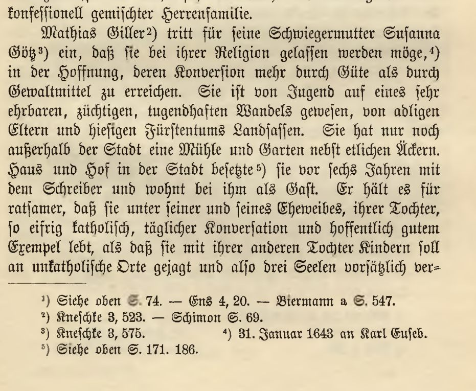
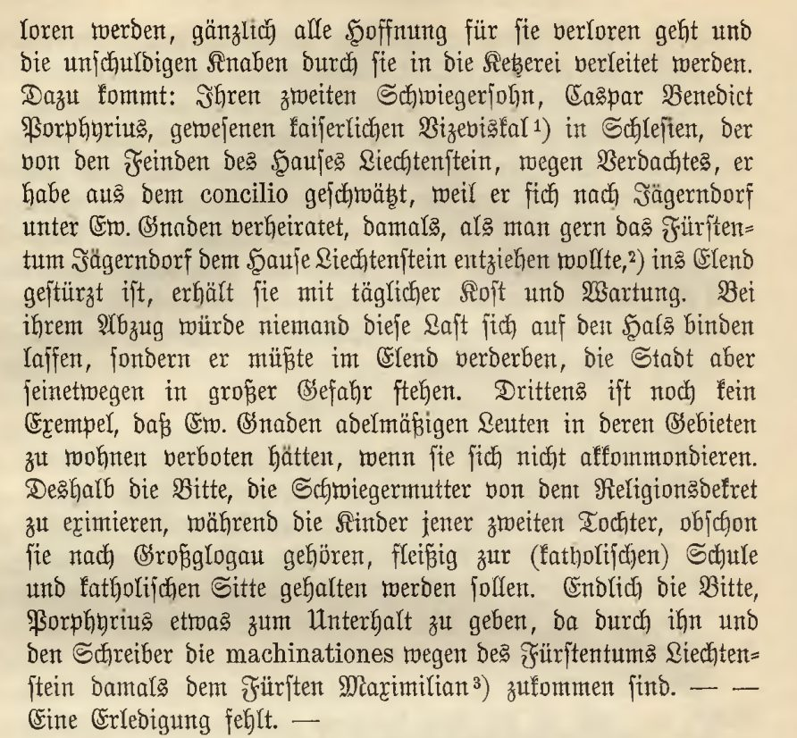

# Krnov, 31. ledna 1643. Matyáš Giller, jeho tchyně a druhý zeť

**Matyáš Giller se v žádosti Karlu Eusebiovi z Lichtenštejna zastal své tchyně Zuzany Götzové.** Georg Loesche při práci v knížecím rodovém archivu převyprávěl list na s. 191–192 prvního dílu. Pod čarou uvádí 31. leden 1643 a adresáta. List je důležitý pro opavskou rodinu Gillerů z Lilienfeldu. Otec ani příslušnost Heinricha Christofa k této rodině z něj nevyplývají. [Loesche I, tištěná s. 191, obraz 205](https://sbc.org.pl/Content/210873/PDF/ii135792_01.pdf#page=205) · [Tištěná s. 192, obraz 206](https://sbc.org.pl/Content/210873/PDF/ii135792_01.pdf#page=206)

## Rodinné vztahy v textu

| Osoba nebo věc | Co výslovně uvádí Loesche podle Matyášova listu |
| --- | --- |
| **Matyáš Giller a Zuzana Götzová** | „Mathias Giller … tritt für seine Schwiegermutter Susanna Götz … ein“. Matyáš prosí za svou žijící tchyni, aby mohla zůstat u svého náboženství. Svou manželku označuje jako její dceru. Jméno manželky v této pasáži chybí. O původu její matky uvádí, že byla z urozených rodičů, zdejších zemských usedlíků. Jména těchto rodičů nedodává. |
| **Dům, dvůr a mlýn** | Tchyně měla ještě mlýn, zahradu a pole za městem. Městský dům a dvůr podle žadatele už šest let obýval či spravoval on a tchyně u něj byla hostem. Přibližně rok 1637 je zpětný výpočet z Matyášova údaje. Právní formu převodu, datum vkladu ani doživotní výměnek list v tomto podání neurčuje. |
| **Kašpar Benedikt Porphyrius** | „Ihren zweiten Schwiegersohn, Caspar Benedict Porphyrius“. Zuzanin druhý zeť byl uváděn jako bývalý císařský vicefiskál ve Slezsku. Žádost říká, že přišel o úřad, byl odkázán na její podporu a žádalo se o příspěvek na jeho výživu. |
| **Druhá dcera a děti** | Děti druhé dcery podle textu příslušely do Velkého Hlohova („nach Großglogau gehören“). Žadatel slibuje nebo navrhuje jejich vedení ke katolické škole a katolickým mravům. Místo školy ani skutečná docházka z formulace nevyplývají. Nejsou uvedena jména dětí, místa narození ani jméno jejich matky. |

## Proč je potřeba opravit výklad roku 1642

Podle Zukalova podání měl Matyáš v roce 1642 získat krnovský dům z pozůstalosti své tchyně. Žádost datovaná lednem následujícího roku vystupuje ve prospěch dosud živé tchyně. Její současné bydlení i podporu druhého zetě rozebírá několika větami. Proto zůstává otevřený způsob převodu domu a také otázka, zda oba výklady míří na totožný majetkový úkon. Matyášova žádost podporuje rozlišení ženy a její matky, sama však neuvádí rodné jméno tchyně ani počet Matyášových manželství. [Dřívější srovnání Zukala a Tesaře](../2026-11-25-kolo2/opava1644/README.md) · [Zukal, s. 109](https://obc.opole.pl/Content/7764/PDF/D8272-34.pdf#page=19)

**Ověření.** Tištěný osobní rejstřík ve druhém dílu pod Giller odkazuje na s. 191. Stránky I, 191–192 jsme četli z obrazů. Dřívější hledání stejného jména ve strojovém přepisu bylo bez výsledku. Loesche v předmluvě uvádí, že většinu písemností vyložil vlastními slovy. Máme proto popis konkrétní dobové žádosti v knížecím archivu, nikoli diplomatický přepis vlastnoručního originálu. Novodobá signatura jednotlivého listu a místo nynějšího uložení v rámci knížecích fondů ještě vyžadují přiřazení. Loesche na konci uvádí, že vyřízení žádosti chybí. K hledání slouží datum, adresát, pisatel, obě příjmení zeťů a předmět. [Rejstřík II, s. 95](https://sbc.org.pl/Content/211567/PDF/ii135792-0000-00-0001.pdf#page=109) · [Způsob vydání, I, předmluva s. VI](https://sbc.org.pl/Content/210873/PDF/ii135792_01.pdf#page=10)
