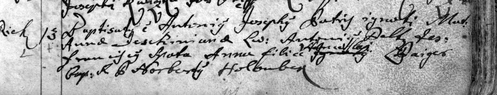
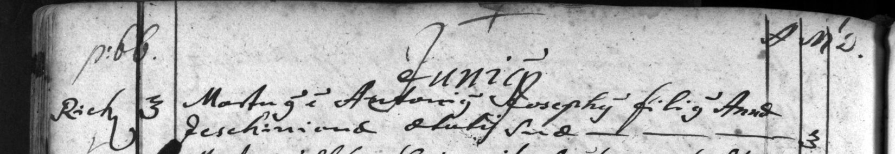
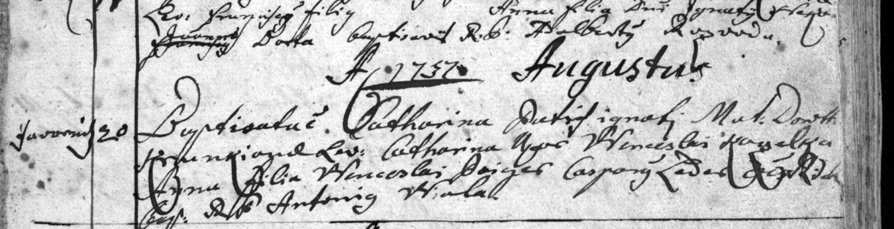
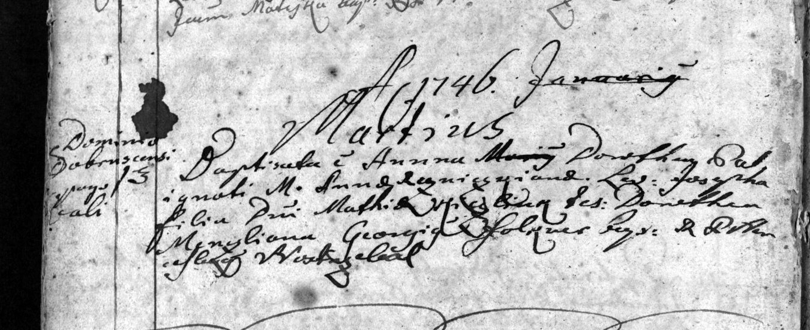
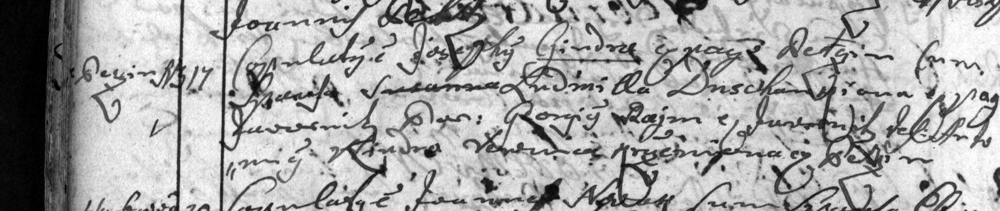

# Rychnov nad Kněžnou. Křty v obou intervalech Josefova narození

**Antonín Josef, pokřtěný 13. března 1746 v Rychnově, zemřel 3. června téhož roku ve věku udaném jako tři měsíce. Tohoto chlapce lze jako pozdějšího býchorského fořta Josefa Gillera vyloučit.** Obě události mají stejné místo, dvě křestní jména dítěte ve stejném pořadí a shodné jméno i příjmí matky Anny. Mezi křtem a úmrtím uplynulo 82 dní. [Úmrtí, sign. 142-7, sn. 494 vlevo nahoře, s. 66 oddílu zemřelých](https://aron.vychodoceskearchivy.cz/api/aron/referencedfiles/3636c0b1-5cc9-4801-9e44-bce3897e97b5) · [SOA v Hradci Králové, Rychnov, sign. 142-7, ukn 8403, snímek 104 vpravo dole, s. 207](https://aron.vychodoceskearchivy.cz/apu/76698ead-6a55-4962-a4d0-f49cfda4a7a3/dao/76698ead-6a55-4962-a4d0-f49cfda4a7a3/file/f3c4fc4c-a28a-46ac-8da6-c62ccff4b1bc) · [Přímý obraz](https://aron.vychodoceskearchivy.cz/api/aron/referencedfiles/f3c4fc4c-a28a-46ac-8da6-c62ccff4b1bc)

**Pracovní přepis celého řádku.** Lomítka označují přechod na další řádek. Hranaté závorky rozepisují zkratku nebo popisují zásah písaře. (…) a (?) vyznačují nečitelné a nejistě přečtené části.

> [okraj] Rich[…] | 13 / Baptizatus ē[st] Antonius Josephus Patris ignoti Mat: / Annæ Jeschinianæ (?) Lev: Antonius Pall[…] Tes: / Franciscus (?) […] Anna filia [opravené slovo] […] / Bap: R[everen]dus […] Holoubek (?).

**Překlad.** V Rychnově dne 13. byl pokřtěn Antonín Josef. Jeho otec byl neznámý. Matkou byla Anna. Příjmí v genitivu lze při porovnání s červnovým zápisem číst jako Jeschinianæ (?). Přesnou českou podobu příjmení tyto dva latinské zápisy neurčují. Dítě při křtu držel Antonín, jeho příjmení začíná nejspíš na Pall-. Mezi svědky lze předběžně číst Františka a Annu uvedenou jako něčí dceru. Křtil kněz pravděpodobně příjmením Holoubek. Samostatný den narození tu uvedený není.

## Úmrtí Antonína Josefa dne 3. června 1746

**Přepis celého zápisu.**

> [okraj] Rich[…] | 3 / Mortuus ē[st] Antonius Josephus filius Annæ / Jeschinianæ (?) ætatis suæ — [sloupec M] 3.

**Překlad.** Dne 3. června v Rychnově zemřel Antonín Josef, syn Anny Jeschiniany (čtení příjmí přibližné), ve věku tří měsíců. Tři měsíce jsou zapsány číslicí ve sloupci M, mezi sloupci pro léta a dny. Zápis sám označuje úmrtí, zvláštní den pohřbu neuvádí. [Snímek 494, první řádek pod červnem v originálu matriky](https://aron.vychodoceskearchivy.cz/apu/76698ead-6a55-4962-a4d0-f49cfda4a7a3/dao/76698ead-6a55-4962-a4d0-f49cfda4a7a3/file/3636c0b1-5cc9-4801-9e44-bce3897e97b5)

Rok 1746 v oddílu zemřelých začíná na snímku 492. Na snímku 493 navazují březen, duben a květen. Zápis z **16. března** patří jinému Josefovi z Javornice. Otcem byl Josef a do kolonky dní písař zapsal 10. Hledanou dvojici křestních jmen, rychnovské bydliště a matčino příjmí spojuje až první červnový zápis na následující dvoustraně. Jsou tak k dispozici dva samostatné doklady o stejném dítěti. [Sn. 492 s rokem 1746](https://aron.vychodoceskearchivy.cz/api/aron/referencedfiles/fc5b815d-189e-49dc-a31b-4d3fde19b4d5) · [Sn. 493, s. 64–65](https://aron.vychodoceskearchivy.cz/api/aron/referencedfiles/57f361e5-d382-4e1e-b36e-56f916dbc9c2) · [Dobový rejstřík zemřelých, 142-38, 1734–1770](https://aron.vychodoceskearchivy.cz/apu/1ee2fd14-998d-4ab1-a50f-0724daa71686)

## Zvláštní oddíl nemanželských dětí

Archiv uvádí na fol. 332–334 nemanželské děti z let 1734–1746. Oddíl má vlastní sled roků. Na konci je ještě mladší zápis děkana o uspořádání svazku. V níže vymezených částech zvláštní řady se chlapce jménem Josef nepodařilo nalézt. [Archivní popis knihy](https://aron.vychodoceskearchivy.cz/apu/76698ead-6a55-4962-a4d0-f49cfda4a7a3)

| Rozsah | Co je na snímku a co z toho vyplývá |
| --- | --- |
| [Sn. 336 vpravo, s. 677](https://aron.vychodoceskearchivy.cz/api/aron/referencedfiles/c541603d-74d5-4690-b0b2-81e61e3e284e) | Pod rokem čteným jako **1737** je **20. srpna Kateřina**. Rok lze srovnat s předcházejícím 1736 a následujícím 1739. Otec je označen „Patris ignoti“. Matka se jmenuje Dorota, místo na okraji zřejmě Javornice. Samostatný ročník 1738 na tomto přechodu chybí. |
| [Sn. 337, s. 678–679](https://aron.vychodoceskearchivy.cz/api/aron/referencedfiles/5caed117-d5f7-4936-b4e6-1cac22a156f1) | Navazuje chronologie následujících let, po níž následuje závěr oddílu na sn. 338. |
| [Sn. 338 vlevo, s. 680](https://aron.vychodoceskearchivy.cz/api/aron/referencedfiles/9d3b8606-8b41-420e-9f6c-37695112ba39) | Poslední zápis má datum **15. března 1746**. Původně psaný leden byl nahrazen březnem. Dítě se jmenuje Anna, další jméno je škrtnuté. Oddíl tedy končí už v březnu. |

U zvláštního zápisu z roku 1737 jsou čitelná slova „Augustus … 20 … Catharina Patris ignoti Mat: Doroth[…]“. V překladu jde o křest Kateřiny, dcery neznámého otce a Doroty, dne 20. srpna. Roku 1746 čteme „A° 1746. [škrtnuto: Januarius] Martius … 15 … Baptizata ē Anna […]“. Dne 15. března tedy byla pokřtěna Anna. Pod zápisy se jménem **Josephus Killar** a označením děkana podepsal pozdější správce knihy. V úřadu byl od konce roku 1799. Samotná podobnost příjmení s variantou Killer nemá rodopisnou průkaznost. [Podpis na s. 680](https://aron.vychodoceskearchivy.cz/api/aron/referencedfiles/9d3b8606-8b41-420e-9f6c-37695112ba39) · [Štěpán Beran, duchovní v Rychnově, oddíl o Josefu Killarovi](https://theses.cz/id/dwqqy5/Beran-S_DP_DuchovniSouvislostiVPusobeniKneziVRychnoveNKn.pdf)

## Kontrola běžné řady

| Část hledaného období | Rozsah a čtení |
| --- | --- |
| **13. 6. 1737 – 12. 6. 1738** podle Josefova věku při sňatku | V běžné řadě jsme prohlédli sn. 29–35. [Sn. 28 vpravo, nadpis Junius](https://aron.vychodoceskearchivy.cz/api/aron/referencedfiles/21b2a71e-79bf-4c30-a7e3-fafa9308b9aa), navazuje [sn. 29 vlevo, 13. června](https://aron.vychodoceskearchivy.cz/api/aron/referencedfiles/aebe607f-67ae-4303-a75d-d27403a54a7d), Alžběta, dcera Václava a Magdaleny. [Sn. 33, záhlaví roku 1738](https://aron.vychodoceskearchivy.cz/api/aron/referencedfiles/eb7ea6b6-6c15-43c1-88c8-3c533c30ec98). **28. března 1738, Rychnov, Josef Vilém** (*Josephus Gulielmus*), syn Václava a Terezie. [Sn. 34, s. 66 vlevo, druhý zápis zdola](https://aron.vychodoceskearchivy.cz/api/aron/referencedfiles/0f69b1c0-227d-450a-ab51-a6fd281133e7). [Červnové zápisy 1738 na sn. 35 vpravo](https://aron.vychodoceskearchivy.cz/api/aron/referencedfiles/1c20fd6e-45e3-449a-9fda-7f9bfa147f0b) sahají až do druhé poloviny měsíce. Zvláštní řada má pro toto období pouze srpnovou Kateřinu. |
| **3. 2. 1746 – 2. 2. 1747** podle věku při pohřbu | Počátek 1746 je na sn. 102. [Začátek února, sn. 103](https://aron.vychodoceskearchivy.cz/api/aron/referencedfiles/412a4d60-ed13-4dcc-b7a4-a20ebcdcb391), a [únor a březen, sn. 104](https://aron.vychodoceskearchivy.cz/api/aron/referencedfiles/f3c4fc4c-a28a-46ac-8da6-c62ccff4b1bc). Dne 24. února je zapsán Josef Jan, syn Josefa a Alžběty. U Antonína Josefa dne 13. března otec chybí. Dítě zemřelo 3. června. |
| Jaro až konec 1746 | Sn. 105–110 byly prohlédnuty orientačně. Dne **3. října** je v běžné řadě zapsán další Antonín, otec neznámý, matka Magdalena, v řádku „e pago Hlas[k]a“. Tento kontrolní zápis dokládá užívání běžné řady pro tyto děti i po skončení zvláštního oddílu. [Sn. 110 vlevo pod nadpisem October, s. 218](https://aron.vychodoceskearchivy.cz/api/aron/referencedfiles/1ce39fe3-17e5-4874-84e8-57b8264505de) |
| Leden a začátek února 1747 | [Sn. 111, závěr roku a začátek ledna](https://aron.vychodoceskearchivy.cz/api/aron/referencedfiles/ce4c88aa-6e6e-49c0-a1b1-8a9ece55ee7b) a [sn. 112, leden a začátek února](https://aron.vychodoceskearchivy.cz/api/aron/referencedfiles/814b2a65-e611-41c7-b089-57f3ce930fed). **19. ledna** v Lipovce Josef, rodiče Václav a Alžběta. **4. února** v Rychnově Josef Ignác, rodiče Jan a Rozálie, již dva dny za horní hranicí. |

Dne 13. března 1746 se běžná a zvláštní chronologie ještě časově překrývaly. Zvláštní řada přesto Antonína Josefa neobsahuje. Proto nelze z jejího mlčení určit Josefovo rodiště. Orientační čtení starších sn. 29–35 a mladších sn. 102–112 neposkytlo zápis se současně čitelným jménem Josef a rodinným příjmením v hledané podobě. Zejména v řadě na sn. 105–110 znesnadňuje čtení příjmení drobné písmo a průsak inkoustu. Pro definitivní vyloučení stejnojmenného dítěte v hlavní řadě zůstává třeba dočíst obtížné řádky a rozlišit u každého Josefa otce, matku a místo. [Starší zjištění o vynechaném záznamu v rychnovském rejstříku](../2026-11-26-jedenacte-kolo/rychnov.md)

## Oddavky roku 1747. Kdo je v rejstříku pod G na straně 48

V předchozím kole jsme v oddacím rejstříku pod G přečetli odkaz na Josefa s příjmením připomínajícím *Grundreich (?)*. Na s. 48 oddací části knihy 142-7 jsme nyní našli odpovídající zápis. **Ženich se jmenuje Josef, nevěsta Ludmila a zápis uvádí u nevěsty Javornici.** Tím lze tento konkrétní odkaz vyřadit z hledání svatby Maximiliána a Johanny. Totožnost muže s jiným známým Josefem z podobnosti příjmení neplyne. [Oddavky, sn. 415 vlevo, s. 48, den 17](https://aron.vychodoceskearchivy.cz/api/aron/referencedfiles/d1af11cd-da53-42e7-af08-9d06783b7139) · [Starší čtení rejstříku 142-30](../2026-11-26-jedenacte-kolo/rychnov.md)

**Pracovní přepis.** Uvádíme čitelné části celého zápisu. Některé koncovky a povolání či bydliště svědků se nepodařilo bezpečně určit.

> [okraj] […] | 17 / Copulatus ē[st] Josephus Grund[…] (?) ex pago […] cum / Sponsa [Susanna (?) přeškrtnuto?] Ludmilla Dusch[…]iana (?) ex pago / Jawornitz. Tes: Georgius […] e Jawornitz, […] / […] Andreas […] ex pago […] […].

**Překlad.** Dne 17. byl oddán Josef, příjmení začíná zřejmě Grund-, z obce dosud neurčené. Nevěsta Ludmila byla z Javornice. Jméno před slovem Ludmila se podobá Zuzaně a je patrně přeškrtnuto. Jako svědci se uvádějí Jiří z Javornice a Ondřej, jejichž příjmení ani další místo jsme bezpečně nepřečetli. Na této části dvoustrany stojí poblíž zápisy pod květnovým a srpnovým nadpisem. Přesné přiřazení měsíce u řádku s číslem 17 zůstává otevřené.
