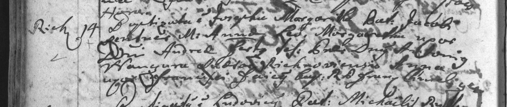

# Rychnov nad Kněžnou. Křest Josefy Markéty 14. dubna 1747

**Josefa Markéta, dcera Jakuba a Anny, byla pokřtěna v Rychnově 14. dubna 1747.** Zápis je v hlavní křestní řadě. V levém sloupci je zkratka města a den 14. Na předchozím snímku začíná duben pod nadpisem *Aprilis*. Na pravé straně snímku 115 začíná po dalších dubnových křtech *Majus*. Zápis uvádí den křtu. Den narození samostatně uvedený není. [SOA v Hradci Králové, Sbírka matrik Východočeského kraje, Rychnov nad Kněžnou, sign. 142-7, ukn 8403, stará sign. IV.D., snímek 115 vlevo, s. 228](https://aron.vychodoceskearchivy.cz/apu/76698ead-6a55-4962-a4d0-f49cfda4a7a3/dao/76698ead-6a55-4962-a4d0-f49cfda4a7a3/file/a42229c6-35f0-473d-b9b5-b2f60c9761e1) · [Celý obraz JPG](https://aron.vychodoceskearchivy.cz/api/aron/referencedfiles/a42229c6-35f0-473d-b9b5-b2f60c9761e1) · [Předchozí snímek s počátkem dubna](https://aron.vychodoceskearchivy.cz/api/aron/referencedfiles/4be881cb-1fe5-4378-b658-4db11115f1f9)

**Pracovní přepis.** Průsak z protější strany překrývá zejména příjmení a zkratky. Znaky v hranatých závorkách jsou doplnění, otazník označuje nejisté čtení a tři tečky nejasnou část. Lomítka odpovídají řádkům.

> [Okraj] Rich[…], 14. / Baptizata [est] Josepha Margaretha Pat: Jacobi / [G?]entner M: Anna Lev: Margaretha uxor / Dni Andreæ […]tz (?) Tes: […] Dnus Antonius / Wanczura (?) Sub[…] Richnovensis Anna / uxor Francisci […] civis (?) Bap: R[…] Fran[…] / Chmeli[…] (?).

**Český překlad.** Dne 14. byla pokřtěna Josefa Markéta. Otcem byl Jakub [G?]entner a matkou Anna. Dítě při křtu držela Markéta, manželka pana Ondřeje, jehož příjmení končí přibližně na „tz“. Následují pan Antonín, příjmením pravděpodobně Vančura, s označením vztahujícím se k Rychnovu, a Anna, manželka Františka. Čtení jejich úplných příjmení, funkce a jména křtitele zůstává otevřené. Kmotřina muže samotný zápis mezi přítomnými neuvádí.

Přesné propojení s Jakubem Kristiánem Gönttnerem stojí na shodě **obou křestních jmen dcery, rodičů, místa, roku a příjmení** s údaji Petra Gundermanna. Rodopis na s. 10 zmiňuje rychnovské matriky a připisuje otci službu u Kolovratů. Křestní zápis potvrzuje pobyt rodiny a totožnost dítěte. U Jakuba se v něm nepodařilo rozeznat název úřadu. U jeho ženy je pouze křestní jméno Anna. Mezi kmotrou a svědky se neobjevují jména Maximilián, Johanna ani příjmení Gillern v rozpoznatelné podobě. Vztah k Maximiliánovi dokládá až jiná matriční událost, křest další Jakubovy dcery v Kladrubech 27. října 1757. [Gundermann, tištěná s. 10](https://www.genealogie.cz/assets/2025/03/lghsp01rada-02.pdf#page=10) · [Kladruby, říjnový zápis a úplný obraz](../2026-11-26-desate-kolo/tynec/README.md)

## Křestní rejstřík a rozsah čtení

[Dobový rychnovský rejstřík, sign. 142-30, ukn 8451](https://aron.vychodoceskearchivy.cz/apu/5a0b6c70-1e0d-4647-8b63-38725ec2642d) má podle archivní karty 126 folií a mikrofilm č. **3076**. Mikrofilm samotné matriky 142-7 je č. **3065**. Jde o čísla uvedená českým archivem. Hlavní řada narozených obou knih pokrývá celé hledané období.

Na [snímku 24](https://aron.vychodoceskearchivy.cz/api/aron/referencedfiles/5677c8fc-b24f-4e48-b414-7f6ecc4115b3) začíná *Lit. G*. Pro 1737 je uveden Václav, roku 1738 Alžběta a Apolonie, roku 1746 Norbert. Za záhlavím 1747 následuje Dorota, pak Anna a Jan a přeškrtnutý řádek před záhlavím 1749. V této části není Josefa Markéta ani odkaz na s. 228. V kolonce 1756 jsou jména Josef a Matyáš. Jedno písmeno rejstříku by tedy nedostačovalo ani k ověření bezpečně doloženého dubnového křtu. Pod stejnou podmínkou nepovažujeme dosavadní výsledek pro Josefa Gillera ani pro Antonína Františka Gönttnera za úplný. [Katalog a rozsahy](https://www.rodovod.cz/matriky/soa-zamrsk/rychnov-nad-kneznou/9857)

V matrice jsme při dohledávání otevřeli sn. **111–116**, s. **220–231**. Záhlaví roku 1747 je na sn. 111 vpravo dole, na sn. 112 vpravo začíná únor. Na s. 226 je ještě další březnový křest dívky se jménem Markéta. Dubnový nález je rozlišitelný právě oběma jmény dítěte a obou rodičů. Dokončená práce pokrývá hledání Josefy Markéty v této části. Úplný jmenný průchod pro Josefa Gillera ve všech obcích, obou věkových oknech a zvláštních oddílech zůstává otevřený. Archiv přímo upozorňuje na **fol. 332–334, nemanželské děti 1734–1746**. U nich má smysl číst i děti zapsané pouze podle matky. [Přechod 1746/1747](https://aron.vychodoceskearchivy.cz/api/aron/referencedfiles/ce4c88aa-6e6e-49c0-a1b1-8a9ece55ee7b) · [Začátek února](https://aron.vychodoceskearchivy.cz/api/aron/referencedfiles/814b2a65-e611-41c7-b089-57f3ce930fed) · [Archivní karta knihy](https://aron.vychodoceskearchivy.cz/apu/76698ead-6a55-4962-a4d0-f49cfda4a7a3)

Další konkrétní srovnání nabízí rychnovský křest **Antonína Františka v roce 1756** podle Gundermanna. Úplná jména kmotrů ze dvou zápisů mohou pomoci i tam, kde písař poprvé použil zkratku. K rodinným výpiskům navíc existuje dosud nečtený rukopis Viktora Genttnera *České císařské kladrubské hřebčiny*, knihovna České genealogické a heraldické společnosti v Praze, **AutP, č. 2414**. [Katalog knihovny](https://archiv.genealogie.cz/uploads/media/Katalog_knihovny_k_15.8.2024.pdf)

## Oddavky Maximiliána a Johanny

V oddacím rejstříku **142-30** jsme přečetli období 1737–1749 pod G a K. Pod G se pro rok 1747 objevuje Josef s příjmením čteným předběžně *Grundreich (?)* a odkazem na s. 48. Další uvedený rok je 1750. V oddílu K jsme zkontrolovali i přechod na snímek 109, kde po posledních zápisech roku 1748 následují tři ženichové pro rok 1749. U žádné z těchto položek jsme nerozeznali ženicha Maximiliána Gillera, Güllera nebo Killera. Rejstřík již u prokázaného křtu Josefy Markéty vynechává očekávaný odkaz pod G. Přímé čtení oddací knihy a kontrola dalších pravopisných variant proto zůstávají otevřené. [Oddavky G, sn. 103](https://aron.vychodoceskearchivy.cz/api/aron/referencedfiles/db47e1ea-4459-4f89-8961-efc5121827f3) · [Oddavky K, sn. 108](https://aron.vychodoceskearchivy.cz/api/aron/referencedfiles/955133eb-ce86-4462-9829-889bc7b4825f) · [Pokračování, sn. 109](https://aron.vychodoceskearchivy.cz/api/aron/referencedfiles/9dfa6fab-db78-4ce0-89f4-a020dab2c959)
