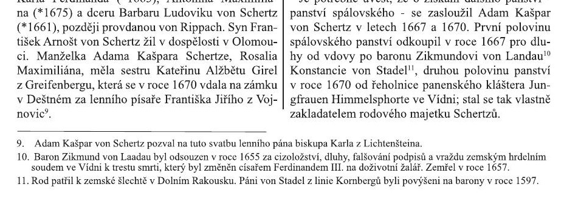
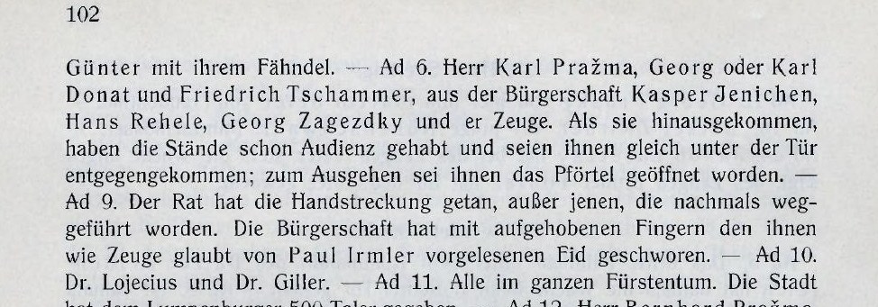
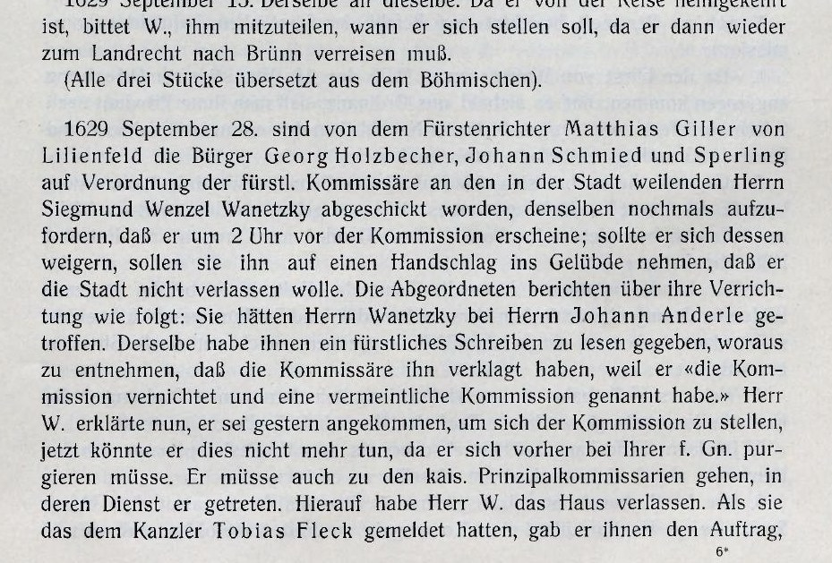
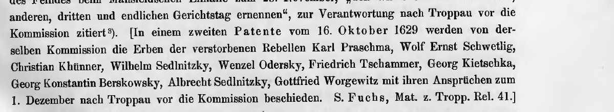

# Osmé kolo · Heinrich Christof a Johann Christof Giller

**Výsledek.** Rok narození ani věk žádného z obou Gillerů se nepodařilo doložit. Nejstarší generaci nelze prodloužit. Novými výsledky jsou přesná identifikace lenních spisů pro dvě různé lokality a ověřitelná stopa ke konfiskačním a dědickým písemnostem jedné opavské větve Tschammerů. Jméno podobné Gillerovi se objevuje v novém článku o zámku v Deštném, kde vyžaduje ověření z dobového spisu.

## 1. „Deschna“ v regionálních pramenech

Vincenc Brandl, *Codex diplomaticus et epistolaris Moraviae*, rejstřík sv. VII, Brno 1868, s. 14, rozlišuje ves jihozápadně od Opavy (*Deschna*, později *Dorf-Teschen*, odkaz 843), ves jižně od Březové nad Svitavou (*Desczna*, německy *Deschna*, odkazy 839–840) a ves jižně od Jemnice (*Desczna*, německy *Döschen*, odkaz 838). Odkazy vedou na středověké položky, jejichž místní určení provedl editor. Již samotné shodné německé označení dvou vsí v tomto rejstříku brání výběru jen podle podoby jména. [Tisk s. 14](https://www.rbmonline.cz/portal/book/72?lpage=14)

| Kandidát | Stav |
|---|---|
| **Deštné u Jakartovic / u Opavy** | Nadále první kandidát kvůli regionu a povaze vsi. Dosavadní prohlídka gruntovní knihy 1579–1665, lánských rejstříků 1657/1676 i nejstarších dosažitelných matrik nepřinesla hledaného (deník 693–696). Gruntovní a lánské knihy zachycují především držitele. Případnou přítomnost ve vrchnostenské domácnosti či pobyt bez vlastního gruntu je třeba ověřovat jinde. |
| **Deštná u Letovic** | Dřívější kontrola křtů 1646–1660 v Letovicích nic nepřinesla (deník 624). Archiv skutečně uvádí pro Deštnou německý název *Deschna*. [Acta Publica](https://www.mza.cz/actapublica/matrika/detail/10603?image=216000010-000253-003368-000000-00504a-000000-00-B00681-00010.jp2) |
| **Dešná u Jemnice** | Jiné místo než Deštná u Jindřichova Hradce. SOA Třeboň, **Dešná 1**, křty 1624–1729, oddaní a zemřelí 1657–1729. Navazující přímé čtení v běžném prohlížeči ověřilo přechod 1629→1651 v originálu i ve filmu FamilySearch DGS 004398293. Rok 1646 v tomto úseku chybí a čitelné křty roku 1651 hledanou rodinu nepotvrdily. [Čtení snímků](desna-krest.md) [Kniha](https://digi.ceskearchivy.cz/DA?id=3110&menu=3) · [Rozsahy po druzích zápisů](https://www.rodovod.cz/matriky/soa-trebon/desna) |
| **Deštná u Jindřichova Hradce / u Soběslavi** | Hrdlička uvádí v dobových urbářích a berní rule roku 1654 *Dešnej* jako **městečko**, 84 hospodářů podle urbáře a 83 položek v daňovém přehledu. Gotha mluví o vsi. Roku 1774 při požáru lehly popelem starší místní matriky a část městského archivu, proto vlastní farní řada začíná v roce 1774. Pro alternativu z revize Fable jsou jmennou cestou urbáře RA Slavatů, **inv. č. 184–186, knihy 27–29** (1613, 1652–1654, 1654, Hrdlička s. 21 pozn. 20, tabulky s. 22 a 24) a berní rula Bechyňského kraje. Digitální soupisy RA Slavatů zde začínají 1671 (inv. č. 189, kn. 32). Obsah jednotlivých urbářů a soupisů jsem nečetl. [Hrdlička](https://theatrum.upce.cz/index.php/theatrum/article/download/2476/2195#page=11) · [Historie města](https://www.destna.cz/volny-cas/historie-destne/) · [SOA – matriky](https://digi.ceskearchivy.cz/DA?doctree=1nrdc&id=3123) · [SOA – soupisy](https://digi.ceskearchivy.cz/50039) |

### Lenní spisy místo druhé kontroly stejných gruntů

- **ZA Opava, pobočka Olomouc, Lenní dvůr Kroměříž, NAD 1416, díl V. – Spisy lén olomouckých biskupů a arcibiskupů, svazek 10, Lenní statek Deštné u Opavy 1588–1871.** Inventář Štěpána Kohouta, Olomouc 2010, **ev. č. pomůcky 1667**. Archiv vykázal dokončené zpracování a inventarizaci 1,1 bm. Cílovým úsekem jsou věci Hüttendorfů/Hittendorfů (přibližně 1622–1664) a přechod ke Schertzům/Scherzům 1664–1665. Podstatný by byl zápis o nájmu, sporu, dědickém nároku či svědectví s plným jménem nebo s jednoznačnou funkcí a dalšími identifikátory. Čísla konkrétních jednotlivin jsem bez textu inventáře nezjistil. [ZA, výroční zpráva 2010, tab. 3, Olomouc, dokončené soubory](https://www.archives.cz/web/rw_common/plugins/stacks/armadillo/media/Zprava_o_cinnosti_2010.pdf) · [Kohoutův inventář citovaný Jiřím Brňovjákem, pozn. 15](https://www.academia.edu/43968408/Hermann_Lorenz_von_Kannegiesser_na_Str%C3%A1%C5%BEovic%C3%ADch_a_Dale%C5%A1ic%C3%ADch_a_jeho_d%C4%9Bdicov%C3%A9_svobodn%C3%AD_p%C3%A1ni_von_Hess) · [Číslo pomůcky, Vlastivědné listy 171/2025, s. 1018, sn. 8](https://www.katovna-odry.cz/files/publications/vl-171---08-2025.pdf#page=8)
- **Tentýž fond, jiná jednotka – Lenní statek Dešná u Jemnice a Županovice 1572–1874.** Dataci i název přebírám z dokončeného souboru v tabulce za rok 2010. Výkaz 2009 měl při rozpracování dílčí hranice 1658–1872. Případné zprávy o obyvatelích z let 1620–1660 je nutné vztáhnout k této konkrétní jednotce. [ZA, výroční zpráva 2010](https://www.archives.cz/web/rw_common/plugins/stacks/armadillo/media/Zprava_o_cinnosti_2010.pdf) · [Výkaz 2009](https://www.archives.cz/web/rw_common/plugins/stacks/armadillo/media/Zprava_o_cinnosti_2009.pdf)
- Obecné pomůcky pro tento fond zahrnují **Lenní knihy 1364–1888** (díl III, v Národním archivu kopie pomůcky C 4522) a **Spisy knížecí arcibiskupské lenní dvorské kanceláře (1274)1529–1883(1929)** (díl IV, kopie pomůcky C 5084). Pro Deštné má přednost už konkrétní svazek dílu V. Obraz předmětných lenních spisů se najít nepodařilo. [Katalog pomůcek NA](https://old.nacr.cz/Z-Files/pomucky/pomucky_cizi.pdf) · [Knihovna ZA](https://knihovna.archives.cz/arl-zao/cs/detail-zao_us_cat-p2124438322-Lenni-dvur-Kromeriz-IV/?disprec=5&iset=1)
- **Slezský stavovský archiv** obsahuje digitalizované opavské a krnovské zemské desky i půhony a nálezy. Veřejný odkaz na archivní pomůcku a odkaz na soubor skenů při tomto přístupu skončily na ověření připojení, obrazy zemských desk tedy nebyly čteny. Má smysl v nich hledat hlavně záležitosti Tschammerů z Oldřišova a Gillery z Lilienfeldu. Deštné samo má samostatnou biskupskou lenní agendu. [Zpráva ZA](https://www.archives.cz/web/aktualne/index.php?post_id=31&title=fond-slezskY-stavovskY-archiv-zp%C5%99istupn%C4%9Bn-digitaln%C4%9B) · [Pomůcka](https://digi.archives.cz/da/permalink?xid=fe487176-2be0-4f9d-b414-8b2bad03af2a)

**Deštné ve vídeňské pozemkové knize.** Dalším kontrolním pramenem pro dataci držitele je vídeňská chrámová gruntovní kniha St. Veit 1518–1689, Archiv města Vídně, Grundbücher 176/1, **fol. 29v (29b), 1652**. V online přepisu regestu Dr. Strobla je „Johann Carl von Huttendorf, erbherr auf dorf Teschen“. Česky „Jan Karel z Huttendorfu, dědičný pán na vsi Teschen“. Regest dále odkazuje na **fol. 70r (70a), 1670** a dcery Johannu Maximilianu a Evu Cristinu. Záznam vznikl kvůli vídeňskému majetku, jenž byl předmětem knihy. Znění mám z přepisu regestu, rukopis jsem neviděl. [Přepis knihovního popisu a ukázkových hesel](https://www.1133.at/document/view/id/276)

**Podobné jméno přímo na zámku.** Pavel Kašpar st., „Adam Kašpar a Karel Ferdinand Schertz v Deštném u Opavy a na Spálově“, *Vlastivědné listy* 171 (srpen 2025), s. 1011–1012, uvádějí Rosalii Maximiliánu **Girel z Greifenbergu** jako manželku Adama Kašpara Schertze a její sestru Kateřinu Alžbětu pod stejným jménem. Podle s. 1012 se Kateřina Alžběta roku 1670 na zámku v Deštném provdala za lenního písaře Františka Jiřího z Vojnovic. Poznámka 9 uvádí, že Schertz na svatbu pozval biskupa Karla z Lichtensteinu. V dostupném výňatku chybí jednotlivá archivní signatura pozvánky nebo svatebního záznamu a další nezávislé potvrzení jména Girel se nepodařilo dohledat. Girel proto vedu jako odlišně zapsané jméno k ověření a žádnou ze sester nepřiřazuji ke Gillerům ani k Heinrichovu druhému sňatku. Přesný test poskytuje originál pozvánky z roku 1670 v biskupské korespondenci, pokud se dochoval. Tištěná pomůcka k této řadě je Orálková–Topičová–Kouřil, *Komunikační síť biskupa Karla z Lichtensteinu-Castelcorna*, 2019, s rejstříkem korespondentů a míst. [Čtený tisk, s. 1012](https://www.katovna-odry.cz/files/publications/vl-171---08-2025.pdf#page=2) · [Bibliografie pomůcky UP](https://www.ff.upol.cz/nc/zprava/clanek/archivni-vyzkum-dal-vzniknout-knize-o-biskupu-karlu-z-lichtensteinu-castelcorna/)

## 2. Tschammerové z Oldřišova a opavské vyšetřování

**Svědecká výpověď z 22. září 1629.** Josef Zukal, *Die Liechtensteinsche Inquisition in den Fürstentümern Troppau und Jägerndorf aus Anlaß des Mansfeldschen Einfalls 1626–1627*, Opava 1912, s. 101–102, oddíl B, *Sessio XIII*, č. 32, Hans Schwarzer, bývalý purkmistr za dánské okupace. V odpovědi 6 svědek uvedl „… Georg oder Karl Donat und Friedrich Tschammer“, českým překladem „… Jiřího nebo Karla Donáta a Bedřicha Tschammera“. V odpovědi 10 „Dr. Lojecius und Dr. Giller“, česky „doktor Lojek a doktor Giller“. V odpovědi 10 jde podle otázky o osoby se zvláštní ochranou proti ubytování vojska, nikoli o příbuzenské spojení (srov. Lojkovu vlastní výpověď s. 104–105). Další dokument z **28. září 1629** na s. 83 jmenuje „Fürstenrichter Matthias Giller von Lilienfeld“ neboli „knížecího rychtáře Matyáše Gillera z Lilienfeldu“. Matyáš byl také lékařem a jmenovitým účastníkem jiného opavského řízení. Oba výskyty neuvádějí hledaného Heinricha ani Johanna. [Výpověď Hans Schwarzer, sn. 108](https://sbc.org.pl/Content/501661/PDF/gr5-0000-00-0001.pdf#page=108) · [Matyáš Giller, sn. 89](https://sbc.org.pl/Content/501661/PDF/gr5-0000-00-0001.pdf#page=89) · [Zukal, *Troppauer Ärztewesen*, s. 109](https://obc.opole.pl/Content/7764/D8272-34.pdf)

**Konfiskace a ochrana práv dědiců.** Zukal na s. 9 označil Bedřicha „Friedrich Tschammer auf Odersch“ (na Oldřišově) a na s. 28 uvádí v pozn. 6 kopii patentu v tehdejším zemském archivu. Julius Krebs (ed.), *Acta publica*, VIII. díl (rok 1629), Vratislav 1906, s. 53 (PDF sn. 67), odkazuje na Gottlieba Fuchse, *Materialien zur evangelischen Religionsgeschichte des Fürstenthums Troppau*, 1771, s. 41. Edice podává regest **patentu ze 16. října 1629**, v němž se vypočítává deset zemřelých včetně Bedřicha Tschammera a komise předvolává jejich dědice „mit ihren Ansprüchen zum 1. Dezember nach Troppau“ (s jejich nároky do Opavy na 1. prosince). Jména dědiců v uvedeném regestu chybí. [Zukal, s. 9](https://sbc.org.pl/Content/501661/PDF/gr5-0000-00-0001.pdf#page=15) · [S. 28](https://sbc.org.pl/Content/501661/PDF/gr5-0000-00-0001.pdf#page=34) · [Acta publica, s. 53](https://sbc.org.pl/Content/9000/PDF/9000.pdf#page=67) · [Fuchs, díl 2, katalog digitálního vydání](https://play.google.com/store/books/details/Gottlieb_Fuchs_Materialien_zur_evangelischen_Relig?id=aSlBAAAAcAAJ)

**Které spisy mají smysl.** Georg Loesche, *Zur Gegenreformation in Schlesien*, s. 62–63, při shrnutí listu Václava Adama Podstatského knížeti Maxmiliánovi z **26. června 1628** přímo jmenuje vdovu „Susanne Tschammer, geb. Adelsbach“ a statek *Odersch*. Vdova se podle regestu domáhala nápravy ohledně zajištění statku a movitostí i odvolání kazatele. Pozn. 4 odkazuje na dvě přílohy z **6. dubna a 1. června 1628**, pokyny Haugvicovy k zajištění majetku, jmenování správce a doplnění inventáře peněz a cenných papírů. Na úvodní straně práce autor určuje výchozí provenienci jako Hausarchiv Liechtenstein, mezi popsanými svazky Troppau a Jägerndorf. Pro genealogii mají větší cenu případná vyjádření vdovy, dědiců a jejich zástupců než samotný patent. Příbuzenskou vazbu této větve k manželce Heinricha Christofa žádný z uvedených výtahů neuvádí. Nejstarší římskokatolická kniha přímo pro Oldřišov je H XIII 1 od roku 1671. [Loesche, s. 62–63 a zkratky na začátku](https://sbc.org.pl/Content/210873/PDF/ii135792_01.pdf) · [Oldřišov, katalog matrik](https://www.rodovod.cz/matriky/za-opava/farni-urad-oldrisov)

Kolace elektronického textu rodové monografie Friedricha Wilhelma von Raczek (Vratislav 1868) nepotvrdila vazbu na Gillery. Výskyt jména při kontrole OCR v podobě „Joseph von Giller“ se týká směnky; v rejstříkových vyhledáváních jsem pro Friedricha z Oldřišova nenašel odpovídající rodinnou pasáž. [Digitalizát monografie](https://archive.org/details/11747757bsb)

Pohřební tisky v online katalozích HAB/GESA poskytly bezpečně identifikované záznamy jiných členů rodu, např. Barbara Elisabeth von Kreckwitz, roz. von Tschammer (* říjen 1638, pohřeb 1704), a George Caspar (1669–1719), katalogové položky 290 a 176. Nevztahují se k Heinrichovu sňatku. Cílené dotazy na Giller/Güller a Bartsch/Sternegg ve veřejně indexovaných záznamech žádného hledaného člověka neukázaly. Úplný korpus kázání a neindexované rukopisy jsem neprohledal. [HAB, položky 176 a 290](https://diglib.hab.de/content.php?dir=edoc%2Fed000212&distype=optional&metsID=edoc_ed000212_katalog_3&xml=breslau2.xml&xsl=tei-transcript.xsl) · [GESA, zahrnuté soupisy](https://www.personalschriften.de/datenbanken/gesa/erfasste-kataloge.html)

## 3. Chronologie a rodokmen

| Údaj | Co umožňují prameny |
|---|---|
| **Heinrich Christof – narození, rodiče** | Bez potvrzeného roku, věku a rodičů. Odhad „1580–1600“ v předchozím zadání nemá věkový doklad. |
| **Johann Christof – narození** | Bez potvrzeného roku a věku. Ztotožní-li se správně s otcem Christofa Heinricha a přijme-li se jeho udávaný rok narození 1646, musel už před tímto narozením žít. Je to pouze podmíněná chronologická mez. Bez pramene o věku, sňatku či dřívější službě nezužuji interval na dekádu. |
| **Heinrichova první a druhá manželka** | Gotha s. 276 připisuje narození Johanna Christofa prvnímu sňatku s rozenou von Tschammer. Křestní jméno v tomto tisku chybí, stejně jako jméno a původ druhé manželky. Pátrání v tomto kole obě identity ponechává otevřené. |
| **Susanne Bartsch** | Gotha ji nazývá roz. Bartsch von Sternegg. Pro hledání v pramenech ze 40. let 17. století má přednost dobové Bartsch/Barsch/Partsch, protože podle předchozí ověřené rešerše (deník 626, 662) dostal Jiří Antonín Bartsch erb a predikát až roku 1695. Příbuzenství Susanny s konkrétními později povýšenými Bartschemi toto kolo nepotvrzuje. |
| **List 1700** | Český Saalbuch sv. CV, fol. 333v podle Doerra, Vídeň 20. srpna 1700 (Doerr s. 181, v dřívějším deníku 694 „s. 333“). Ve vídeňském katalogu je evidován opis v RAA 143.33. Dostupný je katalogový popis, obsah listiny zůstává pro tuto zprávu bez ověření. Rozhodující by byla konkrétní zmínka o otci a dědovi v listu nebo ve spise žádosti. |

[Obraz Gotha 1884, s. 276, sn. 302](https://sbc.org.pl/Content/859298/i635235-1884-00-0001.pdf#page=302) · [RAA 143.33](https://www.archivinformationssystem.at/detail.aspx?ID=2263871) · [Doerr (1900)](https://www.historie.hranet.cz/heraldika/pdf/doerr1900.pdf)
