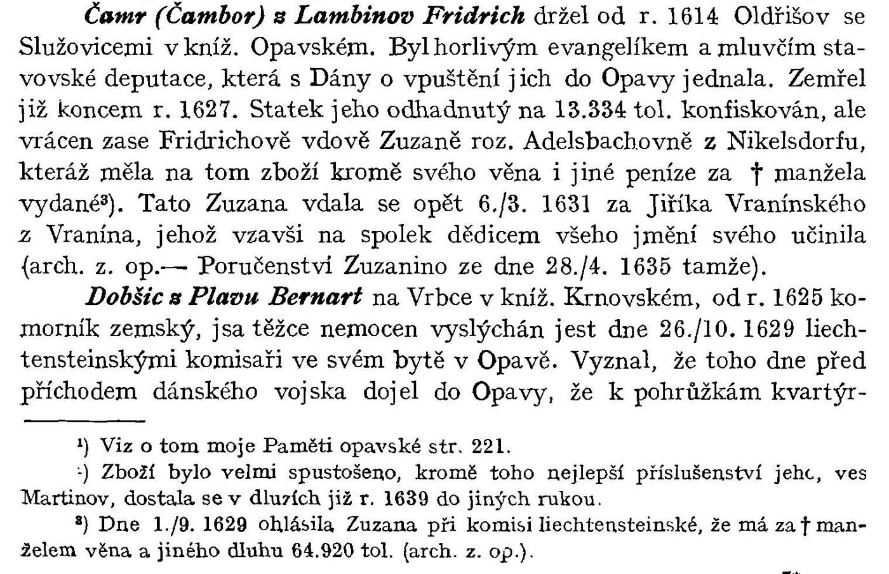
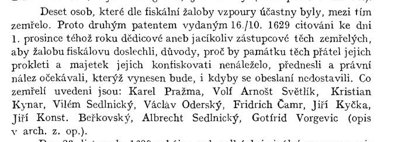

# Oldřišov · dědicové Bedřicha Čamra (Tschammera)

**Nový výsledek.** Josef Zukal dohledal v zemském archivu opavském **poručenství Zuzany, vdovy po Bedřichu Čamrovi, z 28. dubna 1635** a její dřívější přihlášení pohledávky **1. září 1629**. Jméno vdovy, datum listiny a archivní provenience poskytují konkrétní cestu k originálu. Zukalův výtah neuvádí žádné jejich děti ani dětské poručníky. Totožnost první manželky Heinricha Christofa zůstává otevřená.

## Jmenovitý zápis a dvě archivní data

Josef Zukal, *Slezské konfiskace 1620–1630*, Praha 1916, s. 99, heslo **„Čamr (Čambor) z Lambinov Fridrich“**. Na obraze je čitelné, že Čamr držel Oldřišov se Služovicemi od roku 1614 a zemřel koncem roku 1627. Zkonfiskovaný statek se vrátil jeho vdově **Zuzaně roz. Adelsbachovně z Nikelsdorfu**, jež na něm měla věno i další prostředky vydané za manžela. Dne **6. 3. 1631** si vzala **Jiříka Vranínského z Vranína** a Zukal píše, že jej po přijetí na spolek učinila dědicem svého jmění. Stručný pramenný odkaz zní „arch. z. op.— Poručenství Zuzanino ze dne 28./4. 1635 tamže“. Slovo *poručenství* v tomto kontextu označuje závěť či poslední pořízení. Samo nedokládá ustanovení poručníků dětí. [Obraz s. 99](https://kramerius.lib.cas.cz/view/uuid:ffdc99ae-8b89-4c67-ab4e-ad9a0c915887)

Pozn. 3 na téže straně cituje ze zemského archivu opavského také přihlášení věna a jiného dluhu dne **1. 9. 1629** před lichtenštejnskou komisí. To je dřívější úkon než předvolání k císařské komisi na 1. prosince. Jiřík je jmenovaný jako **dědic Zuzanina majetku**, což je odlišná právní skutečnost od dědění po jejím prvním manželovi. Výtah neumožňuje ani potvrdit, ani vyloučit děti prvního manželství. Novodobá informace o opětovném sňatku v roce 1635 je v rozporu se Zukalovým datem sňatku 1631. Rok 1635 je u Zukala datem poručenství. [Zukal s. 99, pozn. 3](https://kramerius.lib.cas.cz/view/uuid:ffdc99ae-8b89-4c67-ab4e-ad9a0c915887) · [Polský herbář, heslo Adelsbach](https://obc.opole.pl/Content/15871/PDF/16776sI.pdf)

## Listiny a protokoly, které mohou nést jména

- **Opava, 16. 10. 1629.** V *Acta publica* VIII, s. 53 (PDF sn. 67) jsou jmenováni zemřelí včetně Friedricha Tschammera. Jejich dědicové se měli **1. 12. 1629** dostavit s nároky. Krebsův regest odkazuje na Fuchse, *Materialien zur evangelischen Religionsgeschichte des Fürstenthums Troppau*, Vratislav 1771, s. 41. V Google Play byl dostupný katalog Fuchsova svazku. Přímý prohlížeč Google Books vyžádal ověření reCAPTCHA, takže jsem obraz s. 41 nepřečetl. Zukal 1916, s. 84, však nabízí podrobnější výtah z jiného svědka téhož patentu, „opis v arch. z. op.“. Jmenuje deset zemřelých včetně „Fridricha Čamra“, předvolává obecně „dědicové aneb jacíkoliv zástupcové“ a zaznamenává, že rozhodnutí padne i při jejich nedostavení. Jednotlivé dědice ani poručníky výtah nejmenuje. Zukal 1912, s. 28 pozn. 6, uvádí opis „im Landesarchiv“ a v hlavním textu doplňuje podpis Dr. Jakwecka. [Krebsův regest](https://sbc.org.pl/Content/9000/PDF/9000.pdf#page=67) · [Fuchs, katalog](https://play.google.com/store/books/details/Gottlieb_Fuchs_Materialien_zur_evangelischen_Relig?id=aSlBAAAAcAAJ) · [Zukal 1916, s. 84](https://kramerius.lib.cas.cz/view/uuid:1a307900-e3df-42eb-95b3-7cc8763cbdbb) · [Zukal 1912, s. 28](https://sbc.org.pl/Content/501661/PDF/gr5-0000-00-0001.pdf#page=34)
- **Opava, 1. 12. 1629.** Prosincový termín patřil císařské exekuční komisi. Ve fulltextu a jmenném rejstříku *Acta publica* VIII je Bedřich jen na s. 53. Jmenný protokol samotného jednání jsem nenašel. Zukal 1912, s. 29 pozn. 2, uvádí, že protokol císařské vyšetřovací komise už nebyl k dispozici, ale jeho jádro se dostalo do *Strafprotokoll* konfiskační komise, **starší sign. Tr. I 2**, tehdy uloženého jako depozitum vratislavského městského archivu ve státním archivu ve Vratislavi. Zukal 1916, s. 84 pozn. 1, uvádí hlavní dochovaný exekuční protokol s názvem **„Prozedur gegen die Troppauer“**, sign. **E, Troppau X.**, rovněž jako městské depozitum ve státním archivu ve Vratislavi. Popisuje v něm řízení proti 96 příslušníkům šlechty obou knížectví a uvádí, že sešit nemá původní paginaci. Současnou signaturu a dostupnost jsem neověřil. Lichtenštejnský vyšetřovací protokol je jiný pramen, jeho opavská série skončila 11. 10. 1629. [Zukal 1912, s. 29, sn. 35](https://sbc.org.pl/Content/501661/PDF/gr5-0000-00-0001.pdf#page=35) · [Zukal 1916, s. 84, pozn. 1](https://kramerius.lib.cas.cz/view/uuid:1a307900-e3df-42eb-95b3-7cc8763cbdbb)
- **Oldřišov, 1628.** Georg Loesche, *Zur Gegenreformation in Schlesien*, s. 62–63, shrnuje stížnost Zuzany Tschammerové roz. Adelsbachové na sekvestraci Oldřišova a movitostí a na odvolání evangelického kazatele. Uvádí dopis Václava Adama Podstatského knížeti Maxmiliánovi z **26. 6. 1628** s přílohami (**6. 4. 1628** k zajištění majetku a správci, **1. 6. 1628** k doplnění inventáře). Podle soupisu zkratek u Loescheho prameny bez odlišného označení pocházejí z *Hausarchiv Liechtenstein*, mezi použitými svazky jsou *Troppau* a *Jägerndorf*. Jednotlivou moderní signaturu ani obraz listu jsem nezískal. [Loesche, s. 62–63 a přehled zkratek](https://sbc.org.pl/Content/210873/PDF/ii135792_01.pdf)

Pro případný genealogický důkaz mají nejvyšší výpovědní hodnotu originály posledního pořízení z **28. 4. 1635** a přihlášky ze **1. 9. 1629**, oba citované do zemského archivu opavského. Zukalův odkaz neuvádí archivní fond ani inventární číslo. Opis patentu, písemnosti exekuční komise a vlastní poručenství je proto třeba vyhledávat jako různé listiny.
