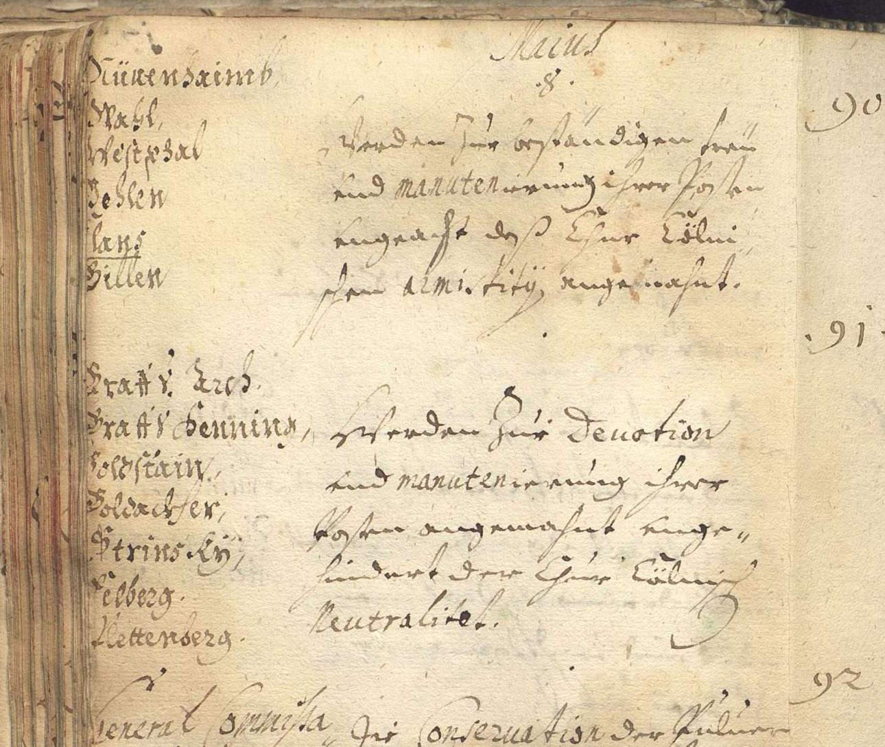

# Gill(e)r ve vojenských pramenech 1644–1647

**Nejstarší zde ověřená jmenovka Giller zůstává 8. května 1647.** Vlastní soudobý rejstřík výslovně potvrzuje příjmení a folio. Křestní jméno, hodnost, posádka, přidělení k Wrbnovu nebo Gallasovu pluku a rodinný vztah zůstávají otevřené. Přímé starší doklady z roku 1644 jmenují Gallasova podplukovníka Karla de St. Maurice a samostatnou Wrbnovu kompanii. Oba doklady dávají nové konkrétní personální a archivní opěrné body.

## 8. května 1647 a kurfiřtské příměří

ÖStA, KA, HKR, Registratur 297, fol. 170v, č. 90–91 ([originál v Hungaricaně](https://library.hungaricana.hu/en/view/KA_HKR_297_1647R/?pg=129)). Zápis č. 90 považuji za společný výpis pokynu pro několik adresátů. Č. 91 má vlastní pořadové číslo i vlastní levý seznam. Hranaté závorky označují rozvinutí nebo nečitelné místo, otazník pracovní čtení.

| Pořadí u č. 90 | Čtení / ověření | Co lze doložit |
| --- | --- | --- |
| 1 | …ünzenhaimb (?) | Slabé čtení, iniciála u vazby. Osobní jméno nedoloženo. |
| 2 | Wahl | V oddílu Wa jasné „Wahl. 170.“. Známý císařsko-bavorský generál Joachim Christian von der Wahl zemřel 31. srpna 1644, takže tentýž člověk v květnu 1647 pokyn dostat nemohl. Křestní jméno skutečného adresáta nedoloženo. [Rejstřík](vyrezy/297-index-wa-wahl.jpg) · [Joachim Christian](https://www.30jaehrigerkrieg.de/wahl-waall-wall-waal-wahle-joachim-christian-freiherr-1642-graf-von-der-iii/) |
| 3 | Westphal | Velmi pravděpodobný je Wilhelm von Westphalen, císařský velitel v Paderbornu. Vlastní dopisy z téže doby se zabývají právě neutralitou Kurkölnu a udržením císařských posádek. Rejstřík má také samostatný geografický odkaz „Westphalien“ k f. 170. [Rejstřík](vyrezy/297-index-we-westphalien.jpg) · [Dopisy a odkazy na edici](https://www.30jaehrigerkrieg.de/westphalen-wilhelm-von/) · [Osobní heslo](https://www.leo-bw.de/en-GB/detail/-/Detail/details/PERSON/wlbblb_personen/189442883/Westphal%20Wilhelm%20von) |
| 4 | Zehlen nebo Vehlen (?) | Kandidáty podle jmen a regionu jsou Alexander II. von Velen a Gottfried Huyn von Geleen. Čtení ani přiřazení konkrétního adresáta nemá nezávislou oporu. |
| 5 | [C]lanz nebo [C]lans v okraji, Clans nebo Claans v rejstříku | Rejstřík v oddílu Ca potvrzuje samostatnou položku k f. 170 a podporuje úvodní C. Identita otevřená. [Výřez rejstříku](vyrezy/297-index-ca-claans.jpg) |
| 6 | Giller | Rejstřík výslovně „Giller. 170.“ pod Gi. Vysoká jistota příjmení v zápisu, neurčená totožnost. [Rejstřík](vyrezy/297-index-gi-giller.jpg) |

Zápis č. 90 má záhlaví „Maius. 8.“ a hlavní text „werden zur beständiger treu / und manutenierung ihrer Posten / ungeacht deß Chur Cöllni- / schen armistitij angemahnt.“ Překlad „Jsou napomenuti k trvalé věrnosti a k udržení svých postů bez ohledu na příměří kolínského kurfiřta.“ Jeho blízký věcný protějšek č. 87 přikládá Blumenthalovi napomínací listy plukovníkům ve vestfálských posádkách a č. 128 z 15. května říká Sparrovi, že listy tamním velitelům odešly. Ani protějšky nepřidělují jednotlivým adresátům č. 90 konkrétní hodnosti. [Č. 87](https://library.hungaricana.hu/en/view/KA_HKR_297_1647R/?pg=128) · [Č. 128](https://library.hungaricana.hu/en/view/KA_HKR_297_1647R/?pg=132)

Zápis č. 91 říká „Werden zur devotion / und manutenierung ihrer / Posten angemahnt unge- / hindert der Chur Cöllnisch[en] / Neutralitet.“ Překlad „Jsou vyzváni k zachování oddanosti a udržení svých postavení bez ohledu na neutralitu kolínského kurfiřtství.“ Slova o postavení sama o sobě neudávají Gillerovu hodnost. U č. 91 je první jméno „Graff v. Arco“. Právě hrabě z Arca je ve Westphalenově dopisu ze 17. května u Vechty, a to podporuje kandidáta Prospera von Arco. Dále jsou v samostatném seznamu pravděpodobná čtení „Graff v. Benning“, „Holstain“, „Goldacher“, „Strinckh“, „[El]berg“ a „[P]lettenberg“. Identifikace posledních jmen zůstávají otevřené. Všechna náleží pod č. 91.

Wilhelm von Westphalen dne 26. dubna píše o čekání na „terminum resolutionis 9. May“ (lhůtu k rozhodnutí 9. května), 17. května již o tom, že „der stillstandt der Waaffen angekündigt worden“ (příměří bylo oznámeno), a 7. června o „Kayserliche und Churcöllnische völcker vermischet“ (smíšených císařských a kurfiřtských vojscích) ve Warendorfu. V dopisu se řeší sporné převzetí tamního stanoviště. Jde o doklad západního dějiště, s významem odlišit kurfiřtství od města Kolína a květnovou fázi od březnové dohody v Ulmu. Westphalenův dopis dokládá Arca ve Vechtě a Warendorf jako řešené stanoviště, Gillerovo přidělení k nim z něj neplyne. Dopisy jsou doloženy ve výňatcích z edice A. Neuwöhnera, *Im Zeichen des Mars* (1998), s. 125, 126 a 128. [Výňatky z dopisů](https://www.30jaehrigerkrieg.de/westphalen-wilhelm-von/) · [Ulmské příměří](https://www.leo-bw.de/de/web/guest/themenmodul/dreissigjaehriger-krieg/friedensschlusse/ulmer-waffenstillstand)

Paralelní květnový Expedit 296 už prošlo předchozí kolo včetně č. 3, 22, 83, 96 a 162. Za stejný pokyn lze považovat pouze text s odpovídajícím obsahem a měsíční chronologií i doloženým adresátem. Takový koncept, odeslaný čistopis ani Westphalenovu potvrzenou odpověď na zápis č. 90 se zde nepodařilo najít. Reálná samostatná archivní stopa je korespondence Wilhelma s Piccolominim v SOA Zámrsk, RA Piccolominové. Kontrolní přesné signatury z téhož roku jsou 25.822 a 25.823 (29. listopadu a 6. prosince 1647). Pro rozhodné květnové dopisy dává konkrétní text a odkazy na originál citovaná edice. [Předchozí práce](../../2026-11-25-kolo2/vojsko1647/README.md) · [Citované signatury](https://www.30jaehrigerkrieg.de/westphalen-wilhelm-von/)

## Starší skutečné osobní a plukovní doklady

| Datum a signatura | Text a český překlad | Důsledek |
| --- | --- | --- |
| 25. 1. 1644, HKR Registratur 291, f. 202v č. 128, rubrika „St. Maurice“ | „An den Obr[ist] Leutenant[en] deß Gall- / assischen Reg[imen]ts, Carl de St. Mau- / rice, soll die in den […] ihme angewiesene Quartier / mantenirn.“ Karlu de St. Maurice, podplukovníkovi Gallasova pluku, aby udržel jemu přikázanou ubikaci. | Jméno, křestní jméno, hodnost i Gallasův pluk jsou výslovné. Sousední č. 123 odkazuje na neshody mezi bavorským vojskem a Gallasovým plukem v markrabství Burgau. Druh pluku není v č. 128 výslovný. Jmenným kandidátem je Charles de Saint-Mauris doložený ve francouzské genealogické literatuře. [Snímek 105](https://library.hungaricana.hu/en/view/KA_HKR_291_1644R/?pg=105) · [Výřez č. 128](vyrezy/291-f202v-c128-gallas.jpg) · [Výřez č. 122–123](vyrezy/291-f202r-c122-123.jpg) · [Nobiliaire universel, sv. 6](https://books.google.com/books?id=KWeTQEppxh8C) |
| 3. 8. 1644, HKR Registratur 291, f. 317v č. 15 | „P[er] wegen anbefohlner abschickung / der Wrbyschen Comp[agni]e und ander / in Böhaimb sich befindend[en] Reutter / nacher S[ch]lesien.“ Pokyn o nařízeném odeslání Wrbnovy kompanie a dalších jezdců nacházejících se v Čechách do Slezska. Okrajové jméno čtu pracovně „Mörder“. | Wrbnova jednotka je jmenovitě doložena již roku 1644 jako kompanie. U Wredeho vznik šestikompanijního kyrysnického pluku spadá do roku 1645. Souběžný dopis Ferdinanda III. Colloredovi ze 3. srpna je v edici *Documenta Bohemica* VII č. 350. [Snímek 201](https://library.hungaricana.hu/en/view/KA_HKR_291_1644R/?pg=201) · [Výřez č. 15](vyrezy/291-f317v-c15-wrba.jpg) · [Výřez rejstříku](vyrezy/291-rejstrik-wrba.jpg) · [Odkaz na edici](https://www.30jaehrigerkrieg.de/vrbna-werba-wrbna-wirben-wirbna-wurben-wurby-wolbrig-wolbrink-conte-de-und-freudenthal-jiri/) |
| 18. 7. 1644, HKR Registratur 291, f. 308v č. 93 | „… dem Conte Ghisillieri / 100. R[eichs]th[ale]r monathlich inter- / teniments.“ Hraběti Ghisillierimu 100 říšských tolarů měsíčního zaopatření. | Rejstříkové Gi je „Ghisillieri“, což potvrzuje hlavní text a titul. Je to samostatná soudobá jmenná stopa. Podobnost s „Guilieri“ v Expeditu 296 f. 180r č. 136 při pátrání nestačí k identifikaci stejné osoby. [Snímek 193](https://library.hungaricana.hu/en/view/KA_HKR_291_1644R/?pg=193) · [Výřez č. 93](vyrezy/291-f308v-c93.jpg) · [Výřez rejstříku](vyrezy/291-rejstrik-ghisillieri.jpg) |

Ve zveřejněných jmenných stránkách Registratur 291 jsem zkontroloval skupiny Ga–Gu (snímky 300–304) a W (365–367). Přímý tvar Giller jsem zde při této kontrole nečetl. Zápisy jsou pracovními výtahy, proto tato dílčí sonda nemůže prokázat nepřítomnost v celém ročníku. Podobně znějící překladatelské jméno Galler z roku 1646 má odlišný kontext již v SOL-06.

Wrbnův životopis obsahuje ještě starší pramenné řetězce z října a listopadu 1642, stráž u Rueblandu v Kladsku a nábor pro Olomouc (*Documenta Bohemica* VI č. 1337 a 1359). Pro červen 1645 nejpřesněji rozděluje osoby Colloredo v dopise Gallasovi, VII č. 606, kde dává Henemana a Ungera výslovně k Bocarmému jako jeho dva kapitány. Dne 28. června Souches nazývá samotného Wrbnu podplukovníkem („Herr Obristleutnant Graf von Wirben“, VII č. 612). Současně zmiňuje dragouny Gallasovy a La Coronovy. VII č. 613 je Wrbnův vlastní dopis Gallasovi z téhož dne. Údaj o Wrbnově vlastní hodnosti a údaj o podplukovníkovi sloužícím pod Wrbnou jsou dvě různá tvrzení. Wrbnu lze zároveň doložit v Opavě a v Lehnhausu v roce 1646 z Engelbertova soupisu Hatzfeldtovy korespondence č. 277. [Pramenné odkazy a výňatky](https://www.30jaehrigerkrieg.de/vrbna-werba-wrbna-wirben-wirbna-wurben-wurby-wolbrig-wolbrink-conte-de-und-freudenthal-jiri/)

## Prakticky ověřené archivní stopy

| Fond nebo edice | Ověřeno online a na co mířit |
| --- | --- |
| Děčín, Rodinný archiv Clam-Gallasů, NAD 1 | Práce opřená o originály potvrzuje existenci **dochovaného abecedního katalogu Gallasových korespondentů ve vojenské registratuře**, pozn. 15. Uvádí používanou pomůcku A. Smíškové, s. IV, 79–81. Jiné doložené signatury téže registratury jsou inv. č. 1397, XVIII/7, 9–11 a 18, kart. 349, 351–353 a 360 pro příklady z let 1635–1638. Přesné uložení abecedního katalogu je stále otevřené. Pro dotaz ve jmenné pomůcce se hodí Giller/Galler, St. Maurice/Saint-Mauris a Vrbna/Wrba/Würben. [Práce s odkazy na originály](https://dspace.cuni.cz/bitstream/handle/20.500.11956/191516/120479518.pdf?isAllowed=y&sequence=1) |
| Landesarchiv Thüringen, Amt Burgk 3-11-4220, č. 0626 | Ve veřejném inventáři ověřena samostatná jednotka k dragounskému pluku Gallase v Hofu s roky **1642 a 1647**. Je to konkrétní předroková stopa pro službu u Gallasových dragounů, s potenciálem dokladů o důstojnících i průchodech. Inventární záznam neposkytl digitální snímek. [Inventář Amt Burgk](https://www.archive-in-thueringen.de/de/findbuch/view/bestand/21868/systematik/160783) |
| Vídeň, HHStA a KA | HHStA HausA Familienkorrespondenz A 55-6, Gallas císaři, 25. 1. 1635 až 12. 4. 1645. Pro západní neutralitu jako možnou paralelu projít HHStA Kriegsakten, podle katalogových hesel pro rok 1647. Ověřené položky kartonu 128 už patří do srpna, což je nevhodné pro přímé datování květnového konceptu. KA HKR Hauptreihe uvádí jen malý zlomek samostatných akt do roku 1700 (1–2 %), vedle hlavní řady má proto smysl zkusit Alte Feldakten se samostatnými soubory přenesenými z HKR. Pro přesný květnový dokument chybí samostatná archivní signatura. [HKR Hauptreihe](https://www.archivinformationsystem.at/detail.aspx?ID=4729) · [Kriegsakten](https://www.archivinformationsystem.at/archivplansuche.aspx?ID=4030049) · [Alte Feldakten](https://archivinformationsystem.at/detail.aspx?ID=3164) |
| MZA, G 361 Rodinný archiv Vrbnů, 1482–1957 | Fond veřejně doložen v přehledu, archivní pomůcka C2993. Přímou evidenci Wrbnových důstojníků z let 1644–1647 tento přehled neurčuje. Pro toto období jsou konkrétnější výše uvedené soudobé dopisy k rokům 1642, 1644 a 1645. [Přehled MZA](https://www.portafontium.eu/cbguide/mza?language=cs) |

Dataci narození Heinricha Christofa nebo Johanna Christofa, jméno Heinrichova otce ani přímou filiaci květnového Gillera zatím žádný z nově prověřených záznamů neurčuje. Pro skutečný posun je nejsilnější personálně identifikovatelný doklad z jedné z přesných stop, zejména abecední katalog korespondentů u Gallase, písemnosti o dragounech v Hofu nebo soudobý opis květnového oběžníku v regionální korespondenci posádek.
