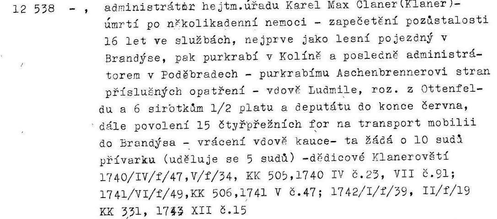
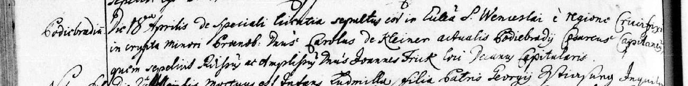
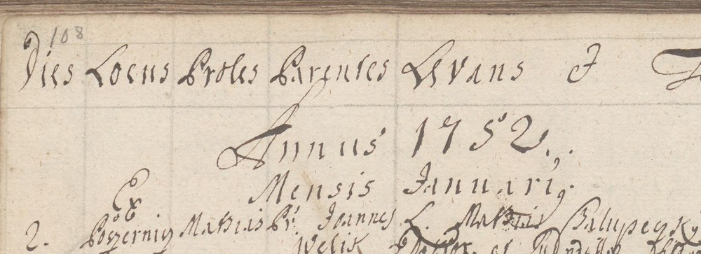
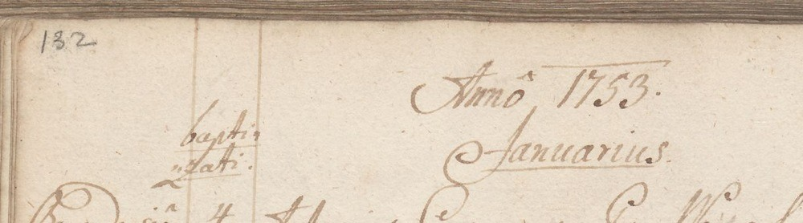

# Clannerova rodina v Brandýse a služba v Poděbradech před rokem 1750

**Nový doklad vede k Brandýsu nad Labem.** Po smrti Karla Maxmiliána Clannera roku 1740 byly vdova Ludmila z Ottenfeldu a šest sirotků do konce června zaopatřeni polovinou platu a deputátu. Komora povolila 15 čtyřspřežních povozů k odvozu mobiliáře do Brandýsa. Přímý údaj o dokončení stěhování, adrese domácnosti nebo přítomnosti Baltazara v Brandýse v tomto výtahu chybí. Přesto je to poprvé konkrétní místo, kam měl po Karlově smrti směřovat majetek jeho domácnosti. [NA, Česká komora, personální záležitosti Poděbrad, inv. 12538, Culková s. 1460, sn. 62](https://vademecum.nacr.cz/vademecum/permalink?xid=298392dbf8cc182bcdd08f4aff2506b1&scan=6eed0069-5835-4d58-b029-78ebe5c2a31d)

## Co je uvedeno v komorní evidenci

Přečten je celý obraz s. 1460, s kontrolou sousední s. 1459 a návaznosti na s. 1461. Jde o archivní regesty několika dobových akt a zápisů do komorních knih. České formulace níže jsou z pomůcky Dagmar Culkové, původní listiny a jejich podpisy zatím nebyly přečteny.

| Pramen | Čtení a význam |
|---|---|
| **NA, Česká komora, NAD 178, inv. 12538, s. 1460** | Karel Max je veden jako „Claner (Klaner)“, administrátor hejtmanského úřadu. Regest uvádí úmrtí po několikadenní nemoci, zapečetění pozůstalosti a **16 let ve službách**, nejprve jako lesní pojezdný v **Brandýse**, poté purkrabí v **Kolíně** a nakonec administrátor v **Poděbradech**. Je to úřední služební pořadí Karlova života bez jednotlivých nástupních dat. Z pověření purkrabího Aschenbrennera, vracení vdoviny kauce a povozů plyne konkrétní agenda k domácnosti po smrti. Rozpis výplat nebo jména všech šesti sirotků v regestu chybějí. |
| **Týž regest, odkazy k předlohám** | **1740/IV/f/47, V/f/34, KK 505, 1740 IV č. 23 a VII č. 91. 1741/VI/f/49, KK 506, 1741 V č. 47. 1742/I/f/39, II/f/19. KK 331, 1743 XII č. 15.** Pomůcka nerozepisuje, která věta připadá na který list. Tyto složky představují samostatný komorní paralelní okruh k deskovému dědictví a mohou obsahovat doručovací adresu vdovy, příjemce služebního platu, zajištění sirotků či vyúčtování. |
| **NA, Česká komora, inv. 12523–12525, s. 1459** | Poděbrady a Kolín, dotaz z roku 1737 k úředníkům bydlícím mimo zámek, **1737/I/f/99**. Zpětné zaslání jistých úředních kaucí k přepracování **1737/II/f/98**. V **inv. 12525, 1737/III/e/19,f/47; 1738/III/f/53** je správce „Claner“ výslovně účastníkem sporu o rybní příplatek Jana Bohunka a o jeho ručitelskou kauci. Křestní jméno správce tento regest neudává. Doba, služba a místo odpovídají Karlu Maxmiliánovi. Spis o ubytování potvrzuje, že bydliště panství a ubytování na zámku byly dvě různé věci. [S. 1459](https://vademecum.nacr.cz/vademecum/permalink?xid=298392dbf8cc182bcdd08f4aff2506b1&scan=58f390b6-d7bd-4240-aa41-925f499cc3a3) |

[Výřez regestu 12525 se správcem Clanerem, s. 1459](vyrezy/ck-12525-clanner.jpg)

Komorní regest uvádí 16 let služby. Hanušův životopis začíná u Karla v Brandýse rokem 1708 a zahrnuje také službu v Hořicích a u Colloredů. Je možné, že komorní písemnost počítá jen léta ve službách komory. Předlohu bude třeba přečíst k určení počátku a rozsahu této lhůty. [Hanušův životopis](https://pratelepardubicka.cz/eduard-napravnik-iv-cast-rod-clanneru-z-engelshofenu/)

V Sedláčkově lístku z **18. 11. 1746** je pět dědiců včetně Baltazara. V komorním regestu po Karlově smrti v roce 1740 stojí šest sirotků, bez jednotlivých jmen. Rozdíl může souviset s úmrtím některého dítěte nebo s tím, koho zahrnují dvě odlišné agendy. Zprávy zatím neumožňují přiřadit konkrétního šestého sirotka. Ověřená karta **NA, DZV, NAD 172/1, inv. 482**, modrozlatý pátý trhový kvatern adirování, datuje svazek do let **1744–1753**, bez obrazů. Původní znění folia C 5, přesné bydliště Baltazara roku 1746 a jeho povolání zůstávají neověřeny. [Sedláčkova kartotéka A09A č. 357](https://www.augustsedlacek.cz/apis/formatter-api/?mode=as_kartoteka_manifest&id=A/A09/A09A/69726) · [Karta DZV 482](https://vademecum.nacr.cz/vademecum/permalink?xid=a95078fa-d5ef-4363-bb38-8953f604fdfb)

## Karel Clanner pohřben 18. dubna 1740 ve Staré Boleslavi

**SOA v Praze, Stará Boleslav 02, oddíl zemřelých, sn. 193, s. 204 podle protější s. 205.** Na sn. 192 vpravo je nadpis „Anno 1740“. Na sn. 193 vpravo začíná rok 1741. Na sn. 193 vlevo je třetí zápis s okrajovou rubrikou „Podiebradia“. Čtu „Die 18ᵛᵃ Aprilis de speciali licentia sepultus est in Aula S. Wenceslai è regione Crucifixi in crypta minori Brandb. D[omi]nus Carolus de Kleiner actualis Podiebradij Caesareus Capitaneus, quem sepelivit R[everendissi]m[us] ac Ampliss[i]m[us] D[omi]n[u]s Joannes Fri[c?]k loci Decanus Capitularis“. Dne 18. dubna byl se zvláštním povolením v chrámu sv. Václava naproti krucifixu v menší kryptě pohřben pan Karel de Kleiner, úřadující císařský hejtman v Poděbradech. Pohřbil ho nejdůstojnější a nejváženější pan Jan Frik (v literatuře také Frick), zdejší kapitulní děkan. Zkratku po označení krypty nerozepisuji. Zápis datuje pohřeb. Den úmrtí, přítomnost vdovy a dětí ani jejich pozdější bydliště neuvádí. Čtení **de Kleiner** je nové dokladové heslo pro hledání Clannerů, shodné s rukopisnou variantou u Jana Clannera v roce 1779 podle Vavákova editora. [Nadpis ročníku](https://ebadatelna.soapraha.cz/d/12376/192) · [Pohřeb](https://ebadatelna.soapraha.cz/d/12376/193) · [Vavák, s. 127, pozn. 2](https://librinostri.catholica.cz/download/vavakpam1-r.pdf) · [Podoba Jan Frik a jeho funkce v Dřísech](https://www.drisy.cz/pamatky/)

## Co to znamená pro Bor

Služba Karlova syna Baltazara v poděbradské a kolínské lesní správě je doložena oddavkami v Opočně **13. října 1747**. K Brandýsu má nyní doloženou starší vazbu otcova služba a zamýšlený odvoz majetku domácnosti. Pro roky před říjnem 1747 zůstává dědický doklad z roku 1746 jedinou přímou stopou po Baltazarovi z tohoto období. Podle dostupného výtahu neznáme jeho tehdejší bydliště ani službu. Zůstává otevřeno také první pracovní zařazení Maximiliána Gillera a místo jeho předchozího pobytu. Není doklad, který by jmenoval Gillera jako nástupce polního myslivce Stumpfa po jeho výslužbě z května 1747. První doložené datum Gillerovy domácnosti v Boru je stále 23. ledna 1750. [Opočenský originál, Opočno 120-1, s. 86](https://aron.vychodoceskearchivy.cz/apu/1215ac03-cbfc-4b1c-9f7f-0a0ebf8f4f45/dao/1215ac03-cbfc-4b1c-9f7f-0a0ebf8f4f45/file/b9e3cc97-718c-4d26-b1e9-11212f8921e8) · [Křest v Boru, Nymburk 07, s. 82](https://ebadatelna.soapraha.cz/d/10406/47)

**Sonda v samostatné farnosti Brandýs nad Labem.** Zkoušel jsem, zda může šestého sirotka vysvětlit úmrtí v Brandýse. Přečtený titul a místní rozdělení jsou v **SOA v Praze, Brandýs nad Labem 35, ID 4186**, sn. 2. Jde o rejstřík zemřelých sestavený v letech 1915–1916 ze starších knih A–C. Oddíl C/Č začíná na sn. 13. V příslušných řádcích na sn. 15 vpravo a sn. 16 (od února 1740 přes říjen 1747) jsem pod Claner/Clanner nikoho nerozpoznal. Rubrika Ch je samostatná (kontrolní sn. 42). V oddílu K jsem souvisle přečetl všechny řádky let **1740–1747** na sn. 57–60. První lednové zápisy roku 1740 začínají dole na sn. 57 vlevo. Poslední zapsané úmrtí roku 1747 je **14. prosince** nahoře na sn. 60 vlevo, hned poté následuje **1. ledna 1748**. Pod variantami **Kleiner, Klainer, Klaner a Klanner** jsem žádný zápis v tomto rozsahu nerozpoznal. Jde o kontrolu rejstříku farních matrik zemřelých. O tom, kde žilo šesté dítě a proč je Sedláčkův výtah neuvádí mezi dědici, tato kontrola nerozhoduje. Pro Ludmilu a Baltazara v Brandýse mezi roky 1740 a 1747 stále chybí přímý datovaný záznam. [Titulní list](https://ebadatelna.soapraha.cz/d/4186/2) · [Začátek C/Č](https://ebadatelna.soapraha.cz/d/4186/13) · [Snímek 15](https://ebadatelna.soapraha.cz/d/4186/15) · [Snímek 16](https://ebadatelna.soapraha.cz/d/4186/16) · [K, sn. 57](https://ebadatelna.soapraha.cz/d/4186/57) · [K, sn. 58](https://ebadatelna.soapraha.cz/d/4186/58) · [K, sn. 59](https://ebadatelna.soapraha.cz/d/4186/59) · [K, sn. 60](https://ebadatelna.soapraha.cz/d/4186/60)

## Ostrov u Záp · křty na snímcích 64–67 patří do roku 1752

**SOA v Praze, Brandýs nad Labem 03, ID 4173, oddíl křtů.** Přesný letopočet vymezují dva nově přečtené roční předěly. Na s. 107, sn. 57 vpravo, je závěr „Finis Anni 1751“. Následující s. 108 na sn. 58 vlevo začíná záhlavím **„Annus 1752, Mensis Januarii“**. Snímek 68 (s. 128–129) pokračuje po 13. listopadu na s. 127 zápisem ze 14. listopadu a přechází do prosince. Na sn. 69 (s. 130–131) končí prosincová řada křtem z 29. prosince v Toušeni a duchovní potvrzuje vykonané křty. Na následující straně 132, sn. 70 vlevo, je výslovné záhlaví **„Anno 1753. Januarius“** a první křest 4. ledna. Dosud neurčené snímky 64–67 tedy pokrývají **16. srpna až 13. listopadu 1752**. Křest ostrovské Anny Kateřiny, dcery Josefa Hadrbolce a Anny rozené Krupičkové, připadá na **20. září 1752** a narození na 19. září. [Křest v Ostrově, s. 124](https://ebadatelna.soapraha.cz/d/4173/66) · [Návaznost listopadu a prosince](https://ebadatelna.soapraha.cz/d/4173/68) · [Konec prosince](https://ebadatelna.soapraha.cz/d/4173/69) · [Závěr roku 1751](https://ebadatelna.soapraha.cz/d/4173/57) · [Záhlaví 1752](https://ebadatelna.soapraha.cz/d/4173/58) · [Záhlaví 1753](https://ebadatelna.soapraha.cz/d/4173/70) · [Starší čtení ostrovského výřezu](../../2026-11-26-treti-kolo/ostrov/brandyske-matriky.md)

Nový obraz s. 128 vlevo zachycuje také **14. listopadu 1752** v Zápech. Při křtu Jana Filipa je jako svědkyně uvedena „Ludmilla filia Georgii Firmus Opilionis ex Wostrow“ (Ludmila, dcera Jiřího Firma, ovčáka z Ostrova). Stejná Ludmila je už podle staršího přepisu kmotrou při zápském křtu Kateřiny 20. října 1752 na s. 126. Dva zápisy dokládají v témže podzimu ostrovského ovčáka Jiřího a jeho dceru mezi rodinami svázanými se Zápy. Zjištěné datum upřesňuje místní matriční souvislosti. Na nově otevřených sn. 55–58 a 68–70 jsem sledoval návaznost měsíců, předěly ročníků a svědectví ze s. 128. Strany 120–127 už pokrývá starší souvislé čtení. [Listopadový zápis](https://ebadatelna.soapraha.cz/d/4173/68) · [Říjnový zápis](https://ebadatelna.soapraha.cz/d/4173/67)

[Výřez závěru prosince 1752, s. 131](vyrezy/brandys03-s131-prosinec-konec.jpg) · [Výřez dokladu Ludmily z Ostrova, s. 128](vyrezy/brandys03-s128-ludmila-ostrov.jpg)
