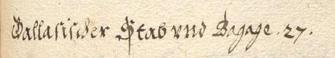
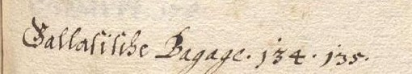

# Starší Gillery ve válečných protokolech let 1646–1647

V registratuře dvorské válečné rady jsou samostatné položky o ubytování Gallasova štábu a o zaopatření jeho důstojníků. Přečtené položky neuvádějí jejich jména ani konkrétní pluk. Johannes Christof ani Heinrich Christof proto nemají nový osobní doklad. Zásadní doplnění k předchozí sondě je na **fol. 27v**: právě zde leží lednová položka, na niž směřuje rejstříkové heslo o Gallasově štábu a bagáži. Dřívější kontrola pokrývala fol. 27r. [Předchozí rozsah, SOL-06](../../2026-11-25/SOL-06/Gillern_SOL_06_vysledek.md) · [Dobový rejstřík Ga](https://library.hungaricana.hu/en/view/KA_HKR_295_1646R/?pg=220) · [Fol. 27v](https://library.hungaricana.hu/en/view/KA_HKR_295_1646R/?pg=22)

## Čtení původního protokolu

Pramen je Österreichisches Staatsarchiv, Kriegsarchiv, Hofkriegsrat, **Registratur 295 (1646)**. Lomítko v přepisu odděluje řádky a hranaté závorky vynechaný text. Číslo `pg` v odkazu počítá od nuly, číslo snímku od jedné.

| Datum a místo | Doslovný úryvek a význam |
| --- | --- |
| **22. 1., fol. 27v, č. 51** | Rejstřík „Gallasischer Stab und Bagage. 27.“ Okraj protokolu „Ertzhertzog“ a věcná rubrika o Gallasově štábu a bagáži. V textu „[…] Gallas Staab undt Bagage / den unterhalt an einem bequemen Orth / zu assigniren.“ Štábu a trénu hraběte Gallase se má určit vhodné místo k zaopatření. Vhodné místo text nepojmenovává. [Fol. 27v, sn. 23](https://library.hungaricana.hu/en/view/KA_HKR_295_1646R/?pg=22) · [Výřez č. 51](vyrezy/hkr295-f27v-c51.jpg) |
| **19. 5., fol. 134v, č. 47** | V rejstříku „Gallasische Bagage. 134. 135.“ Text „Wegen noch lengeren Verpflegung / der Gallassischen bagage und officier“. Jde o další zaopatřování gallasovské bagáže a důstojníků. Okraj odkazuje k vratislavské straně („Breßl[au]“). Příslušnost jednotlivých důstojníků a jejich jména zápis nerozepisuje. [Fol. 134v, sn. 122 vlevo](https://library.hungaricana.hu/en/view/KA_HKR_295_1646R/?pg=121) · [Výřez č. 47](vyrezy/hkr295-f134v-c47.jpg) |
| **25. 5., fol. 135r, č. 52** | „Deß Graffen Gallas bagage die quar- / tier lenger zu laßen.“ Trénu hraběte Gallase mají být déle ponechány kvartýry. Tento druhý odkaz tedy rovněž vede k ubytování. [Fol. 135r, sn. 122 vpravo](https://library.hungaricana.hu/en/view/KA_HKR_295_1646R/?pg=121) · [Výřez č. 52](vyrezy/hkr295-f135r-c52.jpg) |
| **28. 1., fol. 94r, č. 82** | „Bescheid auf seine angebrachte præ- / tensiones.“ Na okraji „Gallas.“ Odpověď na předložené Gallasovy nároky bez bližšího popisu nebo jmen. Jde o věcně málo výtěžný odkaz v obecném hesle „Gallas“. [Fol. 94r, sn. 85 vpravo](https://library.hungaricana.hu/en/view/KA_HKR_295_1646R/?pg=84) · [Výřez č. 82](vyrezy/hkr295-f94r-c82.jpg) |

## Květnová výzva Gillerovi a červnová evidence odpovědí

Starší kolo prošlo okraje celého květnového Expeditu 296 (fol. 167r–194v) a vybrané položky už spárovalo s Registraturou 297. Známý zápis s Gillerem je v odchozí Registratuře **8. 5. 1647, fol. 170v č. 90**. Dvojici č. 90 a 91 je potřeba číst samostatně, každá má vlastní seznam jmen. U první výzvy je bezpečné příjmení Giller a velmi pravděpodobná souvislost s vestfálskými posádkami z okolních položek. V novém průchodu jsem navázal v červnovém Expeditu 296. V rejstříku *We* jsem vzal nejbližší červnové odkazy hesla „Westphalischer Craiß“, fol. 197 a 198, a v textu pokračoval do fol. 201r. [Předchozí květnová sonda](../../2026-11-25-kolo2/vojsko1647/README.md) · [Rozlišení adresátů](../../2026-11-26-osme-kolo/vojsko/README.md) · [Registratura, č. 90–91](https://library.hungaricana.hu/en/view/KA_HKR_297_1647R/?pg=129) · [Rejstřík We](https://library.hungaricana.hu/en/view/KA_HKR_296_1647E/?pg=526)

- **Expedit 296, červnová část, fol. 199v č. 28.** Dobový výtah začíná „Blumenthal auß Cöln 5. May bericht, d[as] Chur Cöln / die neutralitet vermög der geschlos- / senen ulmischen tractaten angenom- / men“. Blumenthal z Kolína 5. května hlásí, že kurfiřt přijal neutralitu v intencích uzavřených ulmských dohod. Na konci výtahu se výslovně uvádí „Copi Chur Cöln schreiben an Blumen- / thal und dessen andwort in / punctis.“ Zápis tedy vede ke kopii dopisu kolínského kurfiřta Blumenthalovi a jeho odpovědi po bodech. Dopis je o tři dny starší než Gillerova výzva. Datum 5. května označuje zprávu, zatímco záhlaví „Junius“ je zařazení ve vídeňském protokolu. [Fol. 199v, sn. 193 vlevo](https://library.hungaricana.hu/en/view/KA_HKR_296_1647E/?pg=192) · [Výřez č. 28](vyrezy/hkr296-f199v-c28.jpg)
- **Tamtéž, fol. 200r–v č. 35.** Okraj jmenuje Trauttmansdorffa, Sparra, Blumenthala a kolínského kurfiřta. V textu stojí „Chur Bay- / rische particular armistitium“ a v pokračování „[…] die Commendanten zur bestän- / digkeit anzumahnen wären.“ Záležitost zvláštního bavorského příměří souvisela s doporučením napomenout velitele k vytrvalosti. To je přímá věcná paralela k pokynu o věrnosti a udržení postů z 8. května. Výtah neuvádí příjemce jménem a z jediného hesla nelze prokázat, že zachycuje tutéž expedici. [Fol. 200r, sn. 193 vpravo](https://library.hungaricana.hu/en/view/KA_HKR_296_1647E/?pg=192) · [Fol. 200v, sn. 194 vlevo](https://library.hungaricana.hu/en/view/KA_HKR_296_1647E/?pg=193) · [Výřez začátku](vyrezy/hkr296-f200r-c35.jpg) · [Výřez pokračování](vyrezy/hkr296-f200v-c35.jpg)

Byl čten rozsah **fol. 197r–201r**, sn. 190–194, s cíleným čtením obou citovaných výtahů a kontrolou okrajových hesel. Giller, Wahl ani jméno jednoznačně odpovídající okrajovému *Clans/Claans* se zde neobjevují. Zápisy poskytují dva konkrétní odkazy na písemnosti kolem Blumenthala a Sparra. Stále chybí příloha či odpověď uvádějící místo Gillerova stanoviště nebo jeho křestní jméno.

## Rozsah a důsledek pro rodokmen

- Na obrazech byl zrakem porovnán rejstřík **Ga** (snímek 221, zde ověřena konkrétní hesla) a **Gi** (snímek 223, se jmény Gisenburg/Gieseburg, Grim a Gisebnicz a heslem ke řeckému Weissenburgu). Pod Gi jsem v této knize nerozpoznal Giller. V hlavním textu byly u odkazů kontrolovány obě strany fol. **27, 88, 94, 134 a 135**, na snímcích 22–23, 78–79, 84–86 a 121–123. Levá f. 88v je bez samostatné čitelné položky. Na 88r je u obecného Gallasova odkazu č. 25 finanční záležitost hraběte. Zbývající odkazy obecného hesla Gallas od fol. 175 dál do této sondy nepatří. [Rejstřík Gi](https://library.hungaricana.hu/en/view/KA_HKR_295_1646R/?pg=222) · [Fol. 88r](https://library.hungaricana.hu/en/view/KA_HKR_295_1646R/?pg=77)
- Výraz „bagage und officier“ potvrzuje předmět úřední písemnosti a dává přesná data pro hledání případných kvartýrních příloh. Samotný výraz nedovoluje přiřadit Johanna Christofa k tomuto štábu ani určit, zda jím uváděná rytmistrovská služba souvisela se stejnými důstojníky. Jeho službu v pluku Gallas a službu Heinricha Christofa v pluku Wrbna uvádí Gotha roku 1884. Známé příjmení Giller v květnu 1647 zůstává bez křestních jmen. Jméno krnovského Matyáše Gillera z roku 1643 samo o sobě nespojuje obě rodiny. [Gotha, s. 276](https://sbc.org.pl/Content/859298/i635235-1884-00-0001.pdf#page=302) · [Giller v květnu 1647](https://library.hungaricana.hu/en/view/KA_HKR_297_1647R/?pg=129) · [Krnovský doklad](../../2026-11-26-dvanacte-kolo/krnov.md)
- Rodiče Heinricha Christofa, narození jeho i Johanna Christofa a místo sňatku se Zuzanou Bartschovou zůstávají otevřené. Rok 1651 je zde jen pracovní údaj pro hledání **Friedricha Wilhelma**, syna podle Gothy z manželství Johanna Christofa a Zuzany. Z hlubčické knihy 1648–1679 jsem neotevřel žádný obraz křtů z let 1650–1651. Veřejný katalog státního archivu v Opolí pro blízkou městskou jednotku 45/9/0/1/62 uvádí správu dluhů 1660–1665, 58 skenů. Karta při otevření hlásila nedostupný portlet. Její rukopisy do přečteného rozsahu nezapočítávám. [Hlubčice a podklady k únorovému křtu 1650](../../2026-11-26-jedenacte-kolo/hlubcice.md) · [Opolský katalog, popis jednotky](https://www.szukajwarchiwach.gov.pl/en/jednostka/-/jednostka/7019513)
